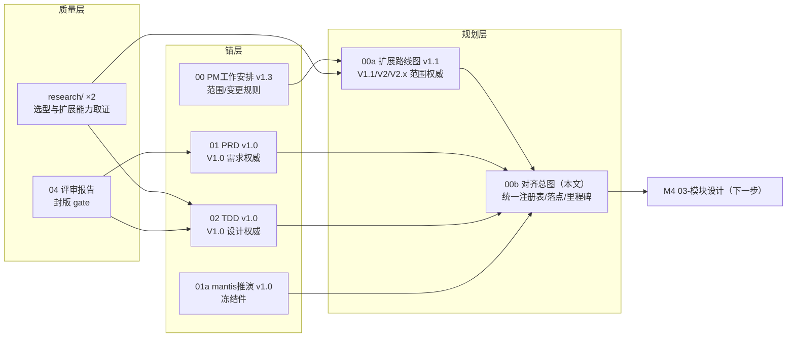

# 00b · 设计与规划对齐总图（决策·模块·节点·波次·里程碑 统一注册表）

| 字段 | 内容 |
|---|---|
| 编号 | docs/00b-设计与规划对齐.md |
| 日期 | 2026-11-08 |
| 作者 | PM（编排） |
| 状态 | **生效**（对齐索引层） |
| 依赖 | 00-PM工作安排 v1.3（变更规则锚）、00a-扩展能力路线图 v1.1（扩展范围锚）、01-PRD v1.0（V1.0 需求权威）、01a v1.0（推演冻结件）、02-TDD v1.0（V1.0 设计权威）、04-评审（封版 gate） |
| 效力 | **只读汇编，不引入新决策**。冲突裁决序：范围矛盾→01/02 管 V1.0、00a 管扩展波次；流程矛盾→00 H 章；本文档是 M4 立卡与 05 排期的唯一索引输入。发现新不一致 → 上报 PM → 修源头文档（封版件走升版）→ 本文同步 |

---

## 1. 对齐核验记录（2026-11-08 本轮发现与处置）

| # | 发现 | 处置 |
|---|---|---|
| A1 | 00a §4「TDD-S 扩展：McpExpose」无模块编号 | 赋正式编号 **TDD-S-06 McpExpose**（00a v1.1 已修） |
| A2 | 00a XR-2 提及 S-10（nut.js）但无正式 spike 行；V1.1/V2.0 前置验证（Office 库、MCP SDK）也无 spike 归口 | 统一 spike 注册表扩至 **S-10/S-11/S-12**（本文 §7 为准，00a v1.1 指引至此） |
| A3 | 版本术语双轨：01/02 用「V1 / Vx / P2」，00a 用「V1.0 / V1.1 / V2.0 / V2.x」 | 等价声明：01/02 的 **V1 ≡ V1.0 波**；**Vx/P2 = 泛指 V1.0 之后**，具体落点以本文 §6 映射表为准。封版文档不回改 |
| A4 | 00a §5 的「ctx.mcp 评估例外」无决策点编号 | 正式化为 **D-19**（见 §3；V2.0 评估，默认不开） |
| A5 | 01 A-17.5（MCP 集成）、A-17.2 部分（命令面板）表态「排除出 V1」，与 00a V2.0 规划并置易读成矛盾 | 非矛盾：01 的排除=**出 V1.0 波，非永久不做**；§6 映射表显式给出落点（MCP→V2.0 D-13、命令面板→V2.0 D-16） |
| A6 | 01 A-17.3（画布框选/多选/批量）排除出 V1；但选型取证证实 @xyflow/react **内置**框选/多选（research §2.1 功能清单） | 标注：**V1.0 build 期顺带开启评估**（近乎免费），不新增 PRD 条目、不改 01 封版；若开启，验收沿用 xyflow 默认行为 |
| A7 | 00a 卡 5 给流程工坊加第四来源 🔌MCP，与 01 A-10.3 冻结的三来源（lib/plaza/new）关系未声明 | 记录为 **A-10.3 的 V2.0 增补语义**：V1.0 三来源不动；V2.0 落地时 00 升版留痕（第四候选仅做规划参考，不改变「生成停在计划卡」交互） |

## 2. 统一决策点注册表（D-1~D-19，状态一览）

> 状态含义：✅ 用户拍板 ｜ ⚠ 按推荐默认执行（用户可推翻，走 00 H 章）｜ 🔒 已裁定关闭 ｜ 📅 排期中

| # | 决策 | 结论 | 状态 | 来源 |
|---|---|---|---|---|
| D-1 | 账号体系 | 最小账号（JWT；广场浏览匿名、下载/安装/发布需登录） | ⚠ 默认 | 00 G / v1.2 X-6 |
| D-2 | 审核流归属 | admin 人工审核 + server 状态机；自动扫描延后 | ⚠ 默认 | 00 G |
| D-3 | 执行沙箱 | 本机子进程+超时强杀+工作目录+env 白名单；容器延后 | ⚠ 默认 | 00 G |
| D-4 | AI 接入 | OpenAI 兼容+自配 baseUrl/apiKey；代理计费延后 | ⚠ 默认 | 00 G |
| D-5 | cron/事件触发 | cron=V1（常驻+补跑）；WS 事件延后 | ⚠ 默认 | 00 G |
| D-6 | 存储介质 | client SQLite；localStorage 仅开发期迁移 | ⚠ 默认（v1.2 细化） | 00 G |
| D-7 | admin 最小集 | 用户/审核/包管理/看板 | ⚠ 默认 | 00 G |
| D-8 | demo 缺口范围 | 重命名+删除进 V1；余按排除 | ⚠ 默认 | 00 G |
| D-9 | UI/画布选型 | @xyflow/react v12 + zustand/zundo + dagre；shadcn/ui | ✅ 画布拍板 / ⚠ UI 默认 | 用户 + research |
| D-10 | SDK 包名 | @constella/sdk 统一 | 🔒（评审核销） | 00 G / 04 |
| D-11 | 包版本规则 | semver、单版本覆盖更新 | ⚠ 默认 | 00 G |
| D-12 | Office/HTML/md 输出节点 | V1.1 全采纳（含 md） | ✅ | 00a §1 / 00 v1.3 |
| D-13 | MCP host + mcp.call | V2.0 采纳 | ✅ | 00a / 00 v1.3 |
| D-14 | skill loader（agentskills.io） | V2.0 采纳 | ✅ | 00a / 00 v1.3 |
| D-15 | computer use 系统级 | V2.x 三级采纳（view→click→full） | ✅ | 00a / 00 v1.3 |
| D-16 | 命令面板 | V2.0 采纳（并入 skill 入口体系） | ✅ | 00a / 00 v1.3 |
| D-17 | ai.subagent 节点 | V2.0 采纳 | ✅ | 00a / 00 v1.3 |
| D-18 | 流程反向发布 MCP server | V2.0 采纳 | ✅ | 00a / 00 v1.3 |
| D-19 | ctx.mcp 是否开放给自定义脚本 | **默认不开**；V2.0 验证「mcp.call→自定义节点」链路后评估开放 | ⚠ 默认（本轮 A4 正式化） | 00a §5 / 本表 |

## 3. 统一模块注册表（M4 立卡的唯一输入；名称与职责详见 02 §3 与 00a §4）

| 模块 | 名称 | 端 | 波次 | 来源 |
|---|---|---|---|---|
| TDD-C-01 | CanvasModule（xyflow 定制） | client | V1.0 | 02 |
| TDD-C-02 | NodeDefinitionRuntime（N1~N8 落地） | client | V1.0 | 02 |
| TDD-C-03 | RunEngine（A-6 语义保真） | client | V1.0 | 02 |
| TDD-C-04 | CdpSessionManager | client | V1.0 | 02 |
| TDD-C-05 | NodeRegistry | client | V1.0 | 02 |
| TDD-C-06 | StorageLayer（SQLite） | client | V1.0 | 02 |
| TDD-C-07 | AIWorkshopEngine（双工坊） | client | V1.0 | 02 |
| TDD-C-08 | ZipPipeline | client | V1.0 | 02 |
| TDD-C-09 | MarketClient | client | V1.0 | 02 |
| TDD-C-10 | TaskCenter | client | V1.0 | 02 |
| TDD-C-11 | Settings | client | V1.0 | 02 |
| TDD-C-12 | SkyBackground | client | V1.0 | 02 |
| TDD-C-13 | NodeEditor（手动自建编辑器） | client | V1.0 | 02（返工 X-8 增补） |
| TDD-C-M1 | main 进程服务层（SandboxExecutor/CdpSessionManager/CronScheduler/SecretVault/StorageService） | client/main | V1.0 | 02 §15.4 |
| TDD-C-18 | ModelRouter（场景路由） | client | **V1.1** | 00a §4 |
| TDD-C-19 | ReportRenderer（模板+内联，out.* 底座） | client | **V1.1** | 00a §4 |
| TDD-C-14 | McpHost | client | **V2.0** | 00a §4 |
| TDD-C-15 | SkillLoader（agentskills.io） | client | **V2.0** | 00a §4 |
| TDD-C-16 | CommandPalette | client | **V2.0** | 00a §4 |
| TDD-C-17 | ComputerKernel（截屏/UIA/合成输入/授权/审计） | client | **V2.x** | 00a §4 |
| TDD-S-01~05 | auth / market / review / admin+stats / StorageAdapter | server | V1.0 | 02 |
| TDD-S-06 | McpExpose（流程→MCP server，D-18） | server | **V2.0** | 00a（本轮 A1 赋号） |
| TDD-A-01~05 | admin 五页面模块 | admin | V1.0 | 02 |
| TDD-K-01 | @constella/sdk（ts+py） | sdk | V1.0 | 02 |
| TDD-X-01 | shared 类型包（DSL/manifest/DTO） | shared | V1.0 | 02 |

## 4. 统一节点类型注册表（31 项 · type id 即注册表键）

| 组 | 类型 | 类目 | 出口 | 波次 | 定位 |
|---|---|---|---|---|---|
| 平台内置（V1.0，demo 冻结） | trigger.manual / trigger.cron / cdp.open / cdp.extract / cdp.click / http.request / ai.llm / data.transform / logic.branch / delay / file.write / human.review | 触发/CDP/网络/AI/数据/逻辑/交互 | 见 00 A-4.1 | V1.0 | 内置积木 |
| 示例资产（V1.0 种子，非内置依赖） | gate.login / xhs.search / xhs.detail / data.vault / ai.classify / ai.copygen / xhs.dm.send / xhs.comment.post / xhs.auto-reply | 自研强节点 | 见 00 A-4.2 | V1.0 种子 | 演示「AI 创作产物形态」（00 A-4.8） |
| 输出家族（V1.1，D-12） | out.md / out.html / out.docx / out.xlsx / out.pptx | 输出 | out / failed | **V1.1** | 平台内置，依赖 TDD-C-19 |
| 工具家族（V2.0，D-13/D-17） | mcp.call / ai.subagent | MCP / AI | out / failed | **V2.0** | 平台内置，依赖 TDD-C-14 / 工坊内核 |
| 电脑家族（V2.x，D-15） | computer.screenshot / computer.click / computer.type（+full 循环） | 电脑 | out（/ failed） | **V2.x 三级** | 平台内置，依赖 TDD-C-17；永不进 ctx |

> 注册表驱动原则不变：全部走 NodeRegistry（TDD-C-05）+ N1~N8 定义（TDD-C-02）；扩展节点可发布上广场（skill 包=V2.0 新包类型，见 00a §7）。

## 5. ctx 能力集演进表（对齐 00 A-4.3 v1.2 与 00a §5）

| 波次 | ctx 成员 | 变更来源 |
|---|---|---|
| V1.0（冻结） | params / input / browser / llm（含多模态）/ im / vault / agent / log / sleep / emit / net（代理+白名单）/ file（限工作目录） | 00 A-4.3 v1.2（G-2 ⚠ 默认执行） |
| V1.1 | 不变 | 00a §5 红线 |
| V2.0 | 不变；**ctx.mcp 按 D-19 评估**（验证节点链够用则不开） | D-19 |
| V2.x | 不变；computer 能力**永不**进 ctx | 00a §5 红线 |

## 6. 「延后项 → 波次」落点映射（01/02 的 Vx/P2 总出口）

| 01 中的延后/排除项 | 出处 | 落点 |
|---|---|---|
| MCP 工具真实集成（A-17.5） | 01 §6#5 | **V2.0（D-13）** |
| 命令面板 + 节点/节点库搜索（A-17.2） | 01 §6#2 | **V2.0（D-16，搜索并入面板索引）** |
| 画布框选/多选/批量删除（A-17.3） | 01 §6#3 | **V1.0 build 顺带评估**（xyflow 内置，A6；不新增验收） |
| 脚本语法高亮（X-8 裁定 P2） | 01 PATH1 | V1.1 顺手候选（不承诺） |
| zip deflate 压缩写 | 01 §10 | 不排（低价值） |
| 星空元素微调/密度档位细化 | 01 §10（P2） | 不排（纯视觉） |
| optsFrom 动态选项源（G-1） | 01 §6.1 | V2 候选池 |
| 跨流程互斥组（G-3） | 01 §6.1/§8.5 | V2 候选池（关联风控 R6） |
| {{nodeId.field}} 运行时求值（T-4） | 01 N7 | V2 候选池 |
| 完整 vault 数据浏览器 | 01 §6.1 附 | V2 候选池 |
| 举报（Report 实体，X-16） | 02 §7.2 登记 | V2 候选池（随广场治理） |
| 包多版本共存/回滚（D-11） | 01 N8 | V2 候选池 |
| WS 外部事件触发（apppush） | 01 §6#4 | V3 池 |
| 容器沙箱（D-3 后段） | 00 G | V3 池 |
| 云同步/多端、计费分成、server 代理计费（D-4 后段） | 01 非目标 | V3 池（登记不承诺） |
| macOS 支持、多语言、浅色主题、移动端/Web 版、多人协作 | 01 §3/§8.4 | V3 池 |
| 自动安全扫描（D-2 后段） | 01 §10 | V2 治理联动候选（随 D-13 广场治理，n8n verified 经验） |

> 规则：**V2 候选池**=V2.0 收尾时统一重评（一次决策会）；**V3 池**=登记不承诺。新增落点必须走 00 H 章变更。

## 7. 统一 spike 注册表（S-1~S-12）

| # | 内容 | 波次前置 | 时点 |
|---|---|---|---|
| S-1~S-9 | 见 02 §15.3（Electron/React/xyflow 兼容、sqlite、CDP、沙箱、ts 执行链、jszip、server、admin、许可证取证） | V1.0 | M4 开工前（S-9 许可证同） |
| **S-10** | nut.js + desktopCapturer + UIA 只读（computer use 三件套冒烟；nut.js 预编译收费/Wayland 限制核实） | V2.x | V2.x 立项前（安全评审前置输入） |
| **S-11** | Office 生成库验证：docx/exceljs（含包装层与备选库替换演练）/pptxgenjs + out.* 模板引擎选型 | V1.1 | V1.1 开工前 |
| **S-12** | @modelcontextprotocol/client（TS SDK v2）在 Electron main 的 host 冒烟：stdio+HTTP 连接、tools/list、工具调用、断连恢复 | V2.0 | V2.0 设计定稿前 |

## 8. 统一里程碑与施工总路线

```
M0 00封版 ✅ 2026-11-08
M1 01/01a/02 草稿 ✅ 2026-11-08
M2 04 评审 ✅ 2026-11-08
M3 封版 ✅ 2026-11-08（04 §十：21 项全核销）
─────────────────────────────────────────────
M4 03-模块设计     输入=§3 统一模块表：V1.0 全量出卡 + V1.1 出卡（TDD-C-18/19 可与 V1.0 并行）
                  + V2.0/V2.x 出「接口占位卡」（只定边界不细化）
                  前置：S-1~S-9（含 S-9 许可证取证）
M5 05-开发计划     任务卡拆解范围=V1.0 + V1.1（每卡 ≤1 AI 工作日当量、验收命令前置）
B1 Build V1.0     分包顺序=02 §15.1；框选/多选按 A6 顺带评估
B2 Build V1.1     前置 S-11；范围=§4 输出家族 + 模型路由；gate=00a §2 V1.1 列
D3 V2.0 设计定稿   前置 S-12；A-10.3 第四来源、D-19 结论随本轮 00 升版留痕
B3 Build V2.0     gate=00a §2 V2.0 列；收尾时重评 §6 V2 候选池
S4 V2.x 安全评审   前置 S-10；computer use 三级 gate（00a 卡 10）
B4 Build V2.x     view→click→full 逐级放行
```

## 9. 文档关系图



变更路由：V1.0 范围变更 → 00 H 章（升 00/01/02）；扩展波次变更 → 00a 升版 + 00 留痕；两处都要动 → 先 00 后 00a，00b 始终同步。

## 10. 本轮同步动作记录

- 00a → v1.1：TDD-S-06 赋号（A1）、spike 指引至本表 §7（A2）、D-19 引用（A4）、变更记录补行。
- 00 v1.3 拍板块补 D-19 一句（A4）。
- 01/02/01a/04：**零改动**（封版纪律）。
- 2026-11-08 开工盘点补行：§3 补 **TDD-C-M1**（main 进程服务层）——02 §15.4 已有该模块而本文漏编，按效力条款同步，02 零改动。
