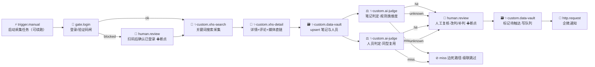
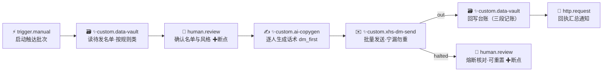
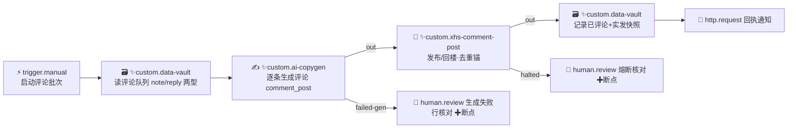
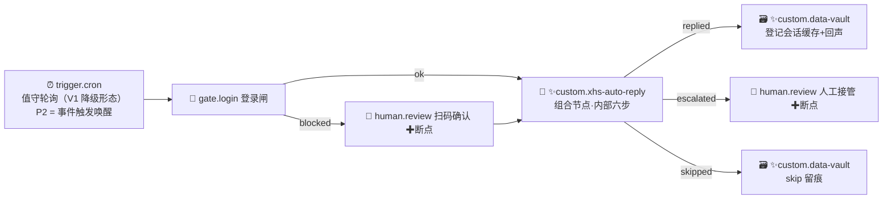
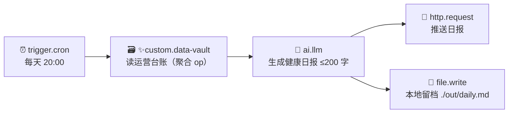

# 01a · AI 创作推演 —— mantis 五流程（MA-1~MA-5）

| 字段 | 内容 |
|---|---|
| 编号 | docs/01a-AI创作推演-mantis五流程.md |
| 日期 | 2026-11-08 |
| 作者 | 产品 · 推演 |
| 状态 | 已封版（v1.0 冻结件 · 2026-11-08 · 04 §十复审通过；G-1/G-2/G-3 处置见 00 v1.2 裁定日志，N-4 cron 七段式示例留痕不改） |
| 依赖 | `docs/00-PM工作安排.md`（重点 A-4.3 脚本资产包契约、A-4.7 八维度 N1~N8、A-4.8 供给模型、A-6 运行引擎语义、A-7 human-in-the-loop、A-8 CDP 会话、A-10 AI 双工坊）；`prototypes/demo.html`（v0.5.0-demo，只读事实源）；mantis 项目 `C:\Users\yg\Desktop\mantis\docs\`（**只读外部输入**，业务事实源，见附录） |
| 目的 | 把 mantis（小红书运营工具）的五条真实业务流程，推演为「在星丛里通过 AI 创作出来」的完整旅程，验证 A-4.7 自定义节点能力模型（N1~N8）是否够用；发现缺口按 00 章硬性要求上报（G-x），不得静默超出 |

## 变更记录

| 版本 | 日期 | 变更 | 作者 |
|---|---|---|---|
| v1.0 | 2026-11-08 | 初版：MA-1~MA-5 逐流程推演 + 覆盖矩阵 + 缺口 G-1~G-3 + PRD/TDD 输入 | 产品 · 推演 |

> **阅读前提**：本文假设的正式版星丛**只有 12 平台内置节点**（demo TYPES 前半，A-4.1）+ 节点库少量条目 + 广场。demo 的 9 个自研强节点与 9 条种子流程按 A-4.8 仅为**示例资产**（演示 AI 创作产物形态），不构成内置依赖——五流程的一切强节点语义都要经 AI 创作旅程重建。本文以 demo 强节点为「AI 产物应该长什么样」的参照系，但规格以 mantis 文档的业务事实为准（两者有出入处逐章标注「mantis 事实 vs 星丛编排」）。

> **编号冻结**：MA-1 爆款采集与 AI 判定 / MA-2 私信触达 / MA-3 智能评论 / MA-4 即时回复值守 / MA-5 账号健康日报。编号与标题不得改动，01-PRD 与 02-TDD 按此引用（对应 D-11 / E-12 验收）。

---

## 1. 推演方法与阅读指引

每个流程的推演遵循**同一条 AI 创作旅程叙事骨架**（S1~S7），对应 demo 已冻结的交互范式（A-10.3 / A-10.2）：所有生成停在计划卡/草稿卡等确认，**绝不直接改画布**。

| 步 | 骨架环节 | 星丛机制出处 |
|---|---|---|
| S1 | 用户在流程工坊输入一句话需求（chip 风格） | demo L700-712、L2314-2328 |
| S2 | AI 出**计划卡**：流程名 + 逐步骤，每步标来源 📚lib（库已有）/ 🏬plaza（广场可装）/ ✨new（现场开发）+ note；src 语义 auto 查库后降级 | demo L2206-2281（planWorkshop / renderPlanCard / SRC_TAG） |
| S3 | 对 ✨new 节点给出 **N1~N8 完整规格**（本文各章 c 节）——这是 AI 现场开发的「施工图」，也是对 A-4.7 八维度的压测点 | 00 A-4.7 |
| S4 | 生成**资产清单**：zip 四件套 manifest.json + nodes/*.json + scripts/*.py\|*.ts + config/*.yaml（+deps/） | 00 A-4.3；demo L941-1056 |
| S5 | **计划校验**（demo 为 mock，B-7 真实化）：① 结构连通（触发器 BFS 可达）② 触发节点存在 ③ 参数 schema 合法（类型/默认值/校验可编译）④ 出口-边匹配（edges 引用的出口名必须在节点 outs 注册表内）⑤ 强节点脚本齐备（防 noScript 运行闸拦截） | demo L2311、L1788-1810、L1893-1904 |
| S6 | 用户点**一键生成**：col/row 定位 + 显式 edges 落画布；✨new 节点顺路入库（含脚本元信息）；流程落盘 + 打「流程工坊生成」版本 | demo L2284-2312 |
| S7 | **运行时行为**：lane 语义（多出边=扇出每支新 lane，独立日志前缀/CDP 会话/端口 9221 递增/partition 按 流程·分支 隔离）；human.* 断点 waiting 等人工（交互卡=数据块+选项 chip+补充输入+跳过/确认）；分支节点只放行命中出口、其余边死路径级联 ⊘；汇合=集齐所有存活入边 | 00 A-6.2 / A-6.3 / A-7.1 / A-8.1；demo L1735-1955 |

**每章固定五节**：a 星丛编排图（mermaid）→ b 节点来源分析 → c 自定义节点规格（N1~N8）→ d AI 创作旅程（按 S1~S7 走）→ e 定制需求结论（维度极限与缺口）。

**节点命名**：沿用 demo 注册表语义（`trigger.manual`、`gate.login`、`xhs.search`、`ai.classify`…）；本文为 mantis 事实新造的节点一律 `custom.` 前缀（如 `custom.ai-judge`），表示正式版节点库里**不存在**、必须现场开发（或广场命中）的类型。同一节点在多个流程出现时，规格在首现章给全，后续章只写差异。

**断点标记**：编排图中标 ✚断点 的 human.review 节点 = 运行到此暂停等人（A-7.1），不是普通节点。

---

## 1.5 mantis 五流程业务事实摘要

> 出处缩写：`01`=mantis/docs/01-需求说明书.md，`02`=02-系统架构设计.md，`tasks/reports/dm/comments/reply`=modules/ 同名文档，`06/07/09/10`=同号专项文档。均为只读引用，全文见附录。

**MA-1 爆款采集与 AI 判定**
- 采集任务制：`tasks:create {keyword, rule_class_id, note_limit 1–200(默认50), comment_limit 1–999(默认100), media}`；采集并发恒 1、忙则排队、登录墙 awaiting_login 队列挂起（tasks §2/§7；02 §3 TaskEngine 状态机 queued/running/awaiting_login/breaker_paused/done/failed）。
- 搜索流：explore→填词→提交→滚动翻页采笔记卡（note_id、含 xsec_token 完整链接、标题）；note_id 去重，重采仅更新热度；动作间随机间隔 3–8s（01 FR-2、§3 风控）。
- 详情采集：逐条进详情取正文全文、赞/藏/评数、作者昵称+user_id（主页链接解析）、发布时间；评论区逐楼采（评论者昵称+user_id+内容）；评论区选择器未命中=步骤失败计入熔断（01 FR-4）。媒体：笔记页 `__INITIAL_STATE__` 直链（图 urlDefault/视频 originVideoKey）零额外请求；评论配图 DOM 提取；0.9 起「采集=下载」即采即落盘（06 §一/§四/§六）。
- 判定：LLM 按**任务绑定的规则类**（用户自建，自由文本规则，01 FR-1.5）判定，输出**匹配/不匹配+理由**，按规则类维度落库；LLM 关闭或失败→**未判定**（不回落臆测）交人工；人工「匹配/排除」永远覆盖机器判定并留痕，仅作用于当前规则类（01 FR-3；reports §2 notes/persons:setVerdict）。Pro 档图判带图（≤3 张、640px 压缩、池耗尽自动降纯文本，07 §三）。
- 报告页人工勾选入队是触达前置（01 FR-5；2026-11-04 起一键入队删除、勾选唯一，reports 裁决①）。

**MA-2 私信触达**
- 队列：`dm:enqueue {recipients:[{user_id,nickname,kind:'author'|'comment',note_id}], rule_class_id}`，报告页勾选入队（dm §2；01 已定决策「作者+评论者都入人员池」）。
- 文案双模式：fixed 用户手输不改写 / llm AI 逐人生成（dm_mode，outreach:save 按规则类覆盖、'' 走全局默认；角色选择器 dm_agent_id；AI 优化按钮，dm §2）。生成侧四层装配：骨架→角色卡→技能→用户规则，注入顺序写死；recentSent 反模板 ≤3 条×220 码点；句末截断 dm_first 200（09 §一/§3.3/附 A）。
- 发送语义（01 FR-6/FR-7）：打开会话→填文案→发送→会话流确认；间隔随机 60–180s **只可拉大**；停止条件仅两个——平台「发送受限/已达上限/频繁」提示、连续 3 次失败；验证码→熔断挂起交人工；**宁漏勿重**：结果不明的发送永不自动重试，置 failed(E-DM-OUTCOME-UNKNOWN) 供人工核对后重置；user_id 全局唯一、success 终态、任何路径不二次发送；台账可查状态/失败原因/来源笔记；失败可人工重置回待发；行删/批量删守卫（pending|failed|skipped 可删，sending/success 挡下，dm §2/§4）。
- v1.1 用户裁决「私信不做数量上限」；后续护栏演进为评论/私信日限 40 到量停到次日（10 §8 护栏表）。

**MA-3 智能评论**
- 两型目标（01 FR-8；2026-11-04 D1 裁决 reports）：**note 型**（评笔记本/作者行盖楼，去重键 `note:<note_id>`）+ **reply 型**（回复评论者楼层，按评论原文前缀或昵称定位，去重键 `reply:<note_id>|<user_id>`）；success 终态。
- 内容：固定文案 或 LLM 按用户撰写指令逐条生成（输入=笔记标题+正文，reply 型另带被回复评论原文）；**生成失败该条 failed 且不静默改用固定文案、不计平台熔断**；实发内容逐条快照留痕（01 v1.3 修订 2）。
- 发送语义与 MA-2 完全对齐：三段记账/宁漏勿重/受限+连续3失败+验证码熔断/间隔随机 60–180s 只可拉大（01 FR-8）。队列状态机 pending|generating|sending|success|failed|skipped（comments §2/§6）。评论发表流选择器（评论框/发送钮/回复钮/上屏确认）为净新增离线猜测校准点（01 v1.3 修订 4）。

**MA-4 即时回复值守**
- 事件驱动常驻：开关勾选即保存启停；2026-11-01 纯事件驱动裁决——定时轮退役，扫描循环只等信号；唤醒源四类：ImPushDecoder 定向事件（apppush WS t=4 帧解析：biz=im=来私信、biz=push you.mentions>0=评论/@，pushid LRU 去重）/ 通用信号兜底 / WS 断 10s reset 轮 / 开启首轮建基线（reply §2/§4；10 §6.2 唤醒源终态清单）。
- 回复内容：服务端角色卡 compose 四层装配（骨架/风格卡/技能/用户规则，注入顺序写死 ADR-8）；敏感内容 action=skip（ADR-7：skip=拒答不升级，评论 markHandled、私信 seen 不动 last_reply_at）；句末截断 reply_chat 120 / reply_comment 80（09 §3.4/§六）。
- 护栏：reply_daily_limit 1–500 达限停扫；评论/私信日限 40 到量停到次日；信号轮 90s±15% 合拍；铃铛 5 分钟限频；构造读预算封顶（reply §2；10 §8）。
- 会话缓存：chatList union（chat 行+comment 行）按 updated_at 倒序截前 50；评论回复记录仅 sent 落库、保 200 条；回声锚守卫（末条我方且新鲜窗内拒删，防发送回声当对方新来信）（reply §2.1；reports 2026-11-07 裁决）。开启前置校验 reply_prompt ≥5 字（reply §2）。
- 判向：末条非我方才算新来信（demo xhs.auto-reply 同款语义，L933）。

**MA-5 账号健康日报**
- **mantis 没有自动定时日报推送**：其「报告」为应用内人工查看视图——采集报告双子表（笔记/人员，规则类全局筛选+判定/详情/文本筛选+分页）+ 评论/私信/回复三只读子页（2026-11-04 裁决只显 success 行、计数同口径）（01 FR-5；reports §1/裁决）。
- 可用于「日报」的数据事实：dm/comments 台账（状态/失败原因/来源笔记，FR-7）、队列状态机全集、熔断与验证码事件（halted 推送，reply §3）、replyscan:status 快照（scans/dmReplies/commentReplies/replyCountToday/replyDailyLimit/lastScanAt/lastError，reply §2）、全局日志（logs:list）。
- 星丛编排（demo f9）以 cron + 台账聚合 + LLM + webhook **组合出 mantis 未提供的自动化日报**——正向能力增强，差异见第 6 章。

---

## 2. MA-1 爆款采集与 AI 判定

### 2.a 星丛编排图



编排要点（均映射冻结语义）：
- **登录闸断点汇合**：g1 只走一个出口（ok 或 blocked），另一边死路径；h0 与 s1 之间「h0 → s1」与「g1 ok → s1」构成 s1 的双入边——集齐存活入边即执行（A-6.2 汇合 + 死路径消除），等价 mantis awaiting_login 挂起→人工恢复续跑（tasks §7 裁决 7）。
- **双判定扇出**：v1 单出口两条出边=扇出，j1/j2 各自成新 lane（A-6.2）；两支判定结果在 h1 汇合（四条入边，任一存活到达即断点）。笔记与人员分别判定= mantis「判定按规则类分维度、笔记/人员双表」事实（01 FR-3/FR-5）。
- miss 边死路径：j1/j2 双双 miss 时 h1 两条入边全死 → h1 ⊘ 级联 → v2/n1 ⊘（A-6.2），即「无一命中则不触达不通知」。
- 人工复核 h1 覆盖 mantis 两类人工动作：改判（匹配/排除覆盖机器判定并留痕）与补判（unknown 未判定交人工）（01 FR-3）。

### 2.b 节点来源分析

| 节点 | 类型 | 来源 | 依据 |
|---|---|---|---|
| t1 启动采集任务 | trigger.manual | 平台内置 | A-4.1 |
| g1 登录/验证码闸 | gate.login | ✨现场开发（demo 示例资产，正式库无） | A-4.8；demo L897-900 |
| h0 / h1 人工确认 | human.review | 平台内置 | A-4.1 |
| s1 关键词搜索采集 | custom.xhs-search | ✨现场开发 / 🏬广场可装 | mantis FR-2 语义超出内置 cdp.* 原子操作 |
| d1 详情+评论+媒体 | custom.xhs-detail | ✨现场开发 | FR-4 + 06 号媒体直链 |
| v1/v2 业务库 | custom.data-vault | ✨现场开发（一次建成、五流程复用） | demo L910-913 形态；FR 台账事实 |
| j1/j2 规则判定 | custom.ai-judge | ✨现场开发（demo ai.classify 仅双出，mantis 需三态） | FR-3 |
| n1 企微通知 | http.request | 平台内置（库初始即有同型，A-15.2） | demo L1223 |

### 2.c 自定义节点规格（N1~N8）

**custom.xhs-search · 关键词搜索采集**（Python）

| 维度 | 规格 |
|---|---|
| N1 | 名称「搜索采集（滚动翻页）」/ 图标 🔎 / 类目 社媒 / ✨自研角标 / 一句话：搜索页填词提交→滚动翻页采卡，去重限速内置 |
| N2 | 入口 in×1；出口 out×1 —— 循环翻页收在脚本内不占编排位（demo 强节点「策略内置」特征，L894-896） |
| N3 | keywords: textarea 必填（每行一个关键词，help=对应 mantis 每任务一词、多任务=多行）；noteLimit: number 默认 50 **校验 1–200**（tasks §2）；sort: select [综合,最新,最热]；media: **boolean 开关** 默认关（采集=下载，06 §六）；ruleClass: text（判定维度键，与 ai-judge 同名对齐，help 提示） |
| N4 | scripts/xhs_search.py + config 同名 yaml；ctx.browser（填词提交/URL 落搜索结果页校验/循环滚动采卡）、ctx.vault（upsert 笔记：note_id 去重、重采仅更新热度）、ctx.sleep（**随机 3–8s 间隔内置**）、ctx.log |
| N5 | 非组合节点 |
| N6 | 超时 15min（翻页长任务）；重试 0——中断可续跑（游标 cursorKey=last_note_id 落 vault）；失败处理=终止 |
| N7 | 输入期望：无（参数自足）；输出 schema：`{notes:[{note_id,url(xsec_token 完整链接),title,author_id}]}` + 示例一行 |
| N8 | v1.0.0；独立 zip 可发布（含 requirements.txt） |

**custom.xhs-detail · 笔记详情+评论+媒体直链**（Python）

| 维度 | 规格 |
|---|---|
| N1 | 「笔记详情+评论提取」/ 📄 / 社媒 / ✨ |
| N2 | in×1 / out×1 |
| N3 | fields: textarea 默认 `title\ndesc\nlikes\ncollects\ncomments\npublish_time`；commentLimit: number 默认 100 校验 1–999（tasks §2）；withMedia: boolean 默认关（开=顺带采 `__INITIAL_STATE__` 媒体直链：images[]/video{originVideoKey}，06 §一；**落盘依赖 G-2**，关=仅存 URL） |
| N4 | ctx.browser（逐笔记导航/等 #detail-title/读 __INITIAL_STATE__/滚动采尽评论区，评论者 user_id 由楼层 DOM+主页链接解析）；ctx.vault（upsert 人员=作者+评论者双表，01 已定决策）；ctx.sleep 3–8s；**评论区选择器未命中=抛错计熔断**（FR-4） |
| N5 | 非组合（多字段提取在单脚本内） |
| N6 | 超时 30min（逐笔记长任务）；重试 1（页面加载类瞬时失败）；失败=终止 |
| N7 | 输入：`{notes:[…]}`（上游 s1 输出）；输出：`{notes:[{…,detail:{…},comments:[{user_id,nickname,content,images[]}],media:{images[],video}}]}` |
| N8 | v1.0.0 |

**custom.ai-judge · AI 规则判定（三出口）**（Python）——本流程对 N2 的压测点

| 维度 | 规格 |
|---|---|
| N1 | 「AI 规则判定」/ ⚖️ / AI / ✨ / 按**用户规则类文本**判定，不预设业务语义（01 v1.2 裁决） |
| N2 | in×1；**out×3：hit / miss / unknown** —— hit=匹配、miss=不匹配、unknown=LLM 关闭或调用失败未判定（不回落臆测，FR-3）。demo 示例资产 ai.classify 为 hit/miss 双出（L914-917），mantis 事实要求第三态 |
| N3 | rule: textarea 必填（自由文本判断规则=规则类本体）；model: select [glm-5,deepseek-v4,kimi-k2]；apiKey: **密钥型**（掩码显示+加密存储，N3 扩展类型）；withImages: boolean 默认关（Pro 档图判 ≤3 张，07 §三；**多模态入参依赖 G-2**，关=纯文本）；ruleClass: text（维度键，判定结果按规则类分维度落库，同批数据多规则类互不覆盖） |
| N4 | ctx.llm（temperature 0.1，仅发送主题/昵称/文本本身+用户规则，FR-3 隐私口径）；ctx.vault（verdict 按 note_id×ruleClass / user_id×ruleClass 分维度写）；**异常 catch 后 return {branch:"unknown"}——失败不猜** |
| N5 | 非组合 |
| N6 | 超时 60s/条；**重试 0**（mantis：LLM 失败即未判定交人工，不做自动重试）；失败处理=**失败分支（unknown 出口）**——N6「失败分支」必须进 V1（00 A-4.7 留给 PRD 表态项，本推演给出依赖证据） |
| N7 | 输入：`{notes[]}` 或 `{persons[]}`（同型节点两用）；输出：`{verdicts:[{id,label:hit\|miss\|unknown,reason}]}` 供断点卡展示（A-7 数据块） |
| N8 | v1.0.0 |

**custom.data-vault · 业务库读写**（Python）——五流程共用底座

| 维度 | 规格 |
|---|---|
| N1 | 「业务库读写」/ 🗃️ / 数据 / ✨ / 本地单库（db.json）：笔记/人员/判定/队列/游标一处收口（demo L910-913 同款） |
| N2 | in×1 / out×1 |
| N3 | op: select [upsert 笔记, upsert 人员, 标记待触达, 读待发名单, 读评论队列, 记录已发送, 登记会话, 读运营台账]（op 集随流程旅程追加，见 6.d——**静态 opts 的局限=G-1**）；ruleClass: text（名单按规则类过滤，dm §2 `dm:queue {rule_class_id}`）；cursorKey: text（可续跑游标，tasks restart 清游标语义） |
| N4 | ctx.vault.exec(op,input,cursor)——上游产出落库、下游按 op 取数；success 终态守卫/去重锚（user_id、note:id、reply:id\|uid）在库层实现（FR-7/FR-8） |
| N5 | 非组合 |
| N6 | 超时 30s；重试 0；失败=终止（本地库故障=全局故障） |
| N7 | 输出随 op 变化（声明为 JSON 型输出 + 每 op 一行示例——N7 最低限度满足）；下游参数可引用（N7 供下游引用） |
| N8 | v1.0.0；后续追加 op 升 minor（v1.1.0，6.d 演示） |

**gate.login · 登录/验证码闸**（Python）——规格与 demo 示例资产一致（L897-900），此处确认 mantis 事实可全覆盖：homeUrl / probe 参数不变；N2 ok/blocked 双出；N6 超时 30s、重试 0、失败=失败分支（blocked）。登录由用户在 CDP 会话窗口人工完成（mantis FR-1「登录由用户在页面完成」），星丛由 A-8.2 CDP 查看窗承载。

### 2.d AI 创作旅程（S1~S7）

- **S1 用户 prompt**（流程工坊输入框，chip 风格）：「像 mantis 那样采集小红书：关键词搜笔记、进详情采互动和评论、按我的规则类让 AI 判定匹配不匹配，命中的进触达队列，企微推我」。
- **S2 计划卡**（模拟 renderPlanCard 输出，demo L2269-2281）：
  ```
  🧩 小红书·爆款采集与规则判定 · 11 节点 · ✨现场开发 5
  📚 库   trigger.manual —— 平台内置触发
  ✨ 现场 gate.login     —— 登录闸：blocked 挂断点交人工（mantis awaiting_login）
  ✨ 现场 custom.xhs-search —— 滚动翻页+note_id 去重+3–8s 限速内置；noteLimit 1–200
  ✨ 现场 custom.xhs-detail —— 详情+评论区+__INITIAL_STATE__ 媒体直链
  ✨ 现场 custom.data-vault —— 业务库底座（五流程复用，后续流程零重复开发）
  ✨ 现场 custom.ai-judge   —— 三出口 hit/miss/unknown；LLM 失败不臆测交人工
  📚 库   human.review ×2 —— 扫码确认 + 人工复核改判（mantis 人工覆盖判定）
  📚 库   http.request   —— 命中结果推送
  [重新规划] [一键生成]
  ```
  来源判定：AI 规划先查节点库（demo L2250-2265 语义：auto/new 查库命中则降 lib），再查广场——用户裸库首跑时 5 个 ✨；若用户曾装过「小红书采集包」，xhs-search/detail 降为 🏬→📚。
- **S3 现场开发**：即 2.c 五个规格 → AI 逐个生成 nodes/*.json（N1~N3/N7 定义）+ scripts/*.py（N4 执行体）+ config/*.yaml（N3 默认值）。
- **S4 资产清单**（zip 四件套，A-4.3）：
  ```
  bundle-xhs-ma1.zip
  ├─ manifest.json            # name=小红书采集判定包 version=1.0.0 scripts 映射
  ├─ nodes/  gate_login.json · xhs_search.json · xhs_detail.json · ai_judge.json · data_vault.json
  ├─ scripts/ 同名 .py ×5     # run(ctx) → {data} 或 {branch}（E-8 契约）
  ├─ config/ 同名 .yaml ×5    # 参数默认值（抽屉参数可覆盖）
  └─ deps/requirements.txt
  ```
- **S5 计划校验**：① 结构连通——g1 blocked→h0→s1 双入边汇合路径可达；② 触发节点存在（t1 ins=[]）；③ 参数 schema——noteLimit 的 min:1/max:200 可编译、ai-judge rule 必填；④ **出口-边匹配**——edges 中 `j1:hit/miss/unknown` 三出口均在 ai_judge.json 的 outs 注册表内（多出口节点必查项，demo mock 未覆盖、正式版必做）；⑤ 强节点五件均有 scripts（否则 noScript 运行闸拦截，A-6.3）。
- **S6 一键生成**：11 节点按 col/row 落画布、显式 edges 含分支边（demo L2298-2300）；✨5 节点顺路入库（含脚本元信息，「开发即沉淀」）；流程落盘 + 打「流程工坊生成」版本（L2306）。
- **S7 运行时**：t1 触发 → g1 走 ok（CDP lane 会话：独立日志前缀/端口 9221 起/partition=`<flowId>·<lane>`，A-8.1）；未登录走 blocked → h0 断点 waiting（交互卡推送到对话流，A-7.1）→ 人工在 CDP 查看窗扫码后点「确认并发送」→ h0 交付 s1（另一入边已死，s1 立即执行）。v1 扇出 j1/j2 两 lane 并行判定 → h1 断点（数据块=上游 verdicts JSON + 改判 chips「标记匹配/排除未判定」+ 补充输入）→ 确认后合并结果交付 v2。miss-only 时 h1/v2/n1 全链 ⊘。CDP 断连→失败终止 run（A-6.3）。

### 2.e 定制需求结论

| 维度 | 压测点 | 结论 |
|---|---|---|
| N2 | 三出口（unknown 态）；blocked→断点→汇合 | **覆盖**——出口数量与标签由定义者决定（A-4.7 N2 行） |
| N3 | 范围校验 1–200/1–999、boolean 开关（media/withImages）、密钥型（apiKey）、select、textarea | **覆盖**——N3 扩展类型四件全用到 |
| N4 | browser/vault/llm/sleep/log 五能力；**媒体落盘需 net+fs、图判需 llm 多模态** | **缺口 G-2**（见第 7 章） |
| N6 | LLM 失败=失败分支（unknown 出口）而非终止/重试 | 覆盖，但**N6「失败分支」必须进 V1**（00 留白项，本文给出依赖证据 → PRD 输入④） |
| N7 | verdicts 结构供断点卡渲染与下游 vault 写入 | 覆盖（最低限度：字段名+类型+示例） |
| 规则类实体 | mantis 独立实体（FR-1.5 新建/编辑/删除） | 降级覆盖=rule 参数 + vault 维度键；**多规则类并行判定**=同型 ai-judge 多实例扇出（编排层能力，无需模型扩展）；编辑态「规则类下拉动态选项」= **缺口 G-1** |
| 任务制差异 | mantis 任务列表/统一队列/批量重启 vs 星丛流程 run | 编排层差异（见下），非模型缺口 |

**mantis 事实 vs 星丛编排差异**：① mantis 判定分笔记/人员双表两入口（notes/persons:setVerdict），星丛用同型 ai-judge 双实例扇出表达，语义等价；② mantis 任务队列（collect 并发恒 1、忙则排队、登录墙挂起队列）在星丛=「同流程不重复跑」（A-6.1）+ 断点挂起 + vault 游标续跑，等价降级；③ mantis 图判为 Pro 档计费能力（07），星丛为本地节点参数（withImages），商业化差异不影响编排。

---

## 3. MA-2 私信触达

### 3.a 星丛编排图



- h1 = mantis「报告页人工勾选入队」（2026-11-04 一键入队已删、勾选唯一，reports 裁决①）的星丛等价物：断点卡数据块=待发名单（昵称/来源笔记/判定理由），chips=「仅发互动 top20 / 排除已触达过的」等筛选（demo f6 L1171-1174 同款），确认后合并名单交付下游。
- dm1 双出口 out/halted：halted=受限提示/连续 3 次失败/验证码熔断（FR-6）→ 断点人工核对（结果不明行人工确认未实际发出后才可重置回待发——宁漏勿重红线，dm §4）。

### 3.b 节点来源分析

| 节点 | 类型 | 来源 |
|---|---|---|
| t1 / n1 | trigger.manual / http.request | 平台内置 |
| v1 / v2 | custom.data-vault | 📚 重用（MA-1 已入库；op=读待发名单/记录已发送） |
| h1 / h2 | human.review | 平台内置 |
| cp1 逐人生成话术 | custom.ai-copygen | ✨现场开发 |
| dm1 批量私信发送 | custom.xhs-dm-send | ✨现场开发（demo 示例资产 xhs.dm.send 为其原型，L923-927） |

### 3.c 自定义节点规格（N1~N8）

**custom.ai-copygen · 触达文案生成**（Python）——MA-3 复用，此处给全

| 维度 | 规格 |
|---|---|
| N1 | 「AI 话术生成」/ ✍️ / AI / ✨ / fixed 模板插槽 + llm 指令生成双模式，反模板校验内置 |
| N2 | in×1 / out×2：**out（正常）/ failed-gen（生成失败行分流）**——mantis「生成失败该条 failed 且不静默改用固定文案、不计平台熔断」（FR-8）：失败行单独成支交断点，不混入发送支 |
| N3 | mode: select [fixed,llm]（dm §2 dm_mode；切换即 AI 入口预检语义由 help 提示）；template: textarea（fixed 模板，`{{nickname}}/{{noteTitle}}` 插槽，demo L920）；instruction: textarea（llm 撰写指令，01 v1.3）；tone: select [专业顾问,朋友口吻,玩梗]；persona: text（角色卡名，09 §5.1 dm_agent_id）；antiRepeat: **boolean** 默认开（recentSent ≤3 条×220 码点反模板，09 §3.3）；scene: select [dm_first,comment_post]（句末截断上限 200 随 scene，09 §3.4） |
| N4 | ctx.llm（四层装配在脚本内拼装：骨架→角色卡 persona→技能→用户规则进最终 user 块，注入顺序写死 ADR-8）；ctx.vault.recentSent(uid,3)；生成后句末截断+剥引号+违禁正则（09 §3.4） |
| N5 | 非组合（逐人循环内置） |
| N6 | 超时 30s/条；重试 1；单条失败不熔断整批（循环内 catch 分流 failed-gen） |
| N7 | 输入：`{data:[{user_id,nickname,note_id,noteTitle,kind}]}`；输出：`{data:[{…,text}],failed:[{user_id,reason}]}` |
| N8 | v1.0.0 |

**custom.xhs-dm-send · 私信批量发送**（Python）

| 维度 | 规格 |
|---|---|
| N1 | 「私信批量发送」/ ✉️ / 社媒 / ✨ / 频控·退避·熔断·台账全内置，画布只留一个节点 |
| N2 | in×1 / **out×2：out（批次完成）/ halted（熔断挂起）**——demo 示例 xhs.dm.send 单出+doc 描述熔断（L923-927），mantis 事实要求熔断成为**可编排的出口**（交人工核对） |
| N3 | minIntervalSec: number 默认 60（随机 60–180s **只可拉大**，FR-6）；confirmWaitSec: number 默认 8（发送→会话流确认轮询）；dailyLimit: number 默认 40 校验 1–500（10 §8 演进护栏；demo 示例 maxPerDay=30 + mantis v1.1「无上限」裁决——**差异见 3.e**） |
| N4 | ctx.im（打开会话/填词/发送/轮询确认——demo ctx 能力集已含 im，L1035）；**三段记账**（sending→success/failed 落 vault）；宁漏勿重：结果不明置 failed(E-DM-OUTCOME-UNKNOWN) 永不自动重试；user_id 去重（success 终态守卫在库层）；受限文案探测/连续 3 失败计数/验证码探测→return {branch:"halted"}；ctx.sleep 随机间隔 |
| N5 | 非组合（逐收件人循环内置） |
| N6 | 超时 = 不设（批次时长由名单决定；N6 超时参数允许 0=不限）；**重试 0**（宁漏勿重禁止自动重试）；失败处理=失败分支 halted |
| N7 | 输入：`{data:[{user_id,text,…}]}`；输出：`{sent:[{user_id,status:sending\|success\|failed\|skipped,reason}],haltReason?}` |
| N8 | v1.0.0 |

（v1/v2/h1/h2 规格：data.vault 见 2.c；human.review 平台内置——question/options 参数即可，A-4.1。）

### 3.d AI 创作旅程（S1~S7）

- **S1 prompt**：「把判定命中的人私信触达：先让我确认名单和话术风格，AI 按人写开场白但不许跟最近发过的雷同，发送要限速、遇到受限或验证码就停下来给我核对，全程宁漏勿重」。
- **S2 计划卡**：`🧩 小红书·私信触达 · 8 节点 · ✨现场开发 2`——v1/v2 标 📚（MA-1 入库沉淀被查库命中，**这是「开发即沉淀」闭环的第一次兑现**，demo L2283 注释语义）；cp1/dm1 ✨；t1/h1/h2/n1 📚。
- **S3**：即 3.c 两规格。
- **S4**：bundle-xhs-ma2.zip（manifest + nodes/ai_copygen.json、xhs_dm_send.json + scripts ×2 + config ×2 + deps）。可与 MA-1 合包发布（N8 包级 semver）。
- **S5 校验**：h1 双入边（v1 与 cp1 之间唯一通路）连通 ✓；dm1 halted 出口有下游（**出口-边匹配**：halted/out 均注册）；minIntervalSec ≥60 范围校验；dailyLimit 1–500；cp1→dm1 的 N7 链型校验（cp1 输出 data[].text 与 dm1 输入期望 data[].text 字段对齐——N7 声明的用途，00 A-4.7 N7 行）。
- **S6 生成**：8 节点上画布（含分支边 dm1→h2 halted）；✨2 入库；「流程工坊生成」版本。
- **S7 运行时**：v1 读名单 → h1 断点（名单数据块+筛选 chips+补充输入；跳过=原始名单直接下发，A-7.1）→ cp1 逐人生成（llm 支 lane）→ failed-gen 支若活则走独立 lane 交断点（扇出=A-6.2）→ dm1 逐条发送（60–180s 随机间隔，任务中心可见进度 n/m，A-9.1）；熔断时 dm1 return halted → v2 台账回写支死路径 ⊘ → h2 断点人工核对（确认未实际发出的行才重置回待发，dm §4 红线）→ 人工确认后流程结束，重跑即续（success 行被库层守卫跳过）。

### 3.e 定制需求结论

| 维度 | 压测点 | 结论 |
|---|---|---|
| N2 | halted 熔断出口、failed-gen 分流出口 | 覆盖 |
| N3 | 双模式 select、boolean 反模板、scene 相关截断 | 覆盖（截断上限按 scene 存 config.yaml 而非参数表——参数分组/help 兜底） |
| N4 | ctx.im 能力；recentSent 从 vault 读 | 覆盖 |
| N6 | **重试禁令**（宁漏勿重）+ 超时=不限（0 值语义） | 覆盖——N6 需支持「超时 0=不限、重试 0=禁」两个边界值（→ PRD 输入⑤） |
| N7 | 上下游链型对齐（copygen.text → dm.send.data[].text） | 覆盖，且是校验器第⑥查的素材（→ TDD 输入④） |
| 数量上限差异 | mantis v1.1「无上限」→ 后续护栏日限 40；demo 示例 30 | N3 默认值由定义者决定，非模型缺口；本文取 40（10 §8 最新事实） |

**mantis 事实 vs 星丛编排差异**：① mantis 私信文案 AI 化（dm_mode llm + 服务端 compose）是 v1.3 后置能力，01 §1「明确不做 AI 生成私信文案」已被后续模块推翻——本文以 dm.md/09 号为准；② mantis 队列页管理（启停/重置/行删批量删/守卫）在星丛无独立 UI 对应物，降级为「断点确认 + vault 守卫 + 重跑续发」；**⚠ 建议新增交互**（最小方案）：data.vault 节点抽屉的 io 区（B-13 真实化方向）增加「查看库数据」只读表格预览——不改画布、纯查看，与 A-4.4 抽屉形态一致；③ mantis「启动前自动保存（所见即所发）」= 星丛运行闸「未保存不许跑」（A-6.1）天然覆盖。

---

## 4. MA-3 智能评论

### 4.a 星丛编排图



（cp1 的 failed-gen 出口承接者是断点 h2——生成失败行**不静默改用固定文案**、单独成支交人工核对，FR-8 红线。）

### 4.b 节点来源分析

| 节点 | 类型 | 来源 |
|---|---|---|
| t1 / n1 / h1 / h2 | trigger.manual / http.request / human.review ×2 | 平台内置 |
| v1 / v2 | custom.data-vault | 📚 重用（op=读评论队列/记录已发送） |
| cp1 | custom.ai-copygen | 📚 重用（MA-2 入库；**参数模板换 scene=comment_post**——同名同型 upsert 参数模板即新预设，A-11.1） |
| cm1 | custom.xhs-comment-post | ✨现场开发（demo xhs.comment.post 原型 L928-931） |

### 4.c 自定义节点规格（N1~N8）

**custom.xhs-comment-post · 智能评论发布**（Python）

| 维度 | 规格 |
|---|---|
| N1 | 「智能评论发布」/ 💬 / 社媒 / ✨ / 评笔记与回楼两型目标，去重锚与频控内置 |
| N2 | in×1 / out×2：out（批次完成）/ halted（熔断：受限+连续 3 失败+验证码，FR-8 对齐 FR-6） |
| N3 | maxLen: number 默认 200（09 §3.4 SCENE_TEXT_MAX comment_post=200；**demo 示例为 50——差异**）；intervalSec: number 默认 60（随机 60–180s 只可拉大；demo 示例 ratePerMin=4 为写档频控口径，mantis 以 FR-8 为准）；dailyLimit: number 默认 40 校验 1–500（10 §8） |
| N4 | ctx.browser：note 型=导航目标笔记→定位评论框→填入→等发送钮异步使能→点击→列表轮询上屏确认（01 v1.3 修订 4 校准点）；**reply 型=按被回复评论原文前缀或昵称定位楼层→点回复→填入→确认**（FR-8）；去重锚 `note:<note_id>` / `reply:<note_id>\|<user_id>` 落 vault（success 终态）；**作者错位防护**（不评论自家笔记，demo L929）；受限探测/连续 3 失败计数→halted |
| N5 | 非组合 |
| N6 | 超时 0=不限；重试 0（宁漏勿重）；失败=失败分支 halted |
| N7 | 输入：`{data:[{targetKind:note\|reply,note_id,user_id?,text,refContent?}]}`；输出：`{posted:[{key,note_id,status,reason}],haltReason?}` |
| N8 | v1.0.0 |

（cp1 复用 MA-2 规格，差异三点：scene=comment_post（截断 200 不变但写作规范换评论体，09 §6.1 场景分叉行）；输入扩 refContent（reply 型带被回复评论原文，FR-8）；instruction 默认值换评论撰写指令。v1 的 op=读评论队列：输出天然派生两型——**作者行→note 型（盖楼）、评论者行→reply 型**，2026-11-04 D1 裁决（reports）的派生规则收进 vault 读取 op。）

### 4.d AI 创作旅程（S1~S7）

- **S1 prompt**：「给匹配的笔记发智能评论，也回复匹配的人的评论：文案 AI 按笔记内容写、回复要带对方评论原文，同一笔记只评一次同一评论只回一次，受限或验证码就停」。
- **S2 计划卡**：`🧩 小红书·智能评论 · 9 节点 · ✨现场开发 1`——cp1 📚（AI 在计划卡 note 标注「复用私信话术节点、切 comment 场景预设」；来源判定的颗粒度=**类型级查库**（demo L2250 libHasType 按 type 查），场景级参数差异由参数模板承载）；仅 cm1 ✨。
- **S3/S4**：cm1 规格 → nodes/xhs_comment_post.json + scripts/xhs_comment_post.py + config + deps（若与 MA-2 合包则升 v1.1.0，N8 minor）。
- **S5 校验**：cm1 halted 有下游 ✓；cp1 两个出口（out/failed-gen）均有边 ✓；**两型目标链型校验**——v1 输出含 targetKind 字段且 cm1 输入期望声明了它（N7 链型）；maxLen/intervalSec 范围校验。
- **S6 生成**：9 节点（含 cp1 双出口两条分支边）；✨1 入库。
- **S7 运行时**：v1 两型名单 → cp1 逐条生成（reply 型输入自动带 refContent）→ failed-gen 支交 h2 断点（人工决定改指令重跑或放弃，**不静默改固定文案**）→ cm1 note 型导航发评 / reply 型定位楼层回评（同一 lane 复用 CDP 会话，A-8.1）；halted → h1 断点核对；成功行落 v2 实发快照。

### 4.e 定制需求结论

| 维度 | 压测点 | 结论 |
|---|---|---|
| N2 | failed-gen 分流出口（生成失败与发送失败两条人工支路分离） | 覆盖 |
| N3 | 同型节点跨场景参数模板（dm_first↔comment_post） | 覆盖——同名同型 upsert 参数模板（A-4.5/A-11.1）+ config.yaml 默认值覆盖机制（A-4.3） |
| N4 | reply 型楼层定位（原文前缀/昵称双策略）；选择器校准点 | 覆盖（脚本内策略；校准点属脚本维护，非模型） |
| N7 | targetKind 判别字段贯穿链路 | 覆盖 |

**mantis 事实 vs 星丛编排差异**：① demo 示例 xhs.comment.post 仅「评笔记」单型，mantis 要求 note/reply 两型+楼层定位——本推演已扩入 N3/N4/N7；② mantis maxLen 语义=LLM 截断上限 200（09 号），demo 示例 50 为另一口径，取 mantis；③ 评论报告只显 success 行（reports 2026-11-04 裁决）在星丛= v2 台账读取侧过滤，属 vault op 内部口径。

---

## 5. MA-4 即时回复值守

### 5.a 星丛编排图



- **值守形态**：mantis 为常驻事件驱动（apppush WS 帧解析唤醒，10 §6.2）；星丛 V1 = trigger.cron 周期轮询（如 `0 */10 * * * * *`，D-5：cron 由 client 常驻进程调度），**幂等性由 a1 内部保证**（判向+冷却+回声锚：无新来信则空轮转出，replied 计 0）。外部事件触发（WS apppush）= A-6.6 P2，形态见 5.e 差异③。
- **三出口**：replied（已回复）/ escalated（应对不了升级人工）/ **skipped（agent 主动拒答：敏感内容或杠精同行，ADR-7——不回复不升级，仅留痕）**。demo 示例 xhs.auto-reply 为 replied/escalated 双出（L932-937），mantis 事实要求第三态。

### 5.b 节点来源分析

| 节点 | 类型 | 来源 |
|---|---|---|
| t1 | trigger.cron | 平台内置（真实调度 P1，D-5） |
| g1 / h0 | gate.login / human.review | 📚 重用（MA-1） / 内置 |
| a1 回复一体机 | custom.xhs-auto-reply | ✨现场开发（**N5 组合节点，本推演最重要压测点**；demo 示例 xhs.auto-reply 为原型，L932-937） |
| v1 / v2 | custom.data-vault | 📚 重用（op=登记会话/skip 留痕） |
| h1 | human.review | 平台内置 |

### 5.c 自定义节点规格（N1~N8）

**custom.xhs-auto-reply · 即时回复一体机**（TypeScript）

| 维度 | 规格 |
|---|---|
| N1 | 「即时回复一体机」/ 🤖 / 社媒 / ✨ / 事件唤醒→判向→装配→发送→登记，应对不了的升级人工 |
| N2 | in×1 / **out×3：replied / escalated / skipped**（语义见 5.a） |
| N3 | persona: text 必填（角色卡名，09 §5.1；**开启前置校验 ≥5 字**——reply §2 同款规则改为参数校验 regex `.{5,}`）；userRules: textarea（用户业务资料 rules.persona——**业务事实唯一合法位置，进最终 user 块**，ADR-8）；cooldownMin: number 默认 3（同会话冷却，demo L936）；dailyLimit: number 默认 50 校验 1–500（reply §2）；apiKey: 密钥型；maxTurns: number 默认 5（单轮处理会话上限，demo「单轮 ≤5 会话」语义） |
| N4 | scripts/auto_reply.ts；**能力集全家桶**：ctx.im（pollUnread 会话/评论列表+发送）、ctx.agent（四层装配 compose：骨架→persona 卡→技能→用户规则，注入顺序写死；输出 {intent,action,text}，action=skip 即 skipped 出口）、ctx.llm（BYOK 本地腿降级装配，ADR-6/10）、ctx.vault（会话缓存 chatList/CommentReplyRecord 仅 sent 落库 200 cap/回声锚）、ctx.log、ctx.sleep |
| N5 | **组合节点**，inner 六步（抽屉内步骤展示，demo L934/L2066 形态）：① 取材·列表复放与新鲜度判据（10 §6.2 事件后按需读）② 会话判向·末条非我方才算新来信+冷却窗+回声锚 ③ 意图识别与风险 skip（敏感内容 action=skip，ADR-7）④ 四层装配生成·recentSent 反模板+句末截断 reply_chat 120 / reply_comment 80（09 §3.4）⑤ 发送·私信/评论两路 ⑥ 登记回声缓存并路由三出口 |
| N6 | 单轮超时 10min（值守批次）；重试 0（回复类动作不自动重试）；失败=失败分支 escalated（异常兜底交人工） |
| N7 | 输出（随出口）：replied→`{handled:[{convId,kind,text}]}`；escalated→`{pending:[{convId,reason}]}`；skipped→`{skipped:[{convId,intent}]}`——三出口各自输出 schema 分别声明（N7 最低限度满足） |
| N8 | v1.0.0；组合节点 zip 的 manifest 需描述 inner 步骤序（nodes/*.json inner 字段） |

（v1 登记 op 内含回声锚守卫（末条我方且新鲜窗内不重判）；v2 skip 留痕 detail=`agent-skip:<intent>`——ADR-7 冻结措辞。）

### 5.d AI 创作旅程（S1~S7）

- **S1 prompt**：「帮我值守小红书私信和评论：有新来信先判断是不是新消息，AI 按我的顾问人设和我的业务资料回复，像真人打字、不许暴露 AI 身份，敏感内容直接不接，搞不定的给我人工接管，同一个人三分钟内别重复回」。
- **S2 计划卡**：`🧩 小红书·即时回复值守 · 7 节点 · ✨现场开发 1`——a1 ✨（note：组合节点，内部六步子流程封装为单节点）；g1/v1/v2 📚（复用）；t1 📚（note：V1 用 cron 轮询，事件触发为 P2 升级位）。
- **S3**：5.c 规格；**AI 生成组合节点是规划引擎的新能力要求**（demo genFlowFromPlan 未涉及 inner 生成——见 TDD 输入②）。
- **S4**：bundle-xhs-ma4.zip——nodes/auto_reply.json（含 inner 六步声明）+ scripts/auto_reply.ts（ts）+ config + deps/package.json。
- **S5 校验**：三出口均有边 ✓；persona regex 校验；**组合节点完整性**——inner 步骤数≥1 且节点为单入口单执行体（inner 是展示性子流程、不是可连线的子图，防规划器生成假子图）；dailyLimit 1–500。
- **S6 生成**：7 节点（a1 三条分支边）；✨1 入库。
- **S7 运行时**：cron 每 10min 触发一轮（同流程不重复跑=上一轮未结束则本轮被运行闸拒绝，A-6.1——天然防重入；**值守启停=任务中心终止/设置页 cron 开关**，无需新交互）→ 登录闸 → a1 六步（无新来信=空轮 replied{handled:[]}）→ escalated 断点 h1（数据块=待接管会话+chips「需要人工回复/疑似售后/疑似骚扰建议拉黑」，demo f8 L1202-1204 同款）→ 人工回复不在画布内完成（在 CDP 会话窗口人工操作，A-8.2 ✕ 只关查看窗不中断）；skipped 落 v2 不打扰人。**run 终止时未决断点自动放行**（A-7.1）保证值守轮次不悬挂。

### 5.e 定制需求结论

| 维度 | 压测点 | 结论 |
|---|---|---|
| N5 | inner 六步（demo 四步的扩展）；组合节点生成与校验 | **覆盖模型**（N5 内嵌子流程对外单节点、内步骤可展示，A-4.7），但 **AI 规划引擎须支持生成 inner**（→ TDD 输入②） |
| N2 | 三出口且各出口独立输出 schema | 覆盖（N7 按出口分声明的写法需 PRD/TDD 认可口径，→ PRD 输入⑥） |
| N4 | agent+im+llm+vault 全能力；BYOK 本地腿 | 覆盖（ctx.agent 在 A-4.3 契约已冻结） |
| N6 | 单轮超时+异常兜底走 escalated | 覆盖 |
| 值守常驻 | mantis 事件驱动常驻监听 | **非 N 维度缺口**：触发器属平台层（A-6.6 外部事件触发 P2、D-5 已决策）；V1 降级=cron 轮询+节点内幂等（判向/冷却/回声锚），语义等价 mantis 2026-11-01 前形态 |

**mantis 事实 vs 星丛编排差异**：① mantis 纯事件驱动（WS 帧解析）→ 星丛 V1 cron 轮询降级、P2 事件触发对齐（demo f8 t1 note「正式版 = WS apppush 事件唤醒」L1199 同向）；② mantis like/follow 仅观测消红点职能（10 §6.2 R1）不进星丛编排（超范围，注明排除）；③ mantis 会话缓存删除/回声锚守卫（2026-11-07）= vault 内部策略，不占编排位；④ mantis 回复内容走**服务端** compose（配额/计费），星丛为**本地**节点脚本（ctx.agent/ctx.llm BYOK，D-4 client 直连）——部署形态差异，装配语义（四层+注入顺序+截断）在 N4 脚本内同构实现。

---

## 6. MA-5 账号健康日报

### 6.a 星丛编排图



- l1 双出边=**扇出**：推送支与留档支各自成 lane 并行（A-6.2），互不阻塞——展示「纯内置节点也能吃满引擎语义」。

### 6.b 节点来源分析

| 节点 | 类型 | 来源 |
|---|---|---|
| c1 定时触发 | trigger.cron | 平台内置 |
| v1 读运营台账 | custom.data-vault | 📚 重用——但「读运营台账」是**新 op**，走**节点工坊「优化已有节点」路径**（A-10.2：差异卡→应用），非新节点 |
| l1 生成日报 | ai.llm | 平台内置 |
| n1 / f1 | http.request / file.write | 平台内置 |

**本流程零新节点**：AI 创作量=1 次已有节点的能力追加（op）+1 条流程编排。

### 6.c 自定义节点规格（N1~N8）

无新节点。data.vault 追加 op 的差异卡（A-10.2 优化路径产物）：

| 项 | 内容 |
|---|---|
| 追加 op | `读运营台账`：聚合查询——dm/comments 台账按日统计（发送量/成功率/failed 明细）、熔断与验证码事件计数（halted 留痕）、回复计数（replyCountToday/replyDailyLimit 口径，reply §2）、队列残留（pending/failed 行数） |
| N3 影响 | op 的 select opts 列表 +1 项（「读运营台账」）——opts 静态列表靠入库 upsert 更新（**G-1 关联**） |
| N6/N7 | 不变；输出 `{ledger:{dm:{…},comment:{…},reply:{…},events:{…}}}`（JSON 型，N7 已支持） |
| N8 | data-vault v1.1.0（minor：向后兼容的能力追加） |

### 6.d AI 创作旅程（S1~S7）

- **S1 prompt**：「每天晚上八点给我发账号健康日报：今天发了多少私信评论、成功率、有没有熔断限流、明天建议干嘛，两百字以内推企微，本地也存一份」。
- **S2 计划卡**：`🧩 小红书·账号健康日报 · 5 节点 · ✨现场开发 0`——v1 标 📚+⚠（note：「业务库缺『读运营台账』操作——顺路用节点工坊给 data-vault 追加一个 op，升 v1.1.0」）；其余全 📚。**计划卡首次出现「零现场开发 + 一处存量增强」形态**——来源标记三档之外的现实第四态，由 note 承载（demo 计划卡 note 字段已有，L2208-2214）。
- **S3**：即 6.c 差异卡（优化路径：用户点「应用」→ lib upsert data-vault 参数模板+脚本元信息，A-10.2 差异卡语义 demo L2394-2408 已示范）。
- **S4**：仅导出 data-vault v1.1.0 的增量 zip（N8 包 semver；或整包重发，D-11 单版本覆盖更新）。
- **S5 校验**：cron 表达式合法；ai.llm prompt 非空；扇出两支互不依赖（结构连通 BFS 两支均可达）。
- **S6 生成**：5 节点上画布；**无 ✨ 入库动作**，改为 data-vault 库条目版本升 v1.1.0（升级提示进库条目，N8/D-11）。
- **S7 运行时**：每日 20:00 cron 触发（错过补跑策略按 D-5 进 PRD）；聚合→LLM 生成→双 lane 扇出（webhook 推送 / file.write 落盘）；断网时推送支 http 失败终止 run 而留档支已并行完成（A-6.2 lane 独立失败不互相阻塞——引擎语义的自然收益）。

### 6.e 定制需求结论

| 维度 | 压测点 | 结论 |
|---|---|---|
| 全维度 | 本流程验证**重用侧**：内置 4 类节点 + 已入库 1 节点 + 1 次 op 追加 | N1~N8 均为「重用」态；唯一新需求=优化已有节点路径承载能力追加（A-10.2 已有差异卡交互，无新交互） |
| N8 | 存量节点 minor 升级（v1.0.0→v1.1.0）与库条目升级提示 | 覆盖（D-11 包版本规则；升级提示进广场卡片已有，库条目提示为同语义延伸 → PRD 输入⑦） |

**mantis 事实 vs 星丛编排差异**：mantis 无自动日报（人工报告页视图，01 FR-5），星丛以 cron+聚合+LLM+双通道扇出**组合出增量能力**——正向差异，无对齐义务。日报数据事实全部有 mantis 出处（台账 FR-7、队列状态机、halted 事件、replyscan:status 快照）。

---

## 7. 汇总

### 7.1 N1~N8 × MA-1~MA-5 覆盖矩阵

| 维度 | MA-1 采集判定 | MA-2 私信 | MA-3 评论 | MA-4 值守 | MA-5 日报 |
|---|---|---|---|---|---|
| N1 元信息 | **用到**（5 节点全自定义） | 用到（2） | 用到（1） | 用到（1） | 重用（升版标注） |
| N2 端口 | **用到·极限**（三出口 hit/miss/unknown + blocked 断点汇合） | 用到（out/halted + failed-gen） | 用到（两型目标链 + halted） | **用到·极限**（三出口各自输出） | 未用（全单出口） |
| N3 参数 schema | **用到·极限**（范围校验 1–200/1–999、boolean、密钥型、select、textarea） | 用到（双模式/boolean/scene） | 用到（跨场景参数模板） | 用到（regex 校验/密钥型/上限 1–500） | 重用（opts 追加） |
| N4 执行体 | 用到（browser/vault/llm/sleep；**G-2 缺口**：net/fs/多模态） | 用到（im/llm/vault） | 用到（browser 楼层定位） | **用到·极限**（agent+im+llm+vault 全家桶） | 重用（vault 聚合 op） |
| N5 组合节点 | 未用（策略内置≠组合） | 未用 | 未用 | **用到·极限**（inner 六步） | 未用 |
| N6 运行策略 | 用到（失败分支=unknown、重试 0、长任务超时） | **用到·极限**（重试禁令、超时 0=不限） | 用到（同 MA-2） | 用到（单轮超时+异常兜底出口） | 未用（内置节点自带） |
| N7 IO 契约 | 用到（verdicts 供断点/下游） | 用到（链型对齐 text 字段） | 用到（targetKind 判别字段） | 用到（按出口分声明） | 用到（ledger 聚合结构） |
| N8 版本分发 | 用到（首发 v1.0.0） | 用到（可合包 minor） | 用到（合包 minor） | 用到（ts 组合节点独立包） | **用到·极限**（存量 minor 升级+库条目提示） |

结论：八维度全部被至少一条流程压到「用到」以上；N2/N3/N4/N5/N6/N8 各有至少一处极限用例；无任何 mantis 业务事实落 在 N1~N8 之外（缺口均属维度内部表达力或编排层，见 7.2）。

### 7.2 缺口清单（G-x）

| # | 内容 | 影响流程 | 建议处置 |
|---|---|---|---|
| G-1 | **N3 参数动态选项源**：select opts 只能静态定义，承载不了「运行时数据驱动的下拉」（mantis 规则类下拉数据源 useRulesStore、角色选择器 agents 过滤；data.vault 的 op 列表靠入库 upsert 人肉追加）。 | MA-1（规则类选择）、MA-2/3（角色卡/场景选择）、MA-5（op 追加体验） | **降级实现为主**（V1：text 手输 + help 提示 + N7 下游引用插槽已覆盖运行时数据流；库 upsert 更新 opts 可用但体验糙）；中期升模型——N3 DSL 增加 `optsFrom` 声明式数据源（如 `vault.query(rule_classes)`），进 A-4.7 vNext |
| G-2 | **N4 ctx 能力集不足**：A-4.3 冻结的 ctx={browser,llm,im,vault,agent,log,sleep} 缺三子项——① 通用网络请求 net（媒体下载需主进程 fetch+防盗链头，06 §五）；② 文件系统能力 file（媒体落盘 userData/media/<note_id>/、快照留痕）；③ ctx.llm 多模态入参（图判带 ≤3 张 640px 图，07 §一）。 | MA-1（媒体落盘、图判）、MA-3（实发快照留痕可降 vault）、MA-5（留档已由内置 file.write 编排兜底） | **升模型为主**：E-8 SDK 契约冻结时扩展 `ctx.net`/`ctx.file` 能力（受 D-3 沙箱与发布权限声明「文件/网络」类目约束——A-13.1 权限推导已有类目，只是 ctx 未供给）；`ctx.llm` 调用签名支持多模态 messages。**降级兜底**：媒体仅存直链 URL 不落盘（mantis 0.5.12 前形态）、图判降纯文本（07「池耗尽自动降纯文本」同款）、文件写入一律经内置 file.write 节点编排 |
| G-3 | **跨流程互斥约束**：mantis 跨类型串行门（collect 与 dm/comment 不并跑——单浏览器单账号争抢+风控，tasks §8.2 D3）；星丛 A-6.1 明确「不同流程可并行」且 A-8 lane 按 流程·分支 隔离 partition——同一小红书账号登录态下，MA-1 采集与 MA-2 私信并行会双开自动化会话互踩。八维度是节点模型，流程级互斥声明无处安放。 | MA-1×MA-2×MA-3 任意组合并发（MA-4 值守轮询同理） | **升模型**：流程属性增加「互斥组/资源锁」声明（如 `mutex: xhs-account`），run 调度器同组串行——属编排层扩展，须走 00 H 章变更规则升 A 清单；**降级实现**：V1 用户手动错峰（任务中心可见并行任务 A-9.1 + 文档提示），并把「同账号流程并行风险」写进 PRD 非功能/风险章节（关联 R6 站点风控） |

### 7.3 给 01-PRD 的输入（AI 创作能力需求清单建议）

1. **AI 创作产物完整度**：流程工坊一键生成对 ✨new 节点必须产出全八维度（含 N6 运行策略默认值、N7 IO 声明、N8 版本号）——不止 demo 计划卡所示的名称+参数；D-11 验收时按 N1~N8 逐维度 grep 的对象包括 AI 生成路径。
2. **来源三标记真实化**（B-7）：lib→plaza→new 查库降级顺序为硬语义；MA-5 揭示第四态「📚+存量增强」由 note 承载，PRD 表态是否给独立标记。
3. **断点卡三类业务剧本**进 A-7 验收场景：名单确认（MA-2）、复核改判（MA-1）、熔断核对（MA-2/3）——断点卡数据块需支持列表型数据的多行展示（⚠ 轻交互扩展，最小方案=hit-card 数据块分页+行级 chip，A-7.1 形态内扩展）。
4. **N6 失败分支必须进 V1**（00 A-4.7 留白项）：MA-1 unknown 出口、MA-2/3 halted 出口、MA-4 escalated 兜底三处依赖「失败=走指定分支」而非终止。
5. **N6 边界值语义**：超时 0=不限、重试 0=禁用（宁漏勿重）须在 PRD 参数语义中显式定义。
6. **N7 按出口分声明**：多出口节点的每出口独立输出 schema（MA-4）为合法声明形态。
7. **库存量节点升级提示**：N8 minor 升级（data-vault v1.1.0）在节点库条目上给升级提示（广场卡片已有同语义，D-11）。
8. **缺口表态**：G-1/G-2/G-3 逐条「V1 降级实现 / 升模型」表态（G-2 建议升、G-1 建议降级、G-3 建议 V1 降级+登记扩展点）。
9. **⚠ 建议新增交互（非缺口）**：data.vault 抽屉「查看库数据」只读表格预览（最小方案见 3.e 差异②）。

### 7.4 给 02-TDD 的输入（AI 规划/生成/校验引擎约束）

1. **三来源降级顺序**为规划引擎硬约束：`auto|new → 查 lib（type 级）→ lib`、`plaza → 装过 → lib`（demo L2260-2264 语义真实化）；同型多实例（MA-1 j1/j2）允许，实例级参数差异走参数模板。
2. **组合节点生成**：规划引擎必须能为 ✨new 生成 inner 子流程声明（MA-4 六步）并保证「inner=展示性步骤序，非可连线子图」的结构不变量（校验器第④查的扩展）。
3. **参数 schema 生成质量**：AI 生成的 N3 必须通过 schema DSL 编译校验（类型合法/范围可求值/regex 可编译/默认值过自身校验——如 dailyLimit 默认 40 ∈ [1,500]）；生成失败不得静默降级为裸 text（对齐 mantis「不静默改用固定文案」红线的产品价值观）。
4. **校验器六查**（demo 三查扩展）：结构连通 / 触发节点 / 参数 schema / **出口-边匹配** / **强节点脚本齐备**（noScript 预拦截）/ **N7 链型对齐**（上游输出字段 ⊇ 下游输入期望，MA-2 text 字段案例）。
5. **汇合+断点+死路径组合语义**的可验证行为（E-7 素材）：MA-1「blocked→断点→双入边汇合」与「双判定双 miss→级联 ⊘」应作为引擎验收用例（种子流程 f5 可作回放剧本，A-15.1）。
6. **E-8 ctx 能力集**：按 G-2 结论决定 `ctx.net`/`ctx.file`/多模态 `ctx.llm` 进 V1 契约或显式登记扩展点；统一 `@constella/sdk` 包名（D-10）。
7. **cron 常驻调度与错过补跑**（D-5）：MA-4/MA-5 依赖 cron 真实化（B 章未列 cron 调度引擎的专条，TDD 须给模块设计）；MA-4 防重入依赖「同流程不重复跑」运行闸。
8. **run 调度器资源锁扩展点**：按 G-3 结论设计互斥组或显式登记不设计（降级=文档级错峰提示）。

---

## 附录 · mantis 文档引用清单

| 文件 | 本文引用内容 |
|---|---|
| `mantis/docs/01-需求说明书.md` | FR-1/1.5/2/3/4/5/6/7/8 全部业务事实；§3 账号风控（限速/熔断/不规避/量克制）；§5 已定决策；v1.3 修订（自动评论/评论校准点） |
| `mantis/docs/02-系统架构设计.md` | §3 进程模型与 TaskEngine 状态机（queued/running/awaiting_login/yielded/breaker_paused/done/failed）、宁漏勿重恢复语义；§4.1 功能域清单（dm/comment/reply-scan 域边界） |
| `mantis/docs/modules/tasks.md` | 采集任务参数（note_limit 1–200/comment_limit 1–999）；§7 统一运行队列（并发 1/登录墙挂起/游标续跑）；§8 批次卡与跨类型串行门（G-3 事实源） |
| `mantis/docs/modules/dm.md` | dm:enqueue/queue/start/stop/reset/remove 契约；dm_mode 双模式与类覆盖；failed 重置红线文案 |
| `mantis/docs/modules/comments.md` | comments 队列状态机 pending\|generating\|sending\|success\|failed\|skipped；去重锚；模式切换预检 |
| `mantis/docs/modules/reply-scan.md` | replyscan:status/chatDetail 契约；开启前置校验 ≥5 字；会话缓存 chatList union/200 cap；skip 留痕 |
| `mantis/docs/modules/reports.md` | 勾选入队唯一（一键删除裁决）；note/reply 两型派生（D1）；报告只显 success 行裁决 |
| `mantis/docs/06-媒体内容获取调研.md` | `__INITIAL_STATE__` 媒体直链；评论配图 DOM；采集=下载；防盗链头与图床域名（G-2 事实源） |
| `mantis/docs/07-Pro档图判定价.md` | 图判多模态（≤3 张/640px/池耗尽降纯文本）（G-2 事实源）；文案模型成本口径 |
| `mantis/docs/09-回复Agent角色卡配置化.md` | 四层装配与注入顺序（ADR-8）；skip 语义（ADR-7）；recentSent 反模板；句末截断 SCENE_TEXT_MAX；BYOK 本地腿（ADR-6/10） |
| `mantis/docs/10-内置浏览器架构设计.md` | §6.2 纯事件驱动唤醒源终态清单（MA-4 事实源）；§8 护栏（日限 40/信号合拍/铃铛限频） |

星丛侧引用：`docs/00-PM工作安排.md` A-4.1/4.3/4.7/4.8/6/7/8/10/11/15 与 D-3/D-4/D-5/D-10/D-11、B-2/B-3/B-7；`prototypes/demo.html` L863-1056（注册表与资产包契约）、L1080-1226（种子流程 f5~f9）、L1735-2014（运行引擎/断点）、L2015-2152（抽屉/入库/试跑）、L2154-2463（一句话生成/双工坊）。

— 本文到此为止：MA-1~MA-5 推演完成，八维度模型判定为**够用（含 3 项登记缺口 G-1/G-2/G-3，均给出升模型/降级处置建议）**，PRD/TDD 输入见 7.3/7.4。
