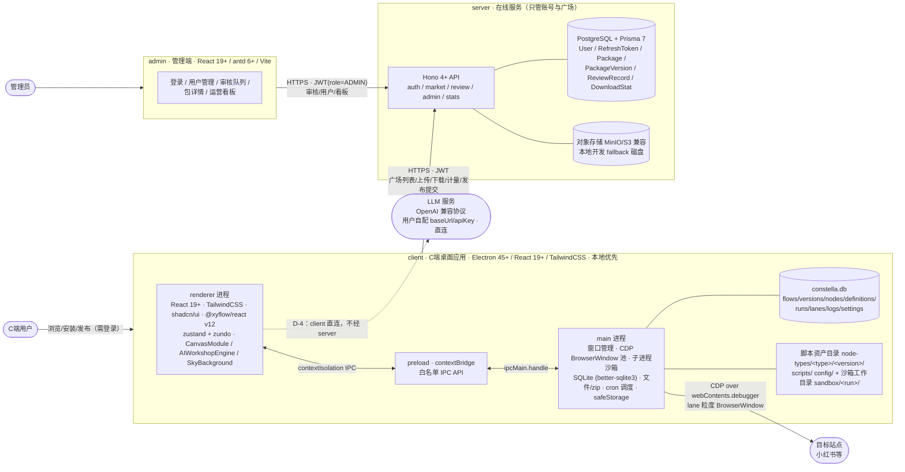
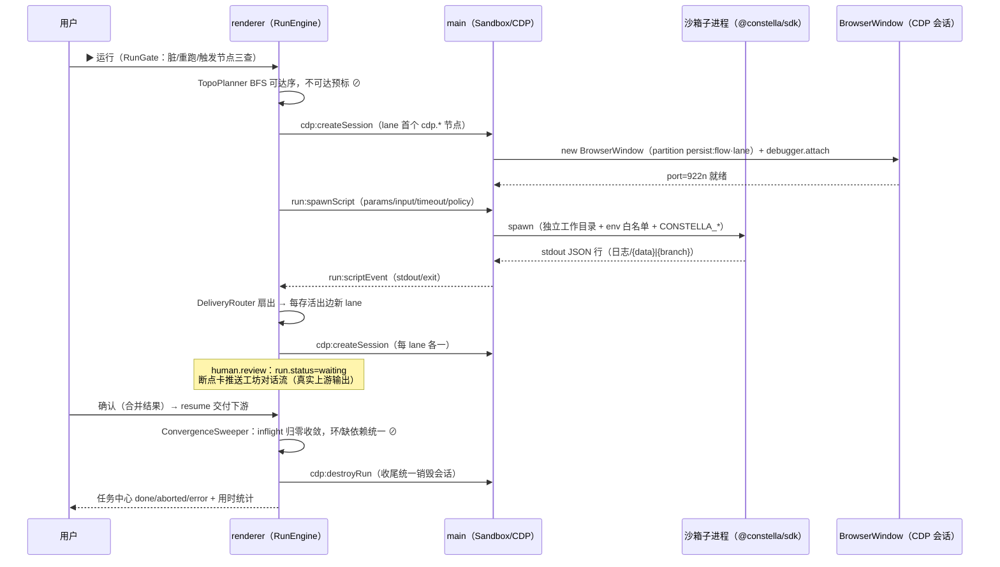
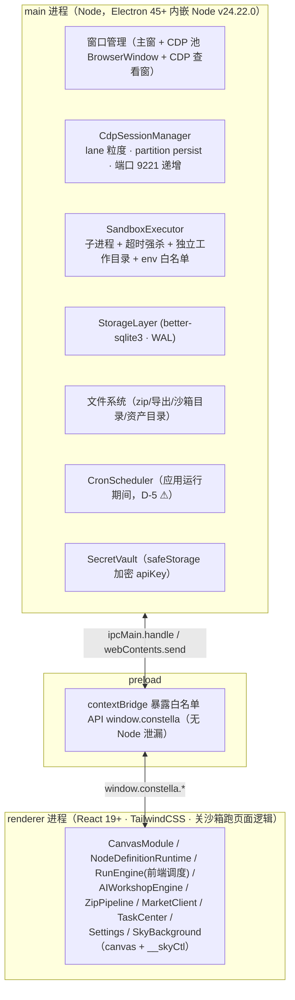
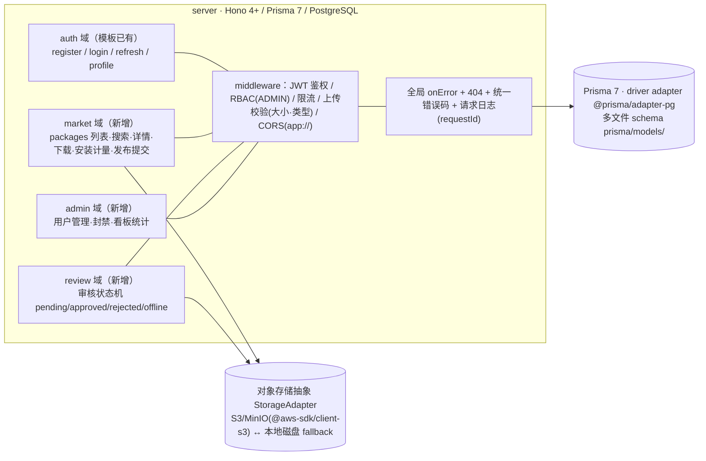
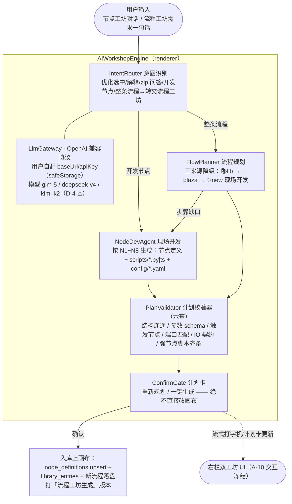

# 02 · TDD 技术设计文档 —— 星丛 Constella

| 字段 | 内容 |
|---|---|
| 编号 | docs/02-TDD-技术设计文档.md |
| 日期 | 2026-11-08 |
| 作者 | 架构 |
| 状态 | 已封版（2026-11-08 · 04 §十复审通过） |
| 依赖 | 00-PM工作安排.md **v1.2**（已封版，范围锚=A 清单 / mock=B 清单 / 验收=E-1~E-12 / 决策=G 章；「评审裁定日志（v1.2）」为本轮返工的权威裁定）；docs/01-PRD-产品需求文档.md（v0.2 定稿，§11 B-13 表态对齐源）；docs/research/技术选型取证-2026-11-08.md（选型证据，版本号与事实仅引此报告）；prototypes/demo.html（v0.5.0-demo，4781 行，事实源）；docs/01a-AI创作推演-mantis五流程.md（v1.0，§9.3/§8.8 事实源——出口数/inner 步数/关键参数/第四态/分支名逐项取自其冻结推演） |
| 变更记录 | v0.1（2026-11-08）：初版，按 00 v1.1 全量起草，E-1~E-12 自查见第 16 章 → v0.2（2026-11-08）：按 04 评审 §八返工指令修订——X-1（ctx 能力集扩 ctx.net/ctx.file/llm 多模态，00 v1.2 G-2 裁定 ⚠）；X-2/X-10（§9.3 按 01a 冻结口径重写、§8.8 改 G-1/G-2/G-3 登记表、PlanValidator 增第⑥查）；X-3/X-4（failBranch 具名出口+环境级故障豁免+0 值语义）；X-5（io per-exit outputs 声明）；X-8（TDD-C-13 NodeEditor）；X-11（§13.1 降为开发期脚本）；X-13/X-14/X-15/X-16/X-18/X-19/X-20（minor 逐项）；E-8/E-12 自查改通过（附核验说明）→ **v1.0 封版（2026-11-08）**：04 §十复审通过（21 项全核销、blocker=0），N-1/N-2/N-3 编辑性修订随封版完成，N-4 留痕 → **v1.0a 勘误（2026-11-08）**：G1 批 arch-reviewer 评审判定 B 三处勘误——①§3.4 storage:invoke 域枚举补 publish（9 域 31 op，细目锚 03 C-06）②§12.1 env 白名单按 S-4 实证同步（传入块语义+libuv 注入事实）③§7.3 A-3.x「flows.edges JSON」更正为 flow_versions.snapshot；均非范围变化，留痕不开升版 → **v1.0b 勘误（2026-11-08）**：M4 收口评审判定 B×2——④§3.4 zip:import 改两段式+zip:export 补发布打包变体（锚 03 C-08 卡，通道数不变）⑤§13.3 恢复出厂确认改应用内弹窗（通道面冻结 24 通道所致，锚 03 C-11 卡）；同为勘误级 → **v1.0c 勘误（2026-11-09）**：⑥§12.1 env 注入清单增 `CONSTELLA_NET_WS`＋CDP_WS 条件注入注记（T0-06 能力桥会签收口，锚 03 TDD-C-M1 §3/TDD-K-01 §2）；勘误级 |

阅读约定：⚠ 标记 = 按 00 G 章默认值或本文假设开工，封版前可推翻；「待验证」= research 报告未取证、留给 spike 的项；本文一切版本号/生态事实出自 research 报告（截至 2026-11-08），不另行编造。

---

## 1. 总体架构（E-1）

### 1.1 架构总图



技术栈标注（与 00 第 2 章冻结约束逐字一致）：

> - C端：React 19+、Electron 45+、TailwindCSS；UI 库与画布（节点编辑器）库需做技术选型（选型结论见 D-9 决策记录）
> - 管理端：React 19+、antd 6+
> - server：参考 https://github.com/YaoGeng/Hono-Prisma-PostgreSql-Template（Hono + Prisma + PostgreSQL）

D-9 决策记录（2026-11-08 用户拍板）：画布方向 = Zapier / n8n 同款范式；落到 React 19 栈 = **@xyflow/react v12**（Zapier 画布即基于 React Flow；n8n 为其 Vue 移植 vue-flow，交互同源）；相关依赖 = **zustand + zundo**（撤销重做）+ **@dagrejs/dagre 或 elkjs**（自动布局）。UI 库 = **shadcn/ui**（research 报告推荐，本文第 2 章采纳）。

### 1.2 职责边界与「不经 server」清单（R7 张力的解法）

client 是本地优先单机应用：编排、运行、存储、AI 创作全部在本机完成，server 只承担账号与广场。**client 本地功能不经 server**（对应 E-4 标注）：

| 本地功能（不经 server） | 承载模块 |
|---|---|
| 画布编排/撤销重做/版本快照/流程管理 | CanvasModule + StorageLayer |
| 运行引擎（数据流/lane/断点/终止）与 CDP 会话 | RunEngine + CdpSessionManager |
| 脚本沙箱执行、业务库（vault）读写 | SandboxExecutor + @constella/sdk |
| 自定义节点定义/注册/参数表单 | NodeDefinitionRuntime + NodeRegistry |
| AI 双工坊（意图/规划/现场开发/校验） | AIWorkshopEngine（LLM client 直连，D-4 ⚠） |
| zip 导出/导入、节点库、任务中心/日志、设置、星空背景 | ZipPipeline / TaskCenter / Settings / SkyBackground |

server 依赖功能（断网即降级）：注册/登录/刷新、广场列表/详情/下载/安装计量、发布提交、（admin 全部）。

### 1.3 离线降级路径（E-1 / R7 / 00-PRD D-5 非功能默认值 ⚠）

- **启动即离线**：本地功能全量可用；顶栏环境 pills 广场项显示「离线」态；广场/发布入口弹离线提示，不阻塞其他导航。
- **运行中断网**：不影响本地 run；若 run 内 ai.llm 节点需访问用户自配 LLM 服务，按节点失败处理（N6 运行策略接管：终止或失败分支），日志可见。
- **发布提交断网/失败**：进入本地「待发布队列」（SQLite 表内 pending 记录），联网恢复后设置页/发布弹窗提示可补交，补交走同一上传 API；不做自动静默重试（避免重复上架，幂等键=内容 SHA-256）。
- **登录态过期且离线**：本地功能照常；广场动作前提示重新登录。
- ⚠ 假设：降级交互细节以 01-PRD D-5 表态为准，本文按「本地全功能 + 在线功能显式降级提示 + 发布补交队列」设计。

### 1.4 关键端到端时序（运行 + 扇出 + 断点路径，其余时序随 03 模块设计补全）



---

## 2. 技术选型（E-2）

### 2.1 画布库对比矩阵（数据源：research 报告第二章，截至 2026-11-08）

候选版本锚点：@xyflow/react 12.12.1（2026-11-02 发布）；Rete.js v2（rete 2.0.6，stable 停在 2025-06-30）；react-konva 19.3.2 + Konva 10.9.1；手写 SVG+DOM（demo 现状）；LiteGraph.js 0.7.18（2024-01-08）；PixiJS 8.22.0。

| 候选 | React 19 兼容 | Electron 45 兼容 | 节点编辑器能力 | 受控渲染性能 | Tailwind 共存 | 许可证 | 维护活跃度 | 加权总分* |
|---|---|---|---|---|---|---|---|---|
| **@xyflow/react v12** | peer react>=17（npm manifest 硬证据） | DOM/SVG 方案，无 Electron 特有阻断（已知 issue 均为 Chromium 层且已修复） | 节点即组件/多 Handle/MiniMap/Controls/连线增删/子流程/布局官方支持 | 数百节点量级在官方 Stress Test 覆盖内；动画/阴影需控制层数 | DOM 渲染，Tailwind 直写节点卡片 | 待验证（报告未取证） | 38.9k star、周下载 2055 万、2026-11-06 仍有推送、v13 开发中 | **3.65** |
| Rete.js v2 | rete-react-plugin@2.1.2 peer 含 ^19 | 同为 DOM 渲染，无已知阻断 | 引擎/渲染/区域分离 + history-plugin（唯一官方撤销重做）+ 插件全 | 同量级可用，样板代码重 | 可用但抽象层多 | 待验证 | stable 停更约 16 个月、单人主导、周下载 14 万 | 3.10 |
| react-konva 19.3.2 | README 声明硬绑定 React ^19.3.0 | Canvas 2D，无阻断 | 无节点/端口/连线/minimap 概念，全部自建 | 大规模渲染强项 | 卡片非 DOM，Tailwind 不可用 | 待验证 | konva 周下载 397 万、2026-10 仍有推送 | 2.60 |
| 手写 SVG+DOM | 无依赖，天然兼容 | demo 已在 Chromium 验证 | 命中/平移缩放/minimap/框选全自研（demo 4781 行即成本证据） | 数百节点无现成优化路径 | DOM 直渲染 | 无第三方 | 自维护 | 2.50 |
| LiteGraph.js | 无 React 集成 | canvas 命令式 | ComfyUI 同款，功能全但节点为 canvas 绘制 widget | 万级节点强项 | 不可用 | 待验证 | 2024-08 后停更、周下载 3404（硬约束淘汰） | 2.30 |
| PixiJS 8.22.0 | @pixi/react 8.0.5 十一个月未更新 | GPU 禁用回退 SwiftShader 性能骤降 | 无编辑器概念 | WebGL/WebGPU 强项（星丛量级收益不成立） | 不可用 | 待验证 | 引擎活跃但绑定层弱 | 2.10 |

\* 加权总分与权重直接引自 research 报告 2.2（权重：兼容 .15/功能 .25/渲染自由度 .20/动画 .10/性能 .15/维护 .10/撤销 .05）；敏感性结论：撤销重做权重提至 0.25 时 xyflow 3.65 vs Rete 3.55，xyflow 仍领先。

### 2.2 UI 库对比矩阵（数据源：research 报告第三章，截至 2026-11-08）

候选版本锚点：shadcn/ui（copy-in，CLI 周下载 1765 万）；Ark UI 5.40.0（2026-10-29）；Base UI 1.0.0-rc.0（2025-12-04）；HeroUI 3.2.7（2026-10-28）；Headless UI 2.2.10（2026-04-07）；antd 6.7.0（2026-11-04）。

| 候选 | React 19 兼容 | Electron 45 兼容 | 玻璃拟态自由度 | demo 7 件套覆盖（Dialog/Drawer/Toast/Tabs/Select/Slider/Switch） | Tailwind v4 共存 | 许可证 | 维护活跃度 | 总分* |
|---|---|---|---|---|---|---|---|---|
| **shadcn/ui（copy-in）** | 官方声明 full support React 19 + Tailwind v4 | Radix 原语均兼容 React 19，DOM 方案无阻断 | 源码进仓库，tokens 直写组件，上限最高 | 66 组件全覆盖 7 件套 | 官方主线 | 待验证 | CLI 周下载 1765 万；copy-in 免疫库停更 | **4.00** |
| Ark UI @ark-ui/react | peer react>=18 | headless，无阻断 | headless 全部自写样式（demo tokens 迁移量大于 shadcn） | 45+ 组件含 7 件套 | 可配 | 待验证 | 5.40.0（2026-10-29）、周下载 141 万 | 3.65 |
| Base UI | peer 含 ^19（RC 版） | 无阻断 | headless | 7 件套齐全 | 可配 | 待验证 | stable 1.0 一年未落地（rc.0 后 11 个月无新版），仓库活跃 | 3.35 |
| HeroUI 3.2.7 | React Aria 组件 | 无阻断 | 预置风格重，深度改造需覆盖大量默认样式 | 7 件套齐 | v3 基于 Tailwind v4 插件（细节报告未逐字核对，采纳前需读原文） | 待验证 | 活跃 | 3.25 |
| Headless UI 2.2.10 | peer 含 ^19 | 无阻断 | headless | **仅 16 组件，缺 Drawer/Toast/Slider**，需拼第三方 | Tailwind 官方团队 | 待验证 | 约 7 个月未更新、周下载 996 万 | 3.25 |
| antd 6（C端复用） | 原生支持 React 19 | 无阻断 | CSS-in-JS + 自有类名体系，与 Tailwind 双样式系统；v6 警告组件内部 DOM 调整破坏自定义选择器 | 全 | 冲突 | 待验证 | 6.7.0 活跃 | 2.75 |

\* 总分引自 research 报告 3.2。结论：antd 6 留在管理端（冻结约束），C 端与管理端共用 design tokens 而非共用组件库。

### 2.3 决策结论

1. **画布 = @xyflow/react v12**（用户拍板：Zapier/n8n 同款范式；Zapier 画布即 React Flow，n8n 为 vue-flow 移植，交互同源）。按 12.x 设计，不追 v13（13.0.0-next.2 开发中）。映射关系：demo 192px 玻璃卡片 → 自定义 nodeTypes（React 组件 + Tailwind）；多出口（true/false、ok/blocked、hit/miss、replied/escalated）→ 原生 multi-handle；双层 path（透明 hit 层 + 可见层流光）→ 自定义 edgeTypes（`animated` + stroke-dashoffset CSS）；20px 吸附 → `snapToGrid=[20,20]`；网格点阵/MiniMap/Controls/Background 开箱即用；AI 生成流程排布 → dagre 自动布局替代 demo col/row 手排。
2. **UI = shadcn/ui（copy-in）**（research 推荐，帕累托占优；xyflow 官方 React Flow UI 组件即基于 shadcn CLI 体系，画布与面板同生态）。
3. 撤销重做 = **zustand + zundo temporal**（xyflow 无内置 API，官方讨论 #1905 认可模式；版本待验证）。
4. 自动布局默认 **@dagrejs/dagre**（AI 生成流程的分层排布足够轻量），复杂布局保留 elkjs 备选（两者版本均待验证，spike S-1 一并锁版本）。

### 2.4 回退方案（含触发条件）

| 主选 | 回退 | 触发条件 | 回退代价 |
|---|---|---|---|
| @xyflow/react v12 | ① Rete.js v2（自带 history-plugin 与 dataflow engine）② 手写 SVG+DOM（demo 现状即回退基线，交互语义已验证） | spike S-1 发现 React 19.3/Electron 45 硬阻断，或 v12 线停止维护且 v13 断档不兼容 | Rete：样板代码重、stable 停更风险；手写：恢复 demo 全部交互自研成本 |
| shadcn/ui | Ark UI 5.40.0（headless + npm 锁版本） | 团队/评审不接受 copy-in 源码复制模式 | 7 件套样式从零写，tokens 迁移工作量增大 |

### 2.5 相关依赖结论

| 依赖 | 结论 | 理由与备注 |
|---|---|---|
| zustand / zundo | 采纳 | D-9 拍板；撤销重做 60 步/流程按 A-5.3 用 zundo `limit(60)` 实现；版本待验证 |
| @dagrejs/dagre（或 elkjs） | 采纳 dagre 为默认 | AI 生成流程排布；elkjs 备选；版本待验证 |
| better-sqlite3 | 采纳 | 同步 API 适合本地单文件事务（保存=落盘+打版本需原子性）；**原生模块**，Electron 45（内嵌 Node v24.22.0）需 prebuild 或 electron-rebuild，spike S-2 验证；备选 node:sqlite（Node 24 内置，成熟度待验证） |
| zip 库 | **读写统一 jszip（纯 JS、无原生依赖）**；写端默认 STORE 压缩档（产物与 demo 自研 store 方案互通），读端支持 STORE+DEFLATE | demo 自研 reader 遇 deflate 即报错「仅支持星丛导出的存储型 zip」（L2568），正式版广场包可能被作者用第三方工具重打包，导入端必须兼容 deflate；demo 自研 CRC32 实现保留在 ZipPipeline 内作为导出产物自校验器；jszip 版本待验证 |
| CodeMirror 6（脚本预览高亮） | 可选增强（P2） | V1 抽屉「查看脚本」用等宽 `<pre>`（demo 现状，L2070）；版本待验证 |

---

## 3. C 端架构（Electron 45）

### 3.1 进程模型与安全基线



- 安全基线：**nodeIntegration=false、contextIsolation=true、sandbox=true（renderer）、webSecurity=true**；preload 经 contextBridge 只暴露第 3.4 节白名单通道；renderer CSP 见第 12 章；外部链接一律 `shell.openExternal`。
- RunEngine 的调度语义（lane/汇合/死路径）在 renderer 内运行（与 demo 同构），重执行体（脚本子进程、CDP）在 main：renderer 下发指令、订阅事件流，符合 E-7「语义不变、实现换代」。
- 版本锚点：Electron 45.2.3（45.0.0 stable 2026-10-21，捆绑 Chromium 156.0.8078.48 / Node v24.22.0 / V8 15.6）；React 19.3.1；TailwindCSS 4.3.5（均出自 research 报告第四章）。

### 3.2 模块划分（renderer 层，TDD-C-xx 供 03/05 引用）

| 模块 | 职责 | 关键接口（节选） |
|---|---|---|
| TDD-C-01 CanvasModule | xyflow 定制：自定义玻璃拟态节点卡片（192px、图标/名称/类型行/✨角标/参数预览 26 字截断、状态样式 running/done/error/skipped/waiting + 徽标 ✓✗⊘⏸⋯）；多 Handle 端口（按 N2 outs 动态）；自定义 edge（双层 path、流光动画、多出口等分高度+文字标签）；20px 吸附；MiniMap/Controls/Background；panToNode 定位+闪烁；A-3.4 交互状态机（pan/node/connect、连线校验：自连/触发节点无入口/重复边）；视图 25%–200% 光标锚点缩放 | `nodeTypes` / `edgeTypes` 注册、`fitView()`、`panToNode(id)` |
| TDD-C-02 NodeDefinitionRuntime | A-4.7 八维度落地（第 8 章）：定义 DSL 校验、参数表单 schema 驱动渲染、组合节点 inner 展开、IO 契约 | `validateDefinition(doc)`、`renderParamForm(schema)` |
| TDD-C-03 RunEngine | A-6 语义保真执行（第 10 章）：运行闸三条、BFS 可达序、lane/扇出/汇合/死路径级联/收敛/终止扩散、N6 运行策略、statuses 双写 | `startRun(flowId)`、`abortRun(runId)`、事件流 `onNodeStatus` |
| TDD-C-04 CdpSessionManager | A-8：lane 粒度会话（分支首次执行 cdp.* 创建、同 lane 复用只更新 URL、端口 9221–9320 递增分配、partition=`persist:<flowId>·<laneLabel>`、收尾统一销毁）；dock 会话列表；查看窗（✕ 只关查看窗不中断自动化） | `openLaneSession(run,lane,node)`、`destroyRun(runId)` |
| TDD-C-05 NodeRegistry | 内置 12 平台类型 + 自定义类型**同一注册表**（单一事实源：名称/图标/类目/出入口/参数 schema/时长估计/发布权限推导全由它驱动）；启动从 node_definitions 表装载，运行时 upsert | `get(type)`、`register(doc)`、`listByCategory()` |
| TDD-C-06 StorageLayer | SQLite DAO（第 7/13 章）：flows/versions/definitions/library/runs/logs/settings/hit/breakpoints；保存=落盘+打版本+换 snapshot 基线+清历史栈（事务）；800ms 防抖自动保存；种子增量迁移 | `saveFlow()`、`pushVersion()`、`restoreVersion()` |
| TDD-C-07 AIWorkshopEngine | 双工坊（第 9 章）：意图识别/规划/现场开发/计划校验/确认入库；LLM client 直连 | `chat(msg)`、`plan(req)`、`confirmPlan(planId)` |
| TDD-C-08 ZipPipeline | 导出四件套资产包（manifest+nodes+scripts+config+deps）/导入（未知 type 兜底 data.transform、noScript 标记、瀑布排布、入库）；zip 安全校验（第 12 章） | `exportFlow(flowId)`、`importArchive(path)` |
| TDD-C-09 MarketClient | 广场列表/搜索/详情/下载/安装计量/发布提交/待发布队列（离线降级） | `list()`、`install(pkg)`、`publish(meta,file)` |
| TDD-C-10 TaskCenter | 任务表（状态点/流程名/当前节点/进度 n/m/CDP 端口/用时 1s 心跳/行内终止/定位含脏闸）+ 全局日志/流程实时日志双写重放 | `runs$`、`logs$` 订阅 |
| TDD-C-11 Settings | 交互设置（吸附/动画/自动保存）、背景与星野 11 开关 + 7 密度滑杆（经 __skyCtl 下发、__skyReady 回放）、危险区（恢复出厂=清库重种） | `get/set`、`applySetting(k)` |
| TDD-C-12 SkyBackground | demo 星空 canvas 1:1 移植（M31/星云/星团/流星/卫星/银道微星、DPR 适配、resize 重建、prefers-reduced-motion 降级、点击流星、视差）；`__skyCtl.layer/dens/pause` 通道保留 | `__skyCtl`、`__skyReady` |
| TDD-C-13 NodeEditor | 自定义节点**手动编辑器**（01 PATH1 手动自建路径的落地，六环节）：元信息 N1 / 端口出入与出口命名 N2 / 参数 schema N3 / 脚本 + config/*.yaml 编辑（**V1 语法校验必须，语法高亮=P2 增强**——00 v1.2 X-8 裁定）/ 组合节点 inner 步骤 N5 / 版本信息与入库 N8（同名同型 upsert，A-11.1）；编辑全程复用 TDD-C-02 validateDefinition 实时校验与 8.3 ParamFormRenderer 参数表单实时预览（X-8） | `editDefinition(type)`、`saveToLibrary(doc)` |

### 3.3 状态管理（zustand store 划分 + zundo temporal + 脏标记管线）

| store | 内容 | temporal |
|---|---|---|
| flowStore | 当前流程文档（nodes/edges 序列化为 xyflow 格式 + demo 语义字段）、activeFlowId | **zundo temporal，limit=60**，partialize 只取 nodes/edges；保存周期清栈（A-5.2/A-5.3）；运行中禁 undo/redo |
| canvasStore | 视图（viewport/zoom）、selection、drawer 状态 | 否（视图不入历史） |
| runStore | runs 镜像、statuses（run.statuses 为数据源，双写还原 A-6.5）、pendingHits | 否 |
| workshopStore | 对话流、计划卡草稿、rail 状态字（待命/思考中/规划中/并行 N 任务） | 否 |
| uiStore | 弹窗/任务中心/广场开关、toast 队列 | 否 |
| settingsStore | settings 键值（持久化走 StorageLayer） | 否 |

脏标记管线（A-5.1 语义）：`markDirty()` → header 保存/取消亮起 + 下拉名 ● + footer 徽标三处联动 → 自动保存开启时 800ms 防抖 `doSave(silent)` → 落盘+打「自动保存」版本+换 snapshot+清历史栈；`doCancel()` = 从 snapshot 克隆还原。脏闸 `guardDirty()` 拦截切换流程/新建/安装/生成等丢改动动作；Electron 下 beforeunload 换原生确认对话框（`dialog.showMessageBox`，main 进程拦截 `close` 事件）。

### 3.4 IPC 契约表（全量；通道前缀 `constella:`；方向 r→m = renderer 调 main，m→r = main 推送）

| 通道 | 方向 | payload（请求 → 响应/事件） | 用途 |
|---|---|---|---|
| `app:version` | r→m | `{}` → `{app,electron,chrome,node,platform}` | 顶栏版本徽标、电脑环境 pill（B-9 真实系统信息之一） |
| `env:systemInfo` | r→m | `{}` → `{os,cpuCores,memTotal,runtimeVersions}` | 电脑环境 pill 真实化（B-9） |
| `env:cdpProbe` | r→m | `{}` → `{ok,detail}` | CDP 连接真实检测（B-9/B-14：附栈会话探活 + 故障上报） |
| `shell:openExternal` | r→m | `{url}` → `void` | 外部链接安全打开 |
| `dialog:openFile` / `dialog:saveFile` | r→m | `{filters}` → `{path}` / `{defaultName}` → `{path}` | zip 导入、导出保存、demo 存档迁移文件选择 |
| `storage:invoke` | r→m | `{op,args}` → op 白名单结果 | DAO 白名单操作（flows/versions/definitions/library/runs/logs/settings/hits 的枚举方法，见 03 模块设计冻结清单；不接受任意 SQL。**勘误 v1.0a（2026-11-08 G1 评审判定 B）**：白名单实际 **9 域 31 op**，含 `publish` 域 3 op（queue/list/remove，依据 §1.3 待发布队列幂等键+§7.1 pending_publish 表；细目以 03 C-06 卡冻结清单为准）） |
| `secret:set` / `secret:get` / `secret:del` | r→m | `{key,value?}` → `{ok}` / `{key}` → `{value}` | safeStorage 加密存取（LLM apiKey 等，第 12 章） |
| `run:spawnScript` | r→m | `{nodeRunId,lang:'py'\|'ts',scriptPath,entry,params,input,configYaml,timeoutMs,retries}` → `{ok,pid}` | 沙箱执行节点脚本（B-2；工作目录/env 白名单在 main 侧构造，见第 12 章） |
| `run:scriptEvent` | m→r | `{nodeRunId,kind:'stdout'\|'stderr'\|'exit',chunk,code,ms}` | 脚本 stdout/stderr 流式回传与退出结果 |
| `run:killScript` | r→m | `{nodeRunId}` → `{ok}` | 超时强杀/终止扩散时杀子进程树 |
| `cdp:createSession` | r→m | `{runId,laneKey,label,startUrl}` → `{port,partition}` | lane 首个 cdp.* 节点创建会话（B-10） |
| `cdp:navigate` | r→m | `{runId,laneKey,url}` → `{ok}` | 同 lane 复用会话只更新 URL |
| `cdp:listSessions` | r→m | `{runId}` → `[{laneKey,label,port,url}]` | CDP dock 列表 |
| `cdp:openViewer` | r→m | `{runId,laneKey}` → `{ok}` | 打开/置顶全屏查看窗（✕ 不中断自动化） |
| `cdp:destroyRun` | r→m | `{runId}` → `{ok}` | 任务收尾统一销毁会话 |
| `cron:upsert` / `cron:cancel` | r→m | `{flowId,cron}` / `{flowId}` → `{ok}` | trigger.cron 真实调度（D-5 ⚠：应用运行期间生效） |
| `cron:fired` | m→r | `{flowId}` → 事件 | cron 到点触发 startRun（含脏闸与同流程不重复跑检查） |
| `zip:export` / `zip:import` | r→m | `{flowId,savePath}` → `{file,count,scripts}` / `{path}` → `{nodes[],noScript[]}` | zip 落盘与解包（jszip；安全校验在 main）。**勘误 v1.0b（2026-11-08 M4 收口评审判定 B）**：与 §12.2#2「未确认不入库」不可兼得——`zip:import` 冻结为**两段式**（inspect `{path}` → 清单+token → confirm `{token}` → 入库；细目以 03 C-08 卡为准）；`zip:export` 补**发布打包变体** `{types[],savePath,meta}`（checksum=SHA-256 幂等键）。通道数不变（仍 24），payload 细目随 X-01 同步 |
| `app:confirmClose` | m→r | `{}` → `{dirty}` | 关窗前脏检查（原生确认） |

HTTP（广场/账号）不经 IPC：renderer `fetch` 直连 server，server 对 `app://` origin 配 CORS（中间件见 5.1 MW，安全细节见 12.3）。

### 3.5 工程结构建议（monorepo，pnpm workspace；包管理器版本待验证）

```
constella/
├─ client/            # Electron 45+（main / preload / renderer 三目录）
│  ├─ src/main/       # 窗口·CDP 池·SandboxExecutor·SQLite·cron·safeStorage·zip
│  ├─ src/preload/    # contextBridge 白名单 API（3.4 表即全部暴露面）
│  └─ src/renderer/   # React 19+：3.2 的 TDD-C-01~13 模块 + ui/（shadcn copy-in）
├─ admin/             # React 19+ / antd 6+ / Vite
├─ server/            # Hono 4+（模板骨架 + market/review/admin/stats 域）
├─ sdk/               # @constella/sdk（ts 包 + py 包，双运行时同构契约）
├─ shared/            # 三端共享类型（节点定义 DSL / API DTO / zip manifest）
├─ spikes/            # S-1~S-8 验证工程，不入主干
└─ docs/
```

约束：client 不依赖 Prisma/pg（原生模块打包风险，N3 风险对策）；shared 只放类型与常量，不放运行时逻辑；shadcn 组件源码 copy-in 于 client/src/renderer/ui/，随仓库演进。

---

## 4. 管理端架构（admin）

React 19+ / antd 6+ / Vite（冻结约束；antd 6.7.0，2026-11-04，原生支持 React 19）。纯 Web SPA，无本地状态机复杂度；状态用 antd Table/Form + 轻量 data fetching（TanStack Query，版本待验证）。

页面模块（D-7 最小集 ⚠）：

| 模块 | 内容 |
|---|---|
| 登录 | 复用 server `/api/auth/login` + role=ADMIN 校验；JWT/refresh 同 client |
| 用户管理 | 列表（搜索/分页）、封禁/解封（理由留痕） |
| 审核队列 | pending 包列表 → 包详情（manifest 摘要、权限标签、脚本清单、下载预检）→ 通过/驳回+理由（状态机见 5.2） |
| 包详情 | 元数据、版本、下载/安装计量、下架操作 |
| 看板 | 包数/待审数/下载量/安装量/用户数 + 7 日趋势（server stats API） |

---

## 5. server 架构

### 5.1 模板骨架与域扩展

基座：YaoGeng/Hono-Prisma-PostgreSql-Template（Hono ^4.12.15 + Prisma ^7.8.0 + PG + Zod ^4.1.12 + @hono/node-server ^2.0.0 + bcryptjs ^3.0.3 + pg ^8.16.3；JWT HS256 Access 15 分钟；Refresh Token 随机 UUID、SHA256 落库、一次性轮换；登录含 dummy bcrypt compare 防时序攻击；env 经 Zod 全量校验——以上为 research 报告逐文件核对事实）。保留 auth 域与分层模式（`routes/模块名.routes.ts + .schemas.ts + .middleware.ts`），新增四域：



### 5.2 保留与自建清单（research 报告 1.6 缺口逐项落位）

| 域 | 模板现状 | 本设计 |
|---|---|---|
| auth | 有（质量高于模板平均线，可全量审计） | 保留；User 增 role/status 字段（7.2）；找回密码/邮箱验证/OAuth 延后（对齐 D-1 ⚠） |
| market | 无 | 列表/分页/排序/关键词搜索（V1 PostgreSQL ILIKE + trigram 待验证，全文检索按需升级）；下载计数；安装计量 |
| 包托管 | 无 | StorageAdapter：生产 S3/MinIO（`@aws-sdk/client-s3`），本地开发 fallback 磁盘目录；上传走 server 中转（校验后转存），下载 302 预签名/流式 |
| 审核 | 无 | 状态机：`pending → approved \| rejected`；`approved → offline`（下架）；版本规则 D-11 ⚠（semver、首发 v1.0.0、V1 单版本覆盖更新）；审核操作记录留痕 |
| 工程化 | 无 docker-compose/CI/测试/OpenAPI/限流/CORS | 补齐：docker-compose（pg+minio+server+admin）、GitHub Actions（lint+test+build）、vitest（版本待验证）、`hono-openapi`/zod-openapi 生成 OpenAPI（报告建议）、限流中间件、CORS、全局 onError/404/统一错误码 |

风险提示（research 报告推断，采纳）：模板 0 star、单人维护、无 CI/测试佐证 production-ready——复用限于代码模式与 auth 实现（代码量小可全量审计），fork 后补 LICENSE（仓库无 LICENSE 文件，package.json 声明 ISC）。

### 5.3 对象存储与部署视图

- StorageAdapter 接口：`put(key, stream, meta)` / `signedUrl(key)` / `getStream(key)` / `delete(key)`；生产实现 `@aws-sdk/client-s3`（MinIO/S3 兼容），本地开发 fallback 磁盘（`server://storage/` 目录 + 同名 .meta.json），env 开关切换，业务层无感。
- 包对象键：`packages/<packageId>/<semver>.zip`；只经 server 中转读写（client 不直连对象存储，便于鉴权与计量）。
- docker-compose 服务：`postgres` + `minio` + `server`（depends_on 前二者）+ `admin`（静态产物 nginx 托管）；CI（GitHub Actions）：lint → test（vitest）→ build → 镜像构建；Prisma 迁移在 server 容器启动钩子执行（`prisma migrate deploy`）。

---

## 6. API 契约（E-4）

### 6.1 统一约定

- Base：`https://<server>/api`；JSON；鉴权 `Authorization: Bearer <accessToken>`（15 分钟）+ refresh 轮换；admin 接口要求 role=ADMIN（403 ERR-FORBIDDEN）。
- 错误结构：`{ "error": { "code": "AUTH-INVALID-CREDENTIALS", "message": "…", "requestId": "…" } }`。
- 错误码总表：`VALIDATION-FAILED`(400)、`UNAUTHORIZED`(401)、`FORBIDDEN`(403)、`NOT-FOUND`(404)、`CONFLICT`(409)、`RATE-LIMITED`(429)、`INTERNAL`(500)；业务：`AUTH-INVALID-CREDENTIALS`、`AUTH-EMAIL-TAKEN`、`AUTH-REFRESH-INVALID`、`MARKET-PACKAGE-NOT-FOUND`、`MARKET-PACKAGE-NOT-APPROVED`、`MARKET-FILE-INVALID`、`REVIEW-ALREADY-DONE`、`ADMIN-USER-BANNED`。

### 6.2 client ↔ server

| 方法 路径 | 鉴权 | 请求 → 响应要点 | 错误码 |
|---|---|---|---|
| POST /auth/register | 无 | `{email,password}` → 201 `{user:{id,email,role}}`（密码 bcrypt） | AUTH-EMAIL-TAKEN、VALIDATION-FAILED |
| POST /auth/login | 无 | `{email,password}` → `{accessToken,refreshToken,user}` | AUTH-INVALID-CREDENTIALS、ADMIN-USER-BANNED |
| POST /auth/refresh | 无 | `{refreshToken}` → 新对（旧 token 一次性失效） | AUTH-REFRESH-INVALID |
| GET /user/profile | 用户 | → `{user}` | UNAUTHORIZED |
| GET /market/packages?kind=node\|pack\|flow&q=&sort=latest\|downloads&page=&pageSize= | 无（浏览不登录 ⚠ D-1） | → `{items:[{id,kind,name,summary,author,perms[],downloadCount,installCount,starCount,version,updatedAt}],total}` | — |
| GET /market/packages/:id | 无 | → 包详情 + versions[] + perms（权限标签：CDP/网络/文件/AI/交互/社媒，由 manifest 类目推导） | MARKET-PACKAGE-NOT-FOUND |
| GET /market/packages/:id/download | 用户 | → 302/流式 zip + 记 DownloadStat(download) | MARKET-PACKAGE-NOT-FOUND、MARKET-PACKAGE-NOT-APPROVED |
| POST /market/packages/:id/installs | 用户 | `{}` → `{ok}`（安装成功后计量；幂等键 userId+packageId+day） | NOT-FOUND |
| POST /market/packages | 用户 | multipart：zip + `{kind,name,summary}` → 202 `{packageId,status:'pending'}`（server 解析 manifest、推导 perms、checksum 存档；幂等键 zip SHA-256） | MARKET-FILE-INVALID、VALIDATION-FAILED |
| GET /market/mine | 用户 | → 我发布的包及审核状态 | UNAUTHORIZED |

### 6.3 admin ↔ server

| 方法 路径 | 鉴权 | 请求 → 响应要点 | 错误码 |
|---|---|---|---|
| GET /admin/users?q=&page= | ADMIN | → `{items:[{id,email,role,status,createdAt,packageCount}],total}` | FORBIDDEN |
| POST /admin/users/:id/ban | ADMIN | `{reason}` → `{ok}`（封禁禁登录） | NOT-FOUND |
| POST /admin/users/:id/unban | ADMIN | `{}` → `{ok}` | NOT-FOUND |
| GET /admin/reviews?status=pending&page= | ADMIN | → 待审包列表（含 perms/大小/作者） | FORBIDDEN |
| GET /admin/packages/:id | ADMIN | → 包详情 + manifest 摘要 + 脚本清单 + 计量 | NOT-FOUND |
| POST /admin/packages/:id/review | ADMIN | `{action:'approve'\|'reject',reason}` → `{status}`（写 ReviewRecord；approve 后进列表） | REVIEW-ALREADY-DONE、NOT-FOUND |
| POST /admin/packages/:id/offline | ADMIN | `{reason}` → `{status:'offline'}`（下架，列表/下载立即屏蔽） | NOT-FOUND |
| GET /admin/stats/overview | ADMIN | → `{userCount,packageCount,pendingCount,downloadTotal,installTotal,daily7d:[]}` | FORBIDDEN |

**client 本地功能（画布/运行/存储/AI 工坊/zip/任务中心/设置/星空）不经 server**——见 1.2 清单与 3.4 IPC 表；本节 API 仅覆盖账号与广场域。

### 6.4 核心接口请求/响应示例（其余接口同构，OpenAPI 由 hono-openapi 生成）

```jsonc
// POST /api/market/packages（multipart：file=constella-pkg-x.zip + meta）
// meta: { "kind": "pack", "name": "小红书运营套件", "summary": "登录闸/采集/判定/私信…" }
// → 202 Accepted
{ "packageId": "9f3c…", "status": "pending",
  "perms": ["CDP", "社媒", "AI"],          // server 解析 manifest 后按类目推导回显
  "checksum": "sha256:ab12…" }             // 与 client 侧 zip hash 一致（幂等键）

// GET /api/market/packages?kind=flow&q=价格&sort=downloads&page=1&pageSize=20
// → 200
{ "total": 3, "items": [{
    "id": "9f3c…", "kind": "flow", "name": "竞品价格日报", "summary": "每日抓取→AI 日报→落盘",
    "author": { "id": "u1", "name": "@老王" },
    "perms": ["CDP", "网络", "文件"], "version": "1.0.0",
    "downloadCount": 1200, "installCount": 640, "starCount": 178, "updatedAt": "2026-11-08T02:11:00Z" }] }

// POST /api/admin/packages/:id/review
// 请求 { "action": "reject", "reason": "脚本含未声明的文件写权限" }
// → 200 { "status": "rejected" }   // 错误：409 REVIEW-ALREADY-DONE
```

发布上传的 server 侧处理序：大小/类型校验 → zip 解包安全校验（同 12.2 第 4 条规则）→ manifest 解析与 perms 推导 → 存储 → Package(PENDING) + PackageVersion 落库 → 返回 202。审核通过前 `download` 一律 404 MARKET-PACKAGE-NOT-APPROVED。

---

## 7. 数据模型（E-3）

### 7.1 client SQLite（better-sqlite3，WAL；文件 `userData/constella.db`）

| 表 | 字段（类型: 说明） | 关系/备注 |
|---|---|---|
| flows | id TEXT PK; name TEXT; order_idx INT; **soft_del INT DEFAULT 0**; created_at/updated_at INT | A-2；重命名/删除（D-8 ⚠）改 name / 置 soft_del=1——删除流程走**软删**（支撑 01 PRD-A2-04，X-15），列表与查询过滤 soft_del=0 |
| flow_versions | id TEXT PK; flow_id FK→flows; label TEXT(手动/自动保存/生成草稿/流程工坊生成/初始版本); node_count/edge_count INT; snapshot JSON(nodes+edges); created_at INT | 每流程 LIFO 保留 20（A-5.4）；恢复=克隆快照回画布呈 dirty |
| nodes | id TEXT PK; flow_id FK; type TEXT FK→node_definitions; name TEXT; x/y REAL; params JSON; no_script INT; created_at/updated_at INT | A-3/A-4 节点实例；删除连带边（应用层，事务内） |
| node_definitions | type TEXT PK; kind TEXT(builtin\|custom); **N1** name/icon/cat/color/description/author/source JSON; **N2** ins JSON / outs JSON([{id,label}]); **N3** params_schema JSON; **N4** exec JSON({lang,file,entry,config,deps}); **N5** inner JSON(子步骤[]); **N6** policy JSON({timeoutMs,retries,backoffMs,onFailure}); **N7** io JSON({input,output}); **N8** version TEXT + pkg_version TEXT + updated_at INT | 八维度全落地（8.1 DSL）；内置 12 类随种子迁移写入、custom 由 AI/导入/手动 upsert |
| asset_packages | id TEXT PK; node_type FK; pkg_version TEXT; content_hash TEXT; dir TEXT(node-types/&lt;type&gt;/&lt;ver&gt;/); manifest JSON; created_at INT | 脚本资产包登记（zip 解包落盘 + hash 防重） |
| library_entries | id TEXT PK; name TEXT; type TEXT FK; params JSON(参数模板); script_meta JSON({lang,file}); updated_at INT | A-11 节点库；同名同型 upsert |
| runs | id TEXT PK; flow_id FK; name TEXT; status TEXT(running/waiting/done/error/aborted); t0/t1 INT; aborted INT; failed INT; total INT; skips JSON; created_at INT | A-6；同流程最多一 active run |
| lanes | id TEXT PK(laneKey); run_id FK; label TEXT; cdp_port INT; partition TEXT; last_url TEXT; status TEXT | A-8 会话台账 |
| node_runs | id TEXT PK; run_id FK; lane_id FK; node_id FK; status TEXT; started_at/ended_at INT; output JSON({data}\|{branch,meta}); error TEXT | 节点运行态 + B-13 真实 IO 落库（抽屉可见） |
| logs | id INTEGER PK AUTOINC; ts TEXT; level TEXT(info/ok/err/warn); msg TEXT; flow_id NULL; run_id NULL; lane_label NULL | A-9；三路双写数据源；保留策略 03 定 |
| hit_breakpoints | id TEXT PK; run_id FK; node_id FK; question TEXT; options JSON; data_snapshot JSON(上游真实输出，B-4); status TEXT(pending/resolved/skipped); payload JSON; created_at/resolved_at INT | A-7 断点（LangGraph interrupt/resume 对应物） |
| settings | key TEXT PK; value JSON | A-14 交互/星野/自动保存/AI 配置引用（apiKey 只存 safeStorage，此处存引用键） |
| seed_flags | flow_id TEXT PK; seeded_at INT | 种子增量迁移标记（13.2） |
| pending_publish | id TEXT PK; meta JSON; file_path TEXT; created_at INT | 离线发布补交队列（1.3） |
| schema_migrations | version INT PK; applied_at INT | 迁移版本 |

核心 DDL 节选（完整约束与索引随 03 冻结；外键开启 `PRAGMA foreign_keys=ON`）：

```sql
CREATE TABLE node_definitions (
  type TEXT PRIMARY KEY, kind TEXT NOT NULL CHECK(kind IN ('builtin','custom')),
  meta JSON NOT NULL, ports JSON NOT NULL, params_schema JSON NOT NULL,
  exec JSON, inner JSON, policy JSON, io JSON,
  version TEXT NOT NULL DEFAULT '1.0.0', pkg_version TEXT NOT NULL DEFAULT '1.0.0',
  updated_at INTEGER NOT NULL
);
CREATE TABLE node_runs (
  id TEXT PRIMARY KEY, run_id TEXT NOT NULL REFERENCES runs(id),
  lane_id TEXT NOT NULL REFERENCES lanes(id),
  node_id TEXT NOT NULL REFERENCES nodes(id),
  status TEXT NOT NULL, started_at INTEGER, ended_at INTEGER,
  output JSON, error TEXT
);
CREATE INDEX idx_node_runs_run ON node_runs(run_id);
CREATE INDEX idx_logs_flow ON logs(flow_id, id);
-- flows/flow_versions/nodes/lanes/runs/logs/hit_breakpoints/library_entries/
-- asset_packages/settings/seed_flags/pending_publish 同构，见 7.1 字段表
```

### 7.2 server Prisma（多文件 schema，`prisma/models/`）

```prisma
model User {
  id           String   @id @default(uuid())
  email        String   @unique
  passwordHash String
  role         Role     @default(USER)      // USER | ADMIN；作者=USER 首次发布置 isAuthor（D-1 两态 ⚠）
  isAuthor     Boolean  @default(false)
  status       UserStatus @default(ACTIVE)  // ACTIVE | BANNED
  createdAt    DateTime @default(now())
  updatedAt    DateTime @updatedAt
  refreshTokens RefreshToken[]
  packages     Package[]
  reviews      ReviewRecord[]
}
model RefreshToken { // 模板原样保留：SHA256 哈希落库、一次性轮换、级联删除
  id String @id @default(uuid())
  tokenHash String @unique
  userId String
  user User @relation(fields:[userId], references:[id], onDelete: Cascade)
  expiresAt DateTime
  @@index([userId])
}
model Package {
  id String @id @default(uuid())
  kind PackageKind // NODE | PACK | FLOW
  name String
  summary String?
  owner User @relation(...)
  ownerUserId String
  status PackageStatus @default(PENDING) // PENDING | APPROVED | REJECTED | OFFLINE
  perms String[]       // CDP/网络/文件/AI/交互/社媒（manifest 类目推导）
  latestVersion PackageVersion? @relation(...)
  downloadCount Int @default(0)
  installCount  Int @default(0)
  starCount     Int @default(0)
  createdAt DateTime @default(now())
  updatedAt DateTime @updatedAt
  versions PackageVersion[]
  reviews ReviewRecord[]
  @@index([status, kind, updatedAt])
}
model PackageVersion {
  id String @id @default(uuid())
  packageId String
  semver String            // D-11：semver，首发 v1.0.0；V1 单版本覆盖更新 ⚠
  storageKey String        // 对象存储键
  checksum  String         // zip SHA-256（幂等/校验）
  sizeBytes Int
  manifest Json            // 上传包 manifest 原文（含 scripts 映射）
  createdAt DateTime @default(now())
  @@unique([packageId, semver])
}
model ReviewRecord {
  id String @id @default(uuid())
  packageId String
  reviewerId String
  action ReviewAction      // APPROVE | REJECT | OFFLINE
  reason String?
  createdAt DateTime @default(now())
}
model DownloadStat {
  id String @id @default(uuid())
  packageId String
  userId String?
  type StatType           // DOWNLOAD | INSTALL
  ts DateTime @default(now())
  @@index([packageId, ts])
}
```

> **举报 = Vx 扩展点**（04 X-16）：Report 实体已移除——超出 00 D-7 最小集与 01 需求（无举报 API/UI 定义，实体悬空，违反 R5 范围纪律）；待 01 补需求并走 00 H 章变更规则后再引入（§4 包详情「举报记录」字样同步清除）。

### 7.3 A 清单需求实体映射（≥10 条）

| A 编号 | 需求 | 实体 |
|---|---|---|
| A-1.3 | 底栏用户身份 | server User（client 本地缓存 profile） |
| A-2.1/2.2 | 流程切换/新建/重命名/删除 | flows、flow_versions |
| A-3.x | 画布节点/边 | nodes（x/y/params）+ flows.edges JSON（**勘误 v1.0a（2026-11-08）**：§7.1 flows 表无 edges 列，边数据的唯一落点=flow_versions.snapshot，见 03 C-06 卡 §4 冻结） |
| A-4.1/4.2 | 12 平台类型 + 9 强节点 | node_definitions（builtin 种子 / custom 示例资产）+ asset_packages |
| A-4.7 | 八维度自定义节点 | node_definitions N1~N8 字段（8.1） |
| A-5.4 | 保存即打版本 LIFO 20 | flow_versions.snapshot |
| A-6.x | 运行任务/lane/节点运行态 | runs、lanes、node_runs |
| A-7.1 | human 断点 | hit_breakpoints（+runs.status=waiting） |
| A-9.x | 任务中心与日志 | runs + logs |
| A-11.1 | 节点库四入口 | library_entries |
| A-13.2/13.3 | 发布/广场 | server Package、PackageVersion、ReviewRecord、DownloadStat |
| A-14.1/14.2 | 设置 | settings（+SkyBackground __skyCtl） |

---

## 8. 自定义节点运行时（E-12 前半 · v1.1 核心）

### 8.1 节点定义 DSL（JSON 文档，AI 生成与手动编辑共用同一 schema，双入口等价）

```jsonc
// node-definitions/<type>.json —— N1~N8 全维度；由 NodeDefinitionRuntime.validateDefinition 校验
{
  "type": "xhs.search", "kind": "custom",
  "meta": {                      // N1 元信息：全部可自定义，✨ 角标=kind==='custom'
    "name": "搜索采集（滚动翻页）", "icon": "🔎", "category": "社媒",
    "color": "accent", "description": "搜索页合成填词提交→循环滚动采卡…",
    "author": "@yeager", "source": "ai-forge | manual | plaza | zip" },
  "ports": { "ins": ["in"],      // N2 端口：0~N 入、1~N 出，出口命名即分支语义
             "outs": [{"id":"out","label":"out"}] },   // 如 [{"id":"hit"},{"id":"miss"}]
  "paramsSchema": [              // N3 参数 schema DSL（类型系统开放可扩展）
    { "k":"keywords", "label":"关键词组（每行一个）", "t":"textarea",
      "default":"装修避坑\n全屋定制", "required":true, "group":"采集",
      "help":"每行一个关键词", "validate":{"minLines":1} },
    { "k":"apiKey", "t":"secret", "storage":"safeStorage" },   // 密钥型：掩码+加密存储
    { "k":"maxNotes", "t":"number", "default":40, "validate":{"min":1,"max":500} },
    { "k":"ratio", "t":"slider", "min":10, "max":100, "step":10, "default":100 } ],
  "exec": {                      // N4 执行体：A-4.3 契约（E-8 冻结）
    "lang": "python", "file": "scripts/xhs_search.py", "entry": "run",
    "config": "config/xhs_search.yaml", "deps": "deps/requirements.txt" },
  "inner": [                     // N5 组合节点：内嵌子流程步骤（可展示，执行时内联展开）
    "会话判向 · 历史复放判新来信", "意图识别 · 咨询/售后/骚扰",
    "生成回复 · 角色卡 persona", "发送登记 · 回声写入会话缓存" ],
  "policy": {                    // N6 运行策略：引擎层执行
    "timeoutMs": 60000, "retries": 2, "backoffMs": 2000,
    "onFailure": { "type": "abort" } },
    // onFailure 两形态（X-3）：{"type":"abort"}＝终止 run；
    // {"type":"failBranch","exit":"<出口id>"}＝走具名失败出口——exit 必须命中本节点 N2 outs（校验见下）
    // 0 值语义（X-4，与字段缺省默认值区分，见 8.6）：timeoutMs=0＝不设超时守护；retries=0＝显式禁用重试
  "io": {                        // N7 IO 契约：供下游引用、AI 规划与校验器
                               // 单 output 与按出口 outputs 兼容共存（X-5）
    "input":  { "type":"object", "fields":[{"name":"keywords","type":"string[]"}] },
    "output": { "fields":[{"name":"notes","type":"object[]","example":"[{title,likes,url}]"}] },
    "outputs": {                 // per-exit 输出声明（X-5）：outputs:{"<exitId>":{fields:[…]}}
      "out": { "fields":[{"name":"notes","type":"object[]"}] } } },
                               // 声明的出口键集合须 ⊆ N2 outs（校验见下）；未声明的出口回退单 output
                               // （多出口节点如 MA-4 三出口各自输出 schema 即此形态）
  "version": "1.2.0", "packageVersion": "1.1.0"   // N8：节点 semver + zip 包 semver（D-11 ⚠）
}
```

校验规则（validateDefinition）：type 命名空间检查（custom 前缀不得撞内置 12 类）；outs ≥1 且 id 唯一；paramsSchema 类型白名单（V1：text/number/select/textarea/boolean/secret/json/slider + 分组/默认值/必填/正则/范围/help，与 N3 一致，扩展点=注册新 renderer 映射）；exec.lang ∈ {python, ts}；policy.onFailure 为 `{"type":"failBranch","exit":…}` 时 **exit 必须属于本节点 N2 outs 的出口 id 集合**（具名失败出口，不与固定出口名绑定——MA-1 unknown / MA-2·MA-3 halted / MA-4 escalated 均此形态，X-3）；io.output.fields 每项有 name+type；**io.outputs 存在时其键集合须 ⊆ N2 outs**、每出口 fields 每项有 name+type（per-exit 按出口分声明，多出口节点 N7 合法形态，兼容既有单 output，X-5）。

### 8.2 注册表动态注册（内置与自定义同一注册表）

NodeRegistry = `Map<type, NodeDefinition>`。启动序：StorageLayer 载入 node_definitions 全量 → 校验失败的定义标记 `broken`（画布节点显示 ⚠，运行闸拦截）→ 注册。运行时 upsert 入口四路：手动编辑器（TDD-C-13 NodeEditor，3.2）、AI 现场开发（9.4）、zip 导入（A-12.3）、广场安装（A-13.3）；内置 12 类与自定义类型在画布/抽屉/引擎/发布权限推导处**无分支处理**，全部读注册表（demo TYPES 单一事实源语义的正式化）。同名同型 upsert 语义沿用 A-11.1。

### 8.3 参数表单 schema 驱动渲染

ParamFormRenderer：`t → shadcn 组件` 映射表 —— text→Input、number→Input[type=number]、select→Select、textarea→Textarea、boolean→Switch、secret→Input(type=password 掩码 + 存 safeStorage，不落 SQLite 明文)、json→Textarea + 提交时 JSON.parse 校验、slider→Slider；`group` 字段分组渲染（Fieldset/Group）；required/regex/min-max 校验在抽屉保存时执行（A-17.8 补齐）。AI 生成的表单与手动定义共用本渲染器（同一 schema DSL）。

### 8.4 脚本资产加载与沙箱执行衔接

ZipPipeline 解包 → manifest.scripts 映射 → 资产落 `node-types/<type>/<version>/`（scripts/config/deps）+ asset_packages 登记（hash 去重）→ 定义 exec 指向文件；缺 scripts/ 的强节点标 `no_script`（运行闸拦截并警告，A-12.3）。执行链：RunEngine 构造 `{params(合并后), input, timeoutMs…}` → IPC `run:spawnScript` → main SandboxExecutor 建独立工作目录（拷贝 config.yaml、vault 快照引用、out/）→ 子进程加载 `@constella/sdk`（py/ts 双运行时，14 章）→ stdout JSON 行协议回传 `{data}` / `{branch,meta}` / 日志 → 超时强杀/退出码非 0 按 N6 处理。**导出/发布密钥剥离（X-20）**：ZipPipeline 导出/发布打包时剥离密钥型（t=secret）参数明文——nodes/*.json 与 config/*.yaml 中 secret 字段仅保留 storage 引用键（safeStorage 键名），不携带明文/密文；安装端首次打开该节点抽屉时提示「密钥型参数需重填」（01 §8.2 补充/PRD-CUSTOM-N3 口径）。ctx 能力与 env 白名单见第 12 章。

### 8.5 组合节点执行（N5）

组合节点对外是单节点（画布 1 个节点、抽屉展示 inner 步骤列表）；执行时引擎把 inner 实例化为**内部 lane 序列内联展开**：子步骤共享该节点的沙箱进程与 ctx（避免每步进程开销），步骤间数据在进程内传递，日志带缩进前缀 `[lane] ▸ 步骤2 意图识别`；子步骤可提前 `ctx.emit(branch, payload)`（demo xhs.auto-reply L1019-1023 的 escalated/replied 双出口模式），最终 `return {data}` 汇总。子流程语义遵守 A-6（内部顺序执行；对上游是单入边、对下游按 emit 的分支出边交付）。demo 已示范形态（inner 四步 + replied/escalated 双出）。

### 8.6 运行策略（N6，引擎层）

TimeoutGuard：policy.timeoutMs 到期 → 杀进程树（Windows `taskkill /T`，跨平台 tree-kill 语义）→ 记 error；RetryPolicy：retries 次数 + backoffMs 指数退避重跑（重跑不计 done 重复交付，lane 数据不变）；onFailure 两形态：`{"type":"abort"}` → run.failed=true 终止整 run（对齐 demo 强节点失败即终止）；`{"type":"failBranch","exit":"<出口id>"}` → 走 N2 outs 中该**具名出口**交付（引擎默认内置、由定义显式声明才启用——MA-1 ai-judge=unknown、MA-2 dm-send 与 MA-3 comment-post=halted、MA-4 auto-reply=escalated 兜底均此形态，见 9.3）。

**0 值语义（X-4）**：`timeoutMs: 0` = 显式**不设超时守护**（批次时长由名单/轮询自身收敛，如 MA-2 dm-send 逐收件人长批次）；`retries: 0` = 显式**禁用重试**（宁漏勿重红线，MA-2/MA-3/MA-4 均要求）。0 是**显式声明的有效值**，与「字段缺省默认值」严格区分：policy 字段缺省（无 policy 或未写该字段）时取默认 timeout 30s、retries 0、onFailure abort（设计值，03 冻结）——缺省 timeout 仍有 30s 守护，显式 0 才是无守护。

**环境级故障豁免（X-3）**：CDP 断连、用户终止指令等**环境级故障不走 failBranch**——CDP 断连直接失败终止 run（A-6.3「CDP 断连 → 失败终止」），终止指令走 AbortCoordinator 常规扩散；failBranch 只承接节点脚本自身执行失败（含超时强杀、重试耗尽后）的 onFailure 决策。

### 8.7 IO 契约（N7）

`io.output.fields` 三用途：①抽屉 io 区展示真实输出示例（替代 demo `out → {data} [mock]`，B-13 落地之一）；②AI 规划器选型依据（9.3：下游需要的字段上游能否提供）；③PlanValidator 端口/字段级校验（9.5）。运行时实际输出存 node_runs.output（B-4/B-13 真实数据可见）。下游参数引用表达式 `{{nodeId.field}}` 为**扩展点**（N7 V1 最低限度=可声明，引用语法留给 Vx，PRD 表态 ⚠）。

### 8.8 mantis 推演能力覆盖核对与缺口登记（G-1/G-2/G-3）

00 硬性要求「五流程所需定制能力必须被 N1~N8 覆盖；缺口上报不得静默」。按 docs/01a v1.0 冻结推演逐项核对：八维度全部被 MA-1~MA-5 至少一条流程压到「用到」以上（N2 三出口、N5 inner 六步、N6 重试禁令/具名失败分支、N8 存量 minor 升级等极限用例的引擎承载见 9.3 与第 10 章）；01a 上报的三个缺口按 00 v1.2「评审裁定日志」裁定登记如下（v0.1「未发现缺口」结论作废——04 X-1/X-2/X-9 修订）：

| # | 缺口（01a §7.2） | 内容 | 处置（00 v1.2 裁定） |
|---|---|---|---|
| G-1 | N3 参数动态选项源（optsFrom） | select opts 只能静态定义，承载不了运行时数据驱动的下拉（规则类选择/角色卡选择/data.vault op 追加体验） | **V1 降级**：text 手输 + help 提示 + 库 upsert 更新 opts；optsFrom 声明式数据源 → vNext 扩展点（8.1 paramsSchema 类型注册表开放预留） |
| G-2 | N4 ctx 能力集缺 net/file/llm 多模态 | 媒体落盘需主进程网络请求+文件写入（MA-1/MA-3）；图判需 llm 多模态入参（MA-1） | **V1 全量升级 ⚠**（00 v1.2 按推荐默认执行，用户封版前可推翻）：ctx.net/ctx.file/llm 多模态进冻结契约（14 章）并联动 12.1 沙箱约束；回退方案=媒体仅存 URL / 图判纯文本 / 文件经 file.write 平台节点（见 14 章 ⚠ 标注） |
| G-3 | 跨流程互斥（同账号并行风控） | 同一目标账号下 MA-1 采集与 MA-2 私信并行会双开自动化会话互踩（mantis 跨类型串行门事实） | **V1 降级**：用户手动错峰（任务中心可见并行任务）+ 01 风险行；run 互斥组/资源锁声明 → **Vx 扩展点**（15.2 R6 关联） |

G-1/G-2/G-3 之外若推演/施工再发现超出项 → 按 00 H 章规则上报 PM 升版本，不得静默；本文既有预留扩展点：paramsSchema 类型注册表开放、ports.outs 动态数量、policy 字段可增、run 调度器互斥组（G-3）。

---

## 9. AI 创作引擎（E-12 后半 · v1.1 核心）

### 9.1 引擎组成与数据流（AIWorkshopEngine，双工坊）



- **意图识别（B-8 真实化）**：demo 的关键词正则路由（L2393-2449）替换为 LLM 结构化输出（意图枚举 + 置信度），空选中态的「优化」意图先反问选节点（保留 demo 行为）；打字机 22ms 假流式（L2352-2361）替换为 OpenAI 兼容 SSE 真流式（A-10.4）。
- **流程规划三来源降级（B-7）**：逐步骤按类型查 library_entries（lib）→ 查 server 广场缓存目录（plaza，在线时；离线只查 lib）→ 都无则 `new` 现场开发（demo src 语义 lib/plaza/new/auto 的正式化：auto=先查库，查到即 lib）；计划卡 = 流程名 + 步骤（来源标记 📚/🏬/✨ + note + 参数预填）。
- **现场开发生成物**：NodeDevAgent 产出 = 节点定义 JSON（8.1 DSL）+ 脚本（bundleCode 契约：`run(ctx)`，参数默认值表、py/ts 模板）+ config/*.yaml + deps 声明，组装为 zip 资产包走 ZipPipeline 同一导入链（校验/落盘/注册/入库，「开发即沉淀」闭环，demo L2292-2296 语义）。
- **计划校验器（B-7 真实化，六查）**：①结构连通——从触发节点 BFS 可达所有步骤、无孤儿；②参数 schema——每步骤参数过 N3 validate；③触发节点——恰有 ≥1 个 ins=[] 步骤；④端口匹配——edges 的 from 端口 ∈ 上游 N2 outs、to 端口 ∈ 下游 ins；⑤IO 契约——下游引用字段在上游 io.output.fields（或 io.outputs 按出口声明）可寻（N7 用途②③）；⑥强节点脚本齐备——计划内强节点预检 scripts 资产，noScript 在**计划卡阶段即预拦截并警告**（不等导入/运行闸才暴露；01a S5⑤，X-10 第⑥查）。校验失败逐条列在计划卡上供「重新规划」。
- **确认后入库上画布**：计划卡停留等确认（绝不直接改画布）；「一键生成」= dagre 自动排布（替代 demo col/row）+ 显式 edges（支持分支路由）+ ✨节点顺路入库 + 新流程落盘 + 打「流程工坊生成」版本 + 脏闸检查。

### 9.2 节点工坊意图路由（B-8 真实化，A-10.2 交互冻结）

| 意图（LLM 结构化分类） | 触发条件 | 产物 | 卡片动作（等确认，绝不直接改画布） |
|---|---|---|---|
| 优化选中节点 | 「优化/改进…」+ 有 selection | 差异卡（追加 N6 policy 重试/超时等） | 「应用」→ pushHistory 改 params/policy |
| 解释节点/概念 | 「解释/是什么…」 | 流式解释文本 | 无（纯对话） |
| zip 问答 | 「导入/导出/打包…」 | ZipPipeline 使用说明 | 无 |
| 开发节点 | 「开发/做一个…节点」 | NodeDevAgent 草稿卡（N1~N8 定义+脚本预览） | 「加入画布」→ 注册表 upsert + 入库 + 视口中心落节点 + 打开抽屉 |
| 整条流程 | 「流程/自动化…」 | 转交流程工坊（带入需求语句） | 自动 switchRail('flow') + 预填需求 |

意图兜底链：LLM 分类失败/离线 → 降级 demo 关键词启发式（guessType 保留为离线路径）；「优化」无选中节点 → 反问引导（保留 demo 行为）。

### 9.3 mantis 五流程逐流程映射（MA-1~MA-5）

引用说明：下表按 docs/01a v1.0 **冻结推演**逐项重写——节点构成/出口数/inner 步数/关键参数/第四态/分支名均取自 01a §2~§6（04 X-2 修订，替换 v0.1 按 demo 种子旧口径的推演）；mantis 业务事实出处见 01a 附录。

| MA | 流程 | 编排与出口（01a 冻结口径） | 现场开发生成物与关键规格（N3/N6 要点） |
|---|---|---|---|
| MA-1 | 爆款采集与AI判定（11 节点 · ✨现场开发 5） | trigger.manual → gate.login（ok/blocked 双出）→ **blocked 走 human.review 断点 h0（扫码确认）→ h0 与 ok 边构成下游 s1 的双入边汇合**（等价 mantis awaiting_login 挂起→人工恢复续跑）→ xhs-search（滚动翻页）→ xhs-detail（详情+评论+媒体直链）→ data.vault「upsert 笔记/人员」→ ai-judge 双实例扇出（笔记/人员各一 lane）——**三出口 hit/miss/unknown**（unknown=LLM 关闭或调用失败未判定，不回落臆测）→ hit/unknown 汇 human.review 人工复核（改判覆盖留痕/补判）、miss 边死路径级联 ⊘ → data.vault「标记待触达」→ http.request 企微通知 | ✨ xhs-search（keywords textarea 必填、noteLimit 默认 50 校验 1–200、sort select、media boolean、随机 3–8s 限速内置）；✨ xhs-detail（commentLimit 默认 100 校验 1–999、withMedia boolean——媒体落盘依赖 ctx.net/ctx.file，G-2）；✨ ai-judge（rule textarea 必填、model select、apiKey 密钥型、withImages 图判 boolean——依赖 llm 多模态，G-2；异常 catch → return {branch:"unknown"}；N6 超时 60s/条、重试 0、失败分支=unknown 出口）；✨ data-vault（op select、ruleClass 维度键、cursorKey 续跑游标）；✨ gate.login（N6 失败分支=blocked）。demo 示例资产 ai.classify（hit/miss 双出）仅为原型，mantis 事实要求第三态 |
| MA-2 | 私信触达（8 节点 · ✨2） | trigger.manual → data.vault「读待发名单·按规则类」→ human.review 确认名单与风格（断点=报告页勾选入队的等价物）→ ai-copygen **双出口 out / failed-gen**（生成失败行单独成支交断点，不静默改固定文案、不计平台熔断）→ xhs-dm-send **双出口 out / halted**（受限提示/连续 3 次失败/验证码熔断 → halted 交人工核对）→ out 支 data.vault 回写台账（三段记账）→ http.request 回执；halted 支 human.review 熔断核对（结果不明行人工确认未实际发出才可重置回待发——宁漏勿重红线） | ✨ ai-copygen（mode fixed/llm 双模式、template 插槽 {{nickname}}/{{noteTitle}}、instruction、persona、antiRepeat boolean 反模板、scene=dm_first 截断 200；N6 超时 30s/条、重试 1、循环内 catch 分流 failed-gen）；✨ xhs-dm-send（minIntervalSec 默认 60——随机 60–180s 只可拉大、confirmWaitSec 默认 8、dailyLimit 默认 40 校验 1–500；宁漏勿重：结果不明置 failed(E-DM-OUTCOME-UNKNOWN) 永不自动重试；N6 **超时 0=不设守护、重试 0=禁用**、失败分支=halted 出口）。data-vault/human.review 📚 重用（MA-1 沉淀，「开发即沉淀」首次兑现） |
| MA-3 | 智能评论（9 节点 · ✨1） | trigger.manual → data.vault「读评论队列 **note/reply 两型**」（作者行→note 型盖楼、评论者行→reply 型回楼）→ ai-copygen 📚 复用（参数模板切 scene=comment_post；双出口 out/failed-gen）→ xhs-comment-post 双出口 out/halted → out 支 data.vault「记录已评论+实发快照」→ http.request 回执；failed-gen 支 human.review 生成失败行核对、halted 支熔断核对（生成失败与发送失败两条人工支路分离） | ✨ xhs-comment-post（**intervalSec 默认 60——随机 60–180s 只可拉大；maxLen 默认 200；dailyLimit 默认 40 校验 1–500**；note 型=评论框定位→异步使能→上屏确认轮询，reply 型=按被回复评论原文前缀/昵称定位楼层；去重锚 `note:<note_id>` / `reply:<note_id>\|<user_id>`；作者错位防护；N6 超时 0=不限、重试 0、失败分支=halted）。ai-copygen 📚（同名同型 upsert 参数模板即新预设） |
| MA-4 | 即时回复值守（7 节点 · ✨1） | trigger.cron 周期轮询（V1 降级形态，五段式表达式如 `*/10 * * * *`；事件触发 WS apppush=P2；幂等由节点内判向+冷却+回声锚保证）→ gate.login ok/blocked（blocked→断点→双入边汇合，同 MA-1）→ xhs-auto-reply 组合节点 **三出口 replied / escalated / skipped**（skipped=agent 主动拒答不升级仅留痕；escalated=应对不了交人工+异常兜底）——**inner 六步**：①取材·列表复放与新鲜度判据 ②会话判向（末条非我方才算新来信+冷却窗+回声锚）③意图识别与风险 skip ④四层装配生成（recentSent 反模板+句末截断 reply_chat 120 / reply_comment 80）⑤发送·私信/评论两路 ⑥登记回声缓存并路由三出口 → replied 支 data.vault 登记会话缓存 / escalated 支 human.review 人工接管断点 / skipped 支 data.vault 留痕 | ✨ xhs-auto-reply（N5 组合节点，manifest 声明 inner 六步序）：persona text 必填 regex `.{5,}`（开启前置校验）、userRules textarea、cooldownMin 默认 3、dailyLimit 默认 50 校验 1–500、maxTurns 默认 5、apiKey 密钥型；ts 脚本能力集全家桶 ctx.im/ctx.agent/ctx.llm/ctx.vault；N6 单轮超时 10min、重试 0、失败分支=escalated 兜底。同流程不重复跑（A-6.1）=值守轮次防重入 |
| MA-5 | 账号健康日报（5 节点 · ✨0） | trigger.cron「`0 20 * * *`」（五段式：分 时 日 月 周）→ data.vault「读运营台账」（**存量节点追加 op**）→ ai.llm 生成日报 ≤200 字 → **双通道扇出**：http.request 企微推送 ∥ file.write 本地留档 ./out/daily.md（两支各自成 lane 并行；断网时推送支失败终止 run 而留档支已并行完成——lane 独立失败的引擎语义收益） | **零新节点**：计划卡出现**第四态「📚+存量增强」**（来源三标记 📚/🏬/✨ 之外，由 note 承载）——存量 data-vault 经节点工坊「优化已有节点」**差异卡**追加「读运营台账」聚合 op（dm/comments 台账按日统计、熔断与验证码事件计数、reply 计数、队列残留），N8 升 minor v1.0.0→v1.1.0 入库（库条目升级提示）；无 ✨ 入库动作，AI 创作量=1 次 op 追加 + 1 条编排 |

---

## 10. 运行引擎语义保真（E-7）

A-6.2 冻结语义逐条 → RunEngine 模块映射与可验证行为（不改变语义，只换实现）：

| # | A-6.2 冻结语义 | 引擎模块 | 可验证行为 |
|---|---|---|---|
| 1 | 两层并行之一：流程间并行（同流程最多 1 run，不同流程并行） | RunRegistry | 同时运行 f1 与 f4：两 run 并行推进、任务表两行心跳独立；对 f1 再次点「▶ 运行」→ toast「该流程已有任务在运行」 |
| 2 | 执行序 = 触发器 BFS 可达序；不可达节点预标 ⊘ | TopoPlanner | 含孤立节点的流程启动：孤立节点立即 ⊘ 徽标，total=可达数，skips 计入日志 |
| 3 | 节点完成即向所有存活出边交付 | DeliveryRouter | 非分支节点 2 条出边：两下游均被调度（f4 的 d1→c1/s1/g1） |
| 4 | 多出边=扇出且每支新 lane（独立日志前缀/独立 CDP 会话/独立 partition） | LaneManager + CdpSessionManager | f4 扇出后三 lane 日志前缀各自为「北京人社局」等；CDP 端口 9221/9222/9223 各自分配，partition=`persist:f4·<lane>` 互不串 cookie |
| 5 | 汇合 = 集齐所有「存活」入边才执行 | JoinTracker（need/got 计数） | 汇合节点 3 入边、其中 1 条死：收到其余 2 条即执行，不等死边 |
| 6 | logic.branch 对 expr 真实求值，命中边放行、未命中边死亡并向下级联 ⊘（死路径消除；00 v1.2 A-6.2/T-1 裁定=对称语义） | BranchFilter + DeadEdgeCascader | f1 expr 求值 true：false 边及下游整支 ⊘ 徽标 + 边置灰（demo L1920-1927 的 skipped class 语义）；求值 false 时对称放行 false 边、true 支级联 ⊘（demo mock 不求值恒走 true 系原型产物）。✅ T-1 已由 00 v1.2 裁定为对称语义 |
| 7 | 环/依赖缺失在收敛时统一 ⊘ | ConvergenceSweeper（inflight 归零 settle） | 构造 A→B→A 环：run 收敛后环上节点 ⊘，run.status=done 不失败 |
| 8 | 终止：置 aborted 标志、50ms 步进轮询自觉退出、瞬时扩散所有并行分支 | AbortCoordinator | 并行 3 lane 中点「■ 终止」：所有分支 ≤ 若干个轮询拍内停止派生、沙箱子进程树被杀、CDP 会话销毁、run.status=aborted、断点自动放行 |
| 9 | 运行闸三条（脏不许跑/同流程不重复/须有触发节点） | RunGate | 三种违例各自 toast + 日志，不产生 run |
| 10 | CDP 断连 → 失败终止；delay 真实计时；强节点 noScript 直接失败终止 | ExecDispatcher | 断连探测（env:cdpProbe 失败）后 run.failed=true 终止；delay 节点真实 setTimeout（可中断） |

**human-in-the-loop 断点（A-7.1，对齐 LangGraph interrupt()/Command(resume)）**：HitCoordinator —— 节点只声明问什么（question/options）；执行到即 run.status=waiting、节点徽标 ⏸、hit_breakpoints 落 pending（data_snapshot=上游真实输出，B-4）；交互卡推送到节点工坊对话流（数据块 + 选项 chip 多选 + 补充输入 + 跳过/确认）；「确认」= LLM 合并 `merge(input, picks, extra)` 为结构化数据交付下游并 resume；「跳过」= 原始 input 直接下发；run 终止时 300ms 轮询自动 finish(null) 放行（demo L1991 语义）。

---

## 11. [mock] 替换落地表（E-5）

B-1~B-14 表态**已按 01 v0.2 定稿**：全部「V1 真实实现」；B-13 范围=按 N7 声明展示，未声明时契约文案兜底（04 X-14 对齐）。

| B# | 落地模块 | 技术方案 | 验收方式 |
|---|---|---|---|
| B-1 运行任务引擎 | RunEngine + CdpSessionManager | 每 lane 一个 `BrowserWindow({webPreferences:{partition:'persist:<flowId>·<lane>'}})`，webContents.debugger.attach 即 CDP 端点；端口 9221–9320 分配 | f4 运行：3 lane 3 窗口 3 partition，dock 列表/查看窗可见，✕ 关查看窗自动化继续 |
| B-2 数据流执行核心 | RunEngine + SandboxExecutor | execNode 真实化：脚本子进程（12/14 章）、真实 CDP/HTTP/文件/vault；DUR 表仅作进度估计 | 节点产出真实数据（如 cdp.extract 提取真实页面字段入下游） |
| B-3 节点脚本内容 | NodeDevAgent（AI 生成） | AI 现场开发生成真实脚本并落盘资产包（9.1）；demo 模板拼接废弃 | 从工坊生成的节点可直接沙箱试跑通过 |
| B-4 human 数据 | HitCoordinator | 断点展示真实上游输出（data_snapshot），合并结果真实交付下游（node_runs.output 可查） | f3 运行到确认节点：卡片数据=真实提取 JD，确认后下游 ai.llm 收到合并 JSON |
| B-5 单节点试跑 | SandboxExecutor | 沙箱内只执行该节点（空 input 或 mock input 注入） | 抽屉「试跑」返回真实 stdout/结果/超时 |
| B-6 一句话生成流程 | FlowPlanner | LLM 真实规划节点序列替代 FLOW_TEMPLATES 关键词命中 | 任意非模板需求（如「监控某 UP 主更新」）出含合理步骤的计划卡 |
| B-7 AI 流程工坊 | FlowPlanner + PlanValidator | 真实规划 + 真实校验器（9.1 六查），规划耗时=真实流式 | 构造缺触发节点/端口错配的计划 → 校验器逐条报错 |
| B-8 AI 节点工坊 | IntentRouter + LlmGateway | 真实 LLM 流式对话 + 结构化意图识别 + 真实脚手架生成（guessType 启发式仅作离线兜底） | 对话「开发一个抓库存的节点」→ 草稿卡 → 入画布可试跑 |
| B-9 CDP 环境状态 | env:* IPC | 真实系统信息（os.cpuMemory/versions）；CDP 连接=附栈会话探活 + 故障上报（自动检测，移除演示开关） | pills 显示与系统实际一致；杀掉会话进程 → pill 转「未连接」且运行中 cdp.* 失败终止 |
| B-10 CDP 会话/查看窗 | CdpSessionManager | BrowserWindow + webContents.debugger 真实 CDP 端点；查看窗=真实页面渲染（同 BrowserWindow 或 attach WebContentsView） | 查看窗内可见真实站点页面与自动化操作过程 |
| B-11 发布上架 | MarketClient + server market/review | zip 上传 server 存储 + 审核状态机（pending/approved/rejected）+ 版本规则 D-11 ⚠ | 发布后 admin 审核通过 → 广场可见 → 另一账号可下载安装 |
| B-12 广场数据 | server market 域 + MarketClient | server 真实列表/搜索/下载/安装计量（6.2 API） | 安装后本地节点库出现条目；下载计数 +1 |
| B-13 drawer io 契约文案 | NodeDefinitionRuntime + 抽屉 | **V1 真实实现（范围=按 N7 声明展示，未声明时契约文案兜底）**（01 v0.2 定稿，X-14）：io 区按 N7 io.output / io.outputs 声明展示输出字段目录（多出口按出口分列）；未声明字段的节点回退 `out → {data}` 契约文案；真实输入输出数据经 node_runs 落库可在任务详情查看 | 抽屉 io 区显示声明字段目录（未声明节点显示契约文案）；run 后任务详情可见真实 output |
| B-14 环境故障路径 | RunEngine + env:cdpProbe | 真实故障检测（会话崩溃/断连捕获）+ N6 重试/失败策略接管 | 运行中关闭被控页面导致会话失效 → 节点按策略重试或失败终止，日志可见 |

---

## 12. 安全设计（E-6）

### 12.1 脚本沙箱（D-3 ⚠ 默认值：本机子进程，容器隔离延后）

- **进程模型**：python（用户环境 python ≥3.x，版本待验证 spike S-4）/ node（Electron 45 内嵌 Node v24.22.0，`process.execPath` + `ELECTRON_RUN_AS_NODE=1` 运行 esbuild 转译后的 ts 脚本，不依赖用户系统 Node）。
- **超时强杀**：N6 timeoutMs → Windows `taskkill /PID <pid> /T /F`（进程树），退出码非 0 记 error。
- **独立工作目录**：`userData/sandbox/<runId>/<nodeId>/`，内含 config.yaml、scripts 只读挂载（拷贝）、vault.json 工作副本、out/；脚本文件写权限仅限该目录（SDK 路径 API 全部约束到 workdir 内，越界拒绝）。
- **env 白名单**：子进程 env 仅 `PATH/SYSTEMROOT/TEMP/PYTHONIOENCODING` + 注入 `CONSTELLA_*`（LLM_BASE_URL、LLM_API_KEY=safeStorage 解密后注入、CDP_WS=lane 会话 ws 端点、VAULT_PATH、RUN_ID/NODE_ID）；**不继承** Electron 主进程全量 env。**勘误 v1.0a（2026-11-08，按 spike S-4 实证同步，G1 评审判定 B）**：白名单修正为「传入 env 块 = `SystemRoot/TEMP/TMP/PATHEXT/ComSpec` + `CONSTELLA_*`（含 CTX=脚本上下文 JSON，S-5 ③；PATH 如需管控须显式覆盖；PYTHONIOENCODING 由 `-X utf8` 形参取代）；Windows 宿主（libuv）会强制注入 11 个系统变量且不可关闭，判据按『传入 env 块』语义断言」——S-4 REPORT 19/19 实证。**勘误 v1.0c（2026-11-09，T0-06 能力桥会签收口，锚 03 TDD-C-M1 §3/TDD-K-01 §2）**：注入清单增 `CONSTELLA_NET_WS`（net 能力桥端点——节点 N1 权限类目含「网络」时注入；域名白名单外默认拒绝径即下条 net 联动条款）；CDP_WS 亦为条件注入（lane 会话已存在时）——caps 绑定判据与桥帧协议细目锚 03（勘误级，非范围变化）。
- **ctx.net / ctx.file 沙箱白名单与权限类目联动（00 v1.2 G-2 裁定 ⚠，X-1）**：`ctx.net` 的 HTTP 请求一律经 **main 进程网络代理**执行（子进程无直连出网能力）；**域名白名单来自节点 N1 权限类目**（manifest「网络」类目声明 → 发布 perms 推导同源，12.2 第 1 条），白名单外域名**默认拒绝**（拒绝默认放行，拒绝事件日志可见）。`ctx.file` 的读写范围**限定为该节点本次运行的沙箱工作目录**（`sandbox/<runId>/<nodeId>/`），路径逃逸（`../` 穿越、绝对路径、symlink 跟随）一律拒绝——与既有「SDK 路径 API 全部约束到 workdir 内」同一执行点。
- **降级路径**：python 未安装 → 试跑/运行前检测并提示（节点级「执行环境缺失」错误，不崩溃）；esbuild 不可用 → ts 节点降级为「仅预览不可执行」标记；杀进程失败 → 孤儿进程检测（runId 标记 + 启动清扫）。
- 纵深：沙箱是 zip 三级防护之后的第四道（12.2），不是唯一防线；容器隔离（gVisor/Docker）登记为 Vx 扩展点。

### 12.2 zip 三级防护落点（R3）

1. **发布权限声明**（安装前可见）：包 manifest 类目→权限标签（CDP/网络/文件/AI/交互/社媒）——client 发布弹窗自动推导（A-13.1）+ server 上传时解析复核存 Package.perms + 广场卡片展示。
2. **安装确认**：广场/zip 导入前弹权限确认框（列出权限标签 + 含脚本徽标 + 「将执行本机脚本」明示），未确认不入库；noScript 包同样明示不可运行。
3. **运行闸**：导入时缺 scripts/ 标 noScript，startRun 拦截并警告（A-12.3）；运行时只有经确认安装的资产目录可被 SandboxExecutor 加载（路径白名单=node-types/ 注册资产）。
4. zip 解析攻击面（main 进程，jszip）：路径穿越（`..`/绝对路径/symlink 条目拒绝）、zip 炸弹（条目数 ≤500、单文件解压 ≤2MB、总量 ≤20MB，设计值 03 冻结）、脚本大小 ≤512KB、manifest JSON Schema 校验。

### 12.3 密钥与通信

- LLM apiKey：Electron **safeStorage** 加密落盘（Windows DPAPI / macOS Keychain），SQLite 只存引用键；运行时注入子进程 env（12.1），日志与 node_runs.output 全链路脱敏（`sk-***` 掩码）。
- CDP 隔离：partition=`persist:<flowId>·<laneLabel>`（cookie/存储按分支隔离）；CDP ws 仅监听 127.0.0.1。
- Electron 基线：CSP（renderer 示意：`default-src 'self'; connect-src 'self' <server 域> <用户 LLM baseUrl 域>; img-src 'self' data:; style-src 'self' 'unsafe-inline'`——按部署域在构建期收敛成具体 host 列表；Tailwind 内联样式需 style-src unsafe-inline，script-src 不放开）、contextIsolation、nodeIntegration=false、禁用 `webSecurity` 例外、导航拦截（主窗非白名单导航转外部浏览器）。
- server：bcryptjs 密码哈希（模板既有）、JWT 最短 32 位 secret 经 Zod 校验（模板既有）、上传接口限流 + 大小/类型校验、下载走鉴权 + 计量。

### 12.4 防护拦截点对照（E-6 评审用，逐条可指到模块）

| 威胁路径 | 拦截点（模块 · 位置） |
|---|---|
| 恶意 zip 路径穿越 | ZipPipeline · 解包条目名规范校验（拒绝 `..`/绝对路径/symlink） |
| zip 炸弹/超大脚本 | ZipPipeline · 条目数/单文件/总量限制（12.2 第 4 条设计值） |
| 伪装类型混入 manifest | NodeDefinitionRuntime.validateDefinition · type 命名空间与 schema 白名单 |
| 未声明权限的脚本执行 | 发布 perms 推导 + 安装确认弹窗（MarketClient/ZipPipeline） |
| noScript 强节点被运行 | RunGate · startRun 三查 + def.custom 且 no_script 拦截（A-12.3） |
| 脚本越权读文件/读全量 env | SandboxExecutor · 工作目录约束 + env 白名单（12.1） |
| 脚本无超时挂死 | TimeoutGuard · N6 timeoutMs 强杀进程树 |
| apiKey 泄漏（存储/日志/子进程） | SecretVault（safeStorage）· 日志脱敏 · env 注入仅 CONSTELLA_* |
| renderer 被注入（XSS/导航） | CSP + contextIsolation + 导航拦截（12.3） |
| CDP 会话串号/跨流程 cookie | partition=`persist:<flowId>·<lane>` 隔离（A-8.1） |
| 未审核包被下载 | server market · status!=APPROVED 一律 404 |

---

## 13. 存储与迁移（E-9）

### 13.1 demo localStorage → SQLite 迁移（开发期脚本；D-6 / 00 v1.2 X-11 裁定）

- **裁定落定（X-11）**：V1 **不做正式版迁移入口**（demo 为原型，正式用户无 demo 存档；00 v1.2 X-11 裁定、D-6 措辞已细化）——本迁移降为**开发期脚本**（`tools/` 下独立脚本，不进产品 UI、无设置页入口），供开发/演示环境把 demo 存档带入 SQLite 验证数据链路。
- 输入：demo 两键 `flowforge.demo.v1`（整档 flows/flowOrder/activeFlow/lib/settings）与 `flowforge.versions.v1`（版本快照）——开发者在 demo 页手工导出 json 文件后作为脚本入参。
- 流程：解析 → 转换（flows/versions/lib/settings → 7.1 各表；节点 type 若不在注册表按 A-12.3 兜底 data.transform）→ **校验**（流程数/节点数/版本数与源档比对，不一致则整体回滚不入库）→ 写 `settings.migratedFromDemo=true` 幂等标记 → 源文件不动。
- SQLite 常态：WAL 模式；保存事务 = flows/nodes 写入 + flow_versions 压栈（LIFO 20）+ snapshot 基线更新，原子提交。

### 13.2 种子增量迁移（沿用 demo L1246-1255 语义）

首启无库 → 播种 9 条种子流程（f1~f9，A-15.1，作为示例资产与验收剧本）+ 内置 12 类 node_definitions + 节点库初始 3 项；升级版本新增种子时按 seed_flags 补种缺失流程，**用户已有数据一律不动**。

### 13.3 版本快照、备份与恢复

- 版本快照：flow_versions.snapshot JSON（nodes+edges 全量克隆，demo 语义），恢复 = 克隆回画布呈 dirty 可撤销。
- 备份：schema 迁移执行前自动复制 `constella.db` → `userData/backups/pre-v<N>-<date>.db`（保留最近 5 份，设计值）；资产目录不自动备份（可由 node-types hash 重新校验）。⚠ 云同步延后（D-6）。
- 恢复出厂（A-14.3 危险区）：确认对话框（**勘误 v1.0b（2026-11-08）：应用内二次确认弹窗**——通道面已冻结 24 通道无原生 confirm 通道，01 A-14.3「二次确认弹窗保留」语义不变）→ 删库 + 清 node-types/sandbox/backups → 重种 → 重启。

---

## 14. SDK 契约冻结（E-8）

包名统一 **`@constella/sdk`**（demo 内 `@flowforge/sdk` L1036 一处作废，全文以本文为准；D-10）。

```ts
// @constella/sdk —— py/ts 双运行时同构契约（冻结）
export interface NodeCtx {
  params: Record<string, any>;        // 合并后参数（见覆盖顺序）
  input: any;                         // 上游交付数据（汇合=最后到达支；单入边=上游 data）
  browser: BrowserCap;   // open/click/type/visible(selector)/extract(selector,attr)/
                         // scrollCollect(kw,limit,sort,dedupe)/scrollComments(url)/
                         // extractNote(url,fields)/openChat(uid)/confirm(sec)/comment(text,rate)
  llm: LlmCap;           // json(prompt,temperature)->object / fill(template,who,tone,avoid)->string
                         // 多模态（⚠ 00 v1.2 G-2 裁定，X-1）：messages 支持 image 输入
                         // （OpenAI 兼容 image_url 内容块；图判：图像来源=CDP 提取的媒体直链/URL，
                         //  ≤3 张·640px 压缩由脚本侧约束）
  net: NetCap;           // ⚠ 00 v1.2 G-2 裁定新增（X-1）：fetch(url,{headers}) 经 main 进程网络代理执行；
                         // 域名白名单=节点 N1 权限类目（「网络」类目），白名单外默认拒绝（12.1）
  file: FileCap;         // ⚠ 00 v1.2 G-2 裁定新增（X-1）：read/write/list 限该节点运行的沙箱工作目录
                         // （12.1），路径逃逸拒绝；媒体落盘与快照留痕由此承载
  im: ImCap;             // pollUnread({cooldownMin,limit})->Session[] / send(convId,text)
  vault: VaultCap;       // exec(op,input,cursor) / upsertNotes / recentSent(uid,n) / logChat
  agent: AgentCap;       // reply(session,persona)->string|null
  log(msg: string): void;
  sleep(ms: number): Promise<void>;
  emit(branch: string, payload?: any): Promise<void>;  // 命令式分支发射（组合节点内提前出口，
                                                       // demo L1019-1023 事实；声明式见返回值）
}
export type NodeOut =
  | { data: any }                                   // 单语义交付：向所有存活出边发 data
  | { branch: string; [meta: string]: any };        // 路由交付：只发 id===branch 的出边，
                                                    // 其余出边死亡级联 ⊘；meta 原样入 node_runs.output
export async function run(ctx: NodeCtx): Promise<NodeOut>;
```

Python 侧同构：`async def run(ctx) -> {"data": ...} | {"branch": "<出边>", ...}`（demo L1042-1049 契约头保留）。

- **config/*.yaml 覆盖顺序（冻结）**：脚本内置 PARAMS 默认值 ← `config/*.yaml`（包级默认）← 节点实例 params（抽屉）。即 demo `p = {**PARAMS, **(ctx.params)}` 的正式化，中间插入 config 层（demo 注释「config 存默认值，抽屉参数可覆盖」L1051-1056 的语义）。
- ctx 能力实现绑定（对子进程透明）：browser→`CONSTELLA_CDP_WS`（lane 会话 CDP ws）；llm→`CONSTELLA_LLM_BASE_URL/API_KEY`（OpenAI 兼容，D-4 ⚠）；im/agent→llm+browser 组合封装；vault→`CONSTELLA_VAULT_PATH`（沙箱工作目录 db.json）；log→stdout JSON 行；sleep→可中断（aborted 时抛 Cancelled）。
- 运行时绑定与 token：`{data}` 无 branch → 全部存活出边交付；branch 必须命中 N2 声明的出口 id，未命中按节点 error 处理（防拼写错路由）。
- **⚠ G-2 扩展说明（00 v1.2 评审裁定，按推荐默认执行、用户封版前可推翻）**：`ctx.net` / `ctx.file` / `llm 多模态` 为「V1 全量升级」裁定新增（01a G-2 缺口处置，8.8 登记表）；沙箱与权限类目联动见 12.1。**回退方案**（用户推翻裁定时）：媒体仅存 URL 不落盘 / 图判降纯文本 / 文件写入一律经内置 file.write 平台节点编排——三项登记为 Vx 扩展点，契约位保留不删。

---

## 15. 里程碑草案与风险（E-10）

### 15.1 实施里程碑（供 M4/M5，日期由 05 承诺）

| 阶段 | 产物 | 进入条件 |
|---|---|---|
| M4 · 03-模块设计 | 按 3.2/5.1 模块切分逐模块施工规格（DDL/接口契约/规则编号/验收清单） | 01/02 封版（M3 gate） |
| M5 · 05-开发计划与任务卡 | 每卡 ≤1 AI 工作日当量、验收命令前置、卡卡过评审 | M4 完成 |
| 施工分包顺序建议 | ① monorepo 脚手架 + spikes（15.3）→ ② server 域扩展 + CI/compose（独立可先行）→ ③ client StorageLayer + NodeRegistry（数据地基）→ ④ CanvasModule（交互大头）→ ⑤ SDK + SandboxExecutor + RunEngine + CdpSessionManager（执行链）→ ⑥ NodeDefinitionRuntime（八维度）→ ⑦ AIWorkshopEngine（依赖 ⑤⑥）→ ⑧ ZipPipeline + MarketClient + admin + server market/review（流通链）→ ⑨ TaskCenter/Settings/SkyBackground/打磨 | 依赖即顺序：⑤ 依赖 ③，⑥ 依赖 ③④，⑦ 依赖 ⑤⑥，⑧ 依赖 ②⑥ |

### 15.2 风险清单（覆盖 R1-R8 + 新增技术风险）

| # | 风险 | 影响 | 概率 | 对策 | 触发条件 |
|---|---|---|---|---|---|
| R1 | ~~画布/UI 选型未决~~ | — | — | **已关闭**（用户拍板 @xyflow/react；shadcn 待本文采纳=已采纳） | — |
| R2 | React 19 × Electron 45 × antd 6 兼容 | 选型返工 | 低（research 第四章：三版本 2026-11-08 均有 stable） | spike S-1/S-7 验证；回退方案 2.4 | spike 失败 |
| R3 | zip 导入=任意代码入本机 | 安全事件 | 中 | 三级防护+沙箱（12 章）；E-6 评审必查 | 出现绕过运行闸的加载路径 |
| R4 | PRD/TDD 并行漂移 | 评审返工 | 中 | A 清单锚 + 编号交叉引用 + 04 gate（本文 ⚠ 项已列第 17 章） | 04 评审 blocker |
| R5 | V1 范围失控 | 延期 | 中 | P0/P1/P2 纪律；范围变更走 00 F 章 | 新增 A 清单外功能 |
| R6 | 真实自动化成功率不可控（小红书风控） | 用户预期落差 | 高 | 验收口径=可运行/可重试/可人工接管/失败可见（00 R6）；gate.login/blocked + human.review 接管即为此设计 | 目标站点改版/风控升级 |
| R7 | server 在线 vs client 本地优先张力 | 设计反复 | 低 | 1.2/1.3 边界与降级路径 | 出现新的离线态功能需求 |
| R8 | demo 已知不一致（SDK 包名/无流程删除重命名） | 债务 | 低 | D-10 已冻结 @constella/sdk（14 章）；D-8 流程重命名/删除进 V1（flows 表已含） | — |
| N1 | **Electron 45 × @xyflow/react v12 兼容 spike**（peer react>=17 已证，但组合实机未验） | 画布方案返工 | 低 | spike S-1；回退 2.4 | S-1 不通过 |
| N2 | **better-sqlite3 原生模块编译**（Electron 45 内嵌 Node v24.22.0 的 prebuild 可用性未证） | 存储层返工 | 中 | spike S-2；备选 node:sqlite（成熟度待验证）或 sql.js+落盘（性能差，最后手段） | S-2 无 prebuild 且 rebuild 失败 |
| N3 | **Prisma 7 driver adapter 仅 server 侧**：client 不引 Prisma（避免 Electron 打包原生 pg） | 架构约束 | — | 已按此设计：client=better-sqlite3，server=Prisma 7（@prisma/adapter-pg）；无行动项 | — |
| N4 | esbuild/TS 执行链（转译 + ELECTRON_RUN_AS_NODE）不稳定 | ts 强节点不可用 | 中 | spike S-5；降级：ts 节点「仅预览」标记 | S-5 失败 |
| N5 | jszip 与 demo 自研 store 产物互通（UTF-8 文件名/时区字段） | 导入失败 | 低 | spike S-6 双向 roundtrip；demo CRC32 自校验器兜底 | roundtrip 校验不一致 |
| N6 | OpenAI 兼容协议在 glm-5/deepseek-v4/kimi-k2 三端的差异（tool call/JSON mode） | AI 工坊输出不稳 | 中 | LlmGateway 适配层收敛（统一走 chat/completions + JSON 输出后处理）；模型名为用户配置项不做能力断言（三模型真实可用性待验证） | 结构化输出失败率超阈值 |
| N7 | CDP 端口段（9221–9320）被占用/耗尽 | lane 会话创建失败 | 低 | 创建前探活，冲突跳号；耗尽报错并提示收敛 lane 数（≤10 并行 lane 内存指标见 PRD D-5 ⚠） | 端口探测失败率上升 |

### 15.3 验证 spike 任务清单（spikes/ 目录，不入主干，03 开工前完成）

| # | Spike | 验证点 | 通过判据 |
|---|---|---|---|
| S-1 | Electron 45 + React 19 + @xyflow/react v12 + Tailwind v4 + shadcn init | 自定义节点/edge/MiniMap/snapToGrid/Zundo 60 步 | 200 节点/500 边拖拽 ≥30fps；undo/redo 正确 |
| S-2 | better-sqlite3 × Electron 45 main（**含 node:sqlite 对照组**，00 v1.2 T-2 裁定） | prebuild/重建、WAL、事务；对照组=node:sqlite 同判据跑一遍 | CRUD + 事务 + 5MB 档读写通过；锁版本 |
| S-3 | BrowserWindow partition + webContents.debugger | lane 隔离、CDP attach、导航/点击/提取 | 双 partition cookie 隔离；extract 可用 |
| S-4 | python 子进程 + env 白名单 + 强杀 | 超时 taskkill /T、白名单最小 env | 超时进程树全灭；env 仅白名单+CONSTELLA_* |
| S-5 | ts 执行链：esbuild 转译 + ELECTRON_RUN_AS_NODE | @constella/sdk ts 版 run(ctx) | import SDK 的脚本执行并回传 {data} |
| S-6 | jszip roundtrip | store 写/deflate 读/demo 包导入 | 三向 roundtrip 校验一致 |
| S-7 | server 模板审计 + docker-compose + CI | auth 域实测 + Prisma 7 迁移 | compose 起 pg+server，注册登录刷新通过 |
| S-8 | admin：antd 6 + Vite + React 19 | 表格/表单/路由 | 空壳看板页跑通 |
| S-9 | 开源依赖许可证取证（X-19） | @xyflow/react、shadcn/Radix 体系、zundo、better-sqlite3（及 2.1/2.2 矩阵其余「许可证待验证」项）的许可证类型与商用/再分发义务 | 产出 licenses 清单文档（含 shadcn copy-in 组件的许可传递结论），无 GPL 类阻断性许可；**M4 前完成**（S-1~S-8 维持 03 开工前） |

### 15.4 M4 模块清单（03-模块设计的拆分输入，编号即引用锚）

| 编号 | 模块 | 所属 | 规格要点 |
|---|---|---|---|
| TDD-C-01~13 | 见 3.2 表（v0.2 新增 TDD-C-13 NodeEditor 手动编辑器，X-8） | client | 逐模块：接口签名/内部状态/demo 行号溯源/验收命令 |
| TDD-C-M1 | main 进程服务层（SandboxExecutor/CdpSessionManager/CronScheduler/SecretVault/StorageService） | client/main | IPC 3.4 表逐通道的 payload schema + 错误语义；CronScheduler cron 表达式约定=**标准五段式（分 时 日 月 周）**（X-18） |
| TDD-S-01 | auth 域 | server | 模板保留项审计结论 + User 扩展字段迁移 |
| TDD-S-02 | market 域 | server | 6.2 API 的 Zod schema/OpenAPI/搜索与计量实现 |
| TDD-S-03 | review 域 | server | 状态机迁移图（PENDING→APPROVED/REJECTED→OFFLINE）与并发防护 |
| TDD-S-04 | admin 域 + stats | server | RBAC 中间件/看板聚合查询 |
| TDD-S-05 | StorageAdapter | server | S3/磁盘双实现 + 预签名策略 |
| TDD-A-01~05 | admin 页面五模块 | admin | 4 章表格逐页字段与交互态 |
| TDD-K-01 | @constella/sdk（ts+py） | sdk | 14 章冻结契约的 API 文档与类型包 |
| TDD-X-01 | shared 类型包 | shared | 节点定义 DSL / manifest / API DTO 单一来源 |

03 阶段规则提醒（对齐 00 C 章）：模块规格只引用本文编号，不复制正文；发现矛盾停卡上报，不改锚。

---

## 16. 附录：E-1~E-12 自查表

| # | 验收项 | 自查 | 对应章节 |
|---|---|---|---|
| E-1 | 总体架构图：三端+server 组件/数据流全，技术栈标注与冻结约束逐字一致，本地边界+离线降级 | ☑ | 1.1-1.3 |
| E-2 | UI/画布库对比矩阵（≥3 候选×≥6 维度，引 D-9 结论与拍板）+ 结论 + 回退方案 | ☑（画布 6 候选×8 维、UI 6 候选×8 维，数据引 research 报告，许可证列报告未取证处标待验证） | 2.1-2.4 |
| E-3 | 数据模型覆盖 PRD 全部实体（用户/流程/节点实例/类型定义/脚本资产包/版本快照/run/lane/节点运行态/日志/断点/节点库/广场包/包版本/审核记录/计量/设置）+ 字段表 + 关系 + 映射表≥10 | ☑（16 实体全覆盖，映射表 12 条） | 7.1-7.3 |
| E-4 | API 契约覆盖 client↔server 与 admin↔server（方法/路径/schema/错误码/鉴权），本地功能标「不经 server」 | ☑ | 6.1-6.3、1.2 |
| E-5 | [mock] B-1~B-14 逐项落地（模块+方案+验收；延后项写扩展点） | ☑（表态已按 01 v0.2 定稿：全 V1 真实实现；B-13=按 N7 声明展示、未声明时契约文案兜底，X-14） | 11 |
| E-6 | 沙箱（超时/工作目录/env 白名单/降级）、zip 三级防护落点、密钥安全存储、CDP partition 隔离 | ☑ | 12.1-12.3 |
| E-7 | A-6.2 逐条映射引擎模块 + 每条可验证行为，不改语义 | ☑（含 ⚠ T-1 待澄清项） | 10 |
| E-8 | SDK 契约冻结：包名统一 @constella/sdk、run(ctx) 签名、ctx 能力集、返回值、config 覆盖顺序 | ☑（核验说明：ctx 能力集按 00 v1.2 G-2 裁定扩展 **ctx.net/ctx.file/llm 多模态**，均 ⚠ 标注「按默认裁定执行、封版前可推翻」及回退方案；emit 已入契约且 00 v1.2 T-3 已补录 A-4.3） | 14、12.1、8.8 |
| E-9 | client 存储介质与迁移（localStorage→SQLite）、版本快照存储、server schema 与 Prisma 对应 | ☑ | 13、7.2 |
| E-10 | 实施里程碑草案 + 风险清单（影响/概率/对策/触发条件）覆盖 R1-R8 | ☑（R1 已关闭 + 新增 N1-N7） | 15.1-15.2 |
| E-11 | 文档头与变更记录齐全，状态「评审中」 | ☑ | 文档头 |
| E-12 | AI 创作引擎逐流程映射 MA-1~MA-5；自定义节点运行时 N1~N8 全落地；缺口显式登记 | ☑（核验说明：9.3 已按 01a v1.0 冻结推演逐流程重写——三出口 hit/miss/unknown、failed-gen/halted、inner 六步、第四态「📚+存量增强」逐项对齐（04 X-2 复审比对项）；N1~N8 见第 8 章；缺口 G-1/G-2/G-3 已按 00 v1.2 裁定登记+处置（8.8），扩展点显式） | 8、9.3、8.8 |

---

## 17. ⚠ 假设清单与待澄清项

**⚠ 假设清单**（按 00 G 章默认值/本文假设开工，封版前可推翻）：

1. D-1 账号最小集；D-2 admin 人工审核+状态机；D-3 本机子进程沙箱；D-4 OpenAI 兼容+用户自配（模型 glm-5/deepseek-v4/kimi-k2 为配置项）；D-5 cron 应用运行期间生效+补跑策略由 PRD 定；D-6 client SQLite；D-7 admin 最小集；D-8 流程重命名/删除进 V1；D-11 semver/首发 v1.0.0/单版本覆盖更新——全部按默认采纳。
2. B-1~B-14 全部 V1 真实实现；B-13 范围=按 N7 声明展示、未声明时契约文案兜底（已按 01 v0.2 定稿，X-14）。
3. MA-1~MA-5 映射已按 01a v1.0 冻结推演逐项重写（9.3；04 X-2 返工完成）。
4. demo localStorage 迁移=开发期脚本 tools/（V1 无正式版迁移入口，00 v1.2 X-11 裁定，13.1）；备份保留 5 份、沙箱/zip 大小限制、默认超时 30s 等为设计值，03 冻结。
5. 运行引擎在 renderer、重执行体在 main（3.1）；HTTP 直连不经 IPC（5.4/6）。

**待澄清项**（✅ 四项均已由 00 v1.2「评审裁定日志」裁定，以下为留痕记录）：

- **T-1**：✅ 已裁定=对称语义（真实求值、命中边放行、未命中边级联 ⊘），§10 #6 已按新措辞引用。
- **T-2**：✅ 已裁定=node:sqlite 纳入 spike S-2 对照组（S-2 行已更新）。
- **T-3**：✅ 已裁定=ctx.emit 补录进 00 A-4.3 冻结契约，本文第 14 章维持纳入。
- **T-4**：✅ 已裁定=V1 只做「声明+校验器+AI 规划期映射」，运行时求值延后 Vx（01 PRD-CUSTOM-N7 已同步收窄）。
