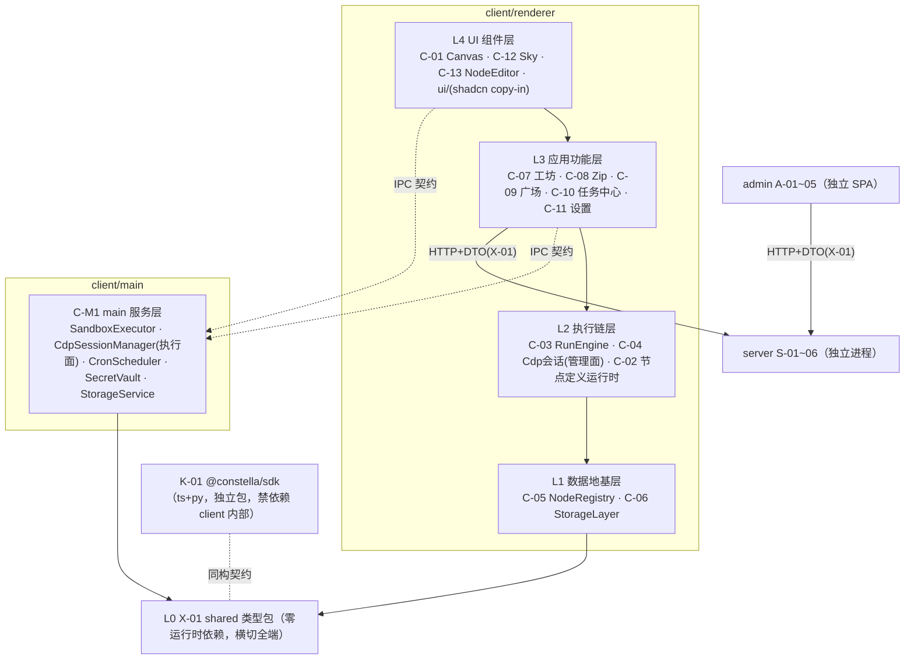
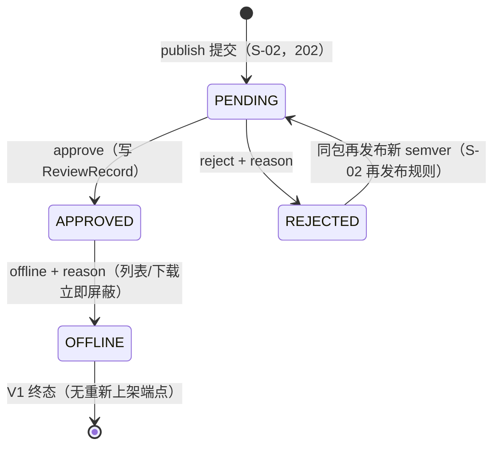

# 03 · 模块设计（模块细分与组件拆分）

| 字段 | 内容 |
|---|---|
| 编号 | docs/03-模块设计.md |
| 日期 | 2026-11-08 |
| 作者 | PM（框架）+ 各批设计工程师（卡片） |
| 状态 | **框架 v0.1 生效，卡片随批封版** |
| 依赖 | 00b §3（模块唯一注册表）、01-PRD / 02-TDD（封版锚）、spikes/*/REPORT.md（可行性证据） |
| 效力 | V1.0 卡 = B1 施工唯一模块输入；V1.1 卡 = B2；占位卡 = 边界声明（不进 M5 拆解）。卡片与 02 冲突时以 02 为准并停卡上报（00 C 章规则） |

> **用户开工令（2026-11-08）**：「架构设计模块细分文档，一定要模块化组件化，要解耦。开发计划配合模块更新。」——即本文件 §0 三条硬约束 + §6 对齐契约的来源。

---

## 0. 设计硬约束（P-1~P-3，每卡强制，评审拦截项）

- **P-1 模块化**：每模块单一职责、显式边界、独立可测。边界 = 对外接口契约（§2 卡模板第 1 节），契约之外一律视为私有。
- **P-2 组件化**：模块内部再拆组件——UI 模块拆到可复用组件（props 接口），非 UI 模块拆到可独立测试的纯函数/类单元。每卡必含「组件拆分」节。
- **P-3 解耦**：依赖**只能向下**（§1 分层图），同层禁止直接 import（经 L0 契约或上层编排）；renderer↔main 只走 02 §3.4 IPC 契约表（payload schema 定义在 TDD-X-01）；UI 层零业务规则；数据层零 UI 依赖；可替换点显式标注并收窄在单一模块内（见 §1 末表）。

**评审拦截**：任一张卡缺少「对外契约 / 依赖方向 / 组件拆分 / 替换点」四节之一 → arch-reviewer 直接打回，不进实质评审。

## 1. 分层与依赖方向总图（依 02 §3 演绎；与 02 冲突以 02 为准并上报）



> **物理落位注记**（逻辑分层 ≠ 进程落位）：C-06 StorageLayer 逻辑画于 renderer L1，**物理执行在 main 进程**（02 §3.1：SQLite 属 main；renderer 侧仅薄客户端+防抖编排，见 C-06 卡 §2/§3）；C-04 跨 renderer（管理面/UI）与 main（CDP 执行面，经 C-M1），边界以各卡 §2 为准。

**替换点登记表**（P-3：收窄在单一模块内，接口先定）：

| 替换点 | 收窄模块 | 当前实现 | 已备替换 |
|---|---|---|---|
| 存储引擎 | C-06 | better-sqlite3 | node:sqlite（S-2 对照组） |
| 画布库 | C-01 | @xyflow/react v12 | Rete v2 / 手写 SVG（02 §2.4） |
| LLM provider | C-07 / C-M1 | OpenAI 兼容自配 | baseUrl/apiKey 可换（D-4） |
| zip 库 | C-08 | jszip 3.10.2 | —（S-6 已冻结） |
| server 地址 | C-09 | 可配置端点 | 离线降级（01 §8） |
| 布局引擎 | C-01（AI 排布辅助） | @dagrejs/dagre | elkjs（如启用走 EPL-2.0 通道，S-9） |
| 对象存储后端 | S-05 StorageAdapter | 磁盘（B1 默认，02 §5.3） | S3 兼容（env 开关；02 §5.3 compose minio ⚠ B1 拍板，见 S-05 卡） |

## 2. 卡片模板（全部批次统一）

```markdown
### TDD-?-?? 模块名
| 端 | 波次 | 分层（§1） | 前置 spike | 批次 |
0. 一句话职责与边界（做什么 / 明确不做什么）
1. 对外接口契约（类型、函数签名、事件；逐条标注来源锚）
2. 依赖方向（imports ↓ 逐模块 / 被谁依赖 ↑）
3. 组件拆分（模块内组件清单：职责 · 接口 · 复用处）
4. 数据契约（DDL / 表结构 / store 形状 / 文件格式，如适用）
5. 规则编号引用（只引锚不复制正文：01 A-x / 02 §x / D-x）
6. 验收清单（可执行命令 + 预期结果，前置到 M5 任务卡）
7. demo 行号溯源（如适用，prototypes/demo.html）
8. 替换点 / 扩展点（无则显式写「无」）
```

## 3. 出卡批次与 spike gate（批次划分源自 00-PM 开工安排 2026-11-08）

| 批 | 卡 | 前置 spike | 状态 |
|---|---|---|---|
| G1 地基 | **X-01、C-05**（无前置，先行）＋ C-06（S-2）＋ C-M1（S-3/S-4/S-5） | 见左 | **四卡全出（2026-11-08）→ 双评审中** |
| G2 交互 | C-01（S-1）、C-13、C-12、C-11 | | 出卡中 |
| G3 执行链 | C-03、C-04（S-3）、C-02、C-07 | | 出卡中 |
| G4 流通链 | S-01~05（S-7 审计结论）、A-01~05（S-8）、K-01（S-5） | | **十一卡全出**（S/A/K） |
| G5 V1.1 | C-19 ReportRenderer（先行）、C-18 ModelRouter | 无 M4 前置（S-11 是 B2 前置） | **两卡已出** |
| G6 占位 | C-14/15/16、S-06、C-17 —— 只定边界不细化，不进 M5 | | 收尾批 |

评审：每批一轮 **arch-reviewer**（机械核验收清单与编号交叉引用 + §0 四节拦截）；G1 整批（4 卡齐）加一轮 **momus** 对抗评审（DDL/契约返工成本最高）。

## 4. spike 结论登记表（卡片强制吸收，M5 任务卡同步引用）

| spike | 判定 | 必须落进哪张卡 |
|---|---|---|
| S-6 jszip roundtrip | 有条件通过：内容/CRC/文件名/结构三向一致；**DOS 时间口径差异**（demo 本地墙钟 vs jszip UTC，同机 +8h） | **C-08 卡强制**：①导入侧时间换算（减本机 UTC 偏移）②`createFolders:false` 必须设在 `jszip.file()` 选项 ③读端统一 jszip（demo reader 静默跳过 deflate 条目） |
| S-8 admin 空壳 | 通过：antd 6.7.0 / React 19.3.1 / Vite 8.3.6 / react-router 7.18.5 / TS 7.0.2 | **A 系卡**：antd 按需引入（S-8 全量引入单 chunk 1.08MB）；`Statistic` 用 `styles.content` 弃 `valueStyle` |
| S-9 许可证 | 通过：无 GPL 阻断 | **K-01/C-M1 分发卡**：third-party-notices 随分发物；jszip 择 MIT 通道 |
| S-7 server 模板+compose | 通过（判据全过，服务器实测）：Prisma 7.8 迁移干净、注册/登录/刷新全通、部署契约 5/6（#6 隔离差异已注明）；**模板 npm start 原本从未跑通（ESM 双重断裂），spike 已修** | **S-01~S-05 卡强制**：①基线=仓库内 `spikes/s7-server/template/`（含 ESM 修复，禁止从上游重 clone 直用）②五项契约改造（register/login 响应补 user 对象、统一错误体 `{error:{code,message,requestId}}`+AUTH-* 码、User 补 role/isAuthor/status、RefreshToken.tokenHash 改 @unique、路由挂 /api 前缀）③版本锁 hono 4.12.15 / prisma 7.8.0（防 8.x RC 漂移）④register 竞态 catch P2002 转 409 ⑤`hono/utils/jwt/jwt` 改 `hono/jwt` |
| S-1 画布组合 | 通过（裕量大）：200 节点/500 边真实拖拽最差秒 51.9fps（判据 30）；undo/redo 100 步逐快照比对 100/100 正确、zundo 深度 101≥60 | **C-01 卡强制**：①锁版本 electron 45.2.3 / react 19.3.1 / @xyflow/react 12.12.1 / tailwind 4.3.5 / shadcn CLI 4.23.0 / zustand 5.1.0 / zundo 2.3.0 ②d3-drag 3.0.1 只吃 MouseEvent（自动化测试合成输入注意）③ESM 产物经 `protocol.handle` 自定义协议加载（免关 webSecurity）④**zundo 集成必须 partialize 剥离 measured/selected 等易变字段并自定义 equality**，否则历史栈被污染、redo 被清空 |
| S-2 sqlite 双组 | 通过（双组同判据全过）：better-sqlite3 13.0.3 N-API prebuild 内置 npm 包（8 平台单文件），Electron 45 main **零编译免 rebuild（N2 解除）**；5MiB 单事务写 ~60MB/s、读回校验 ~190MB/s；两组底层同为 SQLite 3.53.4 | **C-06 卡强制**：①锁 better-sqlite3 13.0.3（node:sqlite=可顶备胎：无事务包装 API、BLOB 走 Uint8Array）②`db.transaction()` 抛错自动回滚覆盖「保存=落盘+打版本」原子性 ③B1 脚手架注意：pnpm 12 的 onlyBuiltDependencies 须写 pnpm-workspace.yaml 顶层键；electron 45.x 无 postinstall、二进制懒下载 |
| S-5 ts 执行链 | 通过（三运行矩阵 ×6 场景零失败，esbuild 0.28.2 cjs/node24 单场景构建 9–67ms；electron-as-node 与普通 node 行为同构）；**N4 建议关闭** | **C-M1/K-01 卡强制**：①stdout JSON 行协议冻结（log/emit/终帧恰一且为末行：result=成功、error=失败）②exit code 0/1/2（成功/脚本错误含 OUT_INVALID/装配错误 ENTRY_NO_RUN 等）③ctx 经 `CONSTELLA_CTX` env 注入④宿主 spawn 必须显式 `ELECTRON_RUN_AS_NODE=1` + 退出看门狗（P1 实测：漏注时按 Electron main 语义执行且**进程不退出**）⑤接 source-map-support（sourcemap linked 已产出）⑥K-01 ts 侧原型=spikes/s5-tsrun/packages/sdk stub |
| S-3 CDP partition | 通过（19/19+4/4）：`persist:<flowId>·<laneLabel>` 命名（含 `·` 与中文）实测可用且跨进程落盘；隐藏窗口即可承载 lane 自动化；attach 仅支持协议 1.2/1.3 | **C-04 卡强制**（四坑）：①attach 后必须先导航再发命令（空窗口发 CDP 不可靠）②**destroy 全部窗口触发 window-all-closed→app.quit，此后新窗口导航一律 ERR_FAILED**——destroyRun 收尾须保 dock 主窗口存活或显式覆盖 window-all-closed ③`Network.setCookie` 不带 expires=会话 cookie 不落盘，须显式 expires ④`Page.loadEventFired` 仅在 Page.enable 后派发，导航等待需 enable+readyState 轮询兜底。工程链：electron@45 npm 包无 postinstall，二进制须手动 `node install.js`（S-1 复现命令同样需追加） |
| S-4 沙箱强杀+env | 通过（19/19 断言）：`taskkill /PID /T /F` 实测三层 python 树（含 py.exe 包装与 conhost）超时全灭；child.kill() 反面实证仅杀直接子进程——弃用 | **C-M1 卡强制**：①强杀=taskkill /T /F + **杀后复查**（/T 按 PID 快照遍历，re-parent 漏杀须 tasklist 枚举补杀）②python 经 py 启动器一次解析绝对路径后直接 spawn python.exe（避免包装层），形参 `-I -X utf8` + windowsHide + stdio pipe ③exit 观测 code=1/signal=null（勿依赖 signal 名）④env=显式白名单 5 项（SystemRoot/TEMP+TMP 指向 run 私有 tmp/PATHEXT/ComSpec）+CONSTELLA_*；PATH 需管控须显式覆盖 ⑤**Windows 平台事实：libuv 强制注入 11 个系统变量不可关闭，「仅白名单+CONSTELLA_*」按「传入 env 块」语义断言** ⑥cwd 与 TEMP/TMP 同指 run 私有目录 |
| ~~S-1~S-9 状态 | **九个 spike 全部收口（2026-11-08），M4 前置 gate 完整通过** | S-10/S-11/S-12 按波次时点（00b §7） |

## 5. 工程落位约束（02 §3.5 摘要，卡片不得违背）

- client 不依赖 Prisma/pg；shared 只放类型与常量；shadcn 组件 copy-in 于 `client/src/renderer/ui/`；spike 工程不入主干（spikes/ 仅 REPORT.md 入库）。

## 6. 03↔05 对齐契约（「开发计划配合模块更新」的落点）

1. 05 的任务卡**按 03 模块卡组织**：每张任务卡头部标注对应模块编号，禁止出现无模块归属的任务；
2. 任务依赖引用**模块编号**（依赖图 = §1 分层图在卡粒度的展开），不自行发明依赖；
3. 任务验收命令**复用模块卡 §6 验收清单**，模块卡变更 → 受影响任务卡同步改并在 05 留痕；
4. 每卡 ≤1 AI 工作日当量、验收命令前置（00 M5 规则）；out.* 卡（V1.1）硬性前置 `TDD-C-19 + C-18 + S-11 gate`；
5. M5 范围 = V1.0 + V1.1（G6 占位卡不拆解）。

---

## G1 · 地基批（卡片区）

### TDD-X-01 shared 类型包

| 端 | 波次 | 分层（§1） | 前置 spike | 批次 |
|---|---|---|---|---|
| shared（横切 client/admin/server；K-01 同构参照） | V1.0 | L0 | 无 | G1 |

**0. 一句话职责与边界**：全仓库类型与常量的单一来源——节点定义 DSL（N1~N8）、zip manifest、HTTP API DTO、IPC payload、设置键、错误码/权限标签/内置类型清单等（02 §15.4：「节点定义 DSL / manifest / API DTO 单一来源」）。**不做**：零运行时逻辑、不放函数体与运行数据（02 §3.5「shared 只放类型与常量，不放运行时逻辑」）；不含 ctx 能力接口与 SDK 实现（K-01 域，02 §14）。包名推荐 `@constella/shared`（对齐 D-10 命名空间；⚠ 02 未冻结包名，随 G1 评审/G4 定，验收命令用目录过滤不依赖包名）。

**1. 对外接口契约（subpath exports；目录落位 `shared/`，02 §3.5）**：

```
shared/
├─ package.json     # dependencies={} 硬约束；exports 见下表
├─ tsconfig.json    # 纯类型编译（noEmit 守护）
└─ src/
   ├─ dsl/          # node-definition.ts · meta.ts · ports.ts · params.ts · exec.ts · policy.ts · io.ts · node-out.ts
   ├─ manifest/     # package-manifest.ts · flow-steps.ts
   ├─ dto/          # common.ts · auth.ts · user.ts · market.ts · admin.ts
   ├─ ipc/          # channels.ts · <域>.payload.ts（app/env/dialog/storage/secret/run/cdp/cron/zip，02 §3.4 前缀分组）
   ├─ constants/    # error-codes.ts · perms.ts · builtin-types.ts · categories.ts
   └─ settings/     # settings-keys.ts
```

| subpath | 导出（类型/常量） | 用途 | 来源锚 |
|---|---|---|---|
| `./dsl` | `NodeDefinition`（聚合根）、`NodeKind`（builtin 或 custom） | 注册表/定义运行时/编辑器/导入链共用定义形 | 02 §8.1 |
| | `NodeMeta`（N1：name/icon/category/color/description/author/source） | ✨角标判定（非内置即 ✨）、类目检索、来源标记 | 02 §8.1；01 PRD-CUSTOM-N1 |
| | `NodePorts`（N2：ins[] 与 outs:[{id,label}]） | 画布多 Handle、ins=[] 触发节点判定、路由校验 | 02 §8.1；01 A-4.01 |
| | `ParamField`/`ParamType`（N3；t 白名单：text/number/select/textarea/boolean/secret/json/slider，开放扩展）、`ParamValidate` | 参数表单 schema 驱动渲染、抽屉保存校验 | 02 §8.1/§8.3 |
| | `ExecSpec`（N4：lang∈{python,ts}/file/entry/config/deps） | 脚本资产加载、沙箱执行链、noScript 判定 | 02 §8.1/§8.4 |
| | `InnerStep`（N5：string[]） | 组合节点步骤展示与内联展开 | 02 §8.1/§8.5 |
| | `RunPolicy`/`OnFailure`（N6；failBranch.exit 具名出口、0 值语义） | TimeoutGuard/RetryPolicy/失败分支 | 02 §8.1/§8.6 |
| | `IoContract`（N7：input/output 单出与 outputs per-exit 声明兼容共存） | 抽屉 io 区、AI 规划选型、PlanValidator 校验 | 02 §8.1/§8.7（X-5） |
| | `NodeOut`（`{data}` 或 `{branch, meta}` 联合） | 脚本返回值、引擎路由、node_runs.output 形 | 02 §14 |
| `./manifest` | `PackageManifest`（scripts 映射 node→{file,lang,entry} + 导出元信息 kind/name/summary/version） | zip 四件套 manifest.json 形、perms 推导输入、server 存档原文形 | 02 §3.2 C-08 行、§6.2、§8.4；01 A-4.03 |
| | `FlowSteps`（BFS 拓扑序 steps 序列化形） | flow 发布/安装回放 | 01 A-13.2 |
| `./dto` | `ErrorBody`/`ErrorCode`（7 通用 + 8 业务字面量联合） | 三端统一错误渲染 | 02 §6.1 |
| | auth/user/market 形（RegisterReq、LoginRes、UserProfile、MarketListItem、PackageDetail、PublishAccepted 等，逐行按表）；`MarketListItem.author.name` 02 未定 → 按 S-02 卡冻结=email 本地部分脱敏（⚠ 待评审） | client↔server | 02 §6.2/§6.4 |
| | admin 形（AdminUserRow、ReviewDecision、StatsOverview 等）；`StatsOverview.daily7d` 元素形 02 §6.3 未定 → 按 S-04 卡冻结=`{date:'YYYY-MM-DD',downloads:number,installs:number}`（⚠ 待评审） | admin↔server | 02 §6.3 |
| | `PermLabel`（CDP/网络/文件/AI/交互/社媒） | 权限标签结果形（广场卡片/安装确认/审核） | 02 §6.2、§12.2#1 |
| | `ReviewQueueItem`（S-03 卡冻结 items 形）、`AdminPackageDetail`（含 versions 元素形）——⚠ 待评审：随 G4 会签裁定（下载预检端点拆分 `/api/admin/packages/:id/download` 一并定） | admin↔server | 02 §6.3 + 03 G4 区 S-03/A-04 卡 |
| `./ipc` | `IPC_CHANNELS` 常量（`constella:` 前缀，02 §3.4 全量通道名）+ 每通道 Request/Response/payload 形（如 `SpawnScriptReq`、`ScriptEvent`、`CreateSessionRes`、`StorageInvokeReq`…） | preload 白名单 API、C-M1 通道实现、renderer 调用方（03 §0 P-3：IPC payload schema 定义在本包） | 02 §3.4 |
| `./constants` | `BUILTIN_TYPE_IDS`（内置 12 type id 字面量元组） | C-02 命名空间校验（custom 不得撞内置）、C-05 种子核对 | 01 A-4.01；00b §4 |
| | `BUILTIN_CATEGORIES`（内置类型类目集合，供网格分组排序参照；N1 category 为自由文本，类型层面 string 不封闭） | 类型网格、perms 推导映射 | demo L867-938 cat 值域（参照）；02 §8.1 N1 |
| | `ERROR_CODES`（错误码常量集） | 错误渲染/断言 | 02 §6.1 |
| `./settings` | `SettingsSchema`（交互三开关 snap/edgeAnim/autoSave、11 星野开关、7 密度滑杆、AI 配置引用键——apiKey 只存 safeStorage 引用键） | C-11 设置面、C-06 settings 表 value 形状、C-12 星野通道 | 01 A-14.1/A-14.2；02 §7.1 settings 行 |

**2. 依赖方向**：
- imports ↓：**无**——零运行时依赖（§1 分层图 L0 声明）；devDependencies 仅 typescript；`dependencies` 必须为空（验收断言）。
- 被依赖 ↑：client renderer 全模块（C-01~C-13）与 preload（IPC 形）、client main C-M1（IPC payload/常量）、admin A-01~05（DTO）、server S-01~05（Zod schema 以本包类型为源型）、K-01（同构契约，§1 图虚线）。
- 三端同构引用：client/admin/server 以同一 workspace 包 import（各端 tsconfig 一致解析）；**与 K-01 的关系（✅ 已裁决，K-01 卡 §2）**：02 §14 冻结的 `NodeCtx`/`run(ctx)`/ctx 能力实现属 K-01（py/ts 双运行时可运行包）；纯数据形 `NodeOut` 归本包、K-01 ts 侧 import 本包，py 侧同构复制并以契约测试对齐——**方向不可反转**（反转即 L0 依赖外部包，违反分层；且 K-01 为独立分发包，被 L0 依赖将令全端继承其版本漂移）。

**3. 组件拆分（类型域分组：每个 subpath = 一个组件，可独立编译、独立评审）**：

| 组件（subpath） | 职责 | 组件级接口（导出面） | 复用处 |
|---|---|---|---|
| dsl | 节点定义 DSL 类型族 | `NodeDefinition` 及 N1~N8 全部形 + `NodeOut` | C-02/C-05/C-07/C-08/C-13、K-01 |
| manifest | zip/发布资产形 | `PackageManifest`/`FlowSteps` | C-08/C-09、S-02/S-03、A-03 |
| dto | HTTP 契约形 | auth/user/market/admin 形 + `ErrorBody`/`PermLabel` | C-09、A-01~05、S-01~04 |
| ipc | 通道常量 + payload | `IPC_CHANNELS` + 全通道 payload 形 | preload、C-M1、renderer 调用方 |
| constants | 跨端常量 | `BUILTIN_TYPE_IDS`/`BUILTIN_CATEGORIES`/`ERROR_CODES` | C-02/C-05/C-08/C-09、S-02 |
| settings | 设置键形 | `SettingsSchema` | C-11、C-06、C-12 |

**4. 数据契约**：本包不持有数据，仅登记「类型 ↔ 存储」映射知识：`NodeDefinition` DSL 键（meta/ports/paramsSchema/exec/inner/policy/io/version/packageVersion，02 §8.1）↔ node_definitions 表列（meta/ports/params_schema/exec/inner/policy/io/version/pkg_version，02 §7.1 DDL 为准——§7.1 字段表按 N1~N8 描述、DDL 列名聚合，两写法映射关系在本表登记；行↔类型转换实现于 C-06 DAO）；`NodeOut` ↔ node_runs.output JSON（02 §7.1）；`PackageManifest` ↔ asset_packages.manifest 与 server PackageVersion.manifest（02 §7.1/§7.2）。

**5. 规则编号引用**：02 §3.4、§3.5、§6.1~6.4、§7.1~7.2、§8.1、§8.3~8.7、§14、§15.4；01 A-4.01、A-4.03、A-12.01、A-13.1、A-13.2、A-14.1/A-14.2；00b §3（TDD-X-01 行）、§4；D-10；03 §0 P-3、§1、§5。

**6. 验收清单（可执行，前置到 M5）**：
1. `pnpm -F ./shared exec tsc --noEmit` → exit 0；
2. 零运行时依赖断言：`node -e "const d=require('./shared/package.json').dependencies||{};process.exit(Object.keys(d).length?1:0)"` → exit 0；
3. exports↔目录一致性：`node scripts/check-shared-exports.mjs`（package.json exports 每项有对应 src 子域且导出非空）→ ok；
4. 三端 import 冒烟：client/admin/server 各建 smoke 文件 import 全部 subpath 后 `pnpm -F ./client exec tsc --noEmit && pnpm -F ./admin exec tsc --noEmit && pnpm -F ./server exec tsc --noEmit` → 0 error；
5. 常量↔锚对齐：`node scripts/check-shared-consts.mjs`——IPC 通道集合与 02 §3.4 表逐行一致、错误码与 02 §6.1 总表逐项一致、`BUILTIN_TYPE_IDS` 与 01 A-4.01 清单逐项一致 → 全 ok；
6. 类型↔02 §7/§14 对齐表逐行核对：以本卡 §1 表为核对清单（每行锚可 grep），arch-reviewer 机械评审。

**7. demo 行号溯源（参照非权威；demo `@flowforge/sdk` 写法作废，02 §14）**：L867-938（TYPES，N1/N2/N3 形态）、L941-945（zip 四件套结构）、L1035-1036（契约头）、L1051-1056（config 覆盖语义）、L2593-2595（manifest 键）、L2875-2880（pubPermsOf 六标签）。

**8. 替换点 / 扩展点**：替换点：无（L0 根，全端唯一）。扩展点：①`ParamType` 白名单开放——新参数类型随 renderer 映射注册追加（02 §8.1「扩展点=注册新 renderer 映射」；G-1 optsFrom 登记 vNext）；②per-exit `outputs` 已按 X-5 预留（02 §8.1）；③ctx 能力形（`NodeCtx` 等）归 K-01 域，G-2 回退（02 §14 ⚠）不改变本包结构。

---

### TDD-C-05 NodeRegistry

| 端 | 波次 | 分层（§1） | 前置 spike | 批次 |
|---|---|---|---|---|
| client/renderer | V1.0 | L1 数据地基层 | 无（S-2 是 C-06 前置，非本卡） | G1 |

**0. 一句话职责与边界**：节点类型**单一事实源**注册表——名称/图标/类目/出入口/参数 schema/时长估计/发布权限推导全由它驱动；启动从 node_definitions 表装载、运行时 upsert（02 §3.2 C-05 行；01 A-4.01）。**不做**：不直接碰 SQLite（经注入的 StorageLayer DAO 装载/持久化）；不做定义校验本体（C-02 validateDefinition，装载时注入调用，02 §8.2）；不执行节点（C-03）、不管节点实例（nodes 表=C-06 域）、不做种子写入（02 §13.2 归 C-06）。

**1. 对外接口契约**（类型来自 X-01；锚逐条标注）：

```ts
interface NodeRegistry {
  get(type: string): NodeDefinition | undefined;          // 02 §3.2
  register(doc: NodeDefinition): void;                     // 运行时 upsert：同名同型覆盖（02 §3.2 + 01 A-11.1）
  has(type: string): boolean;                              // 供 C-02 type 命名空间检查（02 §8.1）
  list(): readonly NodeDefinition[];                       // 全量（AI 规划选型 02 §8.7/§9.1；导入兜底）
  listByCategory(): Record<string, NodeDefinition[]>;      // 02 §3.2（类型网格/抽屉类型格）
  isBroken(type: string): boolean;                         // 02 §8.2 校验失败标记（画布 ⚠、运行闸拦截）
  isBuiltin(type: string): boolean;                        // kind 判定（✨角标、perms 推导排除内置）
  derivePerms(types: readonly string[]): PermLabel[];      // 发布权限推导（01 A-13.1；02 §12.2#1）
  estimateMs(type: string): number;                        // 时长估计驱动（02 §3.2；DUR 仅进度估计，02 §11 B-2）
  loadAll(store: NodeDefinitionStore,
           validate?: (doc: NodeDefinition) => ValidationResult): LoadReport;  // 02 §8.2 启动序
  onChange(fn: (type: string) => void): () => void;        // ⚠ 02 未定义变更通知；upsert 后类型网格/画布刷新需要（demo libAdd 后刷新语义，01 A-11.1）
}
interface NodeDefinitionStore {   // 本卡定义；C-06 实现（IpcDefinitionStore，应用装配点注入，无同层 import）
  loadAllDefinitions(): Promise<NodeDefinition[]>;   // async 定稿（C-06 §1 IpcDefinitionStore，经 storage:invoke IPC；行↔DSL 键映射在 C-06 DAO，映射知识见 X-01 §4）
  upsertDefinition(doc: NodeDefinition): Promise<void>;
}
// LoadReport = { total: number; loaded: number; broken: string[] }
```

**2. 依赖方向**：
- imports ↓：X-01（`NodeDefinition`/`NodeKind`/`PermLabel`/`BUILTIN_TYPE_IDS` 等——纯类型与常量）；运行时仅依赖注入的 `NodeDefinitionStore`（C-06 实现，应用装配点注入——P-3 同层禁直接 import）。**禁止**：better-sqlite3 / node:sqlite、L2+ 模块、任何 UI 库。
- ↑ 被依赖（逐条锚）：C-01 画布取图标/名称/✨角标/按 N2 outs 动态 Handle（02 §3.2 C-01 行；demo L1377、L1382-1387）；C-02 命名空间校验（has + X-01 `BUILTIN_TYPE_IDS`）与表单渲染取 paramsSchema（02 §8.1/§8.3）；C-03 运行闸 broken 拦截、branch∈N2 outs 路由校验（02 §12.4 表、§14）；C-07 PlanValidator 端口/IO 匹配、NodeDevAgent 产物注册（02 §9.1 六查④⑤、§8.2 四路入口之一）；C-08 zip 导入 upsert、未知 type 兜底（02 §8.2；01 A-12.3）；C-09 广场安装回流（01 A-13.3；02 §8.2）；C-13 editDefinition/saveToLibrary 同名同型 upsert（02 §3.2 C-13 行；01 A-11.1）；C-10 任务表当前节点名称/图标（02 §3.2 C-10 行）。

**3. 组件拆分**：

| 组件 | 职责 | 组件级接口 | 复用处 |
|---|---|---|---|
| RegistryCore | `Map<type, NodeDefinition>` + broken 集合；upsert 语义（同名同型覆盖） | get / register / has / list / isBroken / isBuiltin | 全部消费方 |
| DefinitionLoader | 启动装载：store 载入 → validate（C-02 注入，缺省跳过）→ 失败标 broken → 批量注册 | `loadAll(store, validate) → LoadReport` | 应用启动序（02 §8.2） |
| CategoryIndex | 类目倒排索引 + 稳定排序 | `listByCategory()` | C-01 类型网格、C-13/C-04 类型选择 |
| PermDeriver | 类目→权限标签映射：CDP/网络/AI/交互/社媒同名直映、数据→文件、未命中类目不产生标签（01 A-13.1 引 demo pubPermsOf L2875-2880 同源）；kind=builtin 不计（「只选内置类型→无特殊权限」，01 A-13.1/demo L2908） | `derivePerms(types)` | C-08 发布弹窗、C-09 安装确认、S-02 复核同源 |
| EstimationTable | 内置/示例类型时长表（demo DUR L1745-1747 同源冻结）+ 未命中默认值；⚠ 数据落点=node_definitions 无时长列、N1~N8 无时长字段（02 §7.1/§8.1），V1 以模块内常量表承载，值随 M5 任务卡自 demo DUR 同源确定 | `estimateMs(type)` | C-03 进度估计、C-10 用时展示 |
| RegistryEvents | 注册表变更通知 | `onChange(fn) → 退订函数` | 类型网格/画布/节点库刷新 |

**4. 数据契约**：读写的唯一持久层 = **node_definitions 表**（02 §7.1：type PK / kind / meta / ports / params_schema / exec / inner / policy / io / version / pkg_version / updated_at；DDL 全文与索引归 C-06 卡，此处不复制）。内存形 = `NodeDefinition`（X-01 `./dsl`）；列名↔DSL 键映射实现于 C-06 DAO（映射知识登记在 X-01 §4）。**注册表不直接碰 SQLite**：装载/持久化一律经注入的 `NodeDefinitionStore`。内置 12 类定义资产随 client 分发、经种子迁移写入（02 §7.1/§13.2，种子=C-06 职责），本模块只读装载。

**5. 规则编号引用 + 类型组关系（00b §4 注册表驱动原则）**：02 §3.2（C-05 行）、§7.1、§8.1、§8.2（启动序/四路 upsert/无分支原则）、§8.6、§9.1、§12.2#1、§12.4、§14、§15.1（分包③：StorageLayer + NodeRegistry 数据地基先行）；01 A-4.01、A-4.02、A-11.01、A-12.03、A-13.1、A-13.3；00b §4；03 §0 P-1~P-3、§1。类型组三态：
- **平台内置 12**（V1.0 冻结，01 A-4.01）：kind=`builtin`，种子写入后与 custom 同一 Map、消费端零分支（02 §8.2「无分支处理」）；
- **示例资产 9**（V1.0 种子）：**非内置依赖**（01 A-4.02「随示例资产分发、可被同型自定义节点覆盖」）——kind=`custom`，经统一 upsert 入口（zip 资产包链）进入注册表，**不进内置分支、不 hardcode 于本模块**；
- **扩展 10**（out.*×5 属 V1.1 / mcp.call+ai.subagent 属 V2.0 / computer.*×3 属 V2.x，00b §4）：平台内置定位但随波次后置——本卡 V1.0 不含、**不预留代码分支**，届时以 builtin 定义 + 种子升级加入（波次 gate：TDD-C-19/C-14/C-17）。
- 一致性铁律：任一视图不得出现注册表之外的内置类型（01 A-4.01 GWT）。

**6. 验收清单（可执行）**：
1. `pnpm -F ./client exec vitest run node-registry` 全绿，用例覆盖：a) 内存 store 载入 12 定义后 `list()` 长 12、`get('logic.branch').ports.outs` 含 true/false、ins=[] 类型可判触发节点（01 A-4.01）；b) `register` 同名同型 = 覆盖 params_schema 不新增条目（01 A-11.1）；c) validate 注入失败 → `isBroken` true 且 `get` 仍返回定义（画布 ⚠ 可渲染、运行闸可拦截，02 §8.2）；d) `derivePerms`：仅内置 → 空数组；含「社媒」类目自定义类型 → ['社媒']、含「数据」类目 → ['文件']（01 A-13.1/demo L2875-2880）；e) `listByCategory` 覆盖全部已注册类目；
2. 依赖静态检查：`grep -rEl "better-sqlite3|node:sqlite" <本模块目录>` → 0 命中（不碰 SQLite）；`grep -rEl "from '.*storage|from '.*C-02" <本模块目录>` → 0 命中（不 import 同层/上层实现模块，校验经注入）；
3. 内置清单三方一致：`node scripts/check-builtin-seed.mjs`（种子 JSON type 集合 ≡ X-01 `BUILTIN_TYPE_IDS` ≡ 01 A-4.01 清单）→ ok；
4. M5 前置：本清单各项作为对应任务卡验收命令复用（§6 对齐契约）。

**7. demo 行号溯源**：L862-866（注册表=单一事实源注释，02 §8.2 为其正式化）、L867-938（TYPES：12 内置 + 9 强节点形态）、L939（TYPE_KEYS = `list()` 对应物）、L1377（✨自研角标）、L1382-1387（多出口等分渲染）、L1745-1747（DUR 表）、L2045-2051（类型网格）、L2466-2473（libAdd 同名同型 upsert 四入口）、L2875-2880 与 L2908（pubPermsOf 类目→标签映射、「无特殊权限」）。

**8. 替换点 / 扩展点**：替换点：无（注册表接口即 02 §8.2 冻结语义，Map 实现无库依赖）。扩展点：①新内置类型随波次种子加入（out.* / mcp.call / computer.*，00b §4）——零代码分支，仅种子数据升级；②paramsSchema 类型白名单扩展（C-02/X-01 域，本模块自动受益）；③PermDeriver 映射表条目随新类目波次追加（如 V2.x「电脑」类目，未命中不产生标签为默认行为）；④G-1 optsFrom（vNext，02 §8.8）属 N3 域，不落本卡。

---

### TDD-C-06 StorageLayer（SQLite 存储层）

| 端 | 波次 | 分层（§1） | 前置 spike | 批次 |
|---|---|---|---|---|
| client（main 进程执行 + renderer 薄客户端） | V1.0 | L1 数据地基层（03 §1 逻辑位；**物理落位 main，02 §3.1/§3.5 为准，⚠ 见 §0 末）** | S-2 | G1 |

**0. 一句话职责与边界**：客户端唯一 SQLite 持久层与存储事务权威——main 进程持有 `userData/constella.db`（WAL+外键，02 §7.1/§3.1）：逐实体 DAO（02 §3.2 C-06 行九域表）、保存事务（落盘+打版本，原子提交 02 §13.1）、版本快照恢复、种子+增量迁移（02 §13.2）、迁移前备份（02 §13.3）；renderer 半段=薄客户端（`storage:invoke` 白名单 op）+ 保存编排（换基线/清栈回调）+ 800ms 防抖自动保存 + C-05 store 接口实现。**不做**：不收任意 SQL（白名单枚举 op，02 §3.4）；不管 SecretVault（apiKey=safeStorage 经 `secret:*` 通道归 C-M1，本卡只存引用键，02 §12.3）；不做 zip 解包与资产目录落盘（C-08/C-M1；asset_packages 仅表登记）；不持内存状态镜像（statuses/runStore=C-03）；不清 zundo temporal（保存周期清栈=flowStore 域，本卡经 onSaved 回调通知，02 §3.3）；不依赖 Prisma/pg（02 §3.5）。⚠ 上报：03 §1 分层图将本模块画于 renderer L1（逻辑分层视角）；物理执行以 02 为准（SQLite 访问全量在 main，02 §3.1 STO/§3.5 目录），renderer 仅薄客户端——图注更正归 PM，本卡不擅改 §1 图。

**1. 对外接口契约**（类型来自 X-01；锚逐条标注。**op 白名单=本表冻结**——02 §3.4「枚举方法，见 03 模块设计冻结清单」的委托落点；payload 形=X-01 `./ipc` StorageInvokeReq，op 联合类型按本表细型化——X-01 增补建议 ⚠）：

renderer 面（全部经 `constella:storage:invoke` `{op,args}` → 白名单结果，02 §3.4；通道 handler 归 C-M1 StorageService）：

| 域 | op（args → 结果要点） | 来源锚 |
|---|---|---|
| flows | `list`→{items}（过滤 soft_del=0）/ `get{id}`→当前文档（栈顶 snapshot）/ `create{name}`→{id}（并打「初始版本」）/ `rename{id,name}` / `softDelete{id}`（D-8 ⚠ 软删）/ `reorder{ids}` / **`save{id,name,nodes,edges,label}`→{versionId}**（§3 SavePipeline 事务；label∈手动保存/自动保存/生成草稿/流程工坊生成/初始版本） | 02 §7.1 flows/flow_versions 行、§3.2 C-06 行；01 A-2 |
| versions | `list{flowId}`→LIFO 元数据 / `restore{flowId,versionId}`→snapshot（只读返回不落盘，恢复呈 dirty） | 02 §7.1、§13.3；01 A-5.4 |
| definitions | `loadAll`→`NodeDefinition[]` / `upsert{doc}`（列↔DSL 键映射实现于 DAO，知识登记 X-01 §4） | C-05 §1；02 §7.1 node_definitions |
| library | `list` / `upsert{entry}`（同名同型覆盖）/ `delete{id}` | 02 §7.1 library_entries；01 A-11 |
| runs | `list` / `get{runId}`（含 node_runs）/ `create{flowId,name}`→{id} / `finish{runId,...}` / `nodeRunStart`/`nodeRunFinish`（output={data}\|{branch,meta} 落库，抽屉可查） | 02 §7.1 runs/node_runs、§11 B-13；01 A-6 |
| logs | `append{...}` / `list{flowId?\|runId?,beforeId?,limit}`（三路双写数据源+重放） | 02 §7.1 logs；01 A-9 |
| settings | `getAll`→KV（value 形=X-01 SettingsSchema；apiKey 只存引用键）/ `set{key,value}` / `factoryReset`（危险 op：删库→重迁→重种；node-types/sandbox/backups 目录清理与 app 重启归 C-M1 编排） | 02 §7.1 settings、§12.3、§13.3；01 A-14 |
| hits | `list{runId,status?}` / `create{runId,nodeId,question,options,dataSnapshot}` / `resolve{id,status,payload}` | 02 §7.1 hit_breakpoints、§11 B-4；01 A-7 |
| publish ⚠ | `queue{meta,filePath}` / `list` / `remove{id}`（离线待发布队列；幂等键=内容 SHA-256 存 meta） | 02 §1.3、§7.1 pending_publish——**02 §3.4 op 域枚举未含本域，本卡补入白名单并上报同步 02 §3.4**（C-09 renderer 读写无其他通道） |

main 内部面（**不进 IPC 白名单**，main 侧进程内直调 DAO）：`lanes.upsert/close`（cdp:* handler 会话台账，02 §7.1 lanes）；`assetPackages.upsert`（zip:import handler 解包登记+hash 防重，02 §7.1 asset_packages）；seed_flags/schema_migrations 读写（§3 迁移组件私有）。

```ts
// renderer 半段（client/src/renderer/storage/）
storageClient.invoke(op: StorageOp, args): Promise<T>       // StorageOp=X-01 按本卡 §1 表细型化 ⚠
class IpcDefinitionStore implements NodeDefinitionStore {   // C-05 §1 接口；签名本卡定稿（C-05 卡已预留）：
  loadAllDefinitions(): Promise<NodeDefinition[]>           // ⚠ 修订：C-05 原同步签名→Promise（IPC 异步本质）
  upsertDefinition(doc): Promise<void> }                    //   —— 需 PM 同步 C-05 卡 §1 签名，不静默改
interface SaveOrchestrator { doSave(silent: boolean, ctx: { // 保存编排（demo L1637-1645 doSave 同源）：
  serialize(): FlowDoc; onSaved(versionId): void }): Promise<void> }  // 序列化器/回调由 flowStore 注入（P-3 不 import C-01）；
                                                             // onSaved=换 snapshot 基线+temporal 清栈（02 §3.3，动作在 flowStore）
class AutoSaveScheduler { schedule(); cancel(); flush() }    // 800ms 防抖（02 §3.3；demo L1311）；settings.autoSave 门控；flush=关窗前冲刷
// main 半段（client/src/main/storage/）
interface DbConnection { prepare(sql): Stmt; exec(sql): void;
  transaction<T>(fn: () => T): T;                            // better-sqlite3 抛错自动回滚（S-2 ③）=02 §13.1 原子性机制；
  pragma(k,v): unknown; backup(destPath): void }             //   node:sqlite 备胎实现=手写 BEGIN/COMMIT/ROLLBACK（S-2 差异）；
                                                             //   BLOB Buffer↔Uint8Array 在引擎适配层转换（S-2 差异）
class StorageLayer { constructor(engine: DbConnection)       // 引擎注入（§8 替换点收窄）
  open(userDataDir): void   // 打开 constella.db→PRAGMA(WAL,foreign_keys)→migrate(迁移前备份)→seed→ensureInitialVersions
  ops: StorageOpsRegistry   // op→DAO 映射+参数校验（形以 X-01 为源型）；被 C-M1 StorageService 消费
  dao: StorageDao }         // 内部面（lanes/assetPackages/pendingPublish 供 main 侧 handler 直调）
```

**2. 依赖方向**：
- imports ↓：X-01（NodeDefinition/SettingsSchema/StorageInvokeReq/IPC_CHANNELS——纯类型与常量）；better-sqlite3 13.0.3（仅 SqliteEngine 组件，S-2 ① 锁定）；node:fs/path（备份与库文件）。**禁止**：C-01~C-13 任何模块 import（flowStore 序列化器/回调经注入）；zundo/temporal（清栈归 flowStore，02 §3.3）；UI 库；Prisma/pg（02 §3.5）。
- ↑ 被依赖（逐条锚）：**C-M1 StorageService**（`storage:invoke` handler→ops.invoke；通道注册/错误序列化/preload 暴露归 C-M1——02 §3.4、§15.4 C-M1 行）；**C-05**（loadAll 注入 IpcDefinitionStore——C-05 §1/§2、02 §8.2 启动序）；**C-01 flowStore**（装载 flows.get/保存编排/版本下拉 versions.list/restore——02 §3.3，demo L1637-1649/L2987）；**C-03**（runs/nodeRuns/logs/hits 写入，restoreVersion 呈 dirty 供重跑——02 §3.2 C-03 行、§7.1）；**C-10**（runs.list/logs.list 重放——02 §3.2 C-10 行）；**C-11**（settings get/set+factoryReset 危险区——02 §3.2 C-11 行、§13.3）；**C-08**（main 侧 zip:import handler 直调 definitions.upsert+assetPackages.upsert——02 §3.4 zip 行、§8.2 四路入口）；**C-09**（publish.* 待发布队列——02 §1.3）；**C-M1 CdpSessionManager(执行面)**（main 内直调 lanes——02 §7.1 lanes）。

**3. 组件拆分**（main：`client/src/main/storage/`；renderer：`client/src/renderer/storage/`）：

| 组件 | 落位 | 职责 | 组件级接口 | 复用处 |
|---|---|---|---|---|
| SqliteEngine | main/engine/ | **唯一 better-sqlite3 import**（P-3 收窄）；open/pragma/backup；DbConnection 薄适配（备胎差异全吸收于此） | `createConnection(file): DbConnection` | StorageLayer 装配；备胎 NodeSqliteEngine 同接口 |
| MigrationRunner | main/migrate/ | schema_migrations 版本化增量（v1..vN 单调）；迁移前自动备份 `backups/pre-v<N>-<date>.db` 保留 5（设计值） | `migrate(conn): {from,to}` | open()（02 §13.3） |
| SeedsRunner | main/migrate/ | 首启播种 9 流程+12 定义+3 库；按 seed_flags 补种缺失、用户数据不动；ensureInitialVersions（无版本流程补「初始版本」） | `seed(conn)`、`ensureInitialVersions(conn)` | open()（02 §13.2；demo L1246-1255/L3102-3107） |
| DAO×11 | main/dao/ | 逐实体 CRUD+行↔类型转换（flows/versions/definitions/library/runs/nodeRuns/lanes/logs/settings/hits/assetPackages/pendingPublish）；definitions 列↔DSL 映射（X-01 §4） | 每 DAO 一接口（§1 表逐行对应） | SavePipeline/StorageOpsRegistry/内部面 |
| SavePipeline | main/save/ | **saveFlow 事务**=flows upsert→nodes 表重写（镜像）→flow_versions 压栈（snapshot=nodes+edges 全量）→>20 删最旧，单 `db.transaction()` 原子提交；restoreVersion 读快照 | `saveFlow(doc,label)→versionId`、`restoreVersion(flowId,versionId)→snapshot` | flows.save/versions.restore op（02 §13.1；S-2 ③） |
| StorageOpsRegistry | main/ops/ | §1 白名单 op→DAO 映射+参数校验（Zod，源型=X-01）；无透传 SQL | `invoke(op,args)` | C-M1 StorageService handler |
| storageClient | renderer/ | invoke 薄封装+op/payload 类型 | `invoke(op,args)` | 全 renderer 消费方 |
| IpcDefinitionStore | renderer/ | C-05 NodeDefinitionStore 的 IPC 实现 | `loadAllDefinitions()/upsertDefinition()`（async 定稿） | C-05 loadAll 注入 |
| SaveOrchestrator | renderer/ | doSave 编排：serialize（注入）→flows.save→onSaved 回调（换基线+清栈移交 flowStore） | `doSave(silent,ctx)` | header 保存、AutoSaveScheduler |
| AutoSaveScheduler | renderer/ | 800ms 防抖+autoSave 门控+flush | `schedule()/cancel()/flush()` | flowStore markDirty 回调（02 §3.3；demo L1311） |

**4. 数据契约**：15 张表（flows/flow_versions/nodes/node_definitions/asset_packages/library_entries/runs/lanes/node_runs/logs/hit_breakpoints/settings/seed_flags/pending_publish/schema_migrations）**字段/关系全以 02 §7.1 字段表为准**（DDL 节选 node_definitions/node_runs 已给）。本卡补充（02 §7.1「完整约束与索引随 03 冻结」的委托，均为 02 未覆盖处）：①索引——`flow_versions(flow_id,created_at DESC)`（LIFO 列表）、`nodes(flow_id)`、`hit_breakpoints(run_id)`、`library_entries(name,type)`（同名同型查重）、`asset_packages(node_type)`、`logs(flow_id,id)`（02 已给）；②CHECK——flows.soft_del∈{0,1}、logs.level∈{info,ok,err,warn}、hit_breakpoints.status∈{pending,resolved,skipped}、runs.status 五值、JSON 列=TEXT+`json_valid()`；③「同流程最多一 active run」=部分唯一索引 `UNIQUE(flow_id) WHERE status IN('running','waiting')`；④FK 策略=`PRAGMA foreign_keys=ON`（02 §7.1）+应用层事务内显式删除（nodes 连带边语义，02 §7.1），不用 ON DELETE CASCADE（物理删仅 factoryReset）。**⚠ 待定（本卡冻结、评审确认）**：a) **edges 落点**——02 §7.1 无 edges 表/列，本卡冻结=edges 全量随 flow_versions.snapshot 持久化（demo 语义），nodes 表为 FK 支撑/列表镜像（saveFlow 事务内重写）；b) **logs 保留策略**（02 §7.1「保留策略 03 定」委托）=设计值滚动保留最近 20000 行（append 事务内删溢出）；c) settings.value 形=X-01 SettingsSchema（X-01 §1 已登记）；库文件=`userData/constella.db`+WAL sidecar（02 §7.1；S-2 ④）。

**5. 规则编号引用**：02 §1.3、§3.1、§3.2 C-06 行、§3.3、§3.4、§3.5、§7.1、§11 B-4/B-13、§12.3、§13.1、§13.2、§13.3、§15.4（C-06/C-M1 行）；01 A-2、A-5.1~A-5.4、A-6、A-7、A-9、A-11、A-14、A-15.1（经 02 §3.3/§7.1/§13.2 转引）；00b §3 TDD-C-06 行；03 §0 P-1~P-3、§1 替换点登记表（存储引擎行）、§4 S-2 行、§5；spikes/s2-sqlite/REPORT.md；X-01 §1（SettingsSchema/StorageInvokeReq）/§4；C-05 §1/§2（NodeDefinitionStore）。

**6. 验收清单（可执行）**：
1. `pnpm -F ./client exec vitest run storage`（main 侧套件，node 直跑——S-2 同口径）全绿：a) **事务原子性**：saveFlow 注入失败（nodes.type 引用不存在定义，foreign_keys=ON 抛错）→ flows/nodes/flow_versions 三表零变化（S-2 ③ 抛错自动回滚=02 §13.1 原子性）；b) **版本往返**：save×2（label 手动/自动保存）→ versions.list LIFO 2 → restore(v1) 快照与首次保存入参深相等（02 §13.3）；c) LIFO 20：连打 22 版 → 恰 20、最旧淘汰（A-5.4）；d) **种子幂等**：空库 open → flows=9+definitions=12+library=3（02 §13.2）；二启零 delta；伪造 seed_flags 缺 f9 → 仅补 f9、既有行不动（demo L1246-1255）；e) 迁移+备份：v1→v2 → schema_migrations 两行+backups/pre-v2-*.db 生成，重跑幂等；f) reopen 后 journal_mode=wal、foreign_keys=on（S-2 ④）；
2. renderer 半段（vitest+fake timers）：markDirty 两次间隔 300ms → flows.save 恰 1 次（800ms 防抖合并，demo L1311）；autoSave=false → 0 次；doSave 成功 → onSaved 回调恰一次（02 §3.3）；
3. **备胎契约**：NodeSqliteEngine（手写 BEGIN/COMMIT/ROLLBACK+Uint8Array 转换，S-2 两组差异）跑同一 DAO 契约套件全绿——引擎替换零 DAO 改动；
4. 版本锁：`node -e "const d=require('./client/package.json').dependencies;process.exit(d['better-sqlite3']==='13.0.3'?0:1)"` → exit 0（S-2 ①；electron 45.2.3 随 S-1/C-01 锁）；
5. P-3 收窄静态：`grep -rln "better-sqlite3" client/src` ⊆ `client/src/main/storage/engine/`（0 逸出）；
6. 白名单一致性：`node scripts/check-storage-ops.mjs`（X-01 StorageInvokeReq op 联合 ≡ 本卡 §1 表 ≡ StorageOpsRegistry 注册表；无 SQL 透传 op）→ ok；
7. 脚手架：pnpm-workspace.yaml 顶层 `onlyBuiltDependencies` 含 better-sqlite3（S-2 ③ B1 注意）；
8. 本清单前置到 M5 任务卡（§6 对齐契约）。

**7. demo 行号溯源**（参照非权威；localStorage 语义已被 02 §13.1 判定为开发期脚本迁移源）：L721/L760（800ms 文案与开关）、L1071（autoSave 默认 false）、L1246-1255（migrateSeed 增量补种=02 §13.2 语义源）、L1257-1267（versions 仓：保存即打版本、20/流程上限）、L1299-1311（markDirty→scheduleAutoSave 800ms→doSave(true)）、L1637-1649（doSave=落盘+打版本+snapshot 换基线+清栈；doCancel=snapshot 克隆还原）、L2987（版本下拉 LIFO）、L3102-3107（启动序：读档或播种→基线→补「初始版本」）。

**8. 替换点 / 扩展点**：替换点：**存储引擎**（03 §1 登记表行）——收窄组件=SqliteEngine（client/src 唯一 better-sqlite3 import 处）；已备替换=node:sqlite（S-2：零原生依赖、同为 SQLite 3.53.4、数据文件互通；差异=无事务包装 API（适配层手写 BEGIN/COMMIT/ROLLBACK）+BLOB 走 Uint8Array（适配层转换）；契约套件见 §6.3）。扩展点：①schema_migrations 增量序列——新表/新列（V1.1 C-18/C-19 等）一律走新迁移版本+迁移前备份，禁改已发布迁移；②logs 保留策略参数化（§4 设计值→settings 键）；③demo localStorage 迁移脚本（02 §13.1：tools/ 开发期工具，复用 MigrationRunner+SeedsRunner，校验不一致整体回滚，不进产品 UI）；④node:sqlite Session/backup API 转正后可反哺备份实现（S-2 导出面）。

### TDD-C-M1 main 进程服务层

| 端 | 波次 | 分层（§1） | 前置 spike | 批次 |
|---|---|---|---|---|
| client（main 进程执行 + preload 暴露面） | V1.0 | M（§1 图 C-M1；renderer 一切 main 能力唯一经本卡 IPC 面） | S-3 / S-4 / S-5 | G1 |

**0. 一句话职责与边界**：main 进程五大服务 + 宿主装配——SandboxExecutor（ts/python 沙箱执行链）、CdpSessionManager（CDP lane 会话**执行面**）、CronScheduler（常驻调度）、SecretVault（safeStorage 密钥仓）、StorageService（C-06 桥接），外加 AppRuntime 宿主（主窗/查看窗生命周期与 window-all-closed 覆盖——02 §3.1 图 MW 框的卡级落点；⚠ 02 §15.4 五服务枚举未含窗口管理，本卡吸收为第六组件，评审确认）——统一持有 02 §3.4 全量 **24 通道（21 r→m invoke + 3 m→r 推送）**的 handler 注册、payload 校验、错误序列化与 preload contextBridge 白名单。**不做**：RunEngine 调度语义（运行闸/BFS/lane/汇合/死路径全在 renderer C-03，02 §3.1「重执行体在 main，renderer 下发指令、订阅事件流」）；CDP 管理面 UI（dock 列表/查看窗交互=C-04 renderer 侧，本卡只供 cdp:* 通道与窗口原语）；SQLite DAO/迁移/种子本体（C-06，本层仅 ops 桥接与 main 内部面直调）；zip 解包管线与安全校验本体（C-08 G3，本层持通道注册与错误面）；LLM 网关（C-07 renderer 直连）；广场 HTTP（不经 IPC，02 §3.4 末注）；SDK ctx 能力实现（K-01 域，02 §14）。

**1. 对外接口契约 = 02 §3.4 逐通道表的错误语义落点**（02 §15.4 C-M1 行头号规格要点；payload 形以 X-01 `./ipc` 为源——channels.ts + 9 域 payload 文件（app/env/dialog/storage/secret/run/cdp/cron/zip），通道全名=`constella:<name>`（X-01 `IPC_CHANNELS`），本卡不复制类型全文，只冻结**通道×语义×错误码**矩阵）：

**错误序列化铁律（本卡冻结）**：r→m handler 抛出的一切错误经 IpcGateway 统一序列化为 `{code,message}` reject（裸 Error/堆栈不穿 contextBridge；⚠ X-01 `./ipc` 增补 `IpcError` 与下表错误码常量建议——02 §3.4 未定义 IPC 错误码，本卡即其「错误语义」规格落点）；推送通道 fire-and-forget 无错误语义；「业务非错误」一律 in-band 结果不 reject（矩阵末列）。参数校验失败复用 02 §6.1 `VALIDATION-FAILED`。

| 通道（归属服务） | 方向 | 语义要点 | 错误码 / in-band |
|---|---|---|---|
| app:version（AppRuntime） | r→m | process.versions 聚合（B-9） | 无业务错误 |
| env:systemInfo（AppRuntime） | r→m | `os.cpuMemory()` 等（B-9） | 无业务错误 |
| env:cdpProbe（Cdp） | r→m | 附栈会话探活+故障上报（B-9/B-14） | in-band：探活失败→`{ok:false,detail}` |
| shell:openExternal（AppRuntime） | r→m | 外部链接安全打开；仅 http/https（02 §3.1） | SHELL-INVALID-URL |
| dialog:openFile / saveFile（AppRuntime） | r→m | `{filters}`/`{defaultName}` → `{path}`（02 §3.4） | in-band：用户取消→`{path:null}` |
| storage:invoke（StorageService） | r→m | `{op,args}`→C-06 ops 白名单（**9 域 31 op**=02 §3.4 原生 8 域 28 op + C-06 补 publish 域 3 op，C-06 §1 表）；不接受任意 SQL | IPC-UNKNOWN-OP / VALIDATION-FAILED / DAO 业务码透传 |
| secret:set / get / del（SecretVault） | r→m | safeStorage 往返；apiKey 引用键语义（settings 只存引用键，02 §12.3） | SECRET-UNAVAILABLE（safeStorage 不可用）；in-band：get 未命中→`{value:null}` |
| run:spawnScript（Sandbox） | r→m | ts 链=S-5 ①~⑤ / python 链=S-4 ②~⑥（§3）；脚本路径限 node-types/ 资产白名单（02 §12.2#3）；试跑同面（B-5） | RUN-SCRIPT-NOT-FOUND / RUN-ENV-MISSING（python 未安装=节点级执行环境缺失，02 §12.1 降级）/ RUN-INVALID-LANG |
| run:killScript（Sandbox） | r→m | taskkill /T /F + 杀后复查（S-4 ①）；终止扩散原语（A-6.4 AbortCoordinator 消费） | in-band：幂等 `{ok:true}`（已退出亦 ok） |
| cdp:createSession（Cdp） | r→m | lane 首个 cdp.* 创建；partition=`persist:<flowId>·<laneLabel>`（S-3）；`debugger.attach('1.3')`（仅 1.2/1.3，S-3）；隐藏窗口承载（show:false） | CDP-PORT-EXHAUSTED（耗尽报错+提示收敛 lane 数，N7）/ CDP-ATTACH-FAILED |
| cdp:navigate（Cdp） | r→m | 同 lane 复用只更新 URL（A-8.1）；attach 后**先导航**再发命令（S-3 坑①）；Page.enable+readyState 轮询兜底（坑④） | CDP-SESSION-NOT-FOUND / CDP-NAV-FAILED |
| cdp:listSessions（Cdp） | r→m | lanes 台账投影（02 §7.1 lanes） | in-band：无会话→`[]` |
| cdp:openViewer（Cdp） | r→m | 查看窗打开/置顶；✕ 只关窗不中断自动化（A-8.2） | CDP-SESSION-NOT-FOUND |
| cdp:destroyRun（Cdp） | r→m | run 收尾统一销毁（A-6.4/A-8.1）；**保 dock 主窗存活或显式覆盖 window-all-closed**（S-3 坑②） | in-band：幂等 `{ok:true}` |
| cron:upsert / cancel（Cron） | r→m | 注册/同 flowId 覆盖、注销；表达式=**标准五段式（分 时 日 月 周）**（X-18；02 §15.4 C-M1 行） | CRON-INVALID-EXPR；cancel 幂等 in-band |
| zip:export / import（IpcGateway→C-08 装配位） | r→m | 通道注册+错误序列化归本卡；管线与 12.2#4 安全校验本体=C-08 卡（G3）；import 落库直调 C-06 DAO（C-06 §2） | ZIP-WRITE-FAILED / ZIP-FLOW-NOT-FOUND；ZIP-INVALID / ZIP-UNSAFE-ENTRY |
| run:scriptEvent（Sandbox） | m→r | `{nodeRunId,kind:'stdout'\|'stderr'\|'exit',chunk,code,ms}`；转发前 `sk-***` 掩码（02 §12.3/§12.4） | —（推送） |
| cron:fired（Cron） | m→r | `{flowId}` 到点推送；startRun 与三闸复查在 renderer RunGate（脏闸+同流程不重复跑，A-6.1/A-6.6 共用闸；02 §3.4 用途列） | —（推送） |
| app:confirmClose（AppRuntime） | m→r | main 拦截主窗 close → 问 renderer dirty → 原生 `dialog.showMessageBox` 确认（02 §3.3） | —（带响应 `{dirty}`） |

preload 面：contextBridge 暴露 `window.constella`，白名单键 ≡ X-01 `IPC_CHANNELS` ≡ 02 §3.4 全集（24 通道，验收断言见 §6.6）；无 Node 泄漏（02 §3.1 安全基线）。

**2. 依赖方向**：
- imports ↓：X-01（`IPC_CHANNELS`/9 域 payload/错误码常量——纯类型与常量）；C-06（main 进程内直调：`ops.invoke`、`dao.lanes`（cdp:* 台账）、`dao.assetPackages`（zip:import 登记）——C-06 §2 明示被本卡消费）；Electron API（app/BrowserWindow/webContents.debugger/safeStorage/dialog/shell/systemPreferences）；node:child_process/net/fs/path；esbuild 0.28.2（S-5 锁定，ts 链唯一转译器）。**禁止**：import renderer 任何模块（L1~L4）；Prisma/pg（02 §3.5）；K-01 运行时 import（K-01 是被拉起的 SDK 资产——TsExecutor 生成 entry 的 `import '@constella/sdk/bootstrap'` 为子进程产物运行期解析，spawn 协议=S-5 冻结给 C-M1↔K-01 的共同输入）。
- ↑ 被依赖：全 renderer 经 preload 白名单——C-03（run:*/cdp:*/cron:*，02 §1.4 时序）；C-04（cdp:* 管理面，02 §3.2 C-04 行）；C-05/C-01/C-09/C-10/C-11（storage:invoke，C-06 §2 ↑ 清单）；C-07（secret:* 配置 + 抽屉试跑 spawnScript，B-5）；C-08（zip:*，G3）；B-9 env:*（顶栏/环境 pill）。
- main 内部：AppRuntime=组合根，按启动序构造五服务并注入（Cdp←C-06 lanes DAO；Sandbox←SecretVault.reveal；Storage←C-06 StorageLayer）。

**3. 组件拆分**（`client/src/main/`；服务级接口=方法签名+事件+生命周期钩子；spawn 协议=S-5 冻结：stdout JSON 行（log/emit/终帧恰一且为末行）+ exit 0/1/2 + 看门狗）：

| 组件 | 职责 | 组件级接口（签名节选） | 复用处 |
|---|---|---|---|
| AppRuntime | 组合根+窗口管理：主窗创建（electron 45.2.3，S-1 锁）、close 拦截→confirmClose、window-all-closed 覆盖（S-3 坑②兜底）、非白名单导航转 openExternal（02 §12.3）、app:version/env:systemInfo/dialog:*/shell:* | `startup(): Promise<void>`、`shutdown(): Promise<void>` | main.ts 装配 |
| IpcGateway | 24 通道注册、payload Zod 校验（源型=X-01）、`{code,message}` 统一序列化、preload 白名单半段 | `register(ch,handler)`、`serializeError(e): IpcError` | 五服务挂载；C-08 装配位 |
| SandboxExecutor | 执行链编排：spawn 协议解析（S-5 ①②）、env 组装=白名单 5 项+`CONSTELLA_*`（LLM_BASE_URL/LLM_API_KEY=safeStorage 解密注入/CDP_WS/VAULT_PATH/RUN_ID/NODE_ID/CTX，02 §12.1+§14；libuv 11 变量注入按**传入 env 块**断言，S-4 ⑤）、workdir=`sandbox/<runId>/<nodeId>/{config.yaml,scripts/,vault.json,out/}`（02 §12.1）、孤儿检测（runId 标记+启动清扫） | `spawnScript(req): {ok,pid}`、`killScript(nodeRunId)`、`sweepOrphans()`、`dispose()`；事件 `onScriptEvent(e)`→run:scriptEvent | C-03 执行体、B-5 试跑 |
| ├ TsExecutor | esbuild bundle（cjs/node24/sourcemap:'linked'，S-5 配置冻结）+ entry 生成 + **显式 `ELECTRON_RUN_AS_NODE='1'`**（漏注=按 Electron main 语义执行且进程不退出，S-5 ④）+ source-map-support（S-5 ⑤） | `prepare(scriptPath,entry): {cmd,args,env}` | SandboxExecutor |
| ├ PyExecutor | py 启动器**一次解析**绝对路径→直接 spawn python.exe（避免 py.exe 包装层，S-4 ②）+ 形参 `-I -X utf8` + windowsHide + stdio pipe | `resolve(): PythonPath \| EnvMissing` | SandboxExecutor |
| ├ ProcessKiller | `taskkill /PID x /T /F`（win32 冻结）+ **杀后复查**（tasklist 枚举记录 PID、re-parent 残留补杀，S-4 ①）；exit 观测按 code（code=1/signal=null，勿依赖 signal 名，S-4 ③） | `killTree(pid): Promise<KillReport>` | SandboxExecutor、shutdown |
| ├ Watchdog | 退出看门狗（S-5 ④）+ N6 timeoutMs 到点超时强杀（02 §8.6） | `arm(pid,timeoutMs): Promise<ExitInfo>` | SandboxExecutor |
| CdpSessionManager | lane 执行面：隐藏 BrowserWindow + attach 1.3；四坑内化（坑①③④见 §1 矩阵）；lanes 台账直调 C-06 DAO；B-9 探活 | `createSession(req)`、`navigate(...)`、`listSessions(runId)`、`openViewer(...)`、`destroyRun(runId)`、`probe(): {ok,detail}` | C-03/C-04 执行面 |
| ├ PortPool | 9221–9320 递增分配+创建前探活冲突跳号（02 §3.2 C-04 行；N7 对策） | `acquire(): port \| Exhausted` | Cdp、CdpBridge |
| ├ CdpBridge | 子进程 ctx.browser 的 ws 端点（`CONSTELLA_CDP_WS`，02 §14 绑定）：main 内 webContents.debugger↔ws 命令代理；仅监听 127.0.0.1（02 §12.3）。⚠ 02 冻结了 env 绑定但未细化桥接实现（debugger 无原生 ws 端点），本卡冻结=main 内 ws 桥 | `endpointOf(laneKey): string` | SandboxExecutor env 组装 |
| CronScheduler | 常驻调度（应用运行期间生效，D-5 ⚠；A-6.6 P1）：分钟粒度 tick+nextFire；到点推 cron:fired（不自行 startRun——闸在 renderer）；错过**不补跑**、启动 missed 检测→提示「上次计划触发 <时间> 未执行，可手动运行」（A-6.6） | `upsert(flowId,cron)`、`cancel(flowId)`、`start(flows)`、`stop()`；事件 `onFired(flowId)` | cron:* 通道 |
| ├ CronParser | 五段式（分 时 日 月 周，X-18）解析+next 匹配；支持 `* , - /步进`；DOM/DOW 均非 `*` 时按 POSIX OR 语义（⚠ 02 仅定五段式，子集本卡冻结） | `parse(expr): Schedule \| Invalid` | CronScheduler |
| ├ MissedFireDetector | 启动时按 `(lastAliveAt, now]` 计算错过触发点（依据=§4 settings 键 ⚠） | `detect(schedules): MissedFire[]` | start() |
| SecretVault | safeStorage 加密（DPAPI/Keychain）；引用键语义：明文仅 `reveal()` 供 env 注密；密文落 `userData/vault.bin`（⚠ 02 §12.3 未定落点，本卡冻结=独立密文文件，不入 SQLite——密文不随版本/备份扩散） | `set/get/del(key)`、`reveal(refKey): string`、`init()`（可用性探测→SECRET-UNAVAILABLE 降级） | secret:* 通道、SandboxExecutor |
| StorageService | storage:invoke 桥接 C-06 `ops.invoke`（31 op 透传+错误序列化）；**factoryReset 编排**（C-06 删库重迁重种后：清 node-types/sandbox/backups 目录 + app.relaunch 重启——C-06 §1 settings 行明示归本卡，01 A-14.3 经 02 §13.3） | `init(layer)`、`handle(op,args)`、`factoryReset()` | IpcGateway、C-11 危险区 |
| SecretMasker | `sk-***` 掩码纯函数：run:scriptEvent 转发前统一过（02 §12.3 全链路脱敏、§12.4 拦截点） | `mask(text): string` | SandboxExecutor 事件面 |

**生命周期（AppRuntime 编排）**：`whenReady` → StorageService.init（C-06 open：迁移前备份→迁移→种子，02 §13）→ SecretVault.init → CdpSessionManager.init（PortPool 预热）→ 主窗加载 renderer → CronScheduler.start（经 StorageService 读 flows/nodes 提取 trigger.cron 注册 + missed 检测）→ SandboxExecutor.sweepOrphans。退出序（`before-quit`）：CronScheduler.stop（刷 lastAliveAt）→ SandboxExecutor.dispose（在跑树 killTree+复查）→ Cdp 销毁全部 lane 窗（此阶段才允许全空）→ StorageService.close（WAL checkpoint）。

**4. 数据契约**：零新建表——读经 C-06（lanes upsert/close=createSession/navigate/destroyRun 事务点，02 §7.1 lanes；assetPackages 登记=C-08 域）；runs/node_runs/logs 写入归 C-03 经 storage:invoke。本层文件契约：①`userData/sandbox/<runId>/<nodeId>/`（02 §12.1 布局；factoryReset 全清）；②`userData/vault.bin`（⚠ §3）；③cron 注册表=内存 ScheduleTable + settings 键 `cron.lastAliveAt`（⚠ 02 未定，本卡冻结：启动写 now、每次 fire 更新、退出前刷写——missed 检测唯一依据）。

**5. 规则编号引用**：02 §1.4、§3.1、§3.2 C-04 行、§3.3、**§3.4（逐通道表=本卡 §1 源）**、§3.5、§6.1（VALIDATION-FAILED 复用）、§7.1（lanes/node_runs/logs）、§10 表 #4/#8/#9/#10 行、§11 B-1/B-2/B-5/B-9/B-10/B-14、§12.1（沙箱五段强制+降级）、§12.2#3/#4、§12.3、§12.4、§13.1~13.3、§14（ctx 绑定/env 注入）、§15.4 C-M1 行（五段式 cron，X-18）；01 A-6.1/A-6.2/A-6.3/A-6.4/A-6.6、A-8.1/A-8.2、A-14.3；00b §3 TDD-C-M1 行；03 §0 P-1~P-3、§1（物理落位注记+替换点登记表 LLM provider 行）、§4 S-3/S-4/S-5 三行（强制项全吸收）、§5；spikes/s3-cdp、s4-sandbox、s5-tsrun REPORT.md；X-01 §1 ipc 行；C-06 §1/§2（ops 白名单 9 域 31 op、handler/错误序列化/preload 归属声明）。

**6. 验收清单（可执行）**：
1. **SandboxExecutor**（`pnpm -F ./client exec vitest run main/sandbox`，node 直跑+electron-as-node 双口径，S-5 复现链）：a) 协议三态——成功→终帧 `{type:'result'}` 恰一且为末行+exit 0；抛错→error 终帧+exit 1；NodeOut 违规→`OUT_INVALID`+exit 1；entry 缺 run→exit 2（S-5 ①②）；b) 看门狗——模拟不退出进程→超时 taskkill 兜底（S-5 ④）；c) 树杀复查——三层 python 树超时→killTree 后 tasklist 枚举记录 PID 全 DEAD、KillReport 残留=0（S-4 ① 同口径）；d) env——传入 env 块=白名单 5 项+CONSTELLA_* 键集合严格相等（S-4 ⑤；libuv 11 注入集不进断言面）；e) cwd==TEMP==TMP==`sandbox/<runId>/<nodeId>/`（S-4 ⑥）；f) 掩码——脚本 stdout 打印明文 apiKey→run:scriptEvent 收 `sk-***`；
2. **CdpSessionManager**（electron 头跑；环境须手动 `node node_modules/electron/install.js`——S-3 工程链）：a) 双 partition cookie 隔离+跨进程落盘（S-3 判据复用）；b) destroyRun 后新建窗口导航成功（window-all-closed 覆盖回归，S-3 坑②）；c) setCookie 显式 expires 跨进程存活（坑③）；d) 端口池注入耗尽→CDP-PORT-EXHAUSTED 且 detail 含 lane 收敛提示（N7）；
3. **CronScheduler**（fake timers）：a) `0 20 * * *` nextFire=当日/次日 20:00、`*/5` 步进、`61 * * * *`→CRON-INVALID-EXPR；b) 到点恰推一次 `cron:fired`；c) missed——lastAliveAt=昨日 19:00、now=今日 21:00 → MissedFire 含今日 20:00（A-6.6 不补跑只提示）；d) upsert 覆盖旧表达式、cancel 幂等、同 flowId 恰一注册；
4. **SecretVault**：set→get 往返相等；del→get=`{value:null}`；set('k','sk-test-123xyz') 后 `grep -c "sk-test-123xyz" userData/vault.bin` → 0 且 settings 表值=引用键（明文不落任何盘面，02 §12.3）；
5. **StorageService/IpcGateway**：a) 白名单外 op→IPC-UNKNOWN-OP；b) handler 内 throw→reject 形恰 `{code,message}`（无 `Error invoking remote method` 前缀泄漏）；c) 31 op 逐域一 op 往返冒烟（对 C-06 §6 套件）；d) factoryReset→sandbox/node-types/backups 目录空+relaunch 调用断言（mock app）；
6. preload 白名单一致性：`node scripts/check-ipc-surface.mjs`（preload 暴露键 ≡ X-01 `IPC_CHANNELS` ≡ 02 §3.4 全集 24 通道）→ ok；
7. 版本锁：client package.json 断言 `esbuild==='0.28.2'`（S-5）与 electron 45.2.3（S-1/C-01 同锁）→ exit 0；
8. 本清单前置到 M5 任务卡（§6 对齐契约）。

**7. demo 行号溯源**（参照非权威；demo 单进程无 main，以下为行为语义源）：L868-871（trigger.manual/cron 定义、cron 参数 ph `0 9 * * *` 五段式样例）、L1102/L1211（f2「每天 09:00」/F9「每天 20:00」cron 实参）、L1199（f8 t1「正式版=WS apppush 事件唤醒」注释——WS 唤醒 A-6.6 P2 排除）、L1748（cdpPortSeq=9221 递增=PortPool 语义源）、L1792-1796（运行闸三查=renderer RunGate，本卡 cron:fired 的复查对端）、L2808-2819（会话生命周期：lane 首建/同 lane 复用只更新 URL）、L2870（closeRunWindow 收尾统一销毁=destroyRun 语义源）。

**8. 替换点 / 扩展点**：替换点：①**python 解释器发现策略**——收窄=PyExecutor（py -0p 一次解析→settings 路径覆盖→失败=RUN-ENV-MISSING 降级提示，02 §12.1）；②**CDP 会话上限/端口池**——收窄=PortPool（9221–9320 与上限常量，02 §3.2 C-04 行）；③**cron 解析器**——收窄=CronParser 单组件（自实现五段式；若换 cron-parser 走 M5 依赖决策卡，调用面不变）；④**ts 转译器**——收窄=TsExecutor（esbuild 0.28.2，S-5）。扩展点：①**脚本语言执行器注册面**——SandboxExecutor 内 `ScriptExecutor` 接口（ts/python 两实现同构；新语言=新实现注册，S-5 冻结的 spawn 协议不变）；②ctx.net main 网络代理的进程间形态（ws 桥复用 CdpBridge vs 独立端口）——⚠ 02 §12.1/§14 未细化，与 K-01 卡会签（M5 前收口），本卡预留 CapabilityBridge 组件位；③容器隔离沙箱（gVisor/Docker，02 §12.1 Vx 登记项）——WorkdirFactory/ProcessKiller 接口已隔离实现面；④WS apppush 事件唤醒（A-6.6 P2 排除，demo L1199 方向）；⑤非 Windows 进程树杀实现（当前 win32 冻结=taskkill，ProcessKiller 收窄）。

---

## G2 · 交互批（待 G1）

## G3 · 执行链批（待 G1）

## G4 · 流通链批（待 G1）

### TDD-S-01 auth 域 + server 内核（模板基线改造）

| 端 | 波次 | 分层（§1） | 前置 spike | 批次 |
|---|---|---|---|---|
| server（独立进程） | V1.0 | SRV（§1 图：client/admin 仅经 HTTP+X-01 DTO 访问） | S-7 | G4 |

**0. 一句话职责与边界**：auth 域（注册/登录/刷新/资料）+ **server 全局内核**（统一错误体/requestId/请求日志/CORS/限流注册点/healthz/部署工件）+ 模板基线改造持有者——基线=`spikes/s7-server/template/`（S-7 修复后含 ESM 修复，**禁止从上游重 clone**，03 §4 S-7 行①；正式代码迁入 `server/` workspace，spike 目录留档，03 §5）。**不做**：业务域（market=S-02 / review=S-03 / admin=S-04）、对象存储（S-05）、DTO 类型定义（X-01 为源型）、找回密码/邮箱验证/OAuth（02 §5.2 延后，D-1）。

**1. 对外接口契约**（HTTP；DTO 形以 X-01 `./dto/auth.ts`、`./dto/user.ts` 为源型——类型归 X-01、运行时 Zod schema 归本卡，不一致停卡上报）：

现状→目标改造表（S-7 审计结论全部吸收为改造任务；「现状」=template/ 实测）：

| # | 现状 | 目标 | 锚 |
|---|---|---|---|
| C1 | register/login 响应仅 `{accessToken,refreshToken}`（auth.routes.ts L63/L101） | register → 201 `{user:{id,email,role}}`（02 §6.2 字面，不含令牌对；自动登录由 client 串 /auth/login）；login → 200 `{accessToken,refreshToken,user}` | 02 §6.2；03 §4 S-7② |
| C2 | 错误体平文 `{error:"..."}`（L32/L40/L79…） | `{error:{code,message,requestId}}` + AUTH-INVALID-CREDENTIALS/AUTH-EMAIL-TAKEN/AUTH-REFRESH-INVALID/ADMIN-USER-BANNED/VALIDATION-FAILED | 02 §6.1 |
| C3 | User 仅凭证五字段（credential.prisma） | 补 `role`(USER\|ADMIN)/`isAuthor`/`status`(ACTIVE\|BANNED)——Prisma 增量迁移 | 02 §7.2 |
| C4 | `RefreshToken.tokenHash @@index`（session.prisma L11） | `@unique`（封堵并发轮换竞态） | 02 §7.2；S-7 差异④ |
| C5 | 路由裸挂 `/auth`、`/user`（routes/index.ts） | 统一挂 `/api` 前缀 | 02 §6.1；S-7 差异⑤ |
| C6 | register findUnique+create 竞态（并发裸抛 P2002） | create `catch P2002` → 409 AUTH-EMAIL-TAKEN | S-7；03 §4④ |
| C7 | `hono/utils/jwt/jwt` 内部 API 路径（auth.routes.ts L3） | 改 `hono/jwt`（middleware 已是） | S-7；03 §4⑤ |
| C8 | env.ts L46 校验 JWT_REFRESH_SECRET（refresh 非 JWT、未使用） | 删除该项 + .env.example 对应行 | S-7 剥离 |
| C9 | README/README_EN 模板自述；无 LICENSE | 删除两 README；补 LICENSE（ISC，对齐模板 package.json 声明；S-9 无 GPL 阻断） | S-7 剥离；02 §5.2 |
| C10 | hono/prisma 用 `^` 区间（package.json） | 精确锁 hono 4.12.15 / prisma 7.8.0（含 @prisma/client、@prisma/adapter-pg；防 8.x RC 漂移） | S-7 版本表；03 §4③ |
| K1 | ESM 修复（schema.prisma generator 三项 + src 相对导入补 `.js` + tsconfig include generated） | **基线一部分，保留不得回退**（模板上游 npm start 从未跑通） | S-7 关键缺陷；03 §4① |
| K2 | utils 四件（env zod/logger JSON stdout/prisma adapter 单例/process-handlers）、.env.{APP_ENV} 三环境、prettier/eslint、/healthz（spike 已加） | 保留为 S 系公共基础设施 | S-7 保留清单 |
| K3 | 无全局内核 | 新增：requestId 中间件（uuid → c.set + `X-Request-Id` 响应头 + 每请求一行日志）、全局 onError→C2 错误体、404 NOT-FOUND、CORS（env `CORS_ORIGINS` 默认 `app://`、放行 Authorization/Content-Type——client HTTP 直连，02 §3.4 注；admin 与 server 同域经反代免 CORS，部署标准 §5.3/§8 步 4）、限流注册点（设计值：auth 三接口 10 次/分/IP） | 02 §5.1 MW、§12.3 |

端点契约：

| 方法 路径 | 鉴权 | 请求→响应 | 错误码 |
|---|---|---|---|
| POST /api/auth/register | 无 | `{email,password}` → 201 `{user:{id,email,role}}` | AUTH-EMAIL-TAKEN(409)、VALIDATION-FAILED |
| POST /api/auth/login | 无 | `{email,password}` → 200 `{accessToken,refreshToken,user}`；BANNED → 401 | AUTH-INVALID-CREDENTIALS、ADMIN-USER-BANNED |
| POST /api/auth/refresh | 无 | `{refreshToken}` → 200 新对（一次性轮换；BANNED → 401） | AUTH-REFRESH-INVALID |
| GET /api/user/profile | requireActiveUser | → `{user:{id,email,role,isAuthor,createdAt}}` | UNAUTHORIZED |
| GET /healthz | 无 | `{status:"ok"}`（无鉴权无 DB 依赖） | —（部署标准 §6#3） |

内核导出（server 内公共件，目录 `src/kernel/`；server 内部分层本批五卡冻结：**域层（S-01 auth/S-02/S-03/S-04）→ 内核层（S-01 kernel）→ 基础设施层（S-05、prisma models、utils 四件）→ L0 X-01**；域间禁互 import，公共能力只经 kernel/infra 或装配点 `routes/index.ts`）：

```ts
const authMiddleware: MiddlewareHandler      // hono/jwt HS256、exp 15min（模板语义保留）
const requireActiveUser: MiddlewareHandler   // JWT sub → prisma 查 user：不存在/BANNED → 401（封禁即时生效）
function errorBody(code, message, requestId): ErrorBody     // 形=X-01 ./dto ErrorBody
function httpStatusOf(code): 400|401|403|404|409|429|500    // 02 §6.1 总表 + 业务码映射（AUTH-EMAIL-TAKEN→409 等，本卡冻结）
```

轮换并发防护（C4 落地语义）：refresh = `deleteMany({id})` 取 count（0=已被并发消费 → 401）→ 新 token `insert catch P2002` → 401；胜者全得。

**2. 依赖方向**：
- imports ↓：X-01（@constella/shared——⚠ 包名未冻结，X-01 §0；仅类型与错误码常量）；prisma models（`prisma/models/auth/`）。不依赖 S-02~S-05（kernel 被 ↓ 依赖而非反向）。
- ↑ 被依赖：C-09 / A-01（HTTP 消费 auth/user 端点；A-01 登录复用 /api/auth/login + role 判定）；S-02/S-03/S-04（↓ kernel：authMiddleware/requireActiveUser/errorBody/logger/env/prisma）。
- **禁止**：import client/admin 任何代码；S 系域模块间互 import（公共能力下沉 kernel 或经装配点注入，P-3）。

**3. 组件拆分**：

| 组件 | 职责 | 组件级接口 | 复用处 |
|---|---|---|---|
| KernelMiddleware | requestId/请求日志/CORS/404/onError/限流注册（K3） | `withKernel(app, {corsOrigins, rateRules})` | src/index.ts 装配、全域 |
| ErrorContract | 错误体构造 + 错误码→HTTP 状态映射 | `errorBody()`、`httpStatusOf()` | 全域 handler/onError |
| AuthRoutes | register/login/refresh handler（C1/C2/C6 落点） | `authRoutes: Hono` | routes/index.ts |
| AuthSchemas | Zod（email/password≥8/refresh 非空——模板语义保留，形以 X-01 为源型） | registerSchema/loginSchema/refreshSchema | AuthRoutes |
| TokenService | access 签发（15min）/refresh 生成+SHA256+一次性轮换（C4 防护） | `issueTokenPair(user)`、`rotate(token) → pair \| RefreshConflict` | AuthRoutes |
| UserRoutes | /api/user/profile | `userRoutes: Hono` | routes/index.ts |
| InfraUtils | env（C8 删项+增 CORS_ORIGINS；PORT 默认 4399→8051，部署标准 §2.3）/logger/prisma 单例/process-handlers（K2） | env/logger/prisma/registerProcessHandlers | 全域 |
| DeployArtifacts | Dockerfile/compose/entrypoint：spike 隔离版→生产版（restart unless-stopped、版本镜像标签、接 infra 网络连 `aim-pg:5432` 去自带 pg、宿主 `127.0.0.1:8051`；**B1 按部署标准 §8 十步落地，05 任务卡内联条款**） | 三工件 | B1/M5 |

**4. 数据契约**：`prisma/models/auth/credential.prisma`（User + C3 三字段）与 `session.prisma`（RefreshToken tokenHash @unique，C4）——DDL 以 02 §7.2 为准；Role/UserStatus 枚举落 auth 模型文件（多文件 schema，02 §5.3）。迁移策略：模板 init 迁移保留，C3/C4 走新增迁移（新列带默认值 expand、@unique 索引重建，不破坏既有行）。env 契约：DATABASE_URL / JWT_SECRET(≥32，Zod) / PORT / APP_ENV / CORS_ORIGINS。

**5. 规则编号引用**：02 §5.1、§5.2 auth 行、§6.1、§6.2 auth/user 行、§7.2 User/RefreshToken、§12.3、§15.4 TDD-S-01 行；01 PRD-A1-03、第 2 章权限差异、§6#6/#7；00b §2 D-1、§3；03 §0 P-1~P-3、§4 S-7 行、§5；**部署标准 §6 接入契约六条（#1 宿主 127.0.0.1:8051 / #2 env 注入密钥不进镜像 / #3 healthz / #4 stdout 日志 / #5 JWT 自管理 / #6 连接串容器名 aim-pg:5432）+ §6.1 + §2.3 + §8 十步**；spikes/s7-server/REPORT.md §三/§四。

**6. 验收清单（可执行）**：
1. `pnpm -F ./server exec vitest run auth` 全绿：a) register 201 含 `user.role='USER'` 且无 accessToken；b) 并发双 register 同邮箱 → 恰一 201 + 一 409 AUTH-EMAIL-TAKEN（C6）；c) BANNED 用户 login → 401 ADMIN-USER-BANNED；d) 并发双 refresh 同 token → 恰一 200 + 一 401（C4）；e) 错误体=`{error:{code,message,requestId}}` 且 requestId==`X-Request-Id` 头；
2. 版本锁断言：`node -e "const p=require('./server/package.json');const d={...p.dependencies,...p.devDependencies};process.exit((d.hono==='4.12.15'&&d.prisma==='7.8.0'&&d['@prisma/client']==='7.8.0'&&d['@prisma/adapter-pg']==='7.8.0')?0:1)"` → exit 0；
3. 剥离/替换静态检查：`grep -rn "JWT_REFRESH_SECRET\|hono/utils/jwt" server/src server/.env.example` → 0 命中；`test ! -e server/README.md -a ! -e server/README_EN.md -a -f server/LICENSE` → exit 0；
4. 契约冒烟（compose 开发形态）：`curl -s -w " [%{http_code}]" http://127.0.0.1:8051/healthz` → `{"status":"ok"} [200]`；`curl -s -X POST http://127.0.0.1:8051/api/auth/register -H 'content-type: application/json' -d '{"email":"t@t.io","password":"12345678"}' -w " [%{http_code}]"` → 含 `"user"` `[201]`；`curl -s -o /dev/null -w "%{http_code}" -X POST http://127.0.0.1:8051/auth/login` → 404（C5 前缀生效）；
5. 本清单前置到 M5 任务卡（§6 对齐契约）。

**7. demo 行号溯源**：无（server 无 demo 对应物；现状行号见 §1 表 C1~C9 所引 template 源）。

**8. 替换点 / 扩展点**：替换点：无（bcryptjs/hono-jwt/HS256 为 02 冻结选型）。扩展点：①找回密码/邮箱验证/OAuth（02 §5.2 延后，D-1）；②限流后端内存→共享存储（触发=多实例部署；单容器前提=部署标准 §6.1）；③CORS_ORIGINS 纯 env 驱动（域切换零代码）。

---

### TDD-S-02 market 域

| 端 | 波次 | 分层（§1） | 前置 spike | 批次 |
|---|---|---|---|---|
| server（独立进程） | V1.0 | SRV（同上） | S-7 | G4 |

**0. 一句话职责与边界**：广场服务端域——列表/搜索/详情/下载/安装计量/发布提交/我的发布（02 §6.2 market 全部端点），含发布上传处理序（安全校验→perms 推导→存储→落库）与全 server OpenAPI 文档装配。**不做**：审核流转与下架（S-03）、对象存储实现（S-05 接口注入）、admin 视角查询（S-03/S-04）、DTO 类型（X-01 源型）、zip 本地导入（C-08 client 域）。

**1. 对外接口契约**（DTO 形以 X-01 `./dto/market.ts` 为源型：MarketListItem/PackageDetail/PublishAccepted/PermLabel；错误体/码=S-01 kernel）：

| 方法 路径 | 鉴权 | 请求→响应要点 | 错误码 |
|---|---|---|---|
| GET /api/market/packages?kind=&q=&sort=&page=&pageSize= | 无（浏览匿名，D-1） | → 200 `{items:MarketListItem[],total}`；kind=node\|pack\|flow（DTO 小写↔枚举大写边界映射）、sort=latest\|downloads（updatedAt desc / downloadCount desc）、page≥1、pageSize 默认 20 上限 100（设计值）；过滤=status='APPROVED' 且 latestVersion 非空 | VALIDATION-FAILED |
| GET /api/market/packages/:id | 无 | → 200 PackageDetail：基础信息 + `versions:[{semver,createdAt,sizeBytes,checksum}]` + perms + latestVersion 指针（versions 元素形 02 未细化，本卡冻结如左） | MARKET-PACKAGE-NOT-FOUND |
| GET /api/market/packages/:id/download | requireActiveUser | → 302 Location=signedUrl（S3 模式）或流式 zip（disk 模式，能力协商见 TDD-S-05 §1）；发放前事务=DownloadStat(DOWNLOAD) + downloadCount 原子 +1 | MARKET-PACKAGE-NOT-FOUND、MARKET-PACKAGE-NOT-APPROVED（status!=APPROVED 一律 404，02 §12.4） |
| POST /api/market/packages/:id/installs | requireActiveUser | `{}` → `{ok}`；幂等键 userId+packageId+day（应用层查重，当日重复→{ok} 不计数；02 §7.2 无唯一约束，不擅改锚）+ installCount +1 | NOT-FOUND |
| POST /api/market/packages | requireActiveUser | multipart：file(zip)+meta`{kind,name≤24,summary≤40}`（限额=PRD-A13-01）→ 202 PublishAccepted`{packageId,status:'pending',perms,checksum}` | MARKET-FILE-INVALID、VALIDATION-FAILED、CONFLICT（semver 撞既有） |
| GET /api/market/mine | requireActiveUser | → `{items:[MarketListItem & {status, reviewReason?}],total}`（全状态；驳回理由可见=PRD-A13-02） | UNAUTHORIZED |

发布处理序（02 §6.4 冻结为管线，顺序不可换）：①大小/类型校验（zip、总量 ≤20MB，超限→400 MARKET-FILE-INVALID）→ ②zip 解包安全校验（同 02 §12.2#4 规则 server 侧执行：条目 ≤500、单文件解压 ≤2MB、脚本 ≤512KB、`..`/绝对路径/symlink 条目拒绝、manifest JSON Schema 校验）→ ③manifest 解析 + perms 推导（类目→标签映射与 C-05 PermDeriver 同源：CDP/网络/AI/交互/社媒直映、数据→文件、未命中不产生、builtin 不计——server 复核存 Package.perms，02 §12.2#1）→ ④`StorageAdapter.put("packages/<id>/<semver>.zip")` → ⑤Package(PENDING)+PackageVersion 落库 → ⑥202。幂等：同 owner 同 SHA-256 已存在 → 202 返回既有 packageId 不新建（02 §1.3 补交语义）。semver 规则（D-11/PRD-CUSTOM-N8）：首发必须 `1.0.0`、后续须大于既有最大版本。

⚠ 待定（02 未定义，本卡冻结、可走 00 H 章推翻）：a) **再发布规则**=同 owner+kind+name 匹配既有 Package → 复用包、新 PackageVersion、status 重置 PENDING（**复审期包从列表隐藏**——02 未定义 pending 期旧版可否下载）；b) **MarketListItem.author 形**——02 §6.4 示例有 `author.name` 而 User 无昵称字段，V1 冻结 `author={id, name:email 本地部分}`（脱敏），加 User.displayName 走 00 H 章并同步 X-01。

**2. 依赖方向**：
- imports ↓：X-01（dto/market；`./manifest` PackageManifest 为 manifest Zod 源型；constants）；S-01 kernel（requireActiveUser/errorBody/prisma/logger/限流——publish 6 次/分/用户、download 30 次/分/用户，设计值）；S-05（StorageAdapter 接口 + 装配点注入实例，业务层无感，02 §5.3）；prisma models（market：Package/PackageVersion/DownloadStat+枚举）。
- 禁止：import S-03/S-04（同层；包状态只读，迁移由 S-03 触发）；client/admin 代码。
- ↑ 被依赖：C-09 MarketClient（列表/详情/下载/安装/发布 HTTP 消费方，B-11/B-12 验收对端）；S-03（共享 prisma models 数据层，业务方法不互调）。

**3. 组件拆分**：

| 组件 | 职责 | 组件级接口 | 复用处 |
|---|---|---|---|
| market.routes.ts | 六端点路由 + multipart/查询参数解析 | `marketRoutes: Hono` | routes/index.ts |
| market.schemas.ts | Zod：ListQuery/Kind/Sort/IdParam/InstallReq/PublishMeta（zod-openapi 兼容写法=全 /api 跨域约定） | 各 schema 导出 | routes、OpenApiDoc |
| MarketQueryService | 列表（过滤/ILIKE 搜索/排序/分页）与详情聚合 | `list(q): {items,total}`、`detail(id)` | routes |
| ManifestGuard | 处理序②③：zip 安全校验 + manifest Zod（源型=X-01 ./manifest）+ semver 规则 + perms 推导 | `inspectZip(buf) → {manifest,perms,sizeBytes} \| MarketFileInvalid` | PublishPipeline |
| PublishPipeline | 处理序编排 + checksum 幂等 + 再发布匹配 + 事务落库 | `publish(userId,file,meta) → PublishAccepted` | routes |
| MeteringService | 计量事务（DownloadStat insert + 计数原子 increment）+ 安装幂等窗 | `recordDownload(pkg,userId)`、`recordInstall(pkg,userId)` | download/installs handler |
| OpenApiDoc | hono-openapi 聚合全 /api 路由（auth/admin/review schema 以 zod-openapi 兼容为约定，本组件只聚合不定义） | `GET /api/openapi.json` | routes/index.ts（02 §5.2 工程化、§6.4） |

**4. 数据契约**：`prisma/models/market/`（本卡所有）：Package/PackageVersion/DownloadStat——DDL 以 02 §7.2 为准；枚举 PackageKind/PackageStatus/StatType 落位该目录（多文件 schema）；`@@index([status,kind,updatedAt])` 支撑列表、`@@index([packageId,ts])` 支撑 S-04 七日聚合；downloadCount/installCount=反范式计数器（`update{increment:1}` 原子更新，明细行留审计）；对象键=`packages/<packageId>/<semver>.zip`（02 §5.3）。

**5. 规则编号引用**：02 §1.3（补交/幂等）、§5.1、§5.2 market/包托管行、§5.3、§6.1、§6.2、§6.4、§7.2、§12.2#1/#4、§12.4 未审核包行、§15.4 TDD-S-02 行；01 PRD-A13-01/02/03、PRD-CUSTOM-N8、§8.3、B-11/B-12、§6#7；00b §2 D-1/D-11、§6（多版本共存=V2 候选池）；03 §0、§4 S-7 行（/api 前缀/错误体/版本锁全域共用）；部署约束=TDD-S-01 §5（六条+§8 十步），本卡附加契约#2（存储凭据 env 注入）与 02 §12.3 上传限流。

**6. 验收清单（可执行）**：
1. `pnpm -F ./server exec vitest run market` 全绿：a) 匿名 list 仅含 APPROVED+latestVersion 非空，kind=node→NODE 往返映射；b) PENDING 包 download → 404 MARKET-PACKAGE-NOT-APPROVED；c) 同 user 同包同日两次 installs → installCount 恰 +1；d) 恶意 zip 三用例（条目名 `../x`、条目 >500、脚本 >512KB）→ 400 MARKET-FILE-INVALID；e) 同 checksum 重发 → 202 同 packageId 不新建；f) 首发 semver≠1.0.0 → 400；g) perms 推导：仅「数据」类目自定义节点 → ['文件']、仅内置 → []；
2. OpenAPI：`curl -s -o /dev/null -w "%{http_code}" http://127.0.0.1:8051/api/openapi.json` → 200，且 paths 含全部 6 个 market 端点（`node -e` 断言）；
3. 限流：publish 连发超设计值 → 429 RATE-LIMITED；
4. E2E 链路（B-11/B-12 基桩，跨卡复用）：账号 A 发布 → 202 pending →（TDD-S-03 §6.2 审核通过）→ 账号 B download 302/200 且 A 包 downloadCount=1 → B installs `{ok}`；
5. 错误码一致性：`node scripts/check-server-error-codes.mjs`（server 内错误码字面量 ⊆ X-01 ERROR_CODES 且 market 码全覆盖）→ ok；
6. 本清单前置到 M5 任务卡。

**7. demo 行号溯源**：L2875-2880 与 L2908（pubPermsOf 映射与「内置不计」——perms 推导 server 复核同源）；L3013-3024（8 条假数据+本地 unshift=B-12 被本域替换）；L3032-3036（广场卡片字段↔MarketListItem 逐字段）。

**8. 替换点 / 扩展点**：替换点：无（搜索用 PG 内建 ILIKE）。扩展点：①trigram/GIN 全文升级（02 §5.2「待验证」；触发=列表 q 延迟 >200ms 设计值）；②starCount 字段保留展示位——V1 无评分写入口（02 §6.2/6.3 无评分端点，PRD 星级为 demo mock），恒 0，⚠ 待定；③多版本共存/回滚（D-11，V2 候选池，00b §6）。

---

### TDD-S-03 review 域

| 端 | 波次 | 分层（§1） | 前置 spike | 批次 |
|---|---|---|---|---|
| server（独立进程） | V1.0 | SRV（同上） | S-7 | G4 |

**0. 一句话职责与边界**：审核状态机域（D-2：admin 人工审核的 server 侧）——待审队列、审核工作台包详情（含下载预检）、通过/驳回、下架；持有 PENDING→APPROVED/REJECTED→OFFLINE 状态机、并发防护与 ReviewRecord 留痕。**不做**：RBAC 鉴权本体（S-04 requireAdmin，装配点注入）、用户管理/看板（S-04）、market 读写端点（S-02）、自动安全扫描（V2 治理候选，00b §6）。

**1. 对外接口契约**（DTO 形以 X-01 `./dto/admin.ts`（ReviewDecision 等）为源型；鉴权经装配点注入，见 §2）：

状态机（02 §5.2 冻结语义的卡级展开）：



非法迁移（PENDING 外 reject、非 APPROVED offline、OFFLINE 一切出边）→ 409 REVIEW-ALREADY-DONE（包不存在 → 404 NOT-FOUND）。

| 方法 路径 | 鉴权 | 请求→响应要点 | 错误码 |
|---|---|---|---|
| GET /api/admin/reviews?status=pending&page= | requireAdmin | → `{items:[{packageId,kind,name,summary,author,perms,sizeBytes,semver,createdAt}],total}`（items 元素形 02 未细化，本卡冻结） | FORBIDDEN |
| GET /api/admin/packages/:id | requireAdmin | → 包详情 + manifest 摘要 + 脚本清单（manifest.scripts 键集）+ 计量计数 + 下载预检流（经 S-05 getStream 取原包，02 §4 审核队列「下载预检」） | NOT-FOUND |
| POST /api/admin/packages/:id/review | requireAdmin | `{action:'approve'\|'reject',reason}`（reject 时 reason 必填）→ `{status}` | REVIEW-ALREADY-DONE(409)、NOT-FOUND、VALIDATION-FAILED |
| POST /api/admin/packages/:id/offline | requireAdmin | `{reason}` → `{status:'offline'}` | NOT-FOUND |

并发防护（本卡冻结）：迁移=单条条件更新 `prisma.package.updateMany({where:{id,status:'PENDING'},data:{status}})`，affected=0 → 查当前状态 → 409；状态翻转与 ReviewRecord 写入同一事务；offline 条件 `status:'APPROVED'`（防 PENDING 包被下架绕过审核）；两管理员并发审同包恰一成功（一次性语义，与 S-01 refresh 轮换防护同模式）。

**2. 依赖方向**：
- imports ↓：X-01（dto/admin、constants）；S-01 kernel（errorBody/prisma/logger）；S-05（getStream——下载预检，装配点注入）；prisma models（review：ReviewRecord+ReviewAction 枚举=本卡所有；Package/PackageVersion 经共享数据层直读——域间禁业务互调，prisma models 位于域层之下，数据层共享合法）。
- **不 import** S-04 的 requireAdmin：装配点 `routes/index.ts` 在 `/api/admin/*` 子树统一挂 `authMiddleware → requireAdmin` 后再挂本域路由（P-3 同层协作经上层编排）。
- ↑ 被依赖：A-03 审核队列页、A-04 包详情页（HTTP）；S-02（状态迁移后列表/下载可见性变化=数据联动，非调用）。

**3. 组件拆分**：

| 组件 | 职责 | 组件级接口 | 复用处 |
|---|---|---|---|
| review.routes.ts | 四端点路由（鉴权由装配点包裹） | `reviewRoutes: Hono` | routes/index.ts |
| review.schemas.ts | Zod：QueueQuery/ReviewActionReq（action 枚举+reason 条件必填）/OfflineReq | schema 导出 | routes |
| StateMachine | 迁移表 `{PENDING:[APPROVED,REJECTED],APPROVED:[OFFLINE]}` + 非法迁移判定 | `canTransition(from,action): boolean` | ReviewService |
| ReviewService | 条件更新 + ReviewRecord 事务 + 409 判定 | `decide(pkgId,reviewerId,action,reason)`、`offline(pkgId,reviewerId,reason)` | routes |
| ReviewQueueService | 队列分页（status 过滤+owner 聚合） | `queue(status,page)` | routes |
| PackageInspection | 工作台聚合：manifest 摘要/脚本清单/计量 + 下载预检流 | `inspect(pkgId)`、`openPackageStream(pkgId)` | routes |

**4. 数据契约**：`prisma/models/review/`（本卡所有）：ReviewRecord（02 §7.2 DDL 为准：packageId/reviewerId/action(APPROVE\|REJECT\|OFFLINE)/reason?/createdAt）；每次决策恰一行（幂等由状态机条件更新保证）；OFFLINE 亦写 ReviewRecord（下架留痕）。Package.status 的迁移写权归本域唯一（S-02 只读；S-02 仅在 publish/再发布管线置 PENDING）。

**5. 规则编号引用**：02 §4（admin 页面表=端点对应面）、§5.1、§5.2 审核行、§6.3、§6.4（review 示例/409）、§7.2（ReviewRecord/Package.status）、§12.4 未审核包下载拦截行、§15.4 TDD-S-03 行；01 PRD-A13-02（审核通过前不可见/驳回理由可见）、第 2 章权限差异（审核=admin）、B-11；00b §2 D-2、§6（自动扫描=V2 候选）；03 §0 P-2/P-3、§4 S-7 行；部署约束=TDD-S-01 §5（六条+§8 十步）。

**6. 验收清单（可执行）**：
1. `pnpm -F ./server exec vitest run review` 全绿：a) PENDING approve → 200 `{status:'approved'}` + ReviewRecord 恰一行；b) 并发双 decide 同包 → 恰一 200 + 一 409 REVIEW-ALREADY-DONE；c) reject 缺 reason → 400 VALIDATION-FAILED；d) offline 非 APPROVED 包 → 409；e) offline → status='offline' + ReviewRecord(action=OFFLINE, reason)；
2. 队列冒烟：seed 一 pending 包后 `curl -s "http://127.0.0.1:8051/api/admin/reviews?status=pending" -H "Authorization: Bearer <adminToken>"` → 200 且 items 含该包；无 token → 401、USER token → 403 FORBIDDEN；
3. 状态机穷举静态断言：`node scripts/check-review-transitions.mjs`（迁移表与 §1 图一致且无其他出边）→ ok；
4. E2E：与 TDD-S-02 §6.4 同链路复用（B-11）；
5. 本清单前置到 M5 任务卡。

**7. demo 行号溯源**：无（审核为正式版新增域；demo MARKET 队列 unshift 即时可见=mock 行为，PRD-A13-02 明确替换）。

**8. 替换点 / 扩展点**：替换点：无。扩展点：①自动安全扫描（D-2 后段，V2 治理候选——扫描器作为 decide 前钩子挂 StateMachine）；②OFFLINE→重新上架端点（V2 广场治理）；③举报流（X-16 实体已移除，V2 候选池）。

---

### TDD-S-04 admin 域 + stats

| 端 | 波次 | 分层（§1） | 前置 spike | 批次 |
|---|---|---|---|---|
| server（独立进程） | V1.0 | SRV（同上） | S-7 | G4 |

**0. 一句话职责与边界**：管理域与统计域——RBAC 中间件（role=ADMIN，/api/admin 子树公共守卫）、用户管理（列表/搜索/封禁/解封）、运营看板聚合（overview+7 日趋势）。**不做**：审核操作与包管理（S-03）、market 端点（S-02）、admin 前端（A 系）、DTO 类型（X-01）。

**1. 对外接口契约**（DTO 形以 X-01 `./dto/admin.ts`（AdminUserRow/StatsOverview）为源型）：

RBAC 导出（本卡核心件，装配点注入 /api/admin/* 全子树——含 S-03 路由）：

```ts
export const requireAdmin: MiddlewareHandler
// 链在 S-01 authMiddleware 之后：JWT sub → prisma 查 {role,status}
// 不存在/BANNED → 401；role!=ADMIN → 403 FORBIDDEN；拒绝时 logger.warn('admin.rbac',{sub,path})
// role 不入 JWT payload：封禁/降权即时生效，不等 15min token 自然过期
```

| 方法 路径 | 鉴权 | 请求→响应要点 | 错误码 |
|---|---|---|---|
| GET /api/admin/users?q=&page= | requireAdmin | → `{items:AdminUserRow[],total}`（q=email ILIKE；packageCount=owner 包计数聚合） | FORBIDDEN |
| POST /api/admin/users/:id/ban | requireAdmin | `{reason}`（必填）→ `{ok}`（status→BANNED：禁登录、既有 refresh 失效——经 S-01 轮换/requireActiveUser 校验路径） | NOT-FOUND |
| POST /api/admin/users/:id/unban | requireAdmin | `{}` → `{ok}` | NOT-FOUND |
| GET /api/admin/stats/overview | requireAdmin | → `{userCount,packageCount,pendingCount,downloadTotal,installTotal,daily7d}`；`daily7d` 元素形 02 §6.3 未定，本卡冻结=`{date:'YYYY-MM-DD',downloads:number,installs:number}`（含当日共 7 桶、空日补零；聚合=DownloadStat ts 窗口 groupBy 日期×type） | FORBIDDEN |

⚠ 待定（02 未建模，本卡从简冻结、可走 00 H 章）：a) **封禁理由留痕**——02 §4 要求「理由留痕」但 §7.2 无实体/字段，V1=`logger.warn('admin.audit',{action,userId,reason,operatorId})` 结构化日志承载，实体化（BanRecord 表+admin UI）走 00 H 章；b) **首个 ADMIN 账号引导**——02 无端点/种子定义，V1=`prisma/seed.ts` 读 env ADMIN_EMAIL/ADMIN_PASSWORD 首次建号（已存在同 email 则幂等跳过），A-01 登录依赖此机制。

**2. 依赖方向**：
- imports ↓：X-01（dto/admin、constants）；S-01 kernel（authMiddleware 链前置、errorBody、prisma、logger）；prisma models（auth：User 写 status；market：Package/DownloadStat 只读聚合——数据层共享同 TDD-S-03 §2）。
- 禁止：import S-02/S-03 业务方法；admin 前端代码。
- ↑ 被依赖：A-01 登录（复用 POST /api/auth/login + 返回 user.role 判定）、A-02 用户管理、A-05 看板（HTTP）；S-03 与 A-03/A-04（requireAdmin 作为 /api/admin 子树公共守卫经装配点注入）。

**3. 组件拆分**：

| 组件 | 职责 | 组件级接口 | 复用处 |
|---|---|---|---|
| admin.routes.ts | users/stats 端点（自挂 requireAdmin） | `adminRoutes: Hono` | routes/index.ts |
| RbacMiddleware | requireAdmin（§1 签名 + 拒绝审计日志） | `requireAdmin` | 装配点（/api/admin/*：S-03+本卡） |
| admin.schemas.ts | Zod：UsersQuery/BanReq（reason 必填）/UnbanReq | schema 导出 | routes |
| UserAdminService | 搜索/分页/封禁/解封 + 审计日志（⚠ 留痕从简见 §1） | `list(q)`、`ban(id,reason,op)`、`unban(id,op)` | routes |
| StatsService | overview 五计数 + daily7d 日期桶聚合（补零） | `overview()` | routes |
| AdminSeed | 首个 ADMIN 引导（⚠ 待定机制，§1） | `seedAdmin()`（启动幂等） | 启动钩子（entrypoint 迁移后） |

**4. 数据契约**：零新增表——写=User.status（auth 模型）；读=Package/DownloadStat 聚合（02 §7.2 为准）；stats 为纯查询域无写路径；seed 机制见 §1 ⚠（env：ADMIN_EMAIL/ADMIN_PASSWORD）。

**5. 规则编号引用**：02 §4（admin 页面模块表=本域端点对应面）、§5.1（RBAC(ADMIN) MW）、§6.1（403 FORBIDDEN）、§6.3、§7.2、§15.4 TDD-S-04 行；01 第 2 章权限差异（管理员）、§6#7（D-7 最小集）；00b §2 D-7、§3；03 §0 P-3、§4 S-7 行；部署约束=TDD-S-01 §5（六条+§8 十步；契约#5 会话自管理=封禁即时生效路径）。

**6. 验收清单（可执行）**：
1. `pnpm -F ./server exec vitest run admin` 全绿：a) USER token → 403 FORBIDDEN、无 token → 401；b) ban 后目标用户 login → 401 ADMIN-USER-BANNED、既有 refresh → 401、Bearer 业务路由 → 401；c) unban → login 200；d) daily7d 恰 7 桶、当日桶计数=当日 DownloadStat 数、空日补零；e) q= 模糊命中 email；
2. 冒烟：`curl -s http://127.0.0.1:8051/api/admin/stats/overview -H "Authorization: Bearer <adminToken>"` → 200 六字段齐全；
3. RBAC 注入完整性：`grep -n "requireAdmin" server/src/routes/index.ts` ≥1，且 review/admin 两子树均在其后挂载（reviewer 核对装配序：use 先于 route）；
4. seed 幂等：连续两次启动 → admin 用户恰一；
5. 本清单前置到 M5 任务卡。

**7. demo 行号溯源**：无（admin 域无 demo 对应物）。

**8. 替换点 / 扩展点**：替换点：无。扩展点：①封禁留痕实体化（BanRecord+admin UI 展示，触发=合规审计需求，00 H 章）；②看板窗口参数化（daily7d→可配周期，V2）；③举报看板（随 X-16 V2 候选）。

---

### TDD-S-05 StorageAdapter

| 端 | 波次 | 分层（§1） | 前置 spike | 批次 |
|---|---|---|---|---|
| server（独立进程） | V1.0 | SRV（同上） | S-7 | G4 |

**0. 一句话职责与边界**：server 对象存储抽象与双实现——S3/MinIO 兼容与本地磁盘 fallback，接口先行、env 开关切换、业务层无感（02 §5.3）；持有预签名策略（02 §15.4：S3/磁盘双实现+预签名策略）。**不做**：上传校验管线（S-02 ManifestGuard，在 put 之前）、下载鉴权与计量（S-02 Metering，在 signedUrl/getStream 之外）、业务路由。

**1. 对外接口契约**（02 §5.3 接口冻结+本卡细化；server 内 infra 层公共件）：

```ts
interface StorageAdapter {
  put(key: string, body: Buffer | Readable, meta: StorageMeta): Promise<{ key: string; sizeBytes: number }>;
  signedUrl(key: string, opts?: { expiresInSec?: number }): Promise<string>;   // 仅 GET 下载
  getStream(key: string): Promise<Readable>;
  delete(key: string): Promise<void>;
}
interface StorageMeta { contentType: 'application/zip'; checksum: string }  // 落对象元数据 / 同名 .meta.json
```

预签名策略（本卡冻结）：①**只预签名 GET**（TTL 设计值 300s）；PUT/DELETE 不预签名——上传一律经 server 中转（02 §5.3「只经 server 中转读写」），client 不持对象存储凭据；②下载路径能力协商（S-02 消费）：driver=s3 → 302 signedUrl；driver=disk → `getStream` 流式 + `Content-Disposition: attachment; filename="<semver>.zip"`；③签名 URL 不承载身份——鉴权与计量在 302/流式发放**之前**由 S-02 完成（02 §12.3 下载走鉴权+计量，预签名不豁免）；④disk 实现的 `signedUrl` 抛 `StoragePresignUnsupported`（能力声明而非静默降级）。

| 实现 | 依赖 | env | 用途 |
|---|---|---|---|
| S3Storage | @aws-sdk/client-s3（版本 M5 锁——S-7 未取证 ⚠；MinIO/S3/COS/R2 同协议） | STORAGE_DRIVER=s3、S3_ENDPOINT、S3_BUCKET、S3_REGION、S3_ACCESS_KEY_ID、S3_SECRET_ACCESS_KEY | 生产（⚠ 待定：生产默认 driver 由 B1 拍板——02 §5.3 compose 含 minio，而部署标准基础设施仅登记 pg/redis） |
| DiskStorage | node:fs（零新依赖） | STORAGE_DRIVER=disk、STORAGE_DIR（默认 `server://storage/`=server 工作目录下 storage/，02 §5.3 记法） | 本地开发 fallback（对象+同名 .meta.json 同目录） |

`StorageFactory`：读 env 一次性构造单例，装配点（src/index.ts）注入 S-02/S-03——域零感知实现（P-3 收窄）。

**2. 依赖方向**：
- imports ↓：S-01 kernel（env——schema 增补存储项；logger）；X-01 无直接依赖（纯 infra，checksum 由调用方传入）。**零业务域依赖**（infra 最底层：不得 import S-02/S-03/S-04）。
- ↑ 被依赖：S-02（put/signedUrl/getStream——发布存储与下载发放）；S-03（getStream——审核下载预检，02 §5.1 图 RVW→OS）。

**3. 组件拆分**：

| 组件 | 职责 | 组件级接口 | 复用处 |
|---|---|---|---|
| storage.types.ts | 接口 + StorageMeta + 错误类型（StoragePresignUnsupported/StorageNotFound） | 类型导出 | S-02/S-03 |
| S3Storage | AWS SDK 实现（put 上传、GetObjectCommand presign、流式读、delete） | `StorageAdapter` | factory |
| DiskStorage | fs 实现 + .meta.json 同伴文件；key 拼接后 resolve 校验防穿越（key 虽由 server 生成仍防御式校验） | `StorageAdapter` | factory |
| StorageFactory | env 开关构造单例 | `getStorage(): StorageAdapter` | src/index.ts 装配点 |

**4. 数据契约**：零数据库表；对象键规范=`packages/<packageId>/<semver>.zip`（02 §5.3）；disk 目录形=`STORAGE_DIR/packages/<packageId>/<semver>.zip`（+`.meta.json`）；S3 对象元数据=checksum/contentType。

**5. 规则编号引用**：02 §5.1（OS 节点）、§5.2 包托管行、§5.3（接口/键/中转/env 开关）、§12.3（下载鉴权+计量）、§15.4 TDD-S-05 行；03 §0 P-3（可替换点显式标注并收窄单一模块）；部署约束=TDD-S-01 §5（六条+§8 十步），本卡附加契约#2（存储凭据全部 env 注入、不进镜像——部署标准 §6.4）。

**6. 验收清单（可执行）**：
1. `pnpm -F ./server exec vitest run storage` 双实现共用契约套件（同 describe 分别跑 disk 与 s3——s3 用本地 MinIO/testcontainer）：put→getStream roundtrip 字节一致；meta/.meta.json 落位；delete 后 getStream 抛 StorageNotFound；disk signedUrl 抛 StoragePresignUnsupported；穿越 key（`../x.zip`）put 被拒；
2. 切换无感：STORAGE_DRIVER=disk 与 =s3 各跑一遍 TDD-S-02 §6 发布 E2E → 均 202 且对象落对应后端；
3. 预签名时效：s3 模式 signedUrl expiresInSec=300，过期后 GET → 403（MinIO 实测）；
4. P-3 收窄静态验证：`grep -rln "@aws-sdk" server/src` ⊆ StorageAdapter 组件目录（S-02/S-03/S-04 零命中）；
5. 本清单前置到 M5 任务卡。

**7. demo 行号溯源**：无（对象存储无 demo 对应物）。

**8. 替换点 / 扩展点**：**替换点（P-3 登记）：对象存储后端**——收窄模块=TDD-S-05（server 内唯一 import @aws-sdk 处），当前实现=disk（开发默认）/S3 兼容，已备替换=MinIO 容器/Tencent COS/Cloudflare R2（同 S3 协议，仅 env 变更零代码）；03 §1 替换点登记表补行由 PM 汇编（本批编辑范围限 G4 卡片区）。扩展点：①离线包对象生命周期清理（V2 治理联动）；②预签名 PUT 直传（触发=大包上传带宽瓶颈；落地须同步前移 02 §12.2#4 校验，且破坏「只经 server 中转」需 00 H 章评审）。

---

### TDD-A-01 登录 + admin 应用骨架

| 端 | 波次 | 分层（§1） | 前置 spike | 批次 |
|---|---|---|---|---|
| admin（独立 SPA） | V1.0 | ADM（§1 图：仅经 HTTP+DTO[X-01] 连 server） | S-8 | G4 |

**0. 一句话职责与边界**：admin SPA 应用骨架与登录页——路由表 + RequireAdmin 守卫、会话管理（JWT/refresh 存储、启动静默刷新、登出）、HTTP 客户端（ErrorBody 解析、401 单飞刷新重放）、TanStack Query 装配与五页公共组件（PermTags/ReasonModal/PageState），并为 A-02~05 提供工程落位（目录结构、版本锁、antd 引入约束、构建部署约定）。**不做**：任何业务页（A-02~05）；注册/找回入口（admin 账号经 S-04 AdminSeed env 引导，D-1 admin 独立账号）；业务校验规则本体（server Zod 为准，前端仅必填/格式一层）；任何本地业务状态机（02 §4「无本地状态机复杂度」——包/用户状态唯一权威=server 响应）。

**1. 对外接口契约**：

路由表（react-router 7.18.5；SPA fallback 与 `*` 兜底重定向为 S-8 实测）：

| path | 守卫 | 组件 | 备注 |
|---|---|---|---|
| /login | 公开 | LoginPage | 唯一公开路由 |
| / | — | Navigate → /dashboard | 登录后默认落地=看板（设计值，02 未定） |
| /users | RequireAdmin | UsersPage（A-02） | |
| /reviews | RequireAdmin | ReviewsPage（A-03） | |
| /packages/:id | RequireAdmin | PackageDetailPage（A-04） | |
| /dashboard | RequireAdmin | DashboardPage（A-05） | |
| * | — | Navigate → /dashboard | S-8 同款兜底 |

守卫与会话签名：

```ts
function RequireAdmin({ children }: { children: ReactNode }): ReactNode
// 无会话 → <Navigate to="/login" replace>；登录时已拦 role!=ADMIN，此处防御性兜底
interface AuthSession {
  login(email: string, password: string): Promise<{ user: { id: string; email: string; role: string } }>;
  // POST /api/auth/login（TDD-S-01 §1）；role!=ADMIN → 提示「非管理员账号」且不建立会话（02 §4 登录行 role=ADMIN 校验）
  logout(): void;                  // 清 access（内存）+ refresh（localStorage），跳 /login
  bootstrap(): Promise<boolean>;   // 启动：有 refreshToken → POST /api/auth/refresh 静默续期（S-01 一次性轮换语义）
  getAccessToken(): string | null; // access 只存内存不落盘（15min，S-01 §1）
}
```

ApiClient（admin 唯一 HTTP 出口，A-02~05 禁自起 fetch）：
- `request<T>(path, init): Promise<T>`——baseURL `/api`（dev=Vite server.proxy → `http://127.0.0.1:8051`；生产与 server 同域经反代免 CORS，部署标准 §5.3/§8 步 4，与 S-01 K3 同口径）；自动注入 `Authorization: Bearer`；非 2xx 解析为 `ErrorBody`（X-01 `./dto`）抛出；
- 401 → **单飞** POST /api/auth/refresh（并发请求共享同一刷新 promise——S-01 C4 一次性轮换只许一发）→ 重放原请求一次 → 仍 401 → `logout()`。

版本锁（S-8 冻结，03 §4 S-8 行；devDeps 同步锁 @vitejs/plugin-react 6.2.1、@ant-design/icons 6.3.4）：react 19.3.1 / react-dom 19.3.1 / antd 6.7.0 / react-router 7.18.5 / vite 8.3.6 / typescript 7.0.2。**TanStack Query 版本 ⚠ 待锁**（02 §4「版本待验证」——新依赖独立决策卡登记后冻结，M5；本批各卡 hooks 按 v5 `useQuery`/`useMutation`/`invalidateQueries` 语义设计，收窄在 `api/` 目录）。

antd 引入约束（S-8 强制吸收）：①组件一律从 `antd` 具名导入（tree-shaking）②路由级 `React.lazy` 代码分割 + Vite `manualChunks` vendor 分包——对照 S-8 全量引入单 chunk 1.08MB（gzip 345KB）反例③antd 6 弃用 API 以 `styles.content` 系为准（如 `Statistic` 弃 `valueStyle`，A-04/A-05 落地）。

会话存储策略（本卡冻结；02 §4 仅「JWT/refresh 同 client」未细化）：access=内存；refresh=`localStorage['constella.admin.refreshToken']`（轮换后覆写）。⚠ 待评审：localStorage 存 refresh 存在 XSS 残余风险（一次性轮换限制单 token 失效窗口）；替代=httpOnly cookie 需 server 改造（超 V1），异议走 00 H 章。

工程落位（admin workspace 目录；A-02~05 文件落位于此结构内，各自持有）：

```
admin/src/
├─ main.tsx / App.tsx          # QueryClientProvider + AppRouter（A-01）
├─ api/client.ts               # ApiClient（A-01）；api/auth.ts（A-01）
├─ session/authSession.ts      # A-01
├─ components/                 # RequireAdmin / PermTags / ReasonModal / PageState（A-01）
└─ pages/                      # Login（A-01）；Users（A-02）/ Reviews（A-03）/ PackageDetail（A-04）/ Dashboard（A-05）
                               # + 各页 api hooks 文件（api/adminUsers.ts 等，归对应卡）
```

**2. 依赖方向**：
- imports ↓：X-01（`./dto` auth/user 形与 `ErrorBody`——纯类型；⚠ 包名未冻结随 X-01）；react/react-dom/antd/react-router（S-8 锁定版本）；TanStack Query（⚠ 待锁）。**禁止**：import client/server 任何代码（§1 图：admin 与 server 只经 HTTP+DTO）；页面模块互 import（A-02~05 间跳转一律经路由 path）；shared 运行时引用（X-01 零运行时依赖）。
- ↑ 被依赖：A-02~05（路由注册、ApiClient、RequireAdmin、PermTags/ReasonModal/PageState、QueryClient）；对端 S-01（/api/auth/login、/api/auth/refresh）、S-04（AdminSeed 首个 ADMIN 引导=登录前置）。
- admin 内部分层（本批五卡冻结）：页面层（A-02~05）→ 骨架层（A-01）→ X-01 类型 + server HTTP；同层禁直接 import（P-3 在 admin 端的展开）。

**3. 组件拆分**：

| 组件 | 职责 | 组件级接口 | 复用处 |
|---|---|---|---|
| AppRouter | 路由表 + lazy 装配 + 守卫包裹 | `<AppRouter />` | main.tsx |
| RequireAdmin | 无会话重定向 /login（会话失效兜底） | `{children}` | 四个业务路由 |
| LoginPage | 登录表单（email/password；校验范式=S-8 四类规则实测） | 无 props（内部 navigate） | — |
| AuthSession | 会话（内存 access + localStorage refresh + 静默刷新） | §1 接口 | ApiClient、RequireAdmin |
| ApiClient | 统一 HTTP：Bearer 注入、ErrorBody 解析、401 单飞刷新重放 | `request<T>()` + get/post 快捷 | A-02~05 hooks |
| PermTags | `PermLabel[]` → antd Tag 预设色（六标签：CDP/网络/文件/AI/交互/社媒，X-01） | `{perms: PermLabel[]}` | A-03 列表、A-04 详情 |
| ReasonModal | 理由弹窗（reason 必填、trim 非空；长度上限跟随 server Zod，前端不另造） | `{open,title,onSubmit(reason)}` | A-02 封禁、A-04 驳回/下架 |
| PageState | loading/empty/error 三态（error 展示 code+requestId，便于对账 server 请求日志） | 透传 TanStack Query 状态 | 全部页面 |

**4. 数据契约**：零本地数据库/文件；唯一持久化=`localStorage['constella.admin.refreshToken']`（单键，logout 清除）。TanStack Query 缓存键命名空间 `['admin', <域>, <参数>]`（各卡登记：A-02 `['admin','users',{q,page}]`、A-03 `['admin','reviews',page]`、A-04 `['admin','package',id]`、A-05 `['admin','stats','overview']`）。构建产物：`vite build` → `admin/dist`，静态托管于 www/admin/（部署标准 §5.3/§8 条款引用，仓库外文档仅引条款号）；`base` 按该路径约定配置（设计值 `/admin/`，M5 部署卡核对）；dev 期 `server.proxy['/api'] → 127.0.0.1:8051`。

**5. 规则编号引用**：02 §4（admin 架构首段+登录行）、§5.3（反代同域）、§6.1、§6.2 auth 行；01 §3.1（管理端 React 19+/antd 6+ 冻结约束）、第 2 章（admin 独立账号）、§6#6；00b §2 D-1、§3 TDD-A-01~05 行、§7 S-8；03 §0 P-1~P-3、§1、§4 S-8 行、§5；TDD-S-01 §1（login/refresh 端点与轮换、K3 反代口径）、TDD-S-04 §1（AdminSeed/role 判定）；X-01 §1 dto 行；spikes/s8-admin/REPORT.md；部署标准 §5.3/§8。

**6. 验收清单（可执行）**：
1. 版本锁断言：`node -e "const p=require('./admin/package.json');const d={...p.dependencies,...p.devDependencies};process.exit((d.react==='19.3.1'&&d['react-dom']==='19.3.1'&&d.antd==='6.7.0'&&d['react-router']==='7.18.5'&&d.vite==='8.3.6'&&d.typescript==='7.0.2')?0:1)"` → exit 0；
2. `pnpm -F ./admin exec tsc --noEmit` → 0 error；`pnpm -F ./admin build` → exit 0，且 `node -e` 扫 `admin/dist/assets/*.js`：最大单 chunk <1MB 且存在独立 antd vendor chunk（对照 S-8 全量引入 1.08MB 反例）；
3. dev 冒烟：`pnpm -F ./admin dev` 后 `curl -s -o /dev/null -w "%{http_code}" "http://127.0.0.1:5173/admin/login"` → 200（SPA fallback，S-8 套路；URL 前缀=vite base）；
4. 登录/守卫交互冒烟（对端=server compose 形态，S-01 §6.4 环境；`node scripts/admin-smoke.mjs <baseUrl>`，playwright-core 无头 Edge——S-8 已验证可行，devDep 版本随 M5 测试栈决策卡 ⚠）：未登录访问 `/users` → 落地 `/login`；错误密码 → AUTH-INVALID-CREDENTIALS 文案；USER 账号 → 「非管理员」提示且不建会话；ADMIN → 落地 `/dashboard`；刷新页（reload）→ 静默 refresh 保持登录；logout → 回 `/login` 且 localStorage 键清除；
5. 边界静态检查：`grep -rEl "localStorage" admin/src` ⊆ session 模块（唯一落盘点）；`grep -rEn "import \* as" admin/src` → 0 命中（具名导入）；`grep -rEn "fetch\(" admin/src/pages admin/src/components` → 0 命中（业务层禁自起 fetch）；
6. 本清单前置到 M5 任务卡（§6 对齐契约）。

**7. demo 行号溯源**：无（admin 端无 demo 对应物；工程证据=spikes/s8-admin/REPORT.md：表格/表单/路由/SPA fallback/生产构建全 PASS + 唯一弃用告警记录）。

**8. 替换点 / 扩展点**：替换点：①data fetching 层=TanStack Query（版本 ⚠ 待锁；接口面收窄在 `api/` hooks，换库只动该层）②HTTP 传输=ApiClient 单文件（mock/网关改造收窄点）。扩展点：①多角色/细粒度权限（V2，随 S-04 requireAdmin 演进同步扩）②i18n（01 §6#9 排除 V1）③会话时长/记住我策略（随 §1 ⚠ cookie 方案评审）。

---

### TDD-A-02 用户管理

| 端 | 波次 | 分层（§1） | 前置 spike | 批次 |
|---|---|---|---|---|
| admin（独立 SPA） | V1.0 | ADM（同 A-01） | S-8 | G4 |

**0. 一句话职责与边界**：用户管理页——用户列表（email 搜索 + 分页）与封禁/解封操作（封禁理由必填提交）。**不做**：审核/包管理（A-03/A-04）；用户详情/编辑页（02 §4 五页表无此项）；封禁历史回看（V1 无留痕读回端点——对齐 S-04 ⚠ 从简冻结=结构化日志留痕，UI 不展示、不造本地副本）；注册/找回入口（A-01 边界）；本地状态机（用户 status 唯一权威=server 响应）。

**1. 对外接口契约**：路由 `/users`（RequireAdmin 内，A-01 注册）；页面组件 `UsersPage`（无 props）。消费端点（对端 S-04 §1；DTO 形=X-01 `./dto/admin.ts` 冻结）：

| 方法 路径 | 触发交互 | 响应消费 | 错误处理 |
|---|---|---|---|
| GET /api/admin/users?q=&page= | 搜索框（debounce 设计值 300ms）/表格翻页 | `{items:AdminUserRow[],total}`（形=02 §6.3 字面：id/email/role/status/createdAt/packageCount）→ Table；role=Tag、status=Badge | PageState 渲染 ErrorBody（含 requestId） |
| POST /api/admin/users/:id/ban | ACTIVE 行「封禁」→ ReasonModal（reason 必填 trim 非空） | `{ok}` → invalidate 列表 + message | NOT-FOUND → message + 刷新列表 |
| POST /api/admin/users/:id/unban | BANNED 行「解封」→ Popconfirm | `{ok}` → 同上 | 同上 |

操作列按行内 `status` 渲染（ACTIVE→封禁；BANNED→解封）；对 role=ADMIN 行的封禁加二次确认（防自锁，设计值——S-04 未禁止）。⚠ 分页参数：02 §6.3/S-04 端点仅定义 `q&page`（无 pageSize）→ 前端只传 q/page、Table 页大小跟随 server 返回，不擅自加参（需前端调页大小须 S-04 增参会签）。

**2. 依赖方向**：
- imports ↓：A-01 骨架（ApiClient/PageState/ReasonModal/路由注册）；X-01（AdminUserRow 纯类型）。**禁止**：import A-03/A-04/A-05；localStorage 直写；自起 fetch。
- ↑ 被依赖：无（叶子页面，A-01 AppRouter 注册）。对端：S-04（users/ban/unban 端点）。

**3. 组件拆分**：

| 组件 | 职责 | 组件级接口 | 复用处 |
|---|---|---|---|
| UsersPage | 编排：搜索框 + Table + 操作列 | 无 props | AppRouter |
| usersColumns.ts | 列配置纯函数（role/status 展示映射、日期格式化） | `usersColumns({onBan,onUnban}): ColumnsType<AdminUserRow>` | UsersPage |
| useUsersQuery | `useQuery(['admin','users',{q,page}])` + 翻页保留旧数据（placeholderData，防清屏） | `{data,isFetching}` | UsersPage |
| useBanMutation/useUnbanMutation | 提交；成功后 `invalidateQueries(['admin','users'])` 整表失效（留痕语义下以 server 状态为准，不做行级乐观更新） | `mutate({id,reason?})` | 操作列回调 |

**4. 数据契约**：零持久化；Query 缓存键=`['admin','users',{q,page}]`；无跨页缓存联动。

**5. 规则编号引用**：02 §4 用户管理行（列表搜索分页/封禁解封理由留痕）、§6.3 users/ban/unban 三行；01 第 2 章（用户列表/封禁=管理员专属）、§6#7（D-7 最小集）；00b §2 D-7、§3；TDD-S-04 §1（端点/BanReq reason 必填/⚠ 留痕从简=结构化日志）、§6.1b/c；X-01 §1 dto 行；03 §0 P-2/P-3；TDD-A-01 §1（工程约束）/§4（缓存键约定）。

**6. 验收清单（可执行）**：
1. `pnpm -F ./admin exec tsc --noEmit` → 0 error（含本页文件）；
2. 交互冒烟（对端 server compose，seed ≥11 用户便于翻页；`node scripts/admin-smoke.mjs <baseUrl> users`）：a) 未登录访问 `/users` → 重定向 /login；b) 列表行数=server items 数、total 正确；c) 搜索框输入 seed 邮箱前缀（debounce 后）→ 列表收敛命中行；d) 翻第 2 页 → 请求带 page=2；e) 封禁不填理由 → 前端必填拦截；填理由提交 → 行 status 转 BANNED（对端语义=S-04 §6.1b：目标用户即时禁登录）；f) 解封 → status 回 ACTIVE（S-04 §6.1c 对端）；g) 列表页对 NOT-FOUND 行操作 → 提示并自动刷新；
3. 静态检查：`grep -rEn "localStorage|fetch\(" admin/src/pages/Users admin/src/api/adminUsers.ts` → 0 命中；
4. 本清单前置到 M5 任务卡。

**7. demo 行号溯源**：无（admin 无 demo 对应物）。

**8. 替换点 / 扩展点**：替换点：无（纯消费页面）。扩展点：①封禁留痕展示（BanRecord 实体化后本页加留痕抽屉——随 S-04 扩展点①联动，00 H 章通道）②用户详情页（V2）③列表导出（V2 治理）。

---

### TDD-A-03 审核队列

| 端 | 波次 | 分层（§1） | 前置 spike | 批次 |
|---|---|---|---|---|
| admin（独立 SPA） | V1.0 | ADM（同 A-01） | S-8 | G4 |

**0. 一句话职责与边界**：审核队列页——pending 包分页列表（权限标签/大小/作者/版本）与进入包详情工作台的跳转入口；02 §4「pending 列表 → 包详情 → 通过/驳回+理由」链路的列表半段（详情与决策动作归 A-04，按 02 §4 五行两卡对位拼接）。**不做**：审核动作本体（A-04 内 POST review）；包详情展示（A-04）；rejected/offline 历史列表（D-7 最小集外——驳回后同包再发布回 PENDING、OFFLINE 无重上架，S-03 §1 状态机，无入口场景）；本地状态机副本（状态唯一权威=server）。

**1. 对外接口契约**：路由 `/reviews`（RequireAdmin 内）；页面组件 `ReviewsPage`（无 props）。消费端点（对端 S-03 §1）：

| 方法 路径 | 触发交互 | 响应消费 | 错误处理 |
|---|---|---|---|
| GET /api/admin/reviews?status=pending&page= | 进入页面/翻页/重取 | `{items,total}`——items 元素形=S-03 冻结 `{packageId,kind,name,summary,author,perms,sizeBytes,semver,createdAt}` → Table；perms 列=PermTags（A-01） | PageState |
| —（跳转，非 HTTP） | 行操作「审核」 | `navigate('/packages/'+packageId)`（路由 path 解耦，不 import A-04 组件） | — |

V1 固定 `status=pending`（02 §6.3 字面；D-7 最小集），不做 status 切换 tab（见 §8）。⚠ 分页参数同 A-02（仅 page）。头部展示 total（队列长度），与 A-05 pendingCount 同源不同时点（各自请求时刻差异属预期，不做强一致）。从 A-04 返回本页=组件重挂载触发 useQuery 重取（staleTime=0 设计值），不造事件通道。

**2. 依赖方向**：
- imports ↓：A-01 骨架（ApiClient/PageState/PermTags）；X-01（PermLabel 纯类型）。⚠ X-01 缺口：queue items 元素形（ReviewQueueItem）未在 X-01 `./dto/admin.ts` 登记（X-01 §1 仅列 AdminUserRow/ReviewDecision/StatsOverview）——本卡按 S-03 §1 冻结形引用，建议 X-01 评审增补（已上报，不静默改卡）。**禁止**：import A-04 组件；自起 fetch；本地缓存决策结果。
- ↑ 被依赖：无（叶子页面）。对端：S-03 review 域（queue 端点）。

**3. 组件拆分**：

| 组件 | 职责 | 组件级接口 | 复用处 |
|---|---|---|---|
| ReviewsPage | 编排：队列计数头 + Table + 翻页 | 无 props | AppRouter |
| reviewColumns.ts | 列配置纯函数（kind 徽标/name/summary/author/PermTags 列/sizeBytes 格式化/semver/createdAt/操作） | `reviewColumns({onReview}): ColumnsType<ReviewQueueItem>` | ReviewsPage |
| useReviewQueueQuery | `useQuery(['admin','reviews',page])` | `{data,isFetching}` | ReviewsPage |
| QueueEmptyState | 空队列态（「队列已清空」+ 手动刷新） | 无 props | ReviewsPage |

**4. 数据契约**：零持久化；Query 缓存键=`['admin','reviews',page]`；决策后一律失效重取（与 A-04 经 queryClient 全局键名协作，非组件 import）——防陈旧 pending 误导（S-03 409 并发语义的前端配合）。

**5. 规则编号引用**：02 §4 审核队列行、§5.2（状态机权威在 server）、§6.3 reviews 行；01 PRD-A13-02（审核通过前列表不可见/驳回+理由）、第 2 章（审核=管理员）、§6#7（D-7）、B-11；00b §2 D-2、§3；TDD-S-03 §1（queue 端点/items 冻结形/状态机）、§6；X-01 §1 dto 行；03 §0 P-2/P-3；TDD-A-01 §1/§4。

**6. 验收清单（可执行）**：
1. `pnpm -F ./admin exec tsc --noEmit` → 0 error；
2. 交互冒烟（对端 server compose，seed ≥2 个 pending 包；`node scripts/admin-smoke.mjs <baseUrl> reviews`）：a) 队列行数=server items 数、perms 列渲染 PermTags（六标签预设色）；b) 点「审核」→ URL 变 `/packages/:id`（详情渲染断言归 A-04 §6）；c) 另一会话先审掉某包后返回本页 → 该行消失（无陈旧残留）；d) 空队列 → QueueEmptyState 渲染；
3. 静态检查：`grep -rEn "from '.*PackageDetail|from '.*pages/" admin/src/pages/Reviews admin/src/api/reviews.ts` → 0 命中（跨页仅经路由 path）；
4. 本清单前置到 M5 任务卡。

**7. demo 行号溯源**：无（审核为正式版新增域；demo MARKET「上架队列首立即可见」为 mock，PRD-A13-02 明确替换）。

**8. 替换点 / 扩展点**：替换点：无。扩展点：①队列 status 过滤 tab（rejected/offline 视图，随治理需求+S-03 扩展点②）②前端排序（提交时间倒序为 server 默认）③自动扫描结果展示位（随 S-03 扩展点①，V2 治理）。

---

### TDD-A-04 包详情（审核工作台 + 下架）

| 端 | 波次 | 分层（§1） | 前置 spike | 批次 |
|---|---|---|---|---|
| admin（独立 SPA） | V1.0 | ADM（同 A-01） | S-8 | G4 |

**0. 一句话职责与边界**：包详情页=admin 唯一工作台——包元数据、manifest 摘要、脚本清单、版本、下载/安装计量展示 + 下载预检 + 按 status 适配的决策动作（PENDING→通过/驳回+理由；APPROVED→下架+理由）；02 §4「审核队列」链路的详情半段与「包详情」行全量（下架 OFFLINE）。**不做**：队列列表（A-03）；状态迁移逻辑本体（S-03 状态机与条件更新——UI 只发请求、渲染响应，无本地状态机副本）；OFFLINE 重上架（S-03 §1：V1 终态）；广场用户视角（C-09 域）。

**1. 对外接口契约**：路由 `/packages/:id`（id 取 useParams）；页面组件 `PackageDetailPage`（无 props）。消费端点（对端 S-03 §1）：

| 方法 路径 | 触发交互 | 响应消费 | 错误处理 |
|---|---|---|---|
| GET /api/admin/packages/:id | 进入页面 | 包详情 + manifest 摘要 + 脚本清单（manifest.scripts 键集）+ 计量计数 + versions | NOT-FOUND → 「包不存在」+ 回 /reviews；PageState |
| POST /api/admin/packages/:id/review | PENDING 动作区：通过（Popconfirm）/ 驳回（ReasonModal，reason 必填） | `{status}` → invalidate 详情+队列；APPROVED → 跳回 /reviews（设计值）；REJECTED → 停留本页只读展示 | **409 REVIEW-ALREADY-DONE → invalidate 后按实际 status 重渲染 + 提示「已被其他管理员处理」**（S-03 §1 并发语义：两管理员并发审同包恰一成功）；VALIDATION-FAILED → 表单层提示 |
| POST /api/admin/packages/:id/offline | APPROVED 动作区：下架（ReasonModal） | `{status:'offline'}` → 页面转 OFFLINE 只读终态 | 409（非 APPROVED，含并发）→ 同上模式 |
| 下载预检 | 「下载预检」按钮 | 浏览器下载原包 zip（经 S-05 getStream，A-04 无感） | ⚠ 见下 |

⚠ 上报（API 形不一致，不静默改 S 卡）：TDD-S-03 §1 将「下载预检流」并入 `GET /api/admin/packages/:id` 单行——JSON 详情与 zip 流无法同端点同 content-type，HTTP 暴露形式未细化。本卡冻结**交互**=按钮触发浏览器下载原包（文件名 `<semver>.zip`）；**路径**建议 `GET /api/admin/packages/:id/download`（requireAdmin 子树内），待 S-03 会签补端点行后本卡 §1 同步（M5 施工前收口）。

展示分区（全部响应驱动）：元数据区（name/kind/summary/author/status Badge/semver/sizeBytes/checksum）→ perms 区（PermTags）→ manifest 摘要区（导出元信息 kind/name/summary/version，形=X-01 `./manifest` PackageManifest）→ 脚本清单区（scripts 键集：node→{file,lang,entry} 表格）→ 版本区（versions[]）→ 计量区（Statistic×2：下载/安装，`styles.content`——S-8 强制）→ 动作区（按 status：PENDING→通过/驳回；APPROVED→下架；REJECTED/OFFLINE→只读，无动作）。

⚠ X-01 缺口（已上报）：AdminPackageDetail DTO（字段名/versions 元素形）未在 X-01 `./dto/admin.ts` 登记——本卡按 S-03 §1 描述消费，建议 X-01 增补后冻结（随 X-01 ⚠ 待评审项联动）。

**2. 依赖方向**：
- imports ↓：A-01 骨架（ApiClient/PageState/PermTags/ReasonModal）；X-01（PermLabel、PackageManifest 摘要形——纯类型）。**禁止**：import A-03 组件（回队列经 `navigate('/reviews')`）；对 status 做本地推导（动作适配与展示映射除外，一律渲染响应字段）；自起 fetch。
- ↑ 被依赖：无（叶子页面；A-03 经路由 path 跳入）。对端：S-03（detail/review/offline）；间接 S-05（getStream——下载预检透传）。

**3. 组件拆分**：

| 组件 | 职责 | 组件级接口 | 复用处 |
|---|---|---|---|
| PackageDetailPage | 编排 + 动作区适配（status→动作集） | 无 props（useParams id） | AppRouter |
| MetaSection | 元数据 + status Badge + checksum（等宽/复制） | `{pkg: AdminPackageDetail}` | 本页 |
| ManifestSummary | manifest 导出元信息摘要 | `{manifest}`（X-01 ./manifest 摘要形） | 本页 |
| ScriptListTable | scripts 键集清单（node→file/lang/entry） | `{scripts: Record<string,{file,lang,entry}>}` | 本页 |
| VersionsTable | 版本列表 | `{versions}`（元素形 ⚠ 随 X-01） | 本页 |
| MeterCards | 下载/安装计量 Statistic×2（styles.content） | `{downloadCount,installCount}` | 本页 |
| ActionPanel | status 适配动作 + 统一 409 处理（invalidate+提示，不自动重试） | `{pkg,onDone}` | 本页 |
| DownloadPrecheck | 下载预检按钮（ApiClient 流式取包 → a[download]） | `{id,semver}` | 本页 |

**4. 数据契约**：零持久化；Query 缓存键=`['admin','package',id]`；决策/offline 成功后失效 `['admin','package',id]` + `['admin','reviews']`（queryClient 全局键名协作，非组件 import）。

**5. 规则编号引用**：02 §4 审核队列行（详情半段）与包详情行、§5.2（状态机/审核留痕）、§6.3 packages/:id、review、offline 三行、§6.4（review 409 示例）；01 PRD-A13-02（驳回+理由/通过前不可见）、第 2 章（下架=管理员）、§6#7（D-7 包详情/下架）、B-11；00b §2 D-2、§3；TDD-S-03 §1（状态机/端点/并发防护 409）、TDD-S-05 §1（getStream 透传）；X-01 §1 dto/manifest 行；03 §0 P-2/P-3、§4 S-8 行；TDD-A-01 §1/§4。

**6. 验收清单（可执行）**：
1. `pnpm -F ./admin exec tsc --noEmit` → 0 error；
2. 交互冒烟（对端=server compose + seed 一个 pending 包，环境同 S-03 §6.2；`node scripts/admin-smoke.mjs <baseUrl> package`）：a) 从 A-03「审核」跳入 → 元数据/perms/manifest 摘要/脚本清单/计量渲染齐全；b) PENDING「通过」→ 跳回 /reviews 且该包出队；c) 驳回不填理由 → 前端必填拦截；填理由 → 页面转 REJECTED 只读；d) 并发 409：两会话同开一 PENDING 包，A 通过后 B 再驳回 → B 收「已被其他管理员处理」且页面刷新为 APPROVED 态（S-03 §6.1b 对端语义）；e) APPROVED 包「下架」填理由 → OFFLINE 只读终态；f) OFFLINE/REJECTED 页无动作区；g) 下载预检 → 得 `<semver>.zip` 且本地解包可读（端点形式按 §1 ⚠ 收口后核对）；
3. 静态检查：`grep -rn "valueStyle" admin/src` → 0 命中（antd 6 弃用 API，S-8）；状态字面量（PENDING/APPROVED/…）出现处仅限展示映射与动作适配文件（reviewer 核对，无自动断言）；
4. 本清单前置到 M5 任务卡。

**7. demo 行号溯源**：无（审核为正式版新增域）。

**8. 替换点 / 扩展点**：替换点：无。扩展点：①OFFLINE→重新上架入口（随 S-03 扩展点②，V2 广场治理）②自动扫描报告展示位（随 S-03 扩展点① decide 前钩子）③版本回滚操作（D-11 多版本共存，V2 候选池）。

---

### TDD-A-05 运营看板

| 端 | 波次 | 分层（§1） | 前置 spike | 批次 |
|---|---|---|---|---|
| admin（独立 SPA） | V1.0 | ADM（同 A-01） | S-8 | G4 |

**0. 一句话职责与边界**：运营看板页——五计数卡（包数/待审数/下载量/安装量/用户数）+ 7 日趋势图（daily7d 冻结形），登录后默认落地页；纯展示 + 唯一交互=待审数卡跳 /reviews。**不做**：时间窗参数化（S-04 扩展点②，V2）；导出/日报；实时推送（拉模式：进入/staleTime 到期/手动刷新）；本地聚合或补桶（补零=server 职责，S-04 §1）。

**1. 对外接口契约**：路由 `/dashboard`（RequireAdmin 内；`/` 重定向至此，A-01 路由表）；页面组件 `DashboardPage`（无 props）。消费端点（对端 S-04 §1）：

| 方法 路径 | 触发交互 | 响应消费 | 错误处理 |
|---|---|---|---|
| GET /api/admin/stats/overview | 进入页面/手动刷新/staleTime 到期 | `StatsOverview`（X-01/S-04 冻结：userCount/packageCount/pendingCount/downloadTotal/installTotal/daily7d）→ 五 Statistic 卡 + 趋势图 | PageState |

五计数卡=antd `Statistic`（**`styles={{content:…}}` 弃 `valueStyle`**——antd 6 唯一弃用告警点，S-8 实测修正）；pendingCount 卡可点击跳 `/reviews`（路由 path，不 import A-03）。daily7d=7 桶 `{date:'YYYY-MM-DD',downloads,installs}`（⚠ 元素形随 X-01 评审；空日补零 server 完成——前端直绘）。

趋势图组件级候选（**02 §4 未定图表库，⚠ 待评审**；倾向最小依赖，对齐 S-8 包体教训）：

| 候选 | 依赖面 | 评估 |
|---|---|---|
| ① 纯 SVG 自绘分组柱状图（7 桶×双指标） | 零新依赖 | **推荐默认**：图型简单（14 柱+轴+图例）、可控性最好、零包体增量 |
| ② recharts | +1 运行时依赖 | React 友好，V2 交互（tooltip/缩放）有余量 |
| ③ echarts/core 按需注册（BarChart） | +1 运行时依赖（按需可控） | 功能最强，对 7 桶静态图冗余 |

替换收窄：实现收敛于 `TrendChart` 单组件（props：`{data: StatsOverview['daily7d']}`），评审拍板后其余候选删除——页面层零感知（P-3）。

**2. 依赖方向**：
- imports ↓：A-01 骨架（ApiClient/PageState）；X-01（StatsOverview 纯类型）。**禁止**：图表库 import 逸出 TrendChart 组件（若采①则零图表依赖）；自起 fetch；跨会话本地缓存。
- ↑ 被依赖：无（叶子页面；A-01 将 `/` 重定向至此）。对端：S-04 stats 端点。

**3. 组件拆分**：

| 组件 | 职责 | 组件级接口 | 复用处 |
|---|---|---|---|
| DashboardPage | 编排：五卡 + 趋势图 + 刷新 | 无 props | AppRouter |
| StatCard | Statistic 封装（styles.content；pendingCount 变体带跳转） | `{title,value,to?}` | 本页×5 |
| TrendChart | 7 日双指标趋势图（候选实现收窄点，⚠ 待评审） | `{data: StatsOverview['daily7d']}` | 本页 |
| useStatsOverviewQuery | `useQuery(['admin','stats','overview'],{staleTime:60_000})`（设计值） | `{data,isFetching,refetch}` | DashboardPage |

**4. 数据契约**：零持久化；Query 缓存键=`['admin','stats','overview']`；无前端聚合。

**5. 规则编号引用**：02 §4 看板行（五计数+7 日趋势）、§6.3 stats/overview 行；01 §6#7（D-7 运营看板：包数/下载量/安装量）、第 2 章（运营看板=管理员）；00b §2 D-7、§3；TDD-S-04 §1（overview 端点/daily7d 冻结/补零）、§6.1d/§6.2；X-01 §1 dto 行（StatsOverview/daily7d ⚠ 待评审）；03 §0 P-2/P-3、§4 S-8 行（Statistic API/包体）；TDD-A-01 §1/§4。

**6. 验收清单（可执行）**：
1. `pnpm -F ./admin exec tsc --noEmit` → 0 error；
2. 交互冒烟（对端 server compose + seed，造 2 天有量+5 天空；`node scripts/admin-smoke.mjs <baseUrl> dashboard`）：a) 登录落地 /dashboard，五卡值=overview 响应五字段；b) 趋势图渲染 7 桶、空日零高；c) pendingCount 卡点击 → /reviews（列表行数与 pendingCount 对账）；d) console 断言无 `[antd: Statistic] valueStyle` 告警（S-8 告警复测，脚本检查）；
3. 静态检查：`grep -rn "valueStyle" admin/src` → 0 命中；图表库范围=`grep -rEln "echarts|recharts" admin/src` ⊆ TrendChart 文件（若采①则为空）；
4. `pnpm -F ./admin build` 复跑 TDD-A-01 §6.2 包体判据（图表实现入包后不破 <1MB 单 chunk 判据）；
5. 本清单前置到 M5 任务卡。

**7. demo 行号溯源**：无（admin 无 demo 对应物；S-8 spike 看板空壳=工程证据）。

**8. 替换点 / 扩展点**：替换点：①趋势图实现=TrendChart 单组件收窄（三候选 ⚠ 待评审，见 §1）②数据层=useStatsOverviewQuery。扩展点：①看板窗口参数化（daily7d→可配周期，随 S-04 扩展点② server 增参联动）②计数卡下钻（包数→包列表视图，依赖 A-03 扩展①）③导出/日报（V2）。

---

### TDD-K-01 @constella/sdk（ts+py 双运行时同构契约包）

| 端 | 波次 | 分层（§1） | 前置 spike | 批次 |
|---|---|---|---|---|
| sdk（独立包 ts+py，monorepo `sdk/` 目录，02 §3.5；§1 图 K 节点：禁依赖 client 内部） | V1.0 | K（与 X-01 同构契约虚线） | S-5（S-4 py 形参 / S-9 notices） | G4 |

**0. 一句话职责与边界**：02 §14 冻结契约的可运行实现——ts 包（npm 形态）与 py 包同构提供 `run(ctx)` 签名、ctx 类型面（NodeCtx + browser/llm/net/file/im/vault/agent 七能力接口）、bootstrap trampoline（CONSTELLA_CTX 解析、stdout JSON 行协议、exit 0/1/2、NodeOut 校验），并以**同一组 fixture 在两运行时跑出逐字节语义一致的协议帧**证明同构（S-5 六形态为基）。**不做**：能力运行时绑定与桥协议（宿主侧=C-M1，⚠ 见 §2）；宿主 spawn/env 白名单/超时强杀（C-M1，S-4/S-5 结论）；参数合并的 config 半段（建议归 C-M1，§4 ⚠）；类型单一来源（DSL/manifest/DTO=X-01）；脚本转译器（esbuild 归 C-M1，本包只保证可被打包）；IDE/脚手架/对外公开发布（V1 不上 npm/PyPI，§8）。

**1. 对外接口契约**（权威=02 §14；帧/退出码/env 注入=03 §4 S-5 行冻结）：

```ts
// ts 包 @constella/sdk（D-10 🔒；workspace 内部包，落位 sdk/）
// subpath "."：类型面 + 参考实现（S-5 stub 原型升级）
export type { NodeOut } from '@constella/shared/dsl'   // 裁决见 §2：纯数据形归 X-01（⚠ 包名随 X-01），本包 re-export
export interface NodeCtx { params; input; browser; llm; net; file; im; vault; agent;
  log(msg: string): void; sleep(ms: number): Promise<void>; emit(branch, payload?): Promise<void> }
                           // 成员集=00b §5 V1.0 冻结行（llm 含多模态、net 代理+白名单、file 限工作目录——02 §14 逐字）
export async function run(ctx: NodeCtx): Promise<NodeOut>   // 参考实现=identity 透传（S-5 判据「import { run }」形态）
// subpath "./bootstrap"：子进程 trampoline——S-5 原型（spikes/s5-tsrun/packages/sdk）
export async function boot(userRun: unknown): Promise<void>
// CONSTELLA_CTX(JSON:{params,input}) 解析 → ctx 构造（log/sleep/emit 真实现；能力=未绑定访问即抛
// SDK_CAP_UNAVAILABLE，绑定 ⚠ 随 C-M1 桥协议会签）→ await run → NodeOut 校验（恰含 data 或
// branch 之一，违规=OUT_INVALID）→ 终帧；exit 0=成功 / 1=脚本错误（含 OUT_INVALID）/ 2=装配错误
// （ENTRY_NO_RUN·CTX_MISSING·CTX_INVALID_JSON）——S-5②
```

py 包 `constella_sdk`（发行名 constella-sdk，D-10 命名空间对齐，02 未明文卡级冻结；py.typed PEP 561）：`async def run(ctx) -> {"data":...} | {"branch":...}`（02 §14 py 侧原文）；bootstrap=宿主生成 entry 薄脚本（`from constella_sdk.bootstrap import boot; boot(entry_mod.run)`，与 ts 侧 esbuild 生成 entry 对称）——spawn 形参 `python -I -X utf8 <entry>` 不变（S-4），包目录与 entry 同置沙箱脚本目录，`-I` 下经 sys.path[0] 可达（M5 施工核对）。帧形（**双运行时同一套终帧约定**，fixture 冻结）：`{"type":"log","msg"}` / `{"type":"emit","branch","payload"}` / 终帧恰一且为末行 `{"type":"result","out","runtime"}`（runtime={node,electron,execPath,sdkVersion}）或 `{"type":"error","name","message","code","stack"}`；stderr 不承载协议（S-5①）。

**2. 依赖方向**：
- imports ↓：X-01（ts 侧仅 `./dsl` 的 `NodeOut` re-export——**本卡正式裁决 X-01 §2 ⚠**：NodeOut 归 X-01、K-01 ts 侧 import、py 侧以共享 fixture 对齐，**方向不可反转**。理由：①X-01 是 L0 根且 dependencies={} 硬约束（X-01 §6.2），反转即 L0 挂运行时包；②NodeOut 消费面=引擎路由与 node_runs.output（02 §7.1/§14），非 SDK 专有；③K-01 为独立分发包，被 L0 依赖则全端继承其版本漂移。ctx 能力形（NodeCtx/各 Cap）归本包域（与 X-01 §8③ 预留一致））。ts 运行时依赖=零（node 内建）；py=零三方（stdlib）。
- 能力桥（**⚠ 待 C-M1 会签**）：02 §14「对子进程透明」的绑定传输（browser→CONSTELLA_CDP_WS 直连 vs stdio 反向 RPC 经宿主、net 一律经 main 网络代理〔02 §12.1〕、llm 的 env 直连口径）02 未细化、S-5 明示未覆盖——**C-M1 卡并行出卡中，读到的版本未含此卡**：待其出卡后以通道表/协议为准会签冻结 caps 实现与可能的三方依赖（ws 等，过 S-9 通道复验）；本卡 V1.0 冻结面=能力接口形 + 未绑定抛错语义。
- ↑ 被依赖：C-M1 SandboxExecutor（ts entry 生成引用 `./bootstrap`〔S-5 链路〕；py 包置入沙箱）；节点作者脚本（ts `import type { NodeCtx, NodeOut } from '@constella/sdk'`、py 同构 import；demo L1036 `@flowforge/sdk` 作废，02 §14）；C-07 工坊脚本模板（引用本包导入形）。
- **禁止**：import client/admin/server 任何代码；Electron API（须在 RUN_AS_NODE 纯 node 下可跑，S-5 三矩阵）；py 侧依赖 PYTHON* env（-I 隔离）。

**3. 组件拆分**（`sdk/`=ts 包根，`sdk/py/`=py 包，`sdk/fixtures/`=共享资产）：

| 组件 | 职责 | 组件级接口 | 复用处 |
|---|---|---|---|
| ts/core（`./`） | 类型面（NodeCtx+七 Cap）+ identity 参考实现 | `run`/类型导出 | 节点脚本、C-07 模板 |
| ts/bootstrap（`./bootstrap`） | trampoline：ctx 构造/协议帧/exit/NodeOut 校验（S-5 原型） | `boot(userRun)` | C-M1 entry 生成 |
| ts+py caps | 能力客户端与未绑定 stub（实现 ⚠ 桥协议会签后冻结） | 各 Cap 接口 + stub 工厂 | bootstrap ctx 构造 |
| py/constella_sdk | 同构运行时：类型形（Protocol/TypedDict）+ `run` + bootstrap + caps | `run`/`boot`/caps | py 节点脚本、C-M1 |
| fixtures/ | S-5 六形态双语言对照脚本（SDK run 值导入/契约主形态/外部 import/错误抛出/branch+emit/OUT_INVALID）+ 期望帧 JSON | fixture 目录约定 | 双运行时契约测试 |
| packaging | ts dts+双 subpath 构建、py wheel（py.typed）、两包 semver 恒等断言、third-party-notices、API 文档（02 §15.4「API 文档与类型包」） | build/pack 脚本 | B1/M5、节点作者 |

**4. 数据契约**：零表零 IPC；协议契约=①stdout JSON 行帧形（§1，S-5①）②exit 0/1/2（S-5②）③env 注入=`CONSTELLA_CTX`（JSON `{params,input}`，S-5③）+ 能力绑定 `CONSTELLA_CDP_WS/LLM_BASE_URL/LLM_API_KEY/VAULT_PATH/RUN_ID/NODE_ID`（02 §12.1/§14）④NodeOut 联合校验规则（02 §14）。config/*.yaml 覆盖顺序（02 §14 冻结：脚本 PARAMS←config←实例 params）：**建议** config←实例合并归 C-M1 构造 ctx.params（02 §3.4 run:spawnScript 已传 configYaml 佐证），脚本内 `PARAMS←ctx.params` 归脚本作者写法（demo L1051-1056 语义）——本包只文档化约定、不实现 yaml 解析（避免双运行时同构负担），⚠ 会签 C-M1。

**5. 规则编号引用**：02 §14（权威）、§3.4（run:spawnScript）、§8.4、§12.1、§15.4 TDD-K-01 行；01 PRD-A4-03（契约/包名/D-10）、§6.1 G-2；00 A-4.3 v1.2（经 00b §5）；00b §2 D-10/D-11/D-19、§3 TDD-K-01 行、§5（演进红线）、§7；03 §0 P-1~P-3、§1（K 节点）、§3 G4 行、§4 S-4/S-5/S-9 行、§5；spikes/s5-tsrun/REPORT.md（协议/exit/env/原型）、spikes/s4-sandbox/REPORT.md（py 形参）；X-01 §1/§2（⚠ 裁决对象）/§8③；demo L1035-1036、L1042-1049、L1051-1056。

**6. 验收清单（可执行）**：
1. ts 契约：`pnpm -F ./sdk exec vitest run contract` 全绿——fixtures 六形态驱动 bootstrap：stdout 帧序列=期望 JSON（终帧恰一且末行）、exit 0/1/2 逐场景断言（S-5 六形态基）；
2. **同构断言（本卡验收核心）**：`node sdk/test/isomorphism.mjs`——同一 fixture 集分别在 ts 与 py（spawn `python -I -X utf8 <entry>`，S-4 形参）运行，帧序列剥 runtime 字段后逐帧深相等、exit 一致 → ok；
3. `pnpm -F ./sdk exec tsc --noEmit` → 0 error；
4. 打包冒烟：`pnpm -F ./sdk pack --dry-run` 含 d.ts 与 `.`/`./bootstrap` 双 subpath；`python -m build sdk/py` → wheel 含 py.typed；`node -e` 断言两包 version 恒等；
5. esbuild 可打包回归（守护 C-M1 链路）：S-5 式最小脚本（import SDK+bootstrap）bundle 后 `ELECTRON_RUN_AS_NODE=1` 执行回传 `{data}`、exit 0；
6. 依赖红线：`node scripts/check-sdk-deps.mjs`（ts dependencies={} 且 import 面仅 @constella/shared + node: 内建 + 相对路径；py 源零三方 import）→ ok；
7. 分发合规：两包构建产物各含 THIRD-PARTY-NOTICES（S-9；当前零三方=自述声明位仍保留）；
8. 本清单前置到 M5 任务卡（§6 对齐契约）。

**7. demo 行号溯源**（参照非权威；`@flowforge/sdk` 写法作废，02 §14）：L1035-1036（ts 契约头+SDK import 形）、L1042-1049（py 契约头+`{**PARAMS,**ctx.params}` 覆盖写法）、L1051-1056（config/*.yaml 覆盖语义=02 §14 冻结顺序源）。

**8. 替换点 / 扩展点**：替换点：①能力桥传输——收窄 ts/py caps 单组件，桥协议随 C-M1 会签可换（直连端点 vs stdio RPC），§14 能力接口形不变、脚本零感知；②llm/net HTTP 客户端实现（node fetch / stdlib urllib），收窄 caps。扩展点（红线=00b §5 演进表，本卡不越界）：①ctx 成员 V1.1 不变；ctx.mcp 按 D-19（V2.0 评估、默认不开）；**computer 能力永不进 ctx**（00a §5 红线）；②G-2 回退位——ctx.net/ctx.file/llm 多模态若被用户推翻，契约位保留不删（02 §14 ⚠）；③npm/PyPI 公开发布（V2 节点作者生态）；④fixtures 追加（新契约场景=双语言对照 fixture，两运行时同步生效）。

<!-- G4-wave1：TDD-S-01~05 已出（2026-11-08）；G4-wave2：TDD-A-01~05 已出（2026-11-08，S-8 结论吸收）；K-01（待 S-5 收口）后续出卡 -->

## G5 · V1.1 批（可与 V1.0 并行）

### TDD-C-19 ReportRenderer

| 端 | 波次 | 分层（§1） | 前置 spike | 批次 |
|---|---|---|---|---|
| client/renderer | V1.1 | L1 地基层增补成员（纯函数渲染库：零 UI/零存储/零 IPC）——§1 图为 V1.0 基线不回改，V1.1 成员随本卡登记、PM 汇编补行 | 无 M4 前置；**S-11=B2 前置**（00b §7：Office 库+模板引擎选型随 spike 冻结回填 03 §4 登记表，本卡不锁版本） | G5 |

**0. 一句话职责与边界**：out.* 五节点（`out.md`/`out.html`/`out.docx`/`out.xlsx`/`out.pptx`，00b §4 输出家族）的**公共渲染底座**——模板模式（`{{field}}` 占位模板/主题 → 文本）、内联模式（结构化数据直映射 → Office 文档，即 docx 内容映射/xlsx sheets 定义/pptx 幻灯片序列映射，00a §3 五行 N3 要点）+ html 资源内联打包（00a §4 C-19 行「模板引擎+资源内联，out.* 家族共用底座」）。**不做**：不实现具体 out.* 节点——五类型是 V1.1 平台内置类型，走 N1~N8 定义 + 注册表种子升级（00b §4「平台内置，依赖 TDD-C-19」；C-05 卡 §5 扩展10 / §8 扩展点①：零代码分支、仅种子数据升级），节点执行体与 out/failed 出口交付归执行链（任务卡在 05/M5，硬性前置=`TDD-C-19 + C-18 + S-11 gate`，03 §6.4）；不落盘（产物=字节流，落盘经既有 file 能力，见 §2 ⚠）；不动 ctx（00b §5：V1.1 ctx 不变；00a §5 红线：新内核以平台内置节点形态暴露，不开 ctx 口子）；不做工坊「报告/日报类节点优先产 out.md」的规划倾向（C-07 域，00a 卡1）；不做任何报告预览 UI。

**1. 对外接口契约**（输入形锚=X-01 `NodeOut`；节点参数形锚=00a §3）：

```ts
type OutTypeId = 'out.md'|'out.html'|'out.docx'|'out.xlsx'|'out.pptx'  // 00b §4；五类型出口恒 out/failed（00a §3 五行）
interface RenderRequest {
  type: OutTypeId
  params: Record<string, unknown>  // N3 参数实例：template（textarea 模板）/theme（主题键）/mapping/sheets/slides/
                                   // inlineAssets（html 单文件开关）/输出路径等——形由五类型种子定义承载（00a §3），
                                   // 输出路径本模块只透传不消费
  data: unknown                    // 上游交付 data（02 §14 NodeOut `{data}` 解包形；多入边汇合语义由引擎先行归并）
}
interface RenderResult {
  bytes: Uint8Array                // md/html 亦统一 UTF-8 字节流
  mediaType: 'text/markdown'|'text/html'|OOXML MIME×3（docx/xlsx/pptx 按格式）
  appendMode?: boolean             // 生成/追加（out.md，00a §3）——追加语义归落盘通道执行（§2 ⚠），本模块只标记
}
interface ReportRenderer { render(req: RenderRequest): Promise<RenderResult> }  // 五格式统一入口；type→渲染器映射见 §3
```

- 模板模式输入（00a §3）：`params.template`（`{{field}}` 占位，out.md/out.html）或 `params.theme`（内置星空日报主题一套，out.html 行）；docx 可选 `params.templateDocx`、pptx 可选母版。
- 内联模式输入（00a §3）：`params.mapping`（JSON→段落/表格结构）/ `params.sheets`（数组→表头/行映射）/ `params.slides`（幻灯片序列映射）——spec 形见 §4，⚠ 待 S-11 后随库选型冻结。
- 失败语义：渲染异常（模板语法错/映射缺字段/库内部错）→ 抛 `RenderError`，由 out.* 执行体转 **failed 出口**（00a §3 出口列；N6/failBranch 路由机制属执行链，本模块不路由）。

**2. 依赖方向**：
- imports ↓：X-01（`NodeOut` data 形——纯类型）；C-05 仅**种子契约对账**（弱依赖）：运行时不读注册表（渲染输入=节点参数+上游 data，均由执行链传入）；五类型 type id/N2 出口（out/failed）/N3 形以 00a §3 为纲经种子升级入注册表（C-05 §8 扩展点①），本卡渲染映射键与其对账（§6.5）；X-01 `BUILTIN_TYPE_IDS`/`BUILTIN_CATEGORIES` 的 V1.1 增补（12→+5、「输出」类目）→ **⚠ 待 X-01 评审会签**（01 A-4.01 封版为 12 类、扩展波次以 00a 为权威，00b 效力条款；X-01 §6.5 一致性断言随之升版）。
- 运行时**零模块依赖**（纯函数库）；Office/模板库依赖收窄在 §8 替换点。**禁止**：UI 库、SQLite、IPC 调用、L2+ 模块 import。
- ↑ 被依赖：out.* 五节点执行体（执行链内置节点执行分支，B2 任务卡；03 §6.4 前置链）。
- 落盘通道（不新增自有通道）：渲染产物经**既有 file 能力**落盘——语义锚=内置 file.write 节点先例（00 A-4.1；MA-5 留档 `./out/daily.md`，01a §6 f1）与 ctx.file 工作目录约束（02 §14 FileCap）；~~out.* 落盘若需 C-M1 新增通道~~ **✅ 已由 C-M1 卡裁定收口（2026-11-08）**：通道面冻结=02 §3.4 全集 24 通道、**不新增 `file:write`**，渲染产物落盘走沙箱 ctx.file 语义（C-M1 §1 通道矩阵）。

**3. 组件拆分**（P-2；每组件可独立测试）：

| 组件 | 职责 | 组件级接口 | 复用处 |
|---|---|---|---|
| TemplateEngineAdapter | 模板模式底座（mustache 级别，00a §3）：`{{field}}` 占位 + for 循环块（卡2 验收）+ 转义策略 | `render(tpl, data, {escape:'html'\|'none'}): string` | out.md/out.html；docx 模板 docx 可选路径 |
| MdHtmlRenderer（轻族） | md 直渲染 / html 主题渲染（模板或内置星空主题资产） | `renderMd(req)` / `renderHtml(req)` → RenderResult | out.md、out.html |
| AssetInliner | html 资源内联打包（样式/图片 → 内联块，单文件开关） | `inline(html): Promise<string>`（资产解析经主题资产目录） | out.html（00a §3/卡2） |
| InlineMapper | 内联模式数据直映射：内容映射/sheets 定义/幻灯片序列 → 各 Office 库 spec（§4 形） | `toDocxSpec(params,data)` / `toXlsxSpec(...)` / `toPptxSpec(...)` | 三个 Office 渲染器 |
| DocxRenderer / XlsxRenderer / PptxRenderer（Office 族适配器） | 各格式生成库适配（**逐格式独立替换点**，§8）；xlsx=包装层隔离（exceljs 维护停滞，XR-3 + 卡3「备选库可替换」） | `build(spec): Promise<Uint8Array>` | out.docx/out.xlsx/out.pptx |
| RendererRegistry | `OutTypeId → 渲染器` 映射；未知 type 抛 RenderError；键集合 ≡ 五类型种子（01 A-4.01 一致性铁律） | `get(type)` | render() 入口 |

**4. 数据契约**：零自有持久化（零表/零 IPC/零自有文件）；模板与主题资产（星空日报主题一套，00a §3）随 client 分发，落位目录随 B2 工程落位定、M5 任务卡登记（03 §5 约束）。形映射登记：`NodeOut.{data}`（02 §14）↔ `RenderRequest.data`；运行态产物归执行链/node_runs.output（02 §7.1），不经本模块。内联模式 spec 建议形（**⚠ 待评审、S-11 后随库选型冻结**，以 00a §3「内容映射/sheets 定义/幻灯片序列映射」为纲、字段名不锁）：docx `{sections:[{paragraphs:[{text\|tpl,style?}],tables:[{headerField,rowsField}]}],templateDocx?}`；xlsx `{sheets:[{name,header:string[],rowsField}]}`；pptx `{slides:[{titleField,bodyField,layout?}],master?}`。

**5. 规则编号引用**：00a §2（V1.1 gate 前两条）、§3（五节点行）、§4（C-19 行）、卡1/卡2/卡3（验收判据）、§5（ctx 红线）、§7（模板包=V2 广场联动）、§8 XR-3；00b §3（TDD-C-19 行）、§4（输出家族行）、§5（V1.1 ctx 不变）、§7（S-11）、§8（B2 前置/gate）；02 §8.1（N2 出口）、§14（NodeOut/FileCap）、§3.4（IPC 契约表边界——无文件写通道）、§3.5、§7.1（node_runs.output）；00 A-4.1（file.write 内置先例）；01a §6（MA-5 双通道扇出、留档支 ./out/daily.md、§6.c ledger 输出形）；01 A-4.01（一致性铁律）；03 §0 P-1~P-3、§1、§3（G5 行）、§4（S-9 行：third-party notices 通道）、§6.4；TDD-C-05 卡 §5（扩展10 三态）/§8（扩展点①）；TDD-X-01 §1（BUILTIN_TYPE_IDS ⚠ 增补）。

**6. 验收清单（可执行设想；带 ★ 项在 S-11 gate 之后生效，00b §7/§8）**：
1. `pnpm -F ./client exec vitest run report-renderer` 全绿：a) md 模板字段占位全部替换、无残留 `{{`（卡1）；b) 同一日报样例数据双出口 md+html 渲染产物一致（卡2）；c) html 内联开关：开=单文件无外链资源、关=外链；模板占位与 for 循环块渲染正确（卡2）；d) docx 内容映射→段落/表格、xlsx 多 sheet 明细、pptx 5 页总结三用例（卡3）；e) >1MB 数据量生成 ≤10s（卡3）；f) xlsx 包装层单测全覆盖 + 备选库替换演练通过（卡3/XR-3，与 S-11 必做项同一判据）★；
2. OOXML 健全性冒烟（自动）：`node scripts/check-ooxml.mjs`（三件套产物 zip 结构/[Content_Types]/关系完整）→ ok；**Office/WPS 打开无修复提示=人工 gate 项**（00a §2 gate 原文），B2 验收记录留档；md 产物可被 Typora/VSCode 正常渲染（卡1，人工）；
3. ★ 版本锁断言：`node scripts/check-office-libs.mjs`（docx 库/exceljs/pptxgenjs/模板引擎版本 ≡ S-11 冻结清单，03 §4 回填后）→ ok；
4. MA-5 双出口 E2E（00a §2 gate 首条：MA-5 账号健康日报改为 out.md+out.html 双出口跑通）——归 05 任务卡（03 §6.4 前置链），本卡提供 vitest 等价物：以 01a §6.c `{ledger:{dm,comment,reply,events}}` 样例数据做双格式渲染断言；
5. P-3 收窄与一致性静态检查：`grep -rEln "exceljs|pptxgenjs|from 'docx" client/src` ⊆ report-renderer 适配器目录；`grep -rEln "better-sqlite3|ipcRenderer|ui/" <本模块目录>` → 0 命中；RendererRegistry 键集合 ≡ 五 type id 种子（`node scripts/check-builtin-seed.mjs` 扩展断言，随 X-01 ⚠ 会签同步升版）；
6. 本清单前置到 M5 任务卡（§6 对齐契约）。

**7. demo 行号溯源**：无（out.* 家族为 V1.1 新增，无 demo 对应物；落盘语义先例=file.write 内置节点，01a §6 f1 `./out/daily.md`）。

**8. 替换点 / 扩展点**（P-3：逐格式独立收窄、接口先定）：
- **替换点① Office 生成库（逐格式独立）**：候选=docx 库 / exceljs / pptxgenjs（00a §3 内核依赖列；00b §7 S-11 验证项）——**最终选型与版本 ⚠ 待 S-11**；判据=①Office/WPS 打开无修复提示（00a §2 gate）②>1MB 数据 ≤10s（卡3）③Electron 45 renderer 兼容（S-1 环境基线）④许可证过 S-9 通道/third-party notices（03 §4）⑤维护活跃度（exceljs 停滞=XR-3，强制包装层+备选演练）。
- **替换点② 模板引擎**：候选=mustache 级别自研极简实现 / 轻量模板库（00a §3「本体内置，如 mustache 级别」）——判据=`{{field}}`+for 循环块+转义可控（卡2）、零/极小依赖、包体、许可证；收窄=TemplateEngineAdapter 单组件。
- **替换点③ 资源内联打包器**：收窄=AssetInliner 单组件（单文件策略演进不动渲染器）。
- 扩展点：①新输出格式=RendererRegistry 追加映射（调用方零改）；②用户自定义模板/主题与模板 docx/母版资产（00a §3「可选」位）；③广场模板包（office 报表模板/html 主题=包内容形态，00a §7——随 V2 广场治理联动，本卡不展开）。

---

### TDD-C-18 ModelRouter

| 端 | 波次 | 分层（§1） | 前置 spike | 批次 |
|---|---|---|---|---|
| client/renderer | V1.1 | L1 地基层增补成员（配置解析服务：零 UI/零自持有 IPC——密钥经既有 `secret:*` 通道）——§1 图 V1.0 基线不回改，PM 汇编补行 | 无 M4 前置（S-11=B2 波次前置，非本卡设计输入，00b §8） | G5 |

**0. 一句话职责与边界**：**场景路由模型解析器**——四场景（00a §4 C-18 行/卡4：工坊规划（含流程规划，双工坊）/ 节点内 ai.llm / 图判（多模态）/ 子代理）各自绑定模型 profile 的配置读取、解析、命中留痕与降级建议；**D-4 的 baseUrl/apiKey 机制不变、密钥仍走 safeStorage**（00a §4/卡4；00b §2 D-4）。**不做**：设置中心「场景路由」页 UI（C-11 域 V1.1 新页，00a 卡4「设置中心新增」——C-11 卡未出〔G2 批〕，⚠ 待其会签增补）；LLM 调用本体（工坊=C-07 LlmGateway〔02 §9.1〕；ai.llm 内置节点执行体=执行链；沙箱 ctx.llm=C-M1 env 绑定〔02 §14〕）；apiKey 加密存储本体（SecretVault/C-M1，02 §12.3）；provider 失败重试与**自动换模型**（00a 卡4「不静默换模型」——本卡只出建议与提示信号，切换须用户确认）。

**1. 对外接口契约**（四场景=00a §4/卡4 权威清单，不另行发明场景；键名形 ⚠ 待评审）：

```ts
type SceneKey = 'workshop' | 'node-llm' | 'vision' | 'subagent'
// 00a 卡4 原文「工坊规划/流程规划、节点内 ai.llm、图判（多模态）、子代理四场景」——「工坊规划/流程规划」计一场景
// （双工坊两类规划调用）；键名与拆分 ⚠ 待评审。子代理场景配置位 V1.1 先行，消费方 ai.subagent 节点属 V2.0（00a §3）。
interface ModelProfile {      // ⚠ 待定：02 §7.1 settings 仅登记单「AI 配置引用键」形，多 provider 多 profile 叠加形 02 未定
  id: string                 //   ——本卡建议形随评审冻结（可走 00 H 章）
  baseUrl: string            // D-4：OpenAI 兼容自配（02 §9.1 LlmGateway；00b §2 D-4）
  apiKeyRef: string          // safeStorage 引用键——明文不入 SQLite/日志（02 §7.1 settings 行、§12.3）
  model: string              // 候选形如 glm-5 / deepseek-v4 / kimi-k2（02 §9.1，D-4 ⚠）
  multimodal: boolean        // 图判场景要求（02 §14 llm 多模态）
}
interface ModelRouter {
  resolve(scene: SceneKey): ResolvedProfile            // 未绑定/绑定失效 → 回退默认 profile，hit='fallback'（回退默认=
                                                       // 承接 D-4 既有单配置的迁移位，本卡设计值 ⚠ 随配置形评审）
  suggestFallback(scene: SceneKey): ModelProfile | null // provider 失败时的降级建议（提示用，不静默换模型，00a 卡4）
  onFallback(fn: (scene: SceneKey) => void): () => void // 回退/降级提示信号（调用方落日志/toast）
}
interface ResolvedProfile extends ModelProfile { scene: SceneKey; hit: 'scene' | 'fallback' }
```

接线点（本卡被引用面，逐锚）：①**C-07 工坊**——LlmGateway 发起规划/意图/生成调用前 `resolve('workshop')`（02 §9.1；工坊=强模型示例见 00a §2 V1.1 行）；②**ai.llm 内置节点执行体**——派发时 `resolve('node-llm')`（节点 llm=廉价模型示例同锚）；③**沙箱 ctx.llm（图判）**——02 §14 绑定为单 `CONSTELLA_LLM_BASE_URL/API_KEY` env，多场景叠加的 env 形态 **⚠ 待 02 升版（00 H 章）/C-M1 卡会签**（图判=自定义脚本带图调用，MA-1 ai-judge `withImages` 先例，02 §9.3；单 env 无法按调用切换）；④**子代理**——V2.0 ai.subagent 接入即 `resolve('subagent')`（00a §3/§4）。

**2. 依赖方向**：
- imports ↓：X-01（settings 键形/错误码常量——纯类型；`ai.route` 键与 ModelProfile 形的 SettingsSchema 增补 **⚠ 待 X-01 会签**）；运行时仅依赖注入的 `RouteConfigStore`（接口在本卡 §3 定义、C-06 实现、应用装配点注入——同 C-05 卡 `NodeDefinitionStore` 注入先例，P-3 同层禁直接 import）；apiKey 明文由**调用方**经 preload `secret:*` 通道解引用（02 §3.4），本模块只透传引用键、不持明文不落日志（02 §12.3 脱敏）。**禁止**：UI 库、直连 SQLite、L2+ 模块 import、自行发起 LLM 请求。
- ↑ 被依赖：C-07（LlmGateway 工坊场景）；ai.llm 节点执行链（V1.1 接线）；C-11（「场景路由」设置页经本卡 RouteTable 接口读写——UI 归 C-11 ⚠ 会签）；C-M1（沙箱 env 构造消费解析结果，⚠ 会签，§1③）。

**3. 组件拆分**：

| 组件 | 职责 | 组件级接口 | 复用处 |
|---|---|---|---|
| SceneRegistry | 四场景枚举与入口校验（语义名/说明；键集合=00a 卡4 四场景封闭，新场景走扩展点） | `scenes(): readonly SceneKey[]`、`describe(scene)` | 设置页（C-11）、全部接线点 |
| RouteTable | 路由表：scene→profileId 绑定 + profiles 清单 + 默认 profile（**替换点**：规则表 vs 可配置策略，§8） | `getBinding(scene)` / `setBinding(scene,id)` / `listProfiles()` / `getDefault()` | 设置页、ProfileResolver |
| ProfileResolver | 场景解析（绑定→profile→回退默认+hit 标记）；降级建议 | `resolve(scene): ResolvedProfile`、`suggestFallback(scene)` | 全部接线点 |
| FallbackSignal | 回退/降级提示信号分发（不静默换模型，00a 卡4） | `onFallback(fn) → 退订函数` | 调用方日志/toast |
| RouteConfigStore（接口，注入） | settings 表持久化抽象（C-06 实现；value 形见 §4） | `loadRoute(): RouteConfig` / `saveRoute(cfg)` | 应用装配点注入 |

**4. 数据契约**：零新表——settings 表新增键（建议 `ai.route`，键名 ⚠ 待评审）value=`{profiles: ModelProfile[], bindings: Partial<Record<SceneKey,string>>, defaultProfileId: string}`（§1 ⚠ 同源建议形）；apiKey 明文仅 safeStorage（settings 只存 `apiKeyRef` 引用键，02 §7.1/§12.3）。命中留痕机制：`resolve()` 返回 `hit` 标记，由调用方写入各自调用日志（工坊=工坊对话流/logs；节点=node_runs+logs，02 §7.1）——00a 卡4「两处调用日志显示各自命中」即此机制；日志中 model 名保留、apiKey 全链路脱敏（02 §12.3）。

**5. 规则编号引用**：00a §2（V1.1 gate「模型路由按场景生效」）、§4（C-18 行）、卡4（定义+验收）、§5（ctx 红线）；00b §2 D-4、§3（TDD-C-18 行）、§5（V1.1 ctx 不变）、§8（B2 范围含模型路由）；02 §9.1（LlmGateway/OpenAI 兼容/模型候选）、§14（ctx.llm 能力 env 绑定、多模态）、§7.1（settings 行）、§12.3（safeStorage/脱敏/env 注入仅 CONSTELLA_*）、§3.4（secret:* 通道）；01 PRD-A14（设置中心 V1.0 三节=交互/背景星野/危险区，场景路由为 V1.1 增设页——01 封版不回改，以 00a 卡4 为准）；00 A-4.1（ai.llm 内置 12 之一）；02 §9.3 MA-1 行（图判=自定义脚本带图调用先例）；03 §0 P-1~P-3、§1（C-07/C-11=L3）、§3（G5 行）、§6.4；TDD-C-05 卡 §2（Store 注入先例）；TDD-X-01 §1 settings 行（增补 ⚠）。

**6. 验收清单（可执行；无 S-11 依赖——纯 client 路由逻辑，E2E 断言随 B2 生效）**：
1. `pnpm -F ./client exec vitest run model-router` 全绿：a) 四场景各绑不同 profile → `resolve` 各命中且 model 与绑定一致（00a 卡4 主验收的单元等价物）；b) 未绑定场景 → 回退默认 profile、`hit='fallback'`、`onFallback` 触发（不静默换模型）；c) 绑定指向不存在 profileId → 回退+信号；d) 默认 profile 亦缺失 → `resolve` 抛路由未配置错误（显式失败，非静默）；e) `suggestFallback` 语义（有备选返回建议、无则 null+信号）；f) RouteConfig roundtrip（内存 store 注入）；
2. 集成断言（接线完成后生效，B2 任务卡复用本断言）：设置工坊=模型 A、节点 llm=模型 B → 工坊对话日志与 ai.llm 节点 node_runs 各显示命中 A/B（00a 卡4 验收原文：改工坊模型为强模型、节点 llm 为廉价模型后两处调用日志各自命中）；provider 失败 → 按场景降级提示呈现、无静默换模型（卡4 第二句）；
3. 脱敏静态检查：`grep -rEn "apiKey" <本模块目录>` → 仅 `apiKeyRef` 引用键字段，无明文拼接/日志输出（02 §12.3）；
4. 依赖静态检查：`grep -rEl "better-sqlite3|node:sqlite|from 'react|ipcRenderer" <本模块目录>` → 0 命中（存储经注入、密钥经调用方）；
5. 本清单前置到 M5 任务卡（§6 对齐契约）。

**7. demo 行号溯源**：无（demo 为单一 LLM 配置 mock，多场景路由为 V1.1 新增域；profile 先例参照=Codex profiles，00a §4 引用列）。

**8. 替换点 / 扩展点**：
- **替换点（P-3）：路由策略**——收窄=RouteTable 单组件：当前=静态绑定规则表（scene→profileId + 默认回退）；已备=可配置策略（条件路由/优先级链），接口 `getBinding(scene)` 不变、调用方零感知。
- 密钥与 provider 传输**不是**本卡替换点：D-4 机制不变（00a 卡4）；LLM provider 替换点已登记于 03 §1 替换点登记表（C-07/C-M1 行，baseUrl/apiKey 可换），本卡不重复登记。
- 扩展点：①新场景键追加（subagent 消费方 V2.0 接入即用；后续场景走 SceneRegistry 注册）；②profile 健康探测/失败率统计（00a 卡4 降级提示的度量增强，V2）；③代理计费联动（D-4 后段，V3 池——00b §6）。

<!-- G5：TDD-C-19 / TDD-C-18 已出（2026-11-08，arch 批）；out.* 五节点执行体与路由接线任务卡归 M5（05），out.* 卡硬性前置=C-19+C-18+S-11 gate（03 §6.4）；⚠ 待定项见两卡 §1/§2（C-M1/X-01/C-11 会签与 S-11 选型） -->

## G6 · 占位批（收尾）
