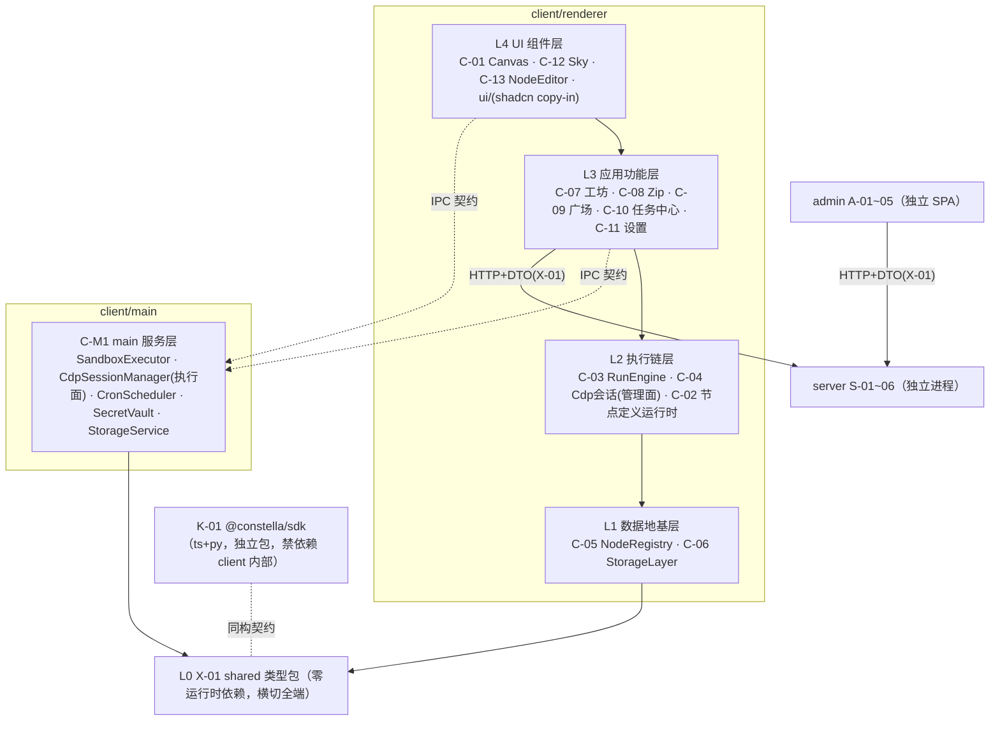

# 03 · 模块设计（模块细分与组件拆分）

| 字段 | 内容 |
|---|---|
| 编号 | docs/03-模块设计.md |
| 日期 | 2026-11-08 |
| 作者 | PM（框架）+ 各批设计工程师（卡片） |
| 状态 | **框架 v0.1 生效，卡片随批封版** |
| 依赖 | 00b §3（模块唯一注册表）、01-PRD / 02-TDD（封版锚）、spikes/*/REPORT.md（可行性证据） |
| 效力 | V1.0 卡 = B1 施工唯一模块输入；V1.1 卡 = B2；占位卡 = 边界声明（不进 M5 拆解）。卡片与 02 冲突时以 02 为准并停卡上报（00 C 章规则） |

> **用户开工令（2026-11-08）**：「架构设计模块细分文档，一定要模块化组件化，要解耦。开发计划配合模块更新。」——即本文件 §0 三条硬约束 + §6 对齐契约的来源。

---

## 0. 设计硬约束（P-1~P-3，每卡强制，评审拦截项）

- **P-1 模块化**：每模块单一职责、显式边界、独立可测。边界 = 对外接口契约（§2 卡模板第 1 节），契约之外一律视为私有。
- **P-2 组件化**：模块内部再拆组件——UI 模块拆到可复用组件（props 接口），非 UI 模块拆到可独立测试的纯函数/类单元。每卡必含「组件拆分」节。
- **P-3 解耦**：依赖**只能向下**（§1 分层图），同层禁止直接 import（经 L0 契约或上层编排）；renderer↔main 只走 02 §3.4 IPC 契约表（payload schema 定义在 TDD-X-01）；UI 层零业务规则；数据层零 UI 依赖；可替换点显式标注并收窄在单一模块内（见 §1 末表）。

**评审拦截**：任一张卡缺少「对外契约 / 依赖方向 / 组件拆分 / 替换点」四节之一 → arch-reviewer 直接打回，不进实质评审。

## 1. 分层与依赖方向总图（依 02 §3 演绎；与 02 冲突以 02 为准并上报）



**替换点登记表**（P-3：收窄在单一模块内，接口先定）：

| 替换点 | 收窄模块 | 当前实现 | 已备替换 |
|---|---|---|---|
| 存储引擎 | C-06 | better-sqlite3 | node:sqlite（S-2 对照组） |
| 画布库 | C-01 | @xyflow/react v12 | Rete v2 / 手写 SVG（02 §2.4） |
| LLM provider | C-07 / C-M1 | OpenAI 兼容自配 | baseUrl/apiKey 可换（D-4） |
| zip 库 | C-08 | jszip 3.10.2 | —（S-6 已冻结） |
| server 地址 | C-09 | 可配置端点 | 离线降级（01 §8） |
| 布局引擎 | C-01（AI 排布辅助） | @dagrejs/dagre | elkjs（如启用走 EPL-2.0 通道，S-9） |

## 2. 卡片模板（全部批次统一）

```markdown
### TDD-?-?? 模块名
| 端 | 波次 | 分层（§1） | 前置 spike | 批次 |
0. 一句话职责与边界（做什么 / 明确不做什么）
1. 对外接口契约（类型、函数签名、事件；逐条标注来源锚）
2. 依赖方向（imports ↓ 逐模块 / 被谁依赖 ↑）
3. 组件拆分（模块内组件清单：职责 · 接口 · 复用处）
4. 数据契约（DDL / 表结构 / store 形状 / 文件格式，如适用）
5. 规则编号引用（只引锚不复制正文：01 A-x / 02 §x / D-x）
6. 验收清单（可执行命令 + 预期结果，前置到 M5 任务卡）
7. demo 行号溯源（如适用，prototypes/demo.html）
8. 替换点 / 扩展点（无则显式写「无」）
```

## 3. 出卡批次与 spike gate（批次划分源自 00-PM 开工安排 2026-11-08）

| 批 | 卡 | 前置 spike | 状态 |
|---|---|---|---|
| G1 地基 | **X-01、C-05**（无前置，先行）＋ C-06（S-2）＋ C-M1（S-3/S-4/S-5） | 见左 | X-01/C-05 已出卡；wave-2 待 spike |
| G2 交互 | C-01（S-1）、C-13、C-12、C-11 | | 待 G1 |
| G3 执行链 | C-03、C-04（S-3）、C-02、C-07 | | 待 G1 |
| G4 流通链 | S-01~05（S-7 审计结论）、A-01~05（S-8）、K-01（S-5） | | 待 G1 |
| G5 V1.1 | C-19 ReportRenderer（先行）、C-18 ModelRouter | 无 M4 前置（S-11 是 B2 前置） | 可与 V1.0 并行 |
| G6 占位 | C-14/15/16、S-06、C-17 —— 只定边界不细化，不进 M5 | | 收尾批 |

评审：每批一轮 **arch-reviewer**（机械核验收清单与编号交叉引用 + §0 四节拦截）；G1 整批（4 卡齐）加一轮 **momus** 对抗评审（DDL/契约返工成本最高）。

## 4. spike 结论登记表（卡片强制吸收，M5 任务卡同步引用）

| spike | 判定 | 必须落进哪张卡 |
|---|---|---|
| S-6 jszip roundtrip | 有条件通过：内容/CRC/文件名/结构三向一致；**DOS 时间口径差异**（demo 本地墙钟 vs jszip UTC，同机 +8h） | **C-08 卡强制**：①导入侧时间换算（减本机 UTC 偏移）②`createFolders:false` 必须设在 `jszip.file()` 选项 ③读端统一 jszip（demo reader 静默跳过 deflate 条目） |
| S-8 admin 空壳 | 通过：antd 6.7.0 / React 19.3.1 / Vite 8.3.6 / react-router 7.18.5 / TS 7.0.2 | **A 系卡**：antd 按需引入（S-8 全量引入单 chunk 1.08MB）；`Statistic` 用 `styles.content` 弃 `valueStyle` |
| S-9 许可证 | 通过：无 GPL 阻断 | **K-01/C-M1 分发卡**：third-party-notices 随分发物；jszip 择 MIT 通道 |
| S-7 server 模板+compose | 通过（判据全过，服务器实测）：Prisma 7.8 迁移干净、注册/登录/刷新全通、部署契约 5/6（#6 隔离差异已注明）；**模板 npm start 原本从未跑通（ESM 双重断裂），spike 已修** | **S-01~S-05 卡强制**：①基线=仓库内 `spikes/s7-server/template/`（含 ESM 修复，禁止从上游重 clone 直用）②五项契约改造（register/login 响应补 user 对象、统一错误体 `{error:{code,message,requestId}}`+AUTH-* 码、User 补 role/isAuthor/status、RefreshToken.tokenHash 改 @unique、路由挂 /api 前缀）③版本锁 hono 4.12.15 / prisma 7.8.0（防 8.x RC 漂移）④register 竞态 catch P2002 转 409 ⑤`hono/utils/jwt/jwt` 改 `hono/jwt` |
| S-1 / S-2 / S-3 / S-4 / S-5 | 运行中 | 收口后回填本表并解锁对应卡 |

## 5. 工程落位约束（02 §3.5 摘要，卡片不得违背）

- client 不依赖 Prisma/pg；shared 只放类型与常量；shadcn 组件 copy-in 于 `client/src/renderer/ui/`；spike 工程不入主干（spikes/ 仅 REPORT.md 入库）。

## 6. 03↔05 对齐契约（「开发计划配合模块更新」的落点）

1. 05 的任务卡**按 03 模块卡组织**：每张任务卡头部标注对应模块编号，禁止出现无模块归属的任务；
2. 任务依赖引用**模块编号**（依赖图 = §1 分层图在卡粒度的展开），不自行发明依赖；
3. 任务验收命令**复用模块卡 §6 验收清单**，模块卡变更 → 受影响任务卡同步改并在 05 留痕；
4. 每卡 ≤1 AI 工作日当量、验收命令前置（00 M5 规则）；out.* 卡（V1.1）硬性前置 `TDD-C-19 + C-18 + S-11 gate`；
5. M5 范围 = V1.0 + V1.1（G6 占位卡不拆解）。

---

## G1 · 地基批（卡片区）

### TDD-X-01 shared 类型包

| 端 | 波次 | 分层（§1） | 前置 spike | 批次 |
|---|---|---|---|---|
| shared（横切 client/admin/server；K-01 同构参照） | V1.0 | L0 | 无 | G1 |

**0. 一句话职责与边界**：全仓库类型与常量的单一来源——节点定义 DSL（N1~N8）、zip manifest、HTTP API DTO、IPC payload、设置键、错误码/权限标签/内置类型清单等（02 §15.4：「节点定义 DSL / manifest / API DTO 单一来源」）。**不做**：零运行时逻辑、不放函数体与运行数据（02 §3.5「shared 只放类型与常量，不放运行时逻辑」）；不含 ctx 能力接口与 SDK 实现（K-01 域，02 §14）。包名推荐 `@constella/shared`（对齐 D-10 命名空间；⚠ 02 未冻结包名，随 G1 评审/G4 定，验收命令用目录过滤不依赖包名）。

**1. 对外接口契约（subpath exports；目录落位 `shared/`，02 §3.5）**：

```
shared/
├─ package.json     # dependencies={} 硬约束；exports 见下表
├─ tsconfig.json    # 纯类型编译（noEmit 守护）
└─ src/
   ├─ dsl/          # node-definition.ts · meta.ts · ports.ts · params.ts · exec.ts · policy.ts · io.ts · node-out.ts
   ├─ manifest/     # package-manifest.ts · flow-steps.ts
   ├─ dto/          # common.ts · auth.ts · user.ts · market.ts · admin.ts
   ├─ ipc/          # channels.ts · <域>.payload.ts（app/env/dialog/storage/secret/run/cdp/cron/zip，02 §3.4 前缀分组）
   ├─ constants/    # error-codes.ts · perms.ts · builtin-types.ts · categories.ts
   └─ settings/     # settings-keys.ts
```

| subpath | 导出（类型/常量） | 用途 | 来源锚 |
|---|---|---|---|
| `./dsl` | `NodeDefinition`（聚合根）、`NodeKind`（builtin 或 custom） | 注册表/定义运行时/编辑器/导入链共用定义形 | 02 §8.1 |
| | `NodeMeta`（N1：name/icon/category/color/description/author/source） | ✨角标判定（非内置即 ✨）、类目检索、来源标记 | 02 §8.1；01 PRD-CUSTOM-N1 |
| | `NodePorts`（N2：ins[] 与 outs:[{id,label}]） | 画布多 Handle、ins=[] 触发节点判定、路由校验 | 02 §8.1；01 A-4.01 |
| | `ParamField`/`ParamType`（N3；t 白名单：text/number/select/textarea/boolean/secret/json/slider，开放扩展）、`ParamValidate` | 参数表单 schema 驱动渲染、抽屉保存校验 | 02 §8.1/§8.3 |
| | `ExecSpec`（N4：lang∈{python,ts}/file/entry/config/deps） | 脚本资产加载、沙箱执行链、noScript 判定 | 02 §8.1/§8.4 |
| | `InnerStep`（N5：string[]） | 组合节点步骤展示与内联展开 | 02 §8.1/§8.5 |
| | `RunPolicy`/`OnFailure`（N6；failBranch.exit 具名出口、0 值语义） | TimeoutGuard/RetryPolicy/失败分支 | 02 §8.1/§8.6 |
| | `IoContract`（N7：input/output 单出与 outputs per-exit 声明兼容共存） | 抽屉 io 区、AI 规划选型、PlanValidator 校验 | 02 §8.1/§8.7（X-5） |
| | `NodeOut`（`{data}` 或 `{branch, meta}` 联合） | 脚本返回值、引擎路由、node_runs.output 形 | 02 §14 |
| `./manifest` | `PackageManifest`（scripts 映射 node→{file,lang,entry} + 导出元信息 kind/name/summary/version） | zip 四件套 manifest.json 形、perms 推导输入、server 存档原文形 | 02 §3.2 C-08 行、§6.2、§8.4；01 A-4.03 |
| | `FlowSteps`（BFS 拓扑序 steps 序列化形） | flow 发布/安装回放 | 01 A-13.2 |
| `./dto` | `ErrorBody`/`ErrorCode`（7 通用 + 8 业务字面量联合） | 三端统一错误渲染 | 02 §6.1 |
| | auth/user/market 形（RegisterReq、LoginRes、UserProfile、MarketListItem、PackageDetail、PublishAccepted 等，逐行按表） | client↔server | 02 §6.2/§6.4 |
| | admin 形（AdminUserRow、ReviewDecision、StatsOverview 等） | admin↔server | 02 §6.3 |
| | `PermLabel`（CDP/网络/文件/AI/交互/社媒） | 权限标签结果形（广场卡片/安装确认/审核） | 02 §6.2、§12.2#1 |
| `./ipc` | `IPC_CHANNELS` 常量（`constella:` 前缀，02 §3.4 全量通道名）+ 每通道 Request/Response/payload 形（如 `SpawnScriptReq`、`ScriptEvent`、`CreateSessionRes`、`StorageInvokeReq`…） | preload 白名单 API、C-M1 通道实现、renderer 调用方（03 §0 P-3：IPC payload schema 定义在本包） | 02 §3.4 |
| `./constants` | `BUILTIN_TYPE_IDS`（内置 12 type id 字面量元组） | C-02 命名空间校验（custom 不得撞内置）、C-05 种子核对 | 01 A-4.01；00b §4 |
| | `BUILTIN_CATEGORIES`（内置类型类目集合，供网格分组排序参照；N1 category 为自由文本，类型层面 string 不封闭） | 类型网格、perms 推导映射 | demo L867-938 cat 值域（参照）；02 §8.1 N1 |
| | `ERROR_CODES`（错误码常量集） | 错误渲染/断言 | 02 §6.1 |
| `./settings` | `SettingsSchema`（交互三开关 snap/edgeAnim/autoSave、11 星野开关、7 密度滑杆、AI 配置引用键——apiKey 只存 safeStorage 引用键） | C-11 设置面、C-06 settings 表 value 形状、C-12 星野通道 | 01 A-14.1/A-14.2；02 §7.1 settings 行 |

**2. 依赖方向**：
- imports ↓：**无**——零运行时依赖（§1 分层图 L0 声明）；devDependencies 仅 typescript；`dependencies` 必须为空（验收断言）。
- 被依赖 ↑：client renderer 全模块（C-01~C-13）与 preload（IPC 形）、client main C-M1（IPC payload/常量）、admin A-01~05（DTO）、server S-01~05（Zod schema 以本包类型为源型）、K-01（同构契约，§1 图虚线）。
- 三端同构引用：client/admin/server 以同一 workspace 包 import（各端 tsconfig 一致解析）；**与 K-01 的关系（⚠ 待定，G4 K-01 卡确认）**：02 §14 冻结的 `NodeCtx`/`run(ctx)`/ctx 能力实现属 K-01（py/ts 双运行时可运行包）；本卡建议纯数据形 `NodeOut` 归本包、K-01 ts 侧 import 本包，py 侧同构复制并以契约测试对齐——方向不可反转（反转即 L0 依赖外部包，违反分层）。02 未明文规定，按此建议执行并留 G4 确认。

**3. 组件拆分（类型域分组：每个 subpath = 一个组件，可独立编译、独立评审）**：

| 组件（subpath） | 职责 | 组件级接口（导出面） | 复用处 |
|---|---|---|---|
| dsl | 节点定义 DSL 类型族 | `NodeDefinition` 及 N1~N8 全部形 + `NodeOut` | C-02/C-05/C-07/C-08/C-13、K-01 |
| manifest | zip/发布资产形 | `PackageManifest`/`FlowSteps` | C-08/C-09、S-02/S-03、A-03 |
| dto | HTTP 契约形 | auth/user/market/admin 形 + `ErrorBody`/`PermLabel` | C-09、A-01~05、S-01~04 |
| ipc | 通道常量 + payload | `IPC_CHANNELS` + 全通道 payload 形 | preload、C-M1、renderer 调用方 |
| constants | 跨端常量 | `BUILTIN_TYPE_IDS`/`BUILTIN_CATEGORIES`/`ERROR_CODES` | C-02/C-05/C-08/C-09、S-02 |
| settings | 设置键形 | `SettingsSchema` | C-11、C-06、C-12 |

**4. 数据契约**：本包不持有数据，仅登记「类型 ↔ 存储」映射知识：`NodeDefinition` DSL 键（meta/ports/paramsSchema/exec/inner/policy/io/version/packageVersion，02 §8.1）↔ node_definitions 表列（meta/ports/params_schema/exec/inner/policy/io/version/pkg_version，02 §7.1 DDL 为准——§7.1 字段表按 N1~N8 描述、DDL 列名聚合，两写法映射关系在本表登记；行↔类型转换实现于 C-06 DAO）；`NodeOut` ↔ node_runs.output JSON（02 §7.1）；`PackageManifest` ↔ asset_packages.manifest 与 server PackageVersion.manifest（02 §7.1/§7.2）。

**5. 规则编号引用**：02 §3.4、§3.5、§6.1~6.4、§7.1~7.2、§8.1、§8.3~8.7、§14、§15.4；01 A-4.01、A-4.03、A-12.01、A-13.1、A-13.2、A-14.1/A-14.2；00b §3（TDD-X-01 行）、§4；D-10；03 §0 P-3、§1、§5。

**6. 验收清单（可执行，前置到 M5）**：
1. `pnpm -F ./shared exec tsc --noEmit` → exit 0；
2. 零运行时依赖断言：`node -e "const d=require('./shared/package.json').dependencies||{};process.exit(Object.keys(d).length?1:0)"` → exit 0；
3. exports↔目录一致性：`node scripts/check-shared-exports.mjs`（package.json exports 每项有对应 src 子域且导出非空）→ ok；
4. 三端 import 冒烟：client/admin/server 各建 smoke 文件 import 全部 subpath 后 `pnpm -F ./client exec tsc --noEmit && pnpm -F ./admin exec tsc --noEmit && pnpm -F ./server exec tsc --noEmit` → 0 error；
5. 常量↔锚对齐：`node scripts/check-shared-consts.mjs`——IPC 通道集合与 02 §3.4 表逐行一致、错误码与 02 §6.1 总表逐项一致、`BUILTIN_TYPE_IDS` 与 01 A-4.01 清单逐项一致 → 全 ok；
6. 类型↔02 §7/§14 对齐表逐行核对：以本卡 §1 表为核对清单（每行锚可 grep），arch-reviewer 机械评审。

**7. demo 行号溯源（参照非权威；demo `@flowforge/sdk` 写法作废，02 §14）**：L867-938（TYPES，N1/N2/N3 形态）、L941-945（zip 四件套结构）、L1035-1036（契约头）、L1051-1056（config 覆盖语义）、L2593-2595（manifest 键）、L2875-2880（pubPermsOf 六标签）。

**8. 替换点 / 扩展点**：替换点：无（L0 根，全端唯一）。扩展点：①`ParamType` 白名单开放——新参数类型随 renderer 映射注册追加（02 §8.1「扩展点=注册新 renderer 映射」；G-1 optsFrom 登记 vNext）；②per-exit `outputs` 已按 X-5 预留（02 §8.1）；③ctx 能力形（`NodeCtx` 等）归 K-01 域，G-2 回退（02 §14 ⚠）不改变本包结构。

---

### TDD-C-05 NodeRegistry

| 端 | 波次 | 分层（§1） | 前置 spike | 批次 |
|---|---|---|---|---|
| client/renderer | V1.0 | L1 数据地基层 | 无（S-2 是 C-06 前置，非本卡） | G1 |

**0. 一句话职责与边界**：节点类型**单一事实源**注册表——名称/图标/类目/出入口/参数 schema/时长估计/发布权限推导全由它驱动；启动从 node_definitions 表装载、运行时 upsert（02 §3.2 C-05 行；01 A-4.01）。**不做**：不直接碰 SQLite（经注入的 StorageLayer DAO 装载/持久化）；不做定义校验本体（C-02 validateDefinition，装载时注入调用，02 §8.2）；不执行节点（C-03）、不管节点实例（nodes 表=C-06 域）、不做种子写入（02 §13.2 归 C-06）。

**1. 对外接口契约**（类型来自 X-01；锚逐条标注）：

```ts
interface NodeRegistry {
  get(type: string): NodeDefinition | undefined;          // 02 §3.2
  register(doc: NodeDefinition): void;                     // 运行时 upsert：同名同型覆盖（02 §3.2 + 01 A-11.1）
  has(type: string): boolean;                              // 供 C-02 type 命名空间检查（02 §8.1）
  list(): readonly NodeDefinition[];                       // 全量（AI 规划选型 02 §8.7/§9.1；导入兜底）
  listByCategory(): Record<string, NodeDefinition[]>;      // 02 §3.2（类型网格/抽屉类型格）
  isBroken(type: string): boolean;                         // 02 §8.2 校验失败标记（画布 ⚠、运行闸拦截）
  isBuiltin(type: string): boolean;                        // kind 判定（✨角标、perms 推导排除内置）
  derivePerms(types: readonly string[]): PermLabel[];      // 发布权限推导（01 A-13.1；02 §12.2#1）
  estimateMs(type: string): number;                        // 时长估计驱动（02 §3.2；DUR 仅进度估计，02 §11 B-2）
  loadAll(store: NodeDefinitionStore,
           validate?: (doc: NodeDefinition) => ValidationResult): LoadReport;  // 02 §8.2 启动序
  onChange(fn: (type: string) => void): () => void;        // ⚠ 02 未定义变更通知；upsert 后类型网格/画布刷新需要（demo libAdd 后刷新语义，01 A-11.1）
}
interface NodeDefinitionStore {   // 本卡定义；C-06 实现满足（结构化兼容，无同层 import，应用装配点注入）
  loadAllDefinitions(): NodeDefinition[];   // 行↔DSL 键映射在 C-06 DAO 内实现（映射知识见 X-01 §4）；⚠ 最终签名以 G1-wave2 C-06 卡为准
  upsertDefinition(doc: NodeDefinition): void;
}
// LoadReport = { total: number; loaded: number; broken: string[] }
```

**2. 依赖方向**：
- imports ↓：X-01（`NodeDefinition`/`NodeKind`/`PermLabel`/`BUILTIN_TYPE_IDS` 等——纯类型与常量）；运行时仅依赖注入的 `NodeDefinitionStore`（C-06 实现，应用装配点注入——P-3 同层禁直接 import）。**禁止**：better-sqlite3 / node:sqlite、L2+ 模块、任何 UI 库。
- ↑ 被依赖（逐条锚）：C-01 画布取图标/名称/✨角标/按 N2 outs 动态 Handle（02 §3.2 C-01 行；demo L1377、L1382-1387）；C-02 命名空间校验（has + X-01 `BUILTIN_TYPE_IDS`）与表单渲染取 paramsSchema（02 §8.1/§8.3）；C-03 运行闸 broken 拦截、branch∈N2 outs 路由校验（02 §12.4 表、§14）；C-07 PlanValidator 端口/IO 匹配、NodeDevAgent 产物注册（02 §9.1 六查④⑤、§8.2 四路入口之一）；C-08 zip 导入 upsert、未知 type 兜底（02 §8.2；01 A-12.3）；C-09 广场安装回流（01 A-13.3；02 §8.2）；C-13 editDefinition/saveToLibrary 同名同型 upsert（02 §3.2 C-13 行；01 A-11.1）；C-10 任务表当前节点名称/图标（02 §3.2 C-10 行）。

**3. 组件拆分**：

| 组件 | 职责 | 组件级接口 | 复用处 |
|---|---|---|---|
| RegistryCore | `Map<type, NodeDefinition>` + broken 集合；upsert 语义（同名同型覆盖） | get / register / has / list / isBroken / isBuiltin | 全部消费方 |
| DefinitionLoader | 启动装载：store 载入 → validate（C-02 注入，缺省跳过）→ 失败标 broken → 批量注册 | `loadAll(store, validate) → LoadReport` | 应用启动序（02 §8.2） |
| CategoryIndex | 类目倒排索引 + 稳定排序 | `listByCategory()` | C-01 类型网格、C-13/C-04 类型选择 |
| PermDeriver | 类目→权限标签映射：CDP/网络/AI/交互/社媒同名直映、数据→文件、未命中类目不产生标签（01 A-13.1 引 demo pubPermsOf L2875-2880 同源）；kind=builtin 不计（「只选内置类型→无特殊权限」，01 A-13.1/demo L2908） | `derivePerms(types)` | C-08 发布弹窗、C-09 安装确认、S-02 复核同源 |
| EstimationTable | 内置/示例类型时长表（demo DUR L1745-1747 同源冻结）+ 未命中默认值；⚠ 数据落点=node_definitions 无时长列、N1~N8 无时长字段（02 §7.1/§8.1），V1 以模块内常量表承载，值随 M5 任务卡自 demo DUR 同源确定 | `estimateMs(type)` | C-03 进度估计、C-10 用时展示 |
| RegistryEvents | 注册表变更通知 | `onChange(fn) → 退订函数` | 类型网格/画布/节点库刷新 |

**4. 数据契约**：读写的唯一持久层 = **node_definitions 表**（02 §7.1：type PK / kind / meta / ports / params_schema / exec / inner / policy / io / version / pkg_version / updated_at；DDL 全文与索引归 C-06 卡，此处不复制）。内存形 = `NodeDefinition`（X-01 `./dsl`）；列名↔DSL 键映射实现于 C-06 DAO（映射知识登记在 X-01 §4）。**注册表不直接碰 SQLite**：装载/持久化一律经注入的 `NodeDefinitionStore`。内置 12 类定义资产随 client 分发、经种子迁移写入（02 §7.1/§13.2，种子=C-06 职责），本模块只读装载。

**5. 规则编号引用 + 类型组关系（00b §4 注册表驱动原则）**：02 §3.2（C-05 行）、§7.1、§8.1、§8.2（启动序/四路 upsert/无分支原则）、§8.6、§9.1、§12.2#1、§12.4、§14、§15.1（分包③：StorageLayer + NodeRegistry 数据地基先行）；01 A-4.01、A-4.02、A-11.01、A-12.03、A-13.1、A-13.3；00b §4；03 §0 P-1~P-3、§1。类型组三态：
- **平台内置 12**（V1.0 冻结，01 A-4.01）：kind=`builtin`，种子写入后与 custom 同一 Map、消费端零分支（02 §8.2「无分支处理」）；
- **示例资产 9**（V1.0 种子）：**非内置依赖**（01 A-4.02「随示例资产分发、可被同型自定义节点覆盖」）——kind=`custom`，经统一 upsert 入口（zip 资产包链）进入注册表，**不进内置分支、不 hardcode 于本模块**；
- **扩展 10**（out.*×5 属 V1.1 / mcp.call+ai.subagent 属 V2.0 / computer.*×3 属 V2.x，00b §4）：平台内置定位但随波次后置——本卡 V1.0 不含、**不预留代码分支**，届时以 builtin 定义 + 种子升级加入（波次 gate：TDD-C-19/C-14/C-17）。
- 一致性铁律：任一视图不得出现注册表之外的内置类型（01 A-4.01 GWT）。

**6. 验收清单（可执行）**：
1. `pnpm -F ./client exec vitest run node-registry` 全绿，用例覆盖：a) 内存 store 载入 12 定义后 `list()` 长 12、`get('logic.branch').ports.outs` 含 true/false、ins=[] 类型可判触发节点（01 A-4.01）；b) `register` 同名同型 = 覆盖 params_schema 不新增条目（01 A-11.1）；c) validate 注入失败 → `isBroken` true 且 `get` 仍返回定义（画布 ⚠ 可渲染、运行闸可拦截，02 §8.2）；d) `derivePerms`：仅内置 → 空数组；含「社媒」类目自定义类型 → ['社媒']、含「数据」类目 → ['文件']（01 A-13.1/demo L2875-2880）；e) `listByCategory` 覆盖全部已注册类目；
2. 依赖静态检查：`grep -rEl "better-sqlite3|node:sqlite" <本模块目录>` → 0 命中（不碰 SQLite）；`grep -rEl "from '.*storage|from '.*C-02" <本模块目录>` → 0 命中（不 import 同层/上层实现模块，校验经注入）；
3. 内置清单三方一致：`node scripts/check-builtin-seed.mjs`（种子 JSON type 集合 ≡ X-01 `BUILTIN_TYPE_IDS` ≡ 01 A-4.01 清单）→ ok；
4. M5 前置：本清单各项作为对应任务卡验收命令复用（§6 对齐契约）。

**7. demo 行号溯源**：L862-866（注册表=单一事实源注释，02 §8.2 为其正式化）、L867-938（TYPES：12 内置 + 9 强节点形态）、L939（TYPE_KEYS = `list()` 对应物）、L1377（✨自研角标）、L1382-1387（多出口等分渲染）、L1745-1747（DUR 表）、L2045-2051（类型网格）、L2466-2473（libAdd 同名同型 upsert 四入口）、L2875-2880 与 L2908（pubPermsOf 类目→标签映射、「无特殊权限」）。

**8. 替换点 / 扩展点**：替换点：无（注册表接口即 02 §8.2 冻结语义，Map 实现无库依赖）。扩展点：①新内置类型随波次种子加入（out.* / mcp.call / computer.*，00b §4）——零代码分支，仅种子数据升级；②paramsSchema 类型白名单扩展（C-02/X-01 域，本模块自动受益）；③PermDeriver 映射表条目随新类目波次追加（如 V2.x「电脑」类目，未命中不产生标签为默认行为）；④G-1 optsFrom（vNext，02 §8.8）属 N3 域，不落本卡。
<!-- G1-wave2：TDD-C-06（待 S-2）、TDD-C-M1（待 S-3/S-4/S-5） -->

## G2 · 交互批（待 G1）

## G3 · 执行链批（待 G1）

## G4 · 流通链批（待 G1）

## G5 · V1.1 批（可与 V1.0 并行）

## G6 · 占位批（收尾）
