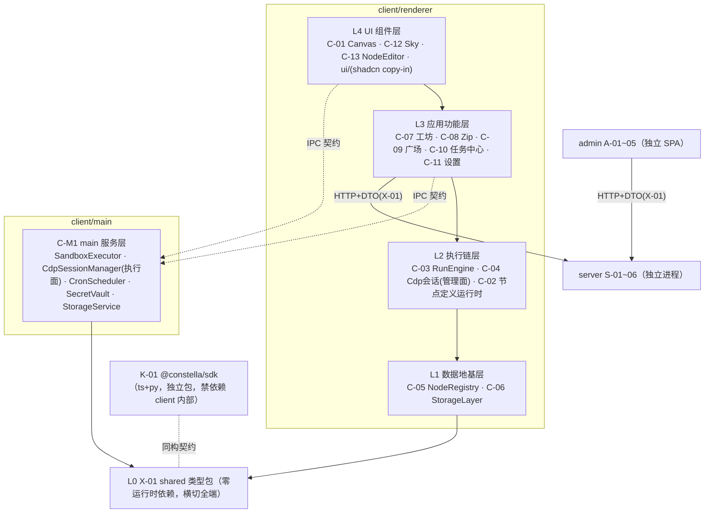
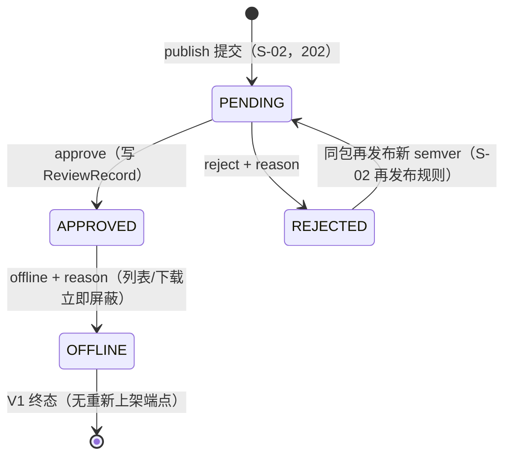

# 03 · 模块设计（模块细分与组件拆分）

| 字段 | 内容 |
|---|---|
| 编号 | docs/03-模块设计.md |
| 日期 | 2026-11-08 |
| 作者 | PM（框架）+ 各批设计工程师（卡片） |
| 状态 | **框架 v0.1 生效，卡片随批封版** |
| 依赖 | 00b §3（模块唯一注册表）、01-PRD / 02-TDD（封版锚）、spikes/*/REPORT.md（可行性证据） |
| 效力 | V1.0 卡 = B1 施工唯一模块输入；V1.1 卡 = B2；占位卡 = 边界声明（不进 M5 拆解）。卡片与 02 冲突时以 02 为准并停卡上报（00 C 章规则） |

> **用户开工令（2026-11-08）**：「架构设计模块细分文档，一定要模块化组件化，要解耦。开发计划配合模块更新。」——即本文件 §0 三条硬约束 + §6 对齐契约的来源。

---

## 0. 设计硬约束（P-1~P-3，每卡强制，评审拦截项）

- **P-1 模块化**：每模块单一职责、显式边界、独立可测。边界 = 对外接口契约（§2 卡模板第 1 节），契约之外一律视为私有。
- **P-2 组件化**：模块内部再拆组件——UI 模块拆到可复用组件（props 接口），非 UI 模块拆到可独立测试的纯函数/类单元。每卡必含「组件拆分」节。
- **P-3 解耦**：依赖**只能向下**（§1 分层图），同层禁止直接 import（经 L0 契约或上层编排）；renderer↔main 只走 02 §3.4 IPC 契约表（payload schema 定义在 TDD-X-01）；UI 层零业务规则；数据层零 UI 依赖；可替换点显式标注并收窄在单一模块内（见 §1 末表）。

**评审拦截**：任一张卡缺少「对外契约 / 依赖方向 / 组件拆分 / 替换点」四节之一 → arch-reviewer 直接打回，不进实质评审。

## 1. 分层与依赖方向总图（依 02 §3 演绎；与 02 冲突以 02 为准并上报）



**替换点登记表**（P-3：收窄在单一模块内，接口先定）：

| 替换点 | 收窄模块 | 当前实现 | 已备替换 |
|---|---|---|---|
| 存储引擎 | C-06 | better-sqlite3 | node:sqlite（S-2 对照组） |
| 画布库 | C-01 | @xyflow/react v12 | Rete v2 / 手写 SVG（02 §2.4） |
| LLM provider | C-07 / C-M1 | OpenAI 兼容自配 | baseUrl/apiKey 可换（D-4） |
| zip 库 | C-08 | jszip 3.10.2 | —（S-6 已冻结） |
| server 地址 | C-09 | 可配置端点 | 离线降级（01 §8） |
| 布局引擎 | C-01（AI 排布辅助） | @dagrejs/dagre | elkjs（如启用走 EPL-2.0 通道，S-9） |
| 对象存储后端 | S-05 StorageAdapter | 磁盘（B1 默认，02 §5.3） | S3 兼容（env 开关；02 §5.3 compose minio ⚠ B1 拍板，见 S-05 卡） |

## 2. 卡片模板（全部批次统一）

```markdown
### TDD-?-?? 模块名
| 端 | 波次 | 分层（§1） | 前置 spike | 批次 |
0. 一句话职责与边界（做什么 / 明确不做什么）
1. 对外接口契约（类型、函数签名、事件；逐条标注来源锚）
2. 依赖方向（imports ↓ 逐模块 / 被谁依赖 ↑）
3. 组件拆分（模块内组件清单：职责 · 接口 · 复用处）
4. 数据契约（DDL / 表结构 / store 形状 / 文件格式，如适用）
5. 规则编号引用（只引锚不复制正文：01 A-x / 02 §x / D-x）
6. 验收清单（可执行命令 + 预期结果，前置到 M5 任务卡）
7. demo 行号溯源（如适用，prototypes/demo.html）
8. 替换点 / 扩展点（无则显式写「无」）
```

## 3. 出卡批次与 spike gate（批次划分源自 00-PM 开工安排 2026-11-08）

| 批 | 卡 | 前置 spike | 状态 |
|---|---|---|---|
| G1 地基 | **X-01、C-05**（无前置，先行）＋ C-06（S-2）＋ C-M1（S-3/S-4/S-5） | 见左 | X-01/C-05 已出卡；wave-2 待 spike |
| G2 交互 | C-01（S-1）、C-13、C-12、C-11 | | 待 G1 |
| G3 执行链 | C-03、C-04（S-3）、C-02、C-07 | | 待 G1 |
| G4 流通链 | S-01~05（S-7 审计结论）、A-01~05（S-8）、K-01（S-5） | | 待 G1 |
| G5 V1.1 | C-19 ReportRenderer（先行）、C-18 ModelRouter | 无 M4 前置（S-11 是 B2 前置） | 可与 V1.0 并行 |
| G6 占位 | C-14/15/16、S-06、C-17 —— 只定边界不细化，不进 M5 | | 收尾批 |

评审：每批一轮 **arch-reviewer**（机械核验收清单与编号交叉引用 + §0 四节拦截）；G1 整批（4 卡齐）加一轮 **momus** 对抗评审（DDL/契约返工成本最高）。

## 4. spike 结论登记表（卡片强制吸收，M5 任务卡同步引用）

| spike | 判定 | 必须落进哪张卡 |
|---|---|---|
| S-6 jszip roundtrip | 有条件通过：内容/CRC/文件名/结构三向一致；**DOS 时间口径差异**（demo 本地墙钟 vs jszip UTC，同机 +8h） | **C-08 卡强制**：①导入侧时间换算（减本机 UTC 偏移）②`createFolders:false` 必须设在 `jszip.file()` 选项 ③读端统一 jszip（demo reader 静默跳过 deflate 条目） |
| S-8 admin 空壳 | 通过：antd 6.7.0 / React 19.3.1 / Vite 8.3.6 / react-router 7.18.5 / TS 7.0.2 | **A 系卡**：antd 按需引入（S-8 全量引入单 chunk 1.08MB）；`Statistic` 用 `styles.content` 弃 `valueStyle` |
| S-9 许可证 | 通过：无 GPL 阻断 | **K-01/C-M1 分发卡**：third-party-notices 随分发物；jszip 择 MIT 通道 |
| S-7 server 模板+compose | 通过（判据全过，服务器实测）：Prisma 7.8 迁移干净、注册/登录/刷新全通、部署契约 5/6（#6 隔离差异已注明）；**模板 npm start 原本从未跑通（ESM 双重断裂），spike 已修** | **S-01~S-05 卡强制**：①基线=仓库内 `spikes/s7-server/template/`（含 ESM 修复，禁止从上游重 clone 直用）②五项契约改造（register/login 响应补 user 对象、统一错误体 `{error:{code,message,requestId}}`+AUTH-* 码、User 补 role/isAuthor/status、RefreshToken.tokenHash 改 @unique、路由挂 /api 前缀）③版本锁 hono 4.12.15 / prisma 7.8.0（防 8.x RC 漂移）④register 竞态 catch P2002 转 409 ⑤`hono/utils/jwt/jwt` 改 `hono/jwt` |
| S-1 画布组合 | 通过（裕量大）：200 节点/500 边真实拖拽最差秒 51.9fps（判据 30）；undo/redo 100 步逐快照比对 100/100 正确、zundo 深度 101≥60 | **C-01 卡强制**：①锁版本 electron 45.2.3 / react 19.3.1 / @xyflow/react 12.12.1 / tailwind 4.3.5 / shadcn CLI 4.23.0 / zustand 5.1.0 / zundo 2.3.0 ②d3-drag 3.0.1 只吃 MouseEvent（自动化测试合成输入注意）③ESM 产物经 `protocol.handle` 自定义协议加载（免关 webSecurity）④**zundo 集成必须 partialize 剥离 measured/selected 等易变字段并自定义 equality**，否则历史栈被污染、redo 被清空 |
| S-2 / S-3 / S-4 / S-5 | 运行中（A1 批，四路并行） | 收口后回填本表并解锁 C-06/C-M1/K-01 |

## 5. 工程落位约束（02 §3.5 摘要，卡片不得违背）

- client 不依赖 Prisma/pg；shared 只放类型与常量；shadcn 组件 copy-in 于 `client/src/renderer/ui/`；spike 工程不入主干（spikes/ 仅 REPORT.md 入库）。

## 6. 03↔05 对齐契约（「开发计划配合模块更新」的落点）

1. 05 的任务卡**按 03 模块卡组织**：每张任务卡头部标注对应模块编号，禁止出现无模块归属的任务；
2. 任务依赖引用**模块编号**（依赖图 = §1 分层图在卡粒度的展开），不自行发明依赖；
3. 任务验收命令**复用模块卡 §6 验收清单**，模块卡变更 → 受影响任务卡同步改并在 05 留痕；
4. 每卡 ≤1 AI 工作日当量、验收命令前置（00 M5 规则）；out.* 卡（V1.1）硬性前置 `TDD-C-19 + C-18 + S-11 gate`；
5. M5 范围 = V1.0 + V1.1（G6 占位卡不拆解）。

---

## G1 · 地基批（卡片区）

### TDD-X-01 shared 类型包

| 端 | 波次 | 分层（§1） | 前置 spike | 批次 |
|---|---|---|---|---|
| shared（横切 client/admin/server；K-01 同构参照） | V1.0 | L0 | 无 | G1 |

**0. 一句话职责与边界**：全仓库类型与常量的单一来源——节点定义 DSL（N1~N8）、zip manifest、HTTP API DTO、IPC payload、设置键、错误码/权限标签/内置类型清单等（02 §15.4：「节点定义 DSL / manifest / API DTO 单一来源」）。**不做**：零运行时逻辑、不放函数体与运行数据（02 §3.5「shared 只放类型与常量，不放运行时逻辑」）；不含 ctx 能力接口与 SDK 实现（K-01 域，02 §14）。包名推荐 `@constella/shared`（对齐 D-10 命名空间；⚠ 02 未冻结包名，随 G1 评审/G4 定，验收命令用目录过滤不依赖包名）。

**1. 对外接口契约（subpath exports；目录落位 `shared/`，02 §3.5）**：

```
shared/
├─ package.json     # dependencies={} 硬约束；exports 见下表
├─ tsconfig.json    # 纯类型编译（noEmit 守护）
└─ src/
   ├─ dsl/          # node-definition.ts · meta.ts · ports.ts · params.ts · exec.ts · policy.ts · io.ts · node-out.ts
   ├─ manifest/     # package-manifest.ts · flow-steps.ts
   ├─ dto/          # common.ts · auth.ts · user.ts · market.ts · admin.ts
   ├─ ipc/          # channels.ts · <域>.payload.ts（app/env/dialog/storage/secret/run/cdp/cron/zip，02 §3.4 前缀分组）
   ├─ constants/    # error-codes.ts · perms.ts · builtin-types.ts · categories.ts
   └─ settings/     # settings-keys.ts
```

| subpath | 导出（类型/常量） | 用途 | 来源锚 |
|---|---|---|---|
| `./dsl` | `NodeDefinition`（聚合根）、`NodeKind`（builtin 或 custom） | 注册表/定义运行时/编辑器/导入链共用定义形 | 02 §8.1 |
| | `NodeMeta`（N1：name/icon/category/color/description/author/source） | ✨角标判定（非内置即 ✨）、类目检索、来源标记 | 02 §8.1；01 PRD-CUSTOM-N1 |
| | `NodePorts`（N2：ins[] 与 outs:[{id,label}]） | 画布多 Handle、ins=[] 触发节点判定、路由校验 | 02 §8.1；01 A-4.01 |
| | `ParamField`/`ParamType`（N3；t 白名单：text/number/select/textarea/boolean/secret/json/slider，开放扩展）、`ParamValidate` | 参数表单 schema 驱动渲染、抽屉保存校验 | 02 §8.1/§8.3 |
| | `ExecSpec`（N4：lang∈{python,ts}/file/entry/config/deps） | 脚本资产加载、沙箱执行链、noScript 判定 | 02 §8.1/§8.4 |
| | `InnerStep`（N5：string[]） | 组合节点步骤展示与内联展开 | 02 §8.1/§8.5 |
| | `RunPolicy`/`OnFailure`（N6；failBranch.exit 具名出口、0 值语义） | TimeoutGuard/RetryPolicy/失败分支 | 02 §8.1/§8.6 |
| | `IoContract`（N7：input/output 单出与 outputs per-exit 声明兼容共存） | 抽屉 io 区、AI 规划选型、PlanValidator 校验 | 02 §8.1/§8.7（X-5） |
| | `NodeOut`（`{data}` 或 `{branch, meta}` 联合） | 脚本返回值、引擎路由、node_runs.output 形 | 02 §14 |
| `./manifest` | `PackageManifest`（scripts 映射 node→{file,lang,entry} + 导出元信息 kind/name/summary/version） | zip 四件套 manifest.json 形、perms 推导输入、server 存档原文形 | 02 §3.2 C-08 行、§6.2、§8.4；01 A-4.03 |
| | `FlowSteps`（BFS 拓扑序 steps 序列化形） | flow 发布/安装回放 | 01 A-13.2 |
| `./dto` | `ErrorBody`/`ErrorCode`（7 通用 + 8 业务字面量联合） | 三端统一错误渲染 | 02 §6.1 |
| | auth/user/market 形（RegisterReq、LoginRes、UserProfile、MarketListItem、PackageDetail、PublishAccepted 等，逐行按表）；`MarketListItem.author.name` 02 未定 → 按 S-02 卡冻结=email 本地部分脱敏（⚠ 待评审） | client↔server | 02 §6.2/§6.4 |
| | admin 形（AdminUserRow、ReviewDecision、StatsOverview 等）；`StatsOverview.daily7d` 元素形 02 §6.3 未定 → 按 S-04 卡冻结=`{date:'YYYY-MM-DD',downloads:number,installs:number}`（⚠ 待评审） | admin↔server | 02 §6.3 |
| | `PermLabel`（CDP/网络/文件/AI/交互/社媒） | 权限标签结果形（广场卡片/安装确认/审核） | 02 §6.2、§12.2#1 |
| `./ipc` | `IPC_CHANNELS` 常量（`constella:` 前缀，02 §3.4 全量通道名）+ 每通道 Request/Response/payload 形（如 `SpawnScriptReq`、`ScriptEvent`、`CreateSessionRes`、`StorageInvokeReq`…） | preload 白名单 API、C-M1 通道实现、renderer 调用方（03 §0 P-3：IPC payload schema 定义在本包） | 02 §3.4 |
| `./constants` | `BUILTIN_TYPE_IDS`（内置 12 type id 字面量元组） | C-02 命名空间校验（custom 不得撞内置）、C-05 种子核对 | 01 A-4.01；00b §4 |
| | `BUILTIN_CATEGORIES`（内置类型类目集合，供网格分组排序参照；N1 category 为自由文本，类型层面 string 不封闭） | 类型网格、perms 推导映射 | demo L867-938 cat 值域（参照）；02 §8.1 N1 |
| | `ERROR_CODES`（错误码常量集） | 错误渲染/断言 | 02 §6.1 |
| `./settings` | `SettingsSchema`（交互三开关 snap/edgeAnim/autoSave、11 星野开关、7 密度滑杆、AI 配置引用键——apiKey 只存 safeStorage 引用键） | C-11 设置面、C-06 settings 表 value 形状、C-12 星野通道 | 01 A-14.1/A-14.2；02 §7.1 settings 行 |

**2. 依赖方向**：
- imports ↓：**无**——零运行时依赖（§1 分层图 L0 声明）；devDependencies 仅 typescript；`dependencies` 必须为空（验收断言）。
- 被依赖 ↑：client renderer 全模块（C-01~C-13）与 preload（IPC 形）、client main C-M1（IPC payload/常量）、admin A-01~05（DTO）、server S-01~05（Zod schema 以本包类型为源型）、K-01（同构契约，§1 图虚线）。
- 三端同构引用：client/admin/server 以同一 workspace 包 import（各端 tsconfig 一致解析）；**与 K-01 的关系（⚠ 待定，G4 K-01 卡确认）**：02 §14 冻结的 `NodeCtx`/`run(ctx)`/ctx 能力实现属 K-01（py/ts 双运行时可运行包）；本卡建议纯数据形 `NodeOut` 归本包、K-01 ts 侧 import 本包，py 侧同构复制并以契约测试对齐——方向不可反转（反转即 L0 依赖外部包，违反分层）。02 未明文规定，按此建议执行并留 G4 确认。

**3. 组件拆分（类型域分组：每个 subpath = 一个组件，可独立编译、独立评审）**：

| 组件（subpath） | 职责 | 组件级接口（导出面） | 复用处 |
|---|---|---|---|
| dsl | 节点定义 DSL 类型族 | `NodeDefinition` 及 N1~N8 全部形 + `NodeOut` | C-02/C-05/C-07/C-08/C-13、K-01 |
| manifest | zip/发布资产形 | `PackageManifest`/`FlowSteps` | C-08/C-09、S-02/S-03、A-03 |
| dto | HTTP 契约形 | auth/user/market/admin 形 + `ErrorBody`/`PermLabel` | C-09、A-01~05、S-01~04 |
| ipc | 通道常量 + payload | `IPC_CHANNELS` + 全通道 payload 形 | preload、C-M1、renderer 调用方 |
| constants | 跨端常量 | `BUILTIN_TYPE_IDS`/`BUILTIN_CATEGORIES`/`ERROR_CODES` | C-02/C-05/C-08/C-09、S-02 |
| settings | 设置键形 | `SettingsSchema` | C-11、C-06、C-12 |

**4. 数据契约**：本包不持有数据，仅登记「类型 ↔ 存储」映射知识：`NodeDefinition` DSL 键（meta/ports/paramsSchema/exec/inner/policy/io/version/packageVersion，02 §8.1）↔ node_definitions 表列（meta/ports/params_schema/exec/inner/policy/io/version/pkg_version，02 §7.1 DDL 为准——§7.1 字段表按 N1~N8 描述、DDL 列名聚合，两写法映射关系在本表登记；行↔类型转换实现于 C-06 DAO）；`NodeOut` ↔ node_runs.output JSON（02 §7.1）；`PackageManifest` ↔ asset_packages.manifest 与 server PackageVersion.manifest（02 §7.1/§7.2）。

**5. 规则编号引用**：02 §3.4、§3.5、§6.1~6.4、§7.1~7.2、§8.1、§8.3~8.7、§14、§15.4；01 A-4.01、A-4.03、A-12.01、A-13.1、A-13.2、A-14.1/A-14.2；00b §3（TDD-X-01 行）、§4；D-10；03 §0 P-3、§1、§5。

**6. 验收清单（可执行，前置到 M5）**：
1. `pnpm -F ./shared exec tsc --noEmit` → exit 0；
2. 零运行时依赖断言：`node -e "const d=require('./shared/package.json').dependencies||{};process.exit(Object.keys(d).length?1:0)"` → exit 0；
3. exports↔目录一致性：`node scripts/check-shared-exports.mjs`（package.json exports 每项有对应 src 子域且导出非空）→ ok；
4. 三端 import 冒烟：client/admin/server 各建 smoke 文件 import 全部 subpath 后 `pnpm -F ./client exec tsc --noEmit && pnpm -F ./admin exec tsc --noEmit && pnpm -F ./server exec tsc --noEmit` → 0 error；
5. 常量↔锚对齐：`node scripts/check-shared-consts.mjs`——IPC 通道集合与 02 §3.4 表逐行一致、错误码与 02 §6.1 总表逐项一致、`BUILTIN_TYPE_IDS` 与 01 A-4.01 清单逐项一致 → 全 ok；
6. 类型↔02 §7/§14 对齐表逐行核对：以本卡 §1 表为核对清单（每行锚可 grep），arch-reviewer 机械评审。

**7. demo 行号溯源（参照非权威；demo `@flowforge/sdk` 写法作废，02 §14）**：L867-938（TYPES，N1/N2/N3 形态）、L941-945（zip 四件套结构）、L1035-1036（契约头）、L1051-1056（config 覆盖语义）、L2593-2595（manifest 键）、L2875-2880（pubPermsOf 六标签）。

**8. 替换点 / 扩展点**：替换点：无（L0 根，全端唯一）。扩展点：①`ParamType` 白名单开放——新参数类型随 renderer 映射注册追加（02 §8.1「扩展点=注册新 renderer 映射」；G-1 optsFrom 登记 vNext）；②per-exit `outputs` 已按 X-5 预留（02 §8.1）；③ctx 能力形（`NodeCtx` 等）归 K-01 域，G-2 回退（02 §14 ⚠）不改变本包结构。

---

### TDD-C-05 NodeRegistry

| 端 | 波次 | 分层（§1） | 前置 spike | 批次 |
|---|---|---|---|---|
| client/renderer | V1.0 | L1 数据地基层 | 无（S-2 是 C-06 前置，非本卡） | G1 |

**0. 一句话职责与边界**：节点类型**单一事实源**注册表——名称/图标/类目/出入口/参数 schema/时长估计/发布权限推导全由它驱动；启动从 node_definitions 表装载、运行时 upsert（02 §3.2 C-05 行；01 A-4.01）。**不做**：不直接碰 SQLite（经注入的 StorageLayer DAO 装载/持久化）；不做定义校验本体（C-02 validateDefinition，装载时注入调用，02 §8.2）；不执行节点（C-03）、不管节点实例（nodes 表=C-06 域）、不做种子写入（02 §13.2 归 C-06）。

**1. 对外接口契约**（类型来自 X-01；锚逐条标注）：

```ts
interface NodeRegistry {
  get(type: string): NodeDefinition | undefined;          // 02 §3.2
  register(doc: NodeDefinition): void;                     // 运行时 upsert：同名同型覆盖（02 §3.2 + 01 A-11.1）
  has(type: string): boolean;                              // 供 C-02 type 命名空间检查（02 §8.1）
  list(): readonly NodeDefinition[];                       // 全量（AI 规划选型 02 §8.7/§9.1；导入兜底）
  listByCategory(): Record<string, NodeDefinition[]>;      // 02 §3.2（类型网格/抽屉类型格）
  isBroken(type: string): boolean;                         // 02 §8.2 校验失败标记（画布 ⚠、运行闸拦截）
  isBuiltin(type: string): boolean;                        // kind 判定（✨角标、perms 推导排除内置）
  derivePerms(types: readonly string[]): PermLabel[];      // 发布权限推导（01 A-13.1；02 §12.2#1）
  estimateMs(type: string): number;                        // 时长估计驱动（02 §3.2；DUR 仅进度估计，02 §11 B-2）
  loadAll(store: NodeDefinitionStore,
           validate?: (doc: NodeDefinition) => ValidationResult): LoadReport;  // 02 §8.2 启动序
  onChange(fn: (type: string) => void): () => void;        // ⚠ 02 未定义变更通知；upsert 后类型网格/画布刷新需要（demo libAdd 后刷新语义，01 A-11.1）
}
interface NodeDefinitionStore {   // 本卡定义；C-06 实现满足（结构化兼容，无同层 import，应用装配点注入）
  loadAllDefinitions(): NodeDefinition[];   // 行↔DSL 键映射在 C-06 DAO 内实现（映射知识见 X-01 §4）；⚠ 最终签名以 G1-wave2 C-06 卡为准
  upsertDefinition(doc: NodeDefinition): void;
}
// LoadReport = { total: number; loaded: number; broken: string[] }
```

**2. 依赖方向**：
- imports ↓：X-01（`NodeDefinition`/`NodeKind`/`PermLabel`/`BUILTIN_TYPE_IDS` 等——纯类型与常量）；运行时仅依赖注入的 `NodeDefinitionStore`（C-06 实现，应用装配点注入——P-3 同层禁直接 import）。**禁止**：better-sqlite3 / node:sqlite、L2+ 模块、任何 UI 库。
- ↑ 被依赖（逐条锚）：C-01 画布取图标/名称/✨角标/按 N2 outs 动态 Handle（02 §3.2 C-01 行；demo L1377、L1382-1387）；C-02 命名空间校验（has + X-01 `BUILTIN_TYPE_IDS`）与表单渲染取 paramsSchema（02 §8.1/§8.3）；C-03 运行闸 broken 拦截、branch∈N2 outs 路由校验（02 §12.4 表、§14）；C-07 PlanValidator 端口/IO 匹配、NodeDevAgent 产物注册（02 §9.1 六查④⑤、§8.2 四路入口之一）；C-08 zip 导入 upsert、未知 type 兜底（02 §8.2；01 A-12.3）；C-09 广场安装回流（01 A-13.3；02 §8.2）；C-13 editDefinition/saveToLibrary 同名同型 upsert（02 §3.2 C-13 行；01 A-11.1）；C-10 任务表当前节点名称/图标（02 §3.2 C-10 行）。

**3. 组件拆分**：

| 组件 | 职责 | 组件级接口 | 复用处 |
|---|---|---|---|
| RegistryCore | `Map<type, NodeDefinition>` + broken 集合；upsert 语义（同名同型覆盖） | get / register / has / list / isBroken / isBuiltin | 全部消费方 |
| DefinitionLoader | 启动装载：store 载入 → validate（C-02 注入，缺省跳过）→ 失败标 broken → 批量注册 | `loadAll(store, validate) → LoadReport` | 应用启动序（02 §8.2） |
| CategoryIndex | 类目倒排索引 + 稳定排序 | `listByCategory()` | C-01 类型网格、C-13/C-04 类型选择 |
| PermDeriver | 类目→权限标签映射：CDP/网络/AI/交互/社媒同名直映、数据→文件、未命中类目不产生标签（01 A-13.1 引 demo pubPermsOf L2875-2880 同源）；kind=builtin 不计（「只选内置类型→无特殊权限」，01 A-13.1/demo L2908） | `derivePerms(types)` | C-08 发布弹窗、C-09 安装确认、S-02 复核同源 |
| EstimationTable | 内置/示例类型时长表（demo DUR L1745-1747 同源冻结）+ 未命中默认值；⚠ 数据落点=node_definitions 无时长列、N1~N8 无时长字段（02 §7.1/§8.1），V1 以模块内常量表承载，值随 M5 任务卡自 demo DUR 同源确定 | `estimateMs(type)` | C-03 进度估计、C-10 用时展示 |
| RegistryEvents | 注册表变更通知 | `onChange(fn) → 退订函数` | 类型网格/画布/节点库刷新 |

**4. 数据契约**：读写的唯一持久层 = **node_definitions 表**（02 §7.1：type PK / kind / meta / ports / params_schema / exec / inner / policy / io / version / pkg_version / updated_at；DDL 全文与索引归 C-06 卡，此处不复制）。内存形 = `NodeDefinition`（X-01 `./dsl`）；列名↔DSL 键映射实现于 C-06 DAO（映射知识登记在 X-01 §4）。**注册表不直接碰 SQLite**：装载/持久化一律经注入的 `NodeDefinitionStore`。内置 12 类定义资产随 client 分发、经种子迁移写入（02 §7.1/§13.2，种子=C-06 职责），本模块只读装载。

**5. 规则编号引用 + 类型组关系（00b §4 注册表驱动原则）**：02 §3.2（C-05 行）、§7.1、§8.1、§8.2（启动序/四路 upsert/无分支原则）、§8.6、§9.1、§12.2#1、§12.4、§14、§15.1（分包③：StorageLayer + NodeRegistry 数据地基先行）；01 A-4.01、A-4.02、A-11.01、A-12.03、A-13.1、A-13.3；00b §4；03 §0 P-1~P-3、§1。类型组三态：
- **平台内置 12**（V1.0 冻结，01 A-4.01）：kind=`builtin`，种子写入后与 custom 同一 Map、消费端零分支（02 §8.2「无分支处理」）；
- **示例资产 9**（V1.0 种子）：**非内置依赖**（01 A-4.02「随示例资产分发、可被同型自定义节点覆盖」）——kind=`custom`，经统一 upsert 入口（zip 资产包链）进入注册表，**不进内置分支、不 hardcode 于本模块**；
- **扩展 10**（out.*×5 属 V1.1 / mcp.call+ai.subagent 属 V2.0 / computer.*×3 属 V2.x，00b §4）：平台内置定位但随波次后置——本卡 V1.0 不含、**不预留代码分支**，届时以 builtin 定义 + 种子升级加入（波次 gate：TDD-C-19/C-14/C-17）。
- 一致性铁律：任一视图不得出现注册表之外的内置类型（01 A-4.01 GWT）。

**6. 验收清单（可执行）**：
1. `pnpm -F ./client exec vitest run node-registry` 全绿，用例覆盖：a) 内存 store 载入 12 定义后 `list()` 长 12、`get('logic.branch').ports.outs` 含 true/false、ins=[] 类型可判触发节点（01 A-4.01）；b) `register` 同名同型 = 覆盖 params_schema 不新增条目（01 A-11.1）；c) validate 注入失败 → `isBroken` true 且 `get` 仍返回定义（画布 ⚠ 可渲染、运行闸可拦截，02 §8.2）；d) `derivePerms`：仅内置 → 空数组；含「社媒」类目自定义类型 → ['社媒']、含「数据」类目 → ['文件']（01 A-13.1/demo L2875-2880）；e) `listByCategory` 覆盖全部已注册类目；
2. 依赖静态检查：`grep -rEl "better-sqlite3|node:sqlite" <本模块目录>` → 0 命中（不碰 SQLite）；`grep -rEl "from '.*storage|from '.*C-02" <本模块目录>` → 0 命中（不 import 同层/上层实现模块，校验经注入）；
3. 内置清单三方一致：`node scripts/check-builtin-seed.mjs`（种子 JSON type 集合 ≡ X-01 `BUILTIN_TYPE_IDS` ≡ 01 A-4.01 清单）→ ok；
4. M5 前置：本清单各项作为对应任务卡验收命令复用（§6 对齐契约）。

**7. demo 行号溯源**：L862-866（注册表=单一事实源注释，02 §8.2 为其正式化）、L867-938（TYPES：12 内置 + 9 强节点形态）、L939（TYPE_KEYS = `list()` 对应物）、L1377（✨自研角标）、L1382-1387（多出口等分渲染）、L1745-1747（DUR 表）、L2045-2051（类型网格）、L2466-2473（libAdd 同名同型 upsert 四入口）、L2875-2880 与 L2908（pubPermsOf 类目→标签映射、「无特殊权限」）。

**8. 替换点 / 扩展点**：替换点：无（注册表接口即 02 §8.2 冻结语义，Map 实现无库依赖）。扩展点：①新内置类型随波次种子加入（out.* / mcp.call / computer.*，00b §4）——零代码分支，仅种子数据升级；②paramsSchema 类型白名单扩展（C-02/X-01 域，本模块自动受益）；③PermDeriver 映射表条目随新类目波次追加（如 V2.x「电脑」类目，未命中不产生标签为默认行为）；④G-1 optsFrom（vNext，02 §8.8）属 N3 域，不落本卡。
<!-- G1-wave2：TDD-C-06（待 S-2）、TDD-C-M1（待 S-3/S-4/S-5） -->

## G2 · 交互批（待 G1）

## G3 · 执行链批（待 G1）

## G4 · 流通链批（待 G1）

### TDD-S-01 auth 域 + server 内核（模板基线改造）

| 端 | 波次 | 分层（§1） | 前置 spike | 批次 |
|---|---|---|---|---|
| server（独立进程） | V1.0 | SRV（§1 图：client/admin 仅经 HTTP+X-01 DTO 访问） | S-7 | G4 |

**0. 一句话职责与边界**：auth 域（注册/登录/刷新/资料）+ **server 全局内核**（统一错误体/requestId/请求日志/CORS/限流注册点/healthz/部署工件）+ 模板基线改造持有者——基线=`spikes/s7-server/template/`（S-7 修复后含 ESM 修复，**禁止从上游重 clone**，03 §4 S-7 行①；正式代码迁入 `server/` workspace，spike 目录留档，03 §5）。**不做**：业务域（market=S-02 / review=S-03 / admin=S-04）、对象存储（S-05）、DTO 类型定义（X-01 为源型）、找回密码/邮箱验证/OAuth（02 §5.2 延后，D-1）。

**1. 对外接口契约**（HTTP；DTO 形以 X-01 `./dto/auth.ts`、`./dto/user.ts` 为源型——类型归 X-01、运行时 Zod schema 归本卡，不一致停卡上报）：

现状→目标改造表（S-7 审计结论全部吸收为改造任务；「现状」=template/ 实测）：

| # | 现状 | 目标 | 锚 |
|---|---|---|---|
| C1 | register/login 响应仅 `{accessToken,refreshToken}`（auth.routes.ts L63/L101） | register → 201 `{user:{id,email,role}}`（02 §6.2 字面，不含令牌对；自动登录由 client 串 /auth/login）；login → 200 `{accessToken,refreshToken,user}` | 02 §6.2；03 §4 S-7② |
| C2 | 错误体平文 `{error:"..."}`（L32/L40/L79…） | `{error:{code,message,requestId}}` + AUTH-INVALID-CREDENTIALS/AUTH-EMAIL-TAKEN/AUTH-REFRESH-INVALID/ADMIN-USER-BANNED/VALIDATION-FAILED | 02 §6.1 |
| C3 | User 仅凭证五字段（credential.prisma） | 补 `role`(USER\|ADMIN)/`isAuthor`/`status`(ACTIVE\|BANNED)——Prisma 增量迁移 | 02 §7.2 |
| C4 | `RefreshToken.tokenHash @@index`（session.prisma L11） | `@unique`（封堵并发轮换竞态） | 02 §7.2；S-7 差异④ |
| C5 | 路由裸挂 `/auth`、`/user`（routes/index.ts） | 统一挂 `/api` 前缀 | 02 §6.1；S-7 差异⑤ |
| C6 | register findUnique+create 竞态（并发裸抛 P2002） | create `catch P2002` → 409 AUTH-EMAIL-TAKEN | S-7；03 §4④ |
| C7 | `hono/utils/jwt/jwt` 内部 API 路径（auth.routes.ts L3） | 改 `hono/jwt`（middleware 已是） | S-7；03 §4⑤ |
| C8 | env.ts L46 校验 JWT_REFRESH_SECRET（refresh 非 JWT、未使用） | 删除该项 + .env.example 对应行 | S-7 剥离 |
| C9 | README/README_EN 模板自述；无 LICENSE | 删除两 README；补 LICENSE（ISC，对齐模板 package.json 声明；S-9 无 GPL 阻断） | S-7 剥离；02 §5.2 |
| C10 | hono/prisma 用 `^` 区间（package.json） | 精确锁 hono 4.12.15 / prisma 7.8.0（含 @prisma/client、@prisma/adapter-pg；防 8.x RC 漂移） | S-7 版本表；03 §4③ |
| K1 | ESM 修复（schema.prisma generator 三项 + src 相对导入补 `.js` + tsconfig include generated） | **基线一部分，保留不得回退**（模板上游 npm start 从未跑通） | S-7 关键缺陷；03 §4① |
| K2 | utils 四件（env zod/logger JSON stdout/prisma adapter 单例/process-handlers）、.env.{APP_ENV} 三环境、prettier/eslint、/healthz（spike 已加） | 保留为 S 系公共基础设施 | S-7 保留清单 |
| K3 | 无全局内核 | 新增：requestId 中间件（uuid → c.set + `X-Request-Id` 响应头 + 每请求一行日志）、全局 onError→C2 错误体、404 NOT-FOUND、CORS（env `CORS_ORIGINS` 默认 `app://`、放行 Authorization/Content-Type——client HTTP 直连，02 §3.4 注；admin 与 server 同域经反代免 CORS，部署标准 §5.3/§8 步 4）、限流注册点（设计值：auth 三接口 10 次/分/IP） | 02 §5.1 MW、§12.3 |

端点契约：

| 方法 路径 | 鉴权 | 请求→响应 | 错误码 |
|---|---|---|---|
| POST /api/auth/register | 无 | `{email,password}` → 201 `{user:{id,email,role}}` | AUTH-EMAIL-TAKEN(409)、VALIDATION-FAILED |
| POST /api/auth/login | 无 | `{email,password}` → 200 `{accessToken,refreshToken,user}`；BANNED → 401 | AUTH-INVALID-CREDENTIALS、ADMIN-USER-BANNED |
| POST /api/auth/refresh | 无 | `{refreshToken}` → 200 新对（一次性轮换；BANNED → 401） | AUTH-REFRESH-INVALID |
| GET /api/user/profile | requireActiveUser | → `{user:{id,email,role,isAuthor,createdAt}}` | UNAUTHORIZED |
| GET /healthz | 无 | `{status:"ok"}`（无鉴权无 DB 依赖） | —（部署标准 §6#3） |

内核导出（server 内公共件，目录 `src/kernel/`；server 内部分层本批五卡冻结：**域层（S-01 auth/S-02/S-03/S-04）→ 内核层（S-01 kernel）→ 基础设施层（S-05、prisma models、utils 四件）→ L0 X-01**；域间禁互 import，公共能力只经 kernel/infra 或装配点 `routes/index.ts`）：

```ts
const authMiddleware: MiddlewareHandler      // hono/jwt HS256、exp 15min（模板语义保留）
const requireActiveUser: MiddlewareHandler   // JWT sub → prisma 查 user：不存在/BANNED → 401（封禁即时生效）
function errorBody(code, message, requestId): ErrorBody     // 形=X-01 ./dto ErrorBody
function httpStatusOf(code): 400|401|403|404|409|429|500    // 02 §6.1 总表 + 业务码映射（AUTH-EMAIL-TAKEN→409 等，本卡冻结）
```

轮换并发防护（C4 落地语义）：refresh = `deleteMany({id})` 取 count（0=已被并发消费 → 401）→ 新 token `insert catch P2002` → 401；胜者全得。

**2. 依赖方向**：
- imports ↓：X-01（@constella/shared——⚠ 包名未冻结，X-01 §0；仅类型与错误码常量）；prisma models（`prisma/models/auth/`）。不依赖 S-02~S-05（kernel 被 ↓ 依赖而非反向）。
- ↑ 被依赖：C-09 / A-01（HTTP 消费 auth/user 端点；A-01 登录复用 /api/auth/login + role 判定）；S-02/S-03/S-04（↓ kernel：authMiddleware/requireActiveUser/errorBody/logger/env/prisma）。
- **禁止**：import client/admin 任何代码；S 系域模块间互 import（公共能力下沉 kernel 或经装配点注入，P-3）。

**3. 组件拆分**：

| 组件 | 职责 | 组件级接口 | 复用处 |
|---|---|---|---|
| KernelMiddleware | requestId/请求日志/CORS/404/onError/限流注册（K3） | `withKernel(app, {corsOrigins, rateRules})` | src/index.ts 装配、全域 |
| ErrorContract | 错误体构造 + 错误码→HTTP 状态映射 | `errorBody()`、`httpStatusOf()` | 全域 handler/onError |
| AuthRoutes | register/login/refresh handler（C1/C2/C6 落点） | `authRoutes: Hono` | routes/index.ts |
| AuthSchemas | Zod（email/password≥8/refresh 非空——模板语义保留，形以 X-01 为源型） | registerSchema/loginSchema/refreshSchema | AuthRoutes |
| TokenService | access 签发（15min）/refresh 生成+SHA256+一次性轮换（C4 防护） | `issueTokenPair(user)`、`rotate(token) → pair \| RefreshConflict` | AuthRoutes |
| UserRoutes | /api/user/profile | `userRoutes: Hono` | routes/index.ts |
| InfraUtils | env（C8 删项+增 CORS_ORIGINS；PORT 默认 4399→8051，部署标准 §2.3）/logger/prisma 单例/process-handlers（K2） | env/logger/prisma/registerProcessHandlers | 全域 |
| DeployArtifacts | Dockerfile/compose/entrypoint：spike 隔离版→生产版（restart unless-stopped、版本镜像标签、接 infra 网络连 `aim-pg:5432` 去自带 pg、宿主 `127.0.0.1:8051`；**B1 按部署标准 §8 十步落地，05 任务卡内联条款**） | 三工件 | B1/M5 |

**4. 数据契约**：`prisma/models/auth/credential.prisma`（User + C3 三字段）与 `session.prisma`（RefreshToken tokenHash @unique，C4）——DDL 以 02 §7.2 为准；Role/UserStatus 枚举落 auth 模型文件（多文件 schema，02 §5.3）。迁移策略：模板 init 迁移保留，C3/C4 走新增迁移（新列带默认值 expand、@unique 索引重建，不破坏既有行）。env 契约：DATABASE_URL / JWT_SECRET(≥32，Zod) / PORT / APP_ENV / CORS_ORIGINS。

**5. 规则编号引用**：02 §5.1、§5.2 auth 行、§6.1、§6.2 auth/user 行、§7.2 User/RefreshToken、§12.3、§15.4 TDD-S-01 行；01 PRD-A1-03、第 2 章权限差异、§6#6/#7；00b §2 D-1、§3；03 §0 P-1~P-3、§4 S-7 行、§5；**部署标准 §6 接入契约六条（#1 宿主 127.0.0.1:8051 / #2 env 注入密钥不进镜像 / #3 healthz / #4 stdout 日志 / #5 JWT 自管理 / #6 连接串容器名 aim-pg:5432）+ §6.1 + §2.3 + §8 十步**；spikes/s7-server/REPORT.md §三/§四。

**6. 验收清单（可执行）**：
1. `pnpm -F ./server exec vitest run auth` 全绿：a) register 201 含 `user.role='USER'` 且无 accessToken；b) 并发双 register 同邮箱 → 恰一 201 + 一 409 AUTH-EMAIL-TAKEN（C6）；c) BANNED 用户 login → 401 ADMIN-USER-BANNED；d) 并发双 refresh 同 token → 恰一 200 + 一 401（C4）；e) 错误体=`{error:{code,message,requestId}}` 且 requestId==`X-Request-Id` 头；
2. 版本锁断言：`node -e "const p=require('./server/package.json');const d={...p.dependencies,...p.devDependencies};process.exit((d.hono==='4.12.15'&&d.prisma==='7.8.0'&&d['@prisma/client']==='7.8.0'&&d['@prisma/adapter-pg']==='7.8.0')?0:1)"` → exit 0；
3. 剥离/替换静态检查：`grep -rn "JWT_REFRESH_SECRET\|hono/utils/jwt" server/src server/.env.example` → 0 命中；`test ! -e server/README.md -a ! -e server/README_EN.md -a -f server/LICENSE` → exit 0；
4. 契约冒烟（compose 开发形态）：`curl -s -w " [%{http_code}]" http://127.0.0.1:8051/healthz` → `{"status":"ok"} [200]`；`curl -s -X POST http://127.0.0.1:8051/api/auth/register -H 'content-type: application/json' -d '{"email":"t@t.io","password":"12345678"}' -w " [%{http_code}]"` → 含 `"user"` `[201]`；`curl -s -o /dev/null -w "%{http_code}" -X POST http://127.0.0.1:8051/auth/login` → 404（C5 前缀生效）；
5. 本清单前置到 M5 任务卡（§6 对齐契约）。

**7. demo 行号溯源**：无（server 无 demo 对应物；现状行号见 §1 表 C1~C9 所引 template 源）。

**8. 替换点 / 扩展点**：替换点：无（bcryptjs/hono-jwt/HS256 为 02 冻结选型）。扩展点：①找回密码/邮箱验证/OAuth（02 §5.2 延后，D-1）；②限流后端内存→共享存储（触发=多实例部署；单容器前提=部署标准 §6.1）；③CORS_ORIGINS 纯 env 驱动（域切换零代码）。

---

### TDD-S-02 market 域

| 端 | 波次 | 分层（§1） | 前置 spike | 批次 |
|---|---|---|---|---|
| server（独立进程） | V1.0 | SRV（同上） | S-7 | G4 |

**0. 一句话职责与边界**：广场服务端域——列表/搜索/详情/下载/安装计量/发布提交/我的发布（02 §6.2 market 全部端点），含发布上传处理序（安全校验→perms 推导→存储→落库）与全 server OpenAPI 文档装配。**不做**：审核流转与下架（S-03）、对象存储实现（S-05 接口注入）、admin 视角查询（S-03/S-04）、DTO 类型（X-01 源型）、zip 本地导入（C-08 client 域）。

**1. 对外接口契约**（DTO 形以 X-01 `./dto/market.ts` 为源型：MarketListItem/PackageDetail/PublishAccepted/PermLabel；错误体/码=S-01 kernel）：

| 方法 路径 | 鉴权 | 请求→响应要点 | 错误码 |
|---|---|---|---|
| GET /api/market/packages?kind=&q=&sort=&page=&pageSize= | 无（浏览匿名，D-1） | → 200 `{items:MarketListItem[],total}`；kind=node\|pack\|flow（DTO 小写↔枚举大写边界映射）、sort=latest\|downloads（updatedAt desc / downloadCount desc）、page≥1、pageSize 默认 20 上限 100（设计值）；过滤=status='APPROVED' 且 latestVersion 非空 | VALIDATION-FAILED |
| GET /api/market/packages/:id | 无 | → 200 PackageDetail：基础信息 + `versions:[{semver,createdAt,sizeBytes,checksum}]` + perms + latestVersion 指针（versions 元素形 02 未细化，本卡冻结如左） | MARKET-PACKAGE-NOT-FOUND |
| GET /api/market/packages/:id/download | requireActiveUser | → 302 Location=signedUrl（S3 模式）或流式 zip（disk 模式，能力协商见 TDD-S-05 §1）；发放前事务=DownloadStat(DOWNLOAD) + downloadCount 原子 +1 | MARKET-PACKAGE-NOT-FOUND、MARKET-PACKAGE-NOT-APPROVED（status!=APPROVED 一律 404，02 §12.4） |
| POST /api/market/packages/:id/installs | requireActiveUser | `{}` → `{ok}`；幂等键 userId+packageId+day（应用层查重，当日重复→{ok} 不计数；02 §7.2 无唯一约束，不擅改锚）+ installCount +1 | NOT-FOUND |
| POST /api/market/packages | requireActiveUser | multipart：file(zip)+meta`{kind,name≤24,summary≤40}`（限额=PRD-A13-01）→ 202 PublishAccepted`{packageId,status:'pending',perms,checksum}` | MARKET-FILE-INVALID、VALIDATION-FAILED、CONFLICT（semver 撞既有） |
| GET /api/market/mine | requireActiveUser | → `{items:[MarketListItem & {status, reviewReason?}],total}`（全状态；驳回理由可见=PRD-A13-02） | UNAUTHORIZED |

发布处理序（02 §6.4 冻结为管线，顺序不可换）：①大小/类型校验（zip、总量 ≤20MB，超限→400 MARKET-FILE-INVALID）→ ②zip 解包安全校验（同 02 §12.2#4 规则 server 侧执行：条目 ≤500、单文件解压 ≤2MB、脚本 ≤512KB、`..`/绝对路径/symlink 条目拒绝、manifest JSON Schema 校验）→ ③manifest 解析 + perms 推导（类目→标签映射与 C-05 PermDeriver 同源：CDP/网络/AI/交互/社媒直映、数据→文件、未命中不产生、builtin 不计——server 复核存 Package.perms，02 §12.2#1）→ ④`StorageAdapter.put("packages/<id>/<semver>.zip")` → ⑤Package(PENDING)+PackageVersion 落库 → ⑥202。幂等：同 owner 同 SHA-256 已存在 → 202 返回既有 packageId 不新建（02 §1.3 补交语义）。semver 规则（D-11/PRD-CUSTOM-N8）：首发必须 `1.0.0`、后续须大于既有最大版本。

⚠ 待定（02 未定义，本卡冻结、可走 00 H 章推翻）：a) **再发布规则**=同 owner+kind+name 匹配既有 Package → 复用包、新 PackageVersion、status 重置 PENDING（**复审期包从列表隐藏**——02 未定义 pending 期旧版可否下载）；b) **MarketListItem.author 形**——02 §6.4 示例有 `author.name` 而 User 无昵称字段，V1 冻结 `author={id, name:email 本地部分}`（脱敏），加 User.displayName 走 00 H 章并同步 X-01。

**2. 依赖方向**：
- imports ↓：X-01（dto/market；`./manifest` PackageManifest 为 manifest Zod 源型；constants）；S-01 kernel（requireActiveUser/errorBody/prisma/logger/限流——publish 6 次/分/用户、download 30 次/分/用户，设计值）；S-05（StorageAdapter 接口 + 装配点注入实例，业务层无感，02 §5.3）；prisma models（market：Package/PackageVersion/DownloadStat+枚举）。
- 禁止：import S-03/S-04（同层；包状态只读，迁移由 S-03 触发）；client/admin 代码。
- ↑ 被依赖：C-09 MarketClient（列表/详情/下载/安装/发布 HTTP 消费方，B-11/B-12 验收对端）；S-03（共享 prisma models 数据层，业务方法不互调）。

**3. 组件拆分**：

| 组件 | 职责 | 组件级接口 | 复用处 |
|---|---|---|---|
| market.routes.ts | 六端点路由 + multipart/查询参数解析 | `marketRoutes: Hono` | routes/index.ts |
| market.schemas.ts | Zod：ListQuery/Kind/Sort/IdParam/InstallReq/PublishMeta（zod-openapi 兼容写法=全 /api 跨域约定） | 各 schema 导出 | routes、OpenApiDoc |
| MarketQueryService | 列表（过滤/ILIKE 搜索/排序/分页）与详情聚合 | `list(q): {items,total}`、`detail(id)` | routes |
| ManifestGuard | 处理序②③：zip 安全校验 + manifest Zod（源型=X-01 ./manifest）+ semver 规则 + perms 推导 | `inspectZip(buf) → {manifest,perms,sizeBytes} \| MarketFileInvalid` | PublishPipeline |
| PublishPipeline | 处理序编排 + checksum 幂等 + 再发布匹配 + 事务落库 | `publish(userId,file,meta) → PublishAccepted` | routes |
| MeteringService | 计量事务（DownloadStat insert + 计数原子 increment）+ 安装幂等窗 | `recordDownload(pkg,userId)`、`recordInstall(pkg,userId)` | download/installs handler |
| OpenApiDoc | hono-openapi 聚合全 /api 路由（auth/admin/review schema 以 zod-openapi 兼容为约定，本组件只聚合不定义） | `GET /api/openapi.json` | routes/index.ts（02 §5.2 工程化、§6.4） |

**4. 数据契约**：`prisma/models/market/`（本卡所有）：Package/PackageVersion/DownloadStat——DDL 以 02 §7.2 为准；枚举 PackageKind/PackageStatus/StatType 落位该目录（多文件 schema）；`@@index([status,kind,updatedAt])` 支撑列表、`@@index([packageId,ts])` 支撑 S-04 七日聚合；downloadCount/installCount=反范式计数器（`update{increment:1}` 原子更新，明细行留审计）；对象键=`packages/<packageId>/<semver>.zip`（02 §5.3）。

**5. 规则编号引用**：02 §1.3（补交/幂等）、§5.1、§5.2 market/包托管行、§5.3、§6.1、§6.2、§6.4、§7.2、§12.2#1/#4、§12.4 未审核包行、§15.4 TDD-S-02 行；01 PRD-A13-01/02/03、PRD-CUSTOM-N8、§8.3、B-11/B-12、§6#7；00b §2 D-1/D-11、§6（多版本共存=V2 候选池）；03 §0、§4 S-7 行（/api 前缀/错误体/版本锁全域共用）；部署约束=TDD-S-01 §5（六条+§8 十步），本卡附加契约#2（存储凭据 env 注入）与 02 §12.3 上传限流。

**6. 验收清单（可执行）**：
1. `pnpm -F ./server exec vitest run market` 全绿：a) 匿名 list 仅含 APPROVED+latestVersion 非空，kind=node→NODE 往返映射；b) PENDING 包 download → 404 MARKET-PACKAGE-NOT-APPROVED；c) 同 user 同包同日两次 installs → installCount 恰 +1；d) 恶意 zip 三用例（条目名 `../x`、条目 >500、脚本 >512KB）→ 400 MARKET-FILE-INVALID；e) 同 checksum 重发 → 202 同 packageId 不新建；f) 首发 semver≠1.0.0 → 400；g) perms 推导：仅「数据」类目自定义节点 → ['文件']、仅内置 → []；
2. OpenAPI：`curl -s -o /dev/null -w "%{http_code}" http://127.0.0.1:8051/api/openapi.json` → 200，且 paths 含全部 6 个 market 端点（`node -e` 断言）；
3. 限流：publish 连发超设计值 → 429 RATE-LIMITED；
4. E2E 链路（B-11/B-12 基桩，跨卡复用）：账号 A 发布 → 202 pending →（TDD-S-03 §6.2 审核通过）→ 账号 B download 302/200 且 A 包 downloadCount=1 → B installs `{ok}`；
5. 错误码一致性：`node scripts/check-server-error-codes.mjs`（server 内错误码字面量 ⊆ X-01 ERROR_CODES 且 market 码全覆盖）→ ok；
6. 本清单前置到 M5 任务卡。

**7. demo 行号溯源**：L2875-2880 与 L2908（pubPermsOf 映射与「内置不计」——perms 推导 server 复核同源）；L3013-3024（8 条假数据+本地 unshift=B-12 被本域替换）；L3032-3036（广场卡片字段↔MarketListItem 逐字段）。

**8. 替换点 / 扩展点**：替换点：无（搜索用 PG 内建 ILIKE）。扩展点：①trigram/GIN 全文升级（02 §5.2「待验证」；触发=列表 q 延迟 >200ms 设计值）；②starCount 字段保留展示位——V1 无评分写入口（02 §6.2/6.3 无评分端点，PRD 星级为 demo mock），恒 0，⚠ 待定；③多版本共存/回滚（D-11，V2 候选池，00b §6）。

---

### TDD-S-03 review 域

| 端 | 波次 | 分层（§1） | 前置 spike | 批次 |
|---|---|---|---|---|
| server（独立进程） | V1.0 | SRV（同上） | S-7 | G4 |

**0. 一句话职责与边界**：审核状态机域（D-2：admin 人工审核的 server 侧）——待审队列、审核工作台包详情（含下载预检）、通过/驳回、下架；持有 PENDING→APPROVED/REJECTED→OFFLINE 状态机、并发防护与 ReviewRecord 留痕。**不做**：RBAC 鉴权本体（S-04 requireAdmin，装配点注入）、用户管理/看板（S-04）、market 读写端点（S-02）、自动安全扫描（V2 治理候选，00b §6）。

**1. 对外接口契约**（DTO 形以 X-01 `./dto/admin.ts`（ReviewDecision 等）为源型；鉴权经装配点注入，见 §2）：

状态机（02 §5.2 冻结语义的卡级展开）：



非法迁移（PENDING 外 reject、非 APPROVED offline、OFFLINE 一切出边）→ 409 REVIEW-ALREADY-DONE（包不存在 → 404 NOT-FOUND）。

| 方法 路径 | 鉴权 | 请求→响应要点 | 错误码 |
|---|---|---|---|
| GET /api/admin/reviews?status=pending&page= | requireAdmin | → `{items:[{packageId,kind,name,summary,author,perms,sizeBytes,semver,createdAt}],total}`（items 元素形 02 未细化，本卡冻结） | FORBIDDEN |
| GET /api/admin/packages/:id | requireAdmin | → 包详情 + manifest 摘要 + 脚本清单（manifest.scripts 键集）+ 计量计数 + 下载预检流（经 S-05 getStream 取原包，02 §4 审核队列「下载预检」） | NOT-FOUND |
| POST /api/admin/packages/:id/review | requireAdmin | `{action:'approve'\|'reject',reason}`（reject 时 reason 必填）→ `{status}` | REVIEW-ALREADY-DONE(409)、NOT-FOUND、VALIDATION-FAILED |
| POST /api/admin/packages/:id/offline | requireAdmin | `{reason}` → `{status:'offline'}` | NOT-FOUND |

并发防护（本卡冻结）：迁移=单条条件更新 `prisma.package.updateMany({where:{id,status:'PENDING'},data:{status}})`，affected=0 → 查当前状态 → 409；状态翻转与 ReviewRecord 写入同一事务；offline 条件 `status:'APPROVED'`（防 PENDING 包被下架绕过审核）；两管理员并发审同包恰一成功（一次性语义，与 S-01 refresh 轮换防护同模式）。

**2. 依赖方向**：
- imports ↓：X-01（dto/admin、constants）；S-01 kernel（errorBody/prisma/logger）；S-05（getStream——下载预检，装配点注入）；prisma models（review：ReviewRecord+ReviewAction 枚举=本卡所有；Package/PackageVersion 经共享数据层直读——域间禁业务互调，prisma models 位于域层之下，数据层共享合法）。
- **不 import** S-04 的 requireAdmin：装配点 `routes/index.ts` 在 `/api/admin/*` 子树统一挂 `authMiddleware → requireAdmin` 后再挂本域路由（P-3 同层协作经上层编排）。
- ↑ 被依赖：A-03 审核队列页、A-04 包详情页（HTTP）；S-02（状态迁移后列表/下载可见性变化=数据联动，非调用）。

**3. 组件拆分**：

| 组件 | 职责 | 组件级接口 | 复用处 |
|---|---|---|---|
| review.routes.ts | 四端点路由（鉴权由装配点包裹） | `reviewRoutes: Hono` | routes/index.ts |
| review.schemas.ts | Zod：QueueQuery/ReviewActionReq（action 枚举+reason 条件必填）/OfflineReq | schema 导出 | routes |
| StateMachine | 迁移表 `{PENDING:[APPROVED,REJECTED],APPROVED:[OFFLINE]}` + 非法迁移判定 | `canTransition(from,action): boolean` | ReviewService |
| ReviewService | 条件更新 + ReviewRecord 事务 + 409 判定 | `decide(pkgId,reviewerId,action,reason)`、`offline(pkgId,reviewerId,reason)` | routes |
| ReviewQueueService | 队列分页（status 过滤+owner 聚合） | `queue(status,page)` | routes |
| PackageInspection | 工作台聚合：manifest 摘要/脚本清单/计量 + 下载预检流 | `inspect(pkgId)`、`openPackageStream(pkgId)` | routes |

**4. 数据契约**：`prisma/models/review/`（本卡所有）：ReviewRecord（02 §7.2 DDL 为准：packageId/reviewerId/action(APPROVE\|REJECT\|OFFLINE)/reason?/createdAt）；每次决策恰一行（幂等由状态机条件更新保证）；OFFLINE 亦写 ReviewRecord（下架留痕）。Package.status 的迁移写权归本域唯一（S-02 只读；S-02 仅在 publish/再发布管线置 PENDING）。

**5. 规则编号引用**：02 §4（admin 页面表=端点对应面）、§5.1、§5.2 审核行、§6.3、§6.4（review 示例/409）、§7.2（ReviewRecord/Package.status）、§12.4 未审核包下载拦截行、§15.4 TDD-S-03 行；01 PRD-A13-02（审核通过前不可见/驳回理由可见）、第 2 章权限差异（审核=admin）、B-11；00b §2 D-2、§6（自动扫描=V2 候选）；03 §0 P-2/P-3、§4 S-7 行；部署约束=TDD-S-01 §5（六条+§8 十步）。

**6. 验收清单（可执行）**：
1. `pnpm -F ./server exec vitest run review` 全绿：a) PENDING approve → 200 `{status:'approved'}` + ReviewRecord 恰一行；b) 并发双 decide 同包 → 恰一 200 + 一 409 REVIEW-ALREADY-DONE；c) reject 缺 reason → 400 VALIDATION-FAILED；d) offline 非 APPROVED 包 → 409；e) offline → status='offline' + ReviewRecord(action=OFFLINE, reason)；
2. 队列冒烟：seed 一 pending 包后 `curl -s "http://127.0.0.1:8051/api/admin/reviews?status=pending" -H "Authorization: Bearer <adminToken>"` → 200 且 items 含该包；无 token → 401、USER token → 403 FORBIDDEN；
3. 状态机穷举静态断言：`node scripts/check-review-transitions.mjs`（迁移表与 §1 图一致且无其他出边）→ ok；
4. E2E：与 TDD-S-02 §6.4 同链路复用（B-11）；
5. 本清单前置到 M5 任务卡。

**7. demo 行号溯源**：无（审核为正式版新增域；demo MARKET 队列 unshift 即时可见=mock 行为，PRD-A13-02 明确替换）。

**8. 替换点 / 扩展点**：替换点：无。扩展点：①自动安全扫描（D-2 后段，V2 治理候选——扫描器作为 decide 前钩子挂 StateMachine）；②OFFLINE→重新上架端点（V2 广场治理）；③举报流（X-16 实体已移除，V2 候选池）。

---

### TDD-S-04 admin 域 + stats

| 端 | 波次 | 分层（§1） | 前置 spike | 批次 |
|---|---|---|---|---|
| server（独立进程） | V1.0 | SRV（同上） | S-7 | G4 |

**0. 一句话职责与边界**：管理域与统计域——RBAC 中间件（role=ADMIN，/api/admin 子树公共守卫）、用户管理（列表/搜索/封禁/解封）、运营看板聚合（overview+7 日趋势）。**不做**：审核操作与包管理（S-03）、market 端点（S-02）、admin 前端（A 系）、DTO 类型（X-01）。

**1. 对外接口契约**（DTO 形以 X-01 `./dto/admin.ts`（AdminUserRow/StatsOverview）为源型）：

RBAC 导出（本卡核心件，装配点注入 /api/admin/* 全子树——含 S-03 路由）：

```ts
export const requireAdmin: MiddlewareHandler
// 链在 S-01 authMiddleware 之后：JWT sub → prisma 查 {role,status}
// 不存在/BANNED → 401；role!=ADMIN → 403 FORBIDDEN；拒绝时 logger.warn('admin.rbac',{sub,path})
// role 不入 JWT payload：封禁/降权即时生效，不等 15min token 自然过期
```

| 方法 路径 | 鉴权 | 请求→响应要点 | 错误码 |
|---|---|---|---|
| GET /api/admin/users?q=&page= | requireAdmin | → `{items:AdminUserRow[],total}`（q=email ILIKE；packageCount=owner 包计数聚合） | FORBIDDEN |
| POST /api/admin/users/:id/ban | requireAdmin | `{reason}`（必填）→ `{ok}`（status→BANNED：禁登录、既有 refresh 失效——经 S-01 轮换/requireActiveUser 校验路径） | NOT-FOUND |
| POST /api/admin/users/:id/unban | requireAdmin | `{}` → `{ok}` | NOT-FOUND |
| GET /api/admin/stats/overview | requireAdmin | → `{userCount,packageCount,pendingCount,downloadTotal,installTotal,daily7d}`；`daily7d` 元素形 02 §6.3 未定，本卡冻结=`{date:'YYYY-MM-DD',downloads:number,installs:number}`（含当日共 7 桶、空日补零；聚合=DownloadStat ts 窗口 groupBy 日期×type） | FORBIDDEN |

⚠ 待定（02 未建模，本卡从简冻结、可走 00 H 章）：a) **封禁理由留痕**——02 §4 要求「理由留痕」但 §7.2 无实体/字段，V1=`logger.warn('admin.audit',{action,userId,reason,operatorId})` 结构化日志承载，实体化（BanRecord 表+admin UI）走 00 H 章；b) **首个 ADMIN 账号引导**——02 无端点/种子定义，V1=`prisma/seed.ts` 读 env ADMIN_EMAIL/ADMIN_PASSWORD 首次建号（已存在同 email 则幂等跳过），A-01 登录依赖此机制。

**2. 依赖方向**：
- imports ↓：X-01（dto/admin、constants）；S-01 kernel（authMiddleware 链前置、errorBody、prisma、logger）；prisma models（auth：User 写 status；market：Package/DownloadStat 只读聚合——数据层共享同 TDD-S-03 §2）。
- 禁止：import S-02/S-03 业务方法；admin 前端代码。
- ↑ 被依赖：A-01 登录（复用 POST /api/auth/login + 返回 user.role 判定）、A-02 用户管理、A-05 看板（HTTP）；S-03 与 A-03/A-04（requireAdmin 作为 /api/admin 子树公共守卫经装配点注入）。

**3. 组件拆分**：

| 组件 | 职责 | 组件级接口 | 复用处 |
|---|---|---|---|
| admin.routes.ts | users/stats 端点（自挂 requireAdmin） | `adminRoutes: Hono` | routes/index.ts |
| RbacMiddleware | requireAdmin（§1 签名 + 拒绝审计日志） | `requireAdmin` | 装配点（/api/admin/*：S-03+本卡） |
| admin.schemas.ts | Zod：UsersQuery/BanReq（reason 必填）/UnbanReq | schema 导出 | routes |
| UserAdminService | 搜索/分页/封禁/解封 + 审计日志（⚠ 留痕从简见 §1） | `list(q)`、`ban(id,reason,op)`、`unban(id,op)` | routes |
| StatsService | overview 五计数 + daily7d 日期桶聚合（补零） | `overview()` | routes |
| AdminSeed | 首个 ADMIN 引导（⚠ 待定机制，§1） | `seedAdmin()`（启动幂等） | 启动钩子（entrypoint 迁移后） |

**4. 数据契约**：零新增表——写=User.status（auth 模型）；读=Package/DownloadStat 聚合（02 §7.2 为准）；stats 为纯查询域无写路径；seed 机制见 §1 ⚠（env：ADMIN_EMAIL/ADMIN_PASSWORD）。

**5. 规则编号引用**：02 §4（admin 页面模块表=本域端点对应面）、§5.1（RBAC(ADMIN) MW）、§6.1（403 FORBIDDEN）、§6.3、§7.2、§15.4 TDD-S-04 行；01 第 2 章权限差异（管理员）、§6#7（D-7 最小集）；00b §2 D-7、§3；03 §0 P-3、§4 S-7 行；部署约束=TDD-S-01 §5（六条+§8 十步；契约#5 会话自管理=封禁即时生效路径）。

**6. 验收清单（可执行）**：
1. `pnpm -F ./server exec vitest run admin` 全绿：a) USER token → 403 FORBIDDEN、无 token → 401；b) ban 后目标用户 login → 401 ADMIN-USER-BANNED、既有 refresh → 401、Bearer 业务路由 → 401；c) unban → login 200；d) daily7d 恰 7 桶、当日桶计数=当日 DownloadStat 数、空日补零；e) q= 模糊命中 email；
2. 冒烟：`curl -s http://127.0.0.1:8051/api/admin/stats/overview -H "Authorization: Bearer <adminToken>"` → 200 六字段齐全；
3. RBAC 注入完整性：`grep -n "requireAdmin" server/src/routes/index.ts` ≥1，且 review/admin 两子树均在其后挂载（reviewer 核对装配序：use 先于 route）；
4. seed 幂等：连续两次启动 → admin 用户恰一；
5. 本清单前置到 M5 任务卡。

**7. demo 行号溯源**：无（admin 域无 demo 对应物）。

**8. 替换点 / 扩展点**：替换点：无。扩展点：①封禁留痕实体化（BanRecord+admin UI 展示，触发=合规审计需求，00 H 章）；②看板窗口参数化（daily7d→可配周期，V2）；③举报看板（随 X-16 V2 候选）。

---

### TDD-S-05 StorageAdapter

| 端 | 波次 | 分层（§1） | 前置 spike | 批次 |
|---|---|---|---|---|
| server（独立进程） | V1.0 | SRV（同上） | S-7 | G4 |

**0. 一句话职责与边界**：server 对象存储抽象与双实现——S3/MinIO 兼容与本地磁盘 fallback，接口先行、env 开关切换、业务层无感（02 §5.3）；持有预签名策略（02 §15.4：S3/磁盘双实现+预签名策略）。**不做**：上传校验管线（S-02 ManifestGuard，在 put 之前）、下载鉴权与计量（S-02 Metering，在 signedUrl/getStream 之外）、业务路由。

**1. 对外接口契约**（02 §5.3 接口冻结+本卡细化；server 内 infra 层公共件）：

```ts
interface StorageAdapter {
  put(key: string, body: Buffer | Readable, meta: StorageMeta): Promise<{ key: string; sizeBytes: number }>;
  signedUrl(key: string, opts?: { expiresInSec?: number }): Promise<string>;   // 仅 GET 下载
  getStream(key: string): Promise<Readable>;
  delete(key: string): Promise<void>;
}
interface StorageMeta { contentType: 'application/zip'; checksum: string }  // 落对象元数据 / 同名 .meta.json
```

预签名策略（本卡冻结）：①**只预签名 GET**（TTL 设计值 300s）；PUT/DELETE 不预签名——上传一律经 server 中转（02 §5.3「只经 server 中转读写」），client 不持对象存储凭据；②下载路径能力协商（S-02 消费）：driver=s3 → 302 signedUrl；driver=disk → `getStream` 流式 + `Content-Disposition: attachment; filename="<semver>.zip"`；③签名 URL 不承载身份——鉴权与计量在 302/流式发放**之前**由 S-02 完成（02 §12.3 下载走鉴权+计量，预签名不豁免）；④disk 实现的 `signedUrl` 抛 `StoragePresignUnsupported`（能力声明而非静默降级）。

| 实现 | 依赖 | env | 用途 |
|---|---|---|---|
| S3Storage | @aws-sdk/client-s3（版本 M5 锁——S-7 未取证 ⚠；MinIO/S3/COS/R2 同协议） | STORAGE_DRIVER=s3、S3_ENDPOINT、S3_BUCKET、S3_REGION、S3_ACCESS_KEY_ID、S3_SECRET_ACCESS_KEY | 生产（⚠ 待定：生产默认 driver 由 B1 拍板——02 §5.3 compose 含 minio，而部署标准基础设施仅登记 pg/redis） |
| DiskStorage | node:fs（零新依赖） | STORAGE_DRIVER=disk、STORAGE_DIR（默认 `server://storage/`=server 工作目录下 storage/，02 §5.3 记法） | 本地开发 fallback（对象+同名 .meta.json 同目录） |

`StorageFactory`：读 env 一次性构造单例，装配点（src/index.ts）注入 S-02/S-03——域零感知实现（P-3 收窄）。

**2. 依赖方向**：
- imports ↓：S-01 kernel（env——schema 增补存储项；logger）；X-01 无直接依赖（纯 infra，checksum 由调用方传入）。**零业务域依赖**（infra 最底层：不得 import S-02/S-03/S-04）。
- ↑ 被依赖：S-02（put/signedUrl/getStream——发布存储与下载发放）；S-03（getStream——审核下载预检，02 §5.1 图 RVW→OS）。

**3. 组件拆分**：

| 组件 | 职责 | 组件级接口 | 复用处 |
|---|---|---|---|
| storage.types.ts | 接口 + StorageMeta + 错误类型（StoragePresignUnsupported/StorageNotFound） | 类型导出 | S-02/S-03 |
| S3Storage | AWS SDK 实现（put 上传、GetObjectCommand presign、流式读、delete） | `StorageAdapter` | factory |
| DiskStorage | fs 实现 + .meta.json 同伴文件；key 拼接后 resolve 校验防穿越（key 虽由 server 生成仍防御式校验） | `StorageAdapter` | factory |
| StorageFactory | env 开关构造单例 | `getStorage(): StorageAdapter` | src/index.ts 装配点 |

**4. 数据契约**：零数据库表；对象键规范=`packages/<packageId>/<semver>.zip`（02 §5.3）；disk 目录形=`STORAGE_DIR/packages/<packageId>/<semver>.zip`（+`.meta.json`）；S3 对象元数据=checksum/contentType。

**5. 规则编号引用**：02 §5.1（OS 节点）、§5.2 包托管行、§5.3（接口/键/中转/env 开关）、§12.3（下载鉴权+计量）、§15.4 TDD-S-05 行；03 §0 P-3（可替换点显式标注并收窄单一模块）；部署约束=TDD-S-01 §5（六条+§8 十步），本卡附加契约#2（存储凭据全部 env 注入、不进镜像——部署标准 §6.4）。

**6. 验收清单（可执行）**：
1. `pnpm -F ./server exec vitest run storage` 双实现共用契约套件（同 describe 分别跑 disk 与 s3——s3 用本地 MinIO/testcontainer）：put→getStream roundtrip 字节一致；meta/.meta.json 落位；delete 后 getStream 抛 StorageNotFound；disk signedUrl 抛 StoragePresignUnsupported；穿越 key（`../x.zip`）put 被拒；
2. 切换无感：STORAGE_DRIVER=disk 与 =s3 各跑一遍 TDD-S-02 §6 发布 E2E → 均 202 且对象落对应后端；
3. 预签名时效：s3 模式 signedUrl expiresInSec=300，过期后 GET → 403（MinIO 实测）；
4. P-3 收窄静态验证：`grep -rln "@aws-sdk" server/src` ⊆ StorageAdapter 组件目录（S-02/S-03/S-04 零命中）；
5. 本清单前置到 M5 任务卡。

**7. demo 行号溯源**：无（对象存储无 demo 对应物）。

**8. 替换点 / 扩展点**：**替换点（P-3 登记）：对象存储后端**——收窄模块=TDD-S-05（server 内唯一 import @aws-sdk 处），当前实现=disk（开发默认）/S3 兼容，已备替换=MinIO 容器/Tencent COS/Cloudflare R2（同 S3 协议，仅 env 变更零代码）；03 §1 替换点登记表补行由 PM 汇编（本批编辑范围限 G4 卡片区）。扩展点：①离线包对象生命周期清理（V2 治理联动）；②预签名 PUT 直传（触发=大包上传带宽瓶颈；落地须同步前移 02 §12.2#4 校验，且破坏「只经 server 中转」需 00 H 章评审）。

<!-- G4-wave1：TDD-S-01~05 已出（2026-11-08）；A-01~05（S-8 已过）、K-01（待 S-5 收口）后续出卡 -->

## G5 · V1.1 批（可与 V1.0 并行）

## G6 · 占位批（收尾）
