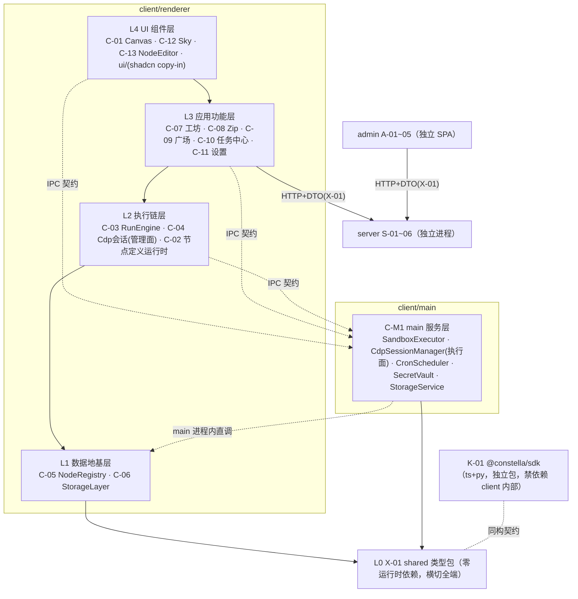
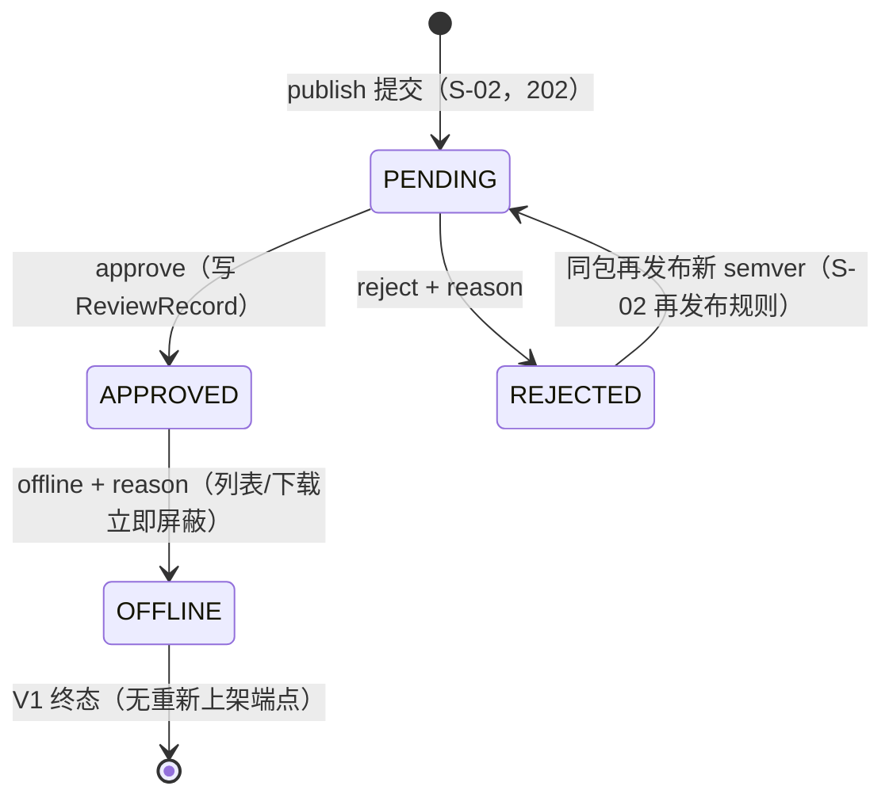

# 03 · 模块设计（模块细分与组件拆分）

| 字段 | 内容 |
|---|---|
| 编号 | docs/03-模块设计.md |
| 日期 | 2026-11-08 |
| 作者 | PM（框架）+ 各批设计工程师（卡片） |
| 状态 | **v1.0 已封版（2026-11-08，M4 完成）**——出卡 33 张全覆盖 00b §3 注册表；G1 双评审 + 收口评审通过（P0=0，P1×6/P2×13 全清）；02 随行勘误 v1.0a/v1.0b 五处；遗留登记见 §7（全部为 M5/B1 时点项） |
| 依赖 | 00b §3（模块唯一注册表）、01-PRD / 02-TDD（封版锚）、spikes/*/REPORT.md（可行性证据） |
| 效力 | V1.0 卡 = B1 施工唯一模块输入；V1.1 卡 = B2；占位卡 = 边界声明（不进 M5 拆解）。卡片与 02 冲突时以 02 为准并停卡上报（00 C 章规则） |

> **用户开工令（2026-11-08）**：「架构设计模块细分文档，一定要模块化组件化，要解耦。开发计划配合模块更新。」——即本文件 §0 三条硬约束 + §6 对齐契约的来源。

---

## 0. 设计硬约束（P-1~P-3，每卡强制，评审拦截项）

- **P-1 模块化**：每模块单一职责、显式边界、独立可测。边界 = 对外接口契约（§2 卡模板第 1 节），契约之外一律视为私有。
- **P-2 组件化**：模块内部再拆组件——UI 模块拆到可复用组件（props 接口），非 UI 模块拆到可独立测试的纯函数/类单元。每卡必含「组件拆分」节。
- **P-3 解耦**：依赖**只能向下**（§1 分层图），同层禁止直接 import（经 L0 契约或上层编排）；renderer↔main 只走 02 §3.4 IPC 契约表（payload schema 定义在 TDD-X-01）；UI 层零业务规则；数据层零 UI 依赖；可替换点显式标注并收窄在单一模块内（见 §1 末表）。
  - **纯类型 import 豁免**（收口评审 P2-3）：**接口形（interface）的跨层纯类型引用不算运行时依赖**——注入式接口的定义可自实现方/消费方以 `import type` 引用，运行时方向以应用装配点的注入为准。登记两例：`NodeDefinitionStore`（定义=C-05 §1，实现=C-06 IpcDefinitionStore）、`RouteConfigStore`（定义=C-18 §3，实现=C-06）。
  - 例外登记（M4 收口裁决 1）：**C-08 ZipPipeline 为 L3 服务位**（管线型模块），允许同层 C-07/C-09 直接 import；其自身对 C-09 的 confirm 交互采取注入不对称，登记备查。

**评审拦截**：任一张卡缺少「对外契约 / 依赖方向 / 组件拆分 / 替换点」四节之一 → arch-reviewer 直接打回，不进实质评审。

## 1. 分层与依赖方向总图（依 02 §3 演绎；与 02 冲突以 02 为准并上报）



> **物理落位注记**（逻辑分层 ≠ 进程落位）：C-06 StorageLayer 逻辑画于 renderer L1，**物理执行在 main 进程**（02 §3.1：SQLite 属 main；renderer 侧仅薄客户端+防抖编排，见 C-06 卡 §2/§3）；C-04 跨 renderer（管理面/UI）与 main（CDP 执行面，经 C-M1），边界以各卡 §2 为准。
>
> 补边注记（M4 收口 P2-1/P2-11）：L2（C-03/C-04 管理面）经 preload IPC 消费 M（通道=C-M1 §1 矩阵 run:*/cdp:*/env:cdpProbe）；M→L1 为 **main 进程内直调**（C-M1 StorageService/CdpSessionManager/zip handler 直调 C-06 main 半段 DAO——同进程调用、非 IPC），原图省略此两边，特此补全。

**替换点登记表**（P-3：收窄在单一模块内，接口先定）：

| 替换点 | 收窄模块 | 当前实现 | 已备替换 |
|---|---|---|---|
| 存储引擎 | C-06 | better-sqlite3 | node:sqlite（S-2 对照组） |
| 画布库 | C-01 | @xyflow/react v12 | Rete v2 / 手写 SVG（02 §2.4） |
| LLM provider | C-07 / C-M1 | OpenAI 兼容自配 | baseUrl/apiKey 可换（D-4） |
| zip 库 | C-08 | jszip 3.10.2 | —（S-6 已冻结） |
| server 地址 | C-09 | 可配置端点 | 离线降级（01 §8） |
| 布局引擎 | C-01（AI 排布辅助） | @dagrejs/dagre | elkjs（如启用走 EPL-2.0 通道，S-9） |
| 对象存储后端 | S-05 StorageAdapter | 磁盘（生产默认——✅ M4 C-1 部署默认裁决，⚠ 默认执行可推翻） | S3 兼容（env 开关=升级位；02 §5.3 compose minio 已备，见 S-05 卡 §1／§7.3） |

## 2. 卡片模板（全部批次统一）

```markdown
### TDD-?-?? 模块名
| 端 | 波次 | 分层（§1） | 前置 spike | 批次 |
0. 一句话职责与边界（做什么 / 明确不做什么）
1. 对外接口契约（类型、函数签名、事件；逐条标注来源锚）
2. 依赖方向（imports ↓ 逐模块 / 被谁依赖 ↑）
3. 组件拆分（模块内组件清单：职责 · 接口 · 复用处）
4. 数据契约（DDL / 表结构 / store 形状 / 文件格式，如适用）
5. 规则编号引用（只引锚不复制正文：01 A-x / 02 §x / D-x）
6. 验收清单（可执行命令 + 预期结果，前置到 M5 任务卡）
7. demo 行号溯源（如适用，prototypes/demo.html）
8. 替换点 / 扩展点（无则显式写「无」）
```

## 3. 出卡批次与 spike gate（批次划分源自 00-PM 开工安排 2026-11-08）

| 批 | 卡 | 前置 spike | 状态 |
|---|---|---|---|
| G1 地基 | **X-01、C-05**（无前置，先行）＋ C-06（S-2）＋ C-M1（S-3/S-4/S-5） | 见左 | **四卡全出（2026-11-08）→ 评审通过（P1 清零，02 v1.0a 勘误）** |
| G2 交互 | C-01（S-1）、C-13、C-12、C-11 ＋ **C-10**（原批次漏列，02 §15.1⑨ 归此批，PM 汇编修正 2026-11-08） | | **五卡全出** |
| G3 执行链 | C-03、C-04（S-3）、C-02、C-07 | | **四卡全出** |
| G4 流通链 | S-01~05（S-7 审计结论）、A-01~05（S-8）、K-01（S-5）＋ **C-08/C-09**（原批次漏列，02 §15.1⑧ 流通链 client 侧归此批，PM 汇编修正 2026-11-08） | | **十三卡全出**（S/A/K/C-08/C-09） |
| G5 V1.1 | C-19 ReportRenderer（先行）、C-18 ModelRouter | 无 M4 前置（S-11 是 B2 前置） | **两卡已出** |
| G6 占位 | C-14/15/16、S-06、C-17 —— 只定边界不细化，不进 M5 | | **五卡已出（占位）（2026-11-08）** |

评审：每批一轮 **arch-reviewer**（机械核验收清单与编号交叉引用 + §0 四节拦截）；G1 整批（4 卡齐）加一轮 **momus** 对抗评审（DDL/契约返工成本最高）。

## 4. spike 结论登记表（卡片强制吸收，M5 任务卡同步引用）

| spike | 判定 | 必须落进哪张卡 |
|---|---|---|
| S-6 jszip roundtrip | 有条件通过：内容/CRC/文件名/结构三向一致；**DOS 时间口径差异**（demo 本地墙钟 vs jszip UTC，同机 +8h） | **C-08 卡强制**：①导入侧时间换算（减本机 UTC 偏移）②`createFolders:false` 必须设在 `jszip.file()` 选项 ③读端统一 jszip（demo reader 静默跳过 deflate 条目） |
| S-8 admin 空壳 | 通过：antd 6.7.0 / React 19.3.1 / Vite 8.3.6 / react-router 7.18.5 / TS 7.0.2 | **A 系卡**：antd 按需引入（S-8 全量引入单 chunk 1.08MB）；`Statistic` 用 `styles.content` 弃 `valueStyle`；**数据层=@tanstack/react-query@5.107.1（✅ T0-02 决策冻结 2026-11-09：MIT、peer `react:"^18 \|\| ^19"` 覆盖 19.3.1、2026-11-06 发——exact pin 必须，周多版节奏）；测试栈=playwright-core@1.65.0（✅ T0-05 决策冻结 2026-11-09：Apache-2.0、msedge channel 官方文档+源码双确认、2026-11-05 发——admin/client 共用单点锁；企业 Edge 策略与系统 Edge 自升级漂移=验收注记）** |
| S-9 许可证 | 通过：无 GPL 阻断 | **K-01/C-M1 分发卡**：third-party-notices 随分发物；jszip 择 MIT 通道；**py 语法校验=@lezer/python@1.1.19（✅ T0-04 决策冻结 2026-11-09：候选 a 纯 JS parser 路径胜出——MIT 全树〔common/lr/highlight 均 MIT〕、error node 偏移定位可行〔NodeType.isError＋iterate→行号换算；message 需自合成=已知妥协〕、0.1MB 最小包体、覆盖 PEP 634/654/695；淘汰记录：skulpt 25.3MB 完整解释器过重且停更 5.5 年、filbert license 无法核清即否决、tree-sitter-python=原生 addon 不满足无原生依赖、brython=运行时非 parser；备选=web-tree-sitter@0.27.2 预编译 wasm 通道仅当 Lezer 覆盖不足时启用）** |
| S-7 server 模板+compose | 通过（判据全过，服务器实测）：Prisma 7.8 迁移干净、注册/登录/刷新全通、部署契约 5/6（#6 隔离差异已注明）；**模板 npm start 原本从未跑通（ESM 双重断裂），spike 已修** | **S-01~S-05 卡强制**：①基线=仓库内 `spikes/s7-server/template/`（含 ESM 修复，禁止从上游重 clone 直用）②五项契约改造（register/login 响应补 user 对象、统一错误体 `{error:{code,message,requestId}}`+AUTH-* 码、User 补 role/isAuthor/status、RefreshToken.tokenHash 改 @unique、路由挂 /api 前缀）③版本锁 hono 4.12.15 / prisma 7.8.0（防 8.x RC 漂移）④register 竞态 catch P2002 转 409 ⑤`hono/utils/jwt/jwt` 改 `hono/jwt`；⑥**对象存储升级位=@aws-sdk/client-s3@3.1164.0＋@aws-sdk/s3-request-presigner@3.1164.0 同版对齐（✅ T0-03 决策冻结 2026-11-09：Apache-2.0、26 包树无 copyleft 且无 NOTICE 文件、MinIO 经 endpoint+forcePathStyle 官方支持〔社区签名案例 minio#14709 注记〕、2026-11-06 发——exact pin；安装随 P2 S-05 首卡、S-03 卡唯一 import 处）** |
| S-1 画布组合 | 通过（裕量大）：200 节点/500 边真实拖拽最差秒 51.9fps（判据 30）；undo/redo 100 步逐快照比对 100/100 正确、zundo 深度 101≥60 | **C-01 卡强制**：①锁版本 electron 45.2.3 / react 19.3.1 / @xyflow/react 12.12.1 / tailwind 4.3.5 / shadcn CLI 4.23.0 / zustand 5.1.0 / zundo 2.3.0 ＋**LayoutEngine=@dagrejs/dagre@3.1.3（✅ T0-01 决策冻结 2026-11-09：MIT 全树含 graphlib@4.0.7 无 GPL；3.x 线 2026-10-24 发——接入按 3.x README 核对 API 面〔1.x→3.x 两次 major，风险注记〕；安装随 P3 C-01 首卡）** ②d3-drag 3.0.1 只吃 MouseEvent（自动化测试合成输入注意）③ESM 产物经 `protocol.handle` 自定义协议加载（免关 webSecurity）④**zundo 集成必须 partialize 剥离 measured/selected 等易变字段并自定义 equality**，否则历史栈被污染、redo 被清空 |
| S-2 sqlite 双组 | 通过（双组同判据全过）：better-sqlite3 13.0.3 N-API prebuild 内置 npm 包（8 平台单文件），Electron 45 main **零编译免 rebuild（N2 解除）**；5MiB 单事务写 ~60MB/s、读回校验 ~190MB/s；两组底层同为 SQLite 3.53.4 | **C-06 卡强制**：①锁 better-sqlite3 13.0.3（node:sqlite=可顶备胎：无事务包装 API、BLOB 走 Uint8Array）②`db.transaction()` 抛错自动回滚覆盖「保存=落盘+打版本」原子性 ③B1 脚手架注意：~~pnpm 12 的 onlyBuiltDependencies 须写 pnpm-workspace.yaml 顶层键~~（✅ B1 实测更正 2026-11-09：pnpm 12.11.2 该键不生效于 install 拦截面，持久化位=`allowBuilds` 映射——pnpm-workspace.yaml 已按实测落位，T0-08 落地留痕）；electron 45.x 无 postinstall、二进制懒下载 |
| S-5 ts 执行链 | 通过（三运行矩阵 ×6 场景零失败，esbuild 0.28.2 cjs/node24 单场景构建 9–67ms；electron-as-node 与普通 node 行为同构）；**N4 建议关闭** | **C-M1/K-01 卡强制**：①stdout JSON 行协议冻结（log/emit/终帧恰一且为末行：result=成功、error=失败）②exit code 0/1/2（成功/脚本错误含 OUT_INVALID/装配错误 ENTRY_NO_RUN 等）③ctx 经 `CONSTELLA_CTX` env 注入④宿主 spawn 必须显式 `ELECTRON_RUN_AS_NODE=1` + 退出看门狗（P1 实测：漏注时按 Electron main 语义执行且**进程不退出**）⑤接 source-map-support（sourcemap linked 已产出）⑥K-01 ts 侧原型=spikes/s5-tsrun/packages/sdk stub |
| S-3 CDP partition | 通过（19/19+4/4）：`persist:<flowId>·<laneLabel>` 命名（含 `·` 与中文）实测可用且跨进程落盘；隐藏窗口即可承载 lane 自动化；attach 仅支持协议 1.2/1.3 | **C-04 卡强制**（四坑）：①attach 后必须先导航再发命令（空窗口发 CDP 不可靠）②**destroy 全部窗口触发 window-all-closed→app.quit，此后新窗口导航一律 ERR_FAILED**——destroyRun 收尾须保 dock 主窗口存活或显式覆盖 window-all-closed ③`Network.setCookie` 不带 expires=会话 cookie 不落盘，须显式 expires ④`Page.loadEventFired` 仅在 Page.enable 后派发，导航等待需 enable+readyState 轮询兜底。工程链：electron@45 npm 包无 postinstall，二进制须手动 `node install.js`（S-1 复现命令同样需追加） |
| S-4 沙箱强杀+env | 通过（19/19 断言）：`taskkill /PID /T /F` 实测三层 python 树（含 py.exe 包装与 conhost）超时全灭；child.kill() 反面实证仅杀直接子进程——弃用 | **C-M1 卡强制**：①强杀=taskkill /T /F + **杀后复查**（/T 按 PID 快照遍历，re-parent 漏杀须 tasklist 枚举补杀）②python 经 py 启动器一次解析绝对路径后直接 spawn python.exe（避免包装层），形参 `-I -X utf8` + windowsHide + stdio pipe ③exit 观测 code=1/signal=null（勿依赖 signal 名）④env=显式白名单 5 项（SystemRoot/TEMP+TMP 指向 run 私有 tmp/PATHEXT/ComSpec）+CONSTELLA_*；PATH 需管控须显式覆盖 ⑤**Windows 平台事实：libuv 强制注入 11 个系统变量不可关闭，「仅白名单+CONSTELLA_*」按「传入 env 块」语义断言** ⑥cwd 与 TEMP/TMP 同指 run 私有目录 |
| ~~S-1~S-9 状态 | **九个 spike 全部收口（2026-11-08），M4 前置 gate 完整通过；M4 收口评审通过（2026-11-08）——33 卡全量出齐，会签/P1/P2 已清（M5 立卡前置登记见 03 §7）** | S-10/S-11/S-12 按波次时点（00b §7） |

## 5. 工程落位约束（02 §3.5 摘要，卡片不得违背）

- client 不依赖 Prisma/pg；shared 只放类型与常量；shadcn 组件 copy-in 于 `client/src/renderer/ui/`；spike 工程不入主干（spikes/ 仅 REPORT.md 入库）。

## 6. 03↔05 对齐契约（「开发计划配合模块更新」的落点）

1. 05 的任务卡**按 03 模块卡组织**：每张任务卡头部标注对应模块编号，禁止出现无模块归属的任务；
2. 任务依赖引用**模块编号**（依赖图 = §1 分层图在卡粒度的展开），不自行发明依赖；
3. 任务验收命令**复用模块卡 §6 验收清单**，模块卡变更 → 受影响任务卡同步改并在 05 留痕；
4. 每卡 ≤1 AI 工作日当量、验收命令前置（00 M5 规则）；out.* 卡（V1.1）硬性前置 `TDD-C-19 + C-18 + S-11 gate`；
5. M5 范围 = V1.0 + V1.1（G6 占位卡不拆解）。

## 7. M5 立卡前置登记（M4 收口汇编，2026-11-08）

> 本节=M4 收口评审（2026-11-08）产出、M5 立卡前必须消化的登记项：7.1 版本决策进 M5 首批依赖决策卡；7.2 会签项按标注时点收口；7.3 ⚠ 默认项可经用户拍板/B1 部署卡推翻；7.4 观察项登记备查。本节不改变任何卡片已冻结接口。

### 7.1 五项版本决策（M5 依赖决策卡输入）

| # | 决策项 | 现状锚 | 时点 |
|---|---|---|---|
| 1 | @dagrejs/dagre 版本 | ✅ 已冻结（T0-01，2026-11-09）＝3.1.3——C-01 §8②/03 §4 S-1 行已回填 | 已收口 |
| 2 | TanStack Query 版本 | ✅ 已冻结（T0-02，2026-11-09）＝5.107.1——A-01 §1/03 §4 S-8 行已回填 | 已收口 |
| 3 | @aws-sdk/client-s3 版本 | ✅ 已冻结（T0-03，2026-11-09）＝3.1164.0（+presigner 同版）——S-05 §1/03 §4 S-7 行已回填 | 已收口 |
| 4 | py 语法 parser 选型 | ✅ 已冻结（T0-04 决策卡，2026-11-09）＝@lezer/python@1.1.19（纯 JS parser 路径 a 胜出；MIT 全树；S-9 复验过）——C-13 §8①/03 §4 S-9 行已回填 | 已收口 |
| 5 | playwright-core 版本 | ✅ 已冻结（T0-05，2026-11-09）＝1.65.0——A-01 §6.4/03 §4 S-8 行已回填 | 已收口 |

### 7.2 两项 B1 前会签

| # | 会签项 | 涉卡 | 状态 |
|---|---|---|---|
| 1 | 能力桥 **net 代理形态**（ws 桥复用 CdpBridge vs 独立端口） | K-01 §2 ↔ C-M1 §8② | ✅ **已收口（T0-06 会签，2026-11-09）**＝独立 NetProxyBridge 端点（run/node 作用域、net 端口段 9321–9420、env 新增 `CONSTELLA_NET_WS`——02 v1.0c 勘误；白名单按节点 N1 解析故不 ride lane 桥）；browser 绑定=CDP_WS 直连 lane 桥（不采 stdio RPC）；细目=C-M1 §3 CdpBridge/NetProxyBridge 行＋K-01 §2 |
| 2 | **cdp 命令传输 payload 细目**（ws 帧协议形/错误映射） | C-04 §1（传输径已冻结=方案 A）↔ C-M1 §3 CdpBridge ↔ X-01 | ✅ **已收口（T0-07 会签，2026-11-09）**＝统一文本帧 `{id,ns,method,params}`→`{id,ok,result\|error}`；ns·method 双白名单（cdp 9 method）；帧错误码集 BRIDGE-\*/CDP-\*/NET-DENIED；类型落 X-01 `./ipc` bridge.ts（K-01 同构复制）；细目=C-M1 §3 CdpBridge 行 |

### 7.3 C-1 两项 ⚠ 部署默认（默认执行，用户未拍板可推翻）

| # | 默认项 | 落卡 | 推翻路径 |
|---|---|---|---|
| 1 | server 生产默认 `STORAGE_DRIVER=disk`（env 开关留 S3/minio 升级位） | S-05 §1（⚠ 标注）；03 §1 替换点表 | 用户拍板 S3/minio → B1 部署卡改 env＋起 minio 容器（02 §5.3 compose 已备），业务层零改 |
| 2 | `market.baseUrl` 默认**空＋首次使用引导** | C-09 §1／X-01 §1 settings（⚠ 标注） | B1 部署卡可把构建期默认改指 `constella.aim8848.com`（用户 DNS 已配）；或用户设置页自填 |

### 7.4 momus 两观察（对抗评审遗留，登记备查）

1. **admin/server 最小 tsconfig**：两 workspace 的 tsconfig 宜按「最小编译上下文」收窄（include/paths 防误引跨端代码）——落 M5 脚手架任务卡核对；
2. **C-06 种子先于 C-05 校验**：种子写入不经 C-02 validateDefinition（校验在 renderer loadAll 启动序，02 §8.2）——种子数据质量由 C-06 §6.1d 断言＋三方一致脚本（check-builtin-seed）守护，已知且接受；坏种子行由 broken 标记路径兜底（画布 ⚠＋运行闸拦截）。

### 7.5 部署标准登记（收口评审 P2-2）

部署标准 **V1.5＝定稿施工输入**（B1 施工与 S/A 系卡引用的 §2.3/§5.3/§6/§6.1/§8 十步条款以其为准）；文档**仓库外维护**（路径不在本仓库，PM 工作文档索引），03 各卡仅按条款号引用、不复制正文。

---

## G1 · 地基批（卡片区）

### TDD-X-01 shared 类型包

| 端 | 波次 | 分层（§1） | 前置 spike | 批次 |
|---|---|---|---|---|
| shared（横切 client/admin/server；K-01 同构参照） | V1.0 | L0 | 无 | G1 |

**0. 一句话职责与边界**：全仓库类型与常量的单一来源——节点定义 DSL（N1~N8）、zip manifest、HTTP API DTO、IPC payload、设置键、错误码/权限标签/内置类型清单等（02 §15.4：「节点定义 DSL / manifest / API DTO 单一来源」）。**不做**：零运行时逻辑、不放函数体与运行数据（02 §3.5「shared 只放类型与常量，不放运行时逻辑」）；不含 ctx 能力接口与 SDK 实现（K-01 域，02 §14）。包名＝**`@constella/shared`**（对齐 D-10 命名空间；✅ **M4 收口定名（#8①）**，02 侧引用随包名；验收命令仍用目录过滤以独立于包名）。

**1. 对外接口契约（subpath exports；目录落位 `shared/`，02 §3.5）**：

```
shared/
├─ package.json     # dependencies={} 硬约束；exports 见下表
├─ tsconfig.json    # 纯类型编译（noEmit 守护）
└─ src/
   ├─ dsl/          # node-definition.ts · meta.ts · ports.ts · params.ts · exec.ts · policy.ts · io.ts · node-out.ts
   ├─ manifest/     # package-manifest.ts · flow-steps.ts
   ├─ dto/          # common.ts · auth.ts · user.ts · market.ts · admin.ts
   ├─ ipc/          # channels.ts · <域>.payload.ts（app/env/dialog/storage/secret/run/cdp/cron/zip，02 §3.4 前缀分组）· bridge.ts（CapabilityBridge ws 帧协议——T0-07 会签）
   ├─ constants/    # error-codes.ts · perms.ts · builtin-types.ts · categories.ts
   └─ settings/     # settings-keys.ts
```

| subpath | 导出（类型/常量） | 用途 | 来源锚 |
|---|---|---|---|
| `./dsl` | `NodeDefinition`（聚合根）、`NodeKind`（builtin 或 custom） | 注册表/定义运行时/编辑器/导入链共用定义形 | 02 §8.1 |
| | `NodeMeta`（N1：name/icon/category/color/description/author/source） | ✨角标判定（非内置即 ✨）、类目检索、来源标记 | 02 §8.1；01 PRD-CUSTOM-N1 |
| | `NodePorts`（N2：ins[] 与 outs:[{id,label}]） | 画布多 Handle、ins=[] 触发节点判定、路由校验 | 02 §8.1；01 A-4.01 |
| | `ParamField`/`ParamType`（N3；t 白名单：text/number/select/textarea/boolean/secret/json/slider，开放扩展）、`ParamValidate` | 参数表单 schema 驱动渲染、抽屉保存校验 | 02 §8.1/§8.3 |
| | `ExecSpec`（N4：lang∈{python,ts}/file/entry/config/deps） | 脚本资产加载、沙箱执行链、noScript 判定 | 02 §8.1/§8.4 |
| | `InnerStep`（N5：string[]） | 组合节点步骤展示与内联展开 | 02 §8.1/§8.5 |
| | `RunPolicy`/`OnFailure`（N6；failBranch.exit 具名出口、0 值语义） | TimeoutGuard/RetryPolicy/失败分支 | 02 §8.1/§8.6 |
| | `IoContract`（N7：input/output 单出与 outputs per-exit 声明兼容共存） | 抽屉 io 区、AI 规划选型、PlanValidator 校验 | 02 §8.1/§8.7（X-5） |
| | `NodeOut`（`{data}` 或 `{branch, meta}` 联合） | 脚本返回值、引擎路由、node_runs.output 形 | 02 §14 |
| `./manifest` | `PackageManifest`（scripts 映射 node→{file,lang,entry} + 导出元信息 kind/name/summary/version） | zip 四件套 manifest.json 形、perms 推导输入、server 存档原文形 | 02 §3.2 C-08 行、§6.2、§8.4；01 A-4.03 |
| | `FlowSteps`（BFS 拓扑序 steps 序列化形） | flow 发布/安装回放 | 01 A-13.2 |
| `./dto` | `ErrorBody`/`ErrorCode`（7 通用 + 8 业务字面量联合） | 三端统一错误渲染 | 02 §6.1 |
| | auth/user/market 形（RegisterReq、LoginRes、UserProfile、MarketListItem、PackageDetail、PublishAccepted 等，逐行按表）；`MarketListItem.author` ✅ 已登记（M4 #8③）＝`{id, name:email 本地部分}`（脱敏；S-02 §1 冻结识） | client↔server | 02 §6.2/§6.4 |
| | admin 形（AdminUserRow、ReviewDecision、StatsOverview 等）；`StatsOverview.daily7d` 元素形 ✅ 已登记（M4 #8④）＝`{date:'YYYY-MM-DD',downloads:number,installs:number}`（S-04 §1 冻结识；空日补零=server 职责） | admin↔server | 02 §6.3 |
| | `PermLabel`（CDP/网络/文件/AI/交互/社媒） | 权限标签结果形（广场卡片/安装确认/审核） | 02 §6.2、§12.2#1 |
| | `ReviewQueueItem` ✅ 已登记（M4 #8②）＝`{packageId,kind,name,summary,author,perms,sizeBytes,semver,createdAt}`（S-03 §1 冻结形）；`AdminPackageDetail`（含 `versions:[{semver,createdAt,sizeBytes,checksum}]` 元素形——与 S-02 §1 detail versions 同形；下载预检端点已拆分 `GET /api/admin/packages/:id/download`，✅ M4 #9，S-03 §1） | admin↔server | 02 §6.3 + 03 G4 区 S-03/A-04 卡 |
| `./ipc` | `IPC_CHANNELS` 常量（`constella:` 前缀，02 §3.4 全量通道名）+ 每通道 Request/Response/payload 形（如 `SpawnScriptReq`、`ScriptEvent`、`CreateSessionRes`、`StorageInvokeReq`…）。**M4 收口增补（#8⑦⑧⑨／P2-10／裁决 5／#7）**：①`IpcError`（`{code,message}`）＋IPC 错误码常量集（以 C-M1 §1 矩阵为准：SHELL-INVALID-URL / IPC-UNKNOWN-OP / SECRET-UNAVAILABLE / RUN-SCRIPT-NOT-FOUND / RUN-ENV-MISSING / RUN-INVALID-LANG / CDP-PORT-EXHAUSTED / CDP-ATTACH-FAILED / CDP-SESSION-NOT-FOUND / CDP-NAV-FAILED / CRON-INVALID-EXPR / ZIP-WRITE-FAILED / ZIP-FLOW-NOT-FOUND / ZIP-INVALID / ZIP-UNSAFE-ENTRY）；②`StorageInvokeReq` op 联合细型＝**9 域 31 op**（C-06 §1 表冻结：02 §3.4 原生 8 域 28 op＋C-06 补 publish 域 3 op）；③zip 域 payload＝zip:import 两段式（`{path,phase:'inspect'}`→ImportSummary／`{path,phase:'commit',token}`→`{nodes[],noScript[]}`）＋zip:export 打包变体 `{types[],savePath,meta}`（C-08 §1 冻结；✅ 02 v1.0b 已勘误同步）；④`FlowDoc` 载荷形（nodes/edges 序列化子集＝02 §3.3＋C-01 §4 语义字段——**落位 ./ipc storage 域**〔flows.save args〕，P2-10）；⑤`run:spawnScript` 增可选 `scene` 字段（V1.1——PM 裁决 5 场景注入径，C-18 §1③）；⑥`env:systemInfo` payload 附 **lanes 内存数组**（按 lane 会话窗口聚合——单 lane ≤150MB 预算告警数据源，M4 #7；01 §12）；⑦`run:spawnScript` req 增可选 `laneKey`（✅ T0-06 会签：browser 绑定解析——lane 会话存在→注入 CDP_WS，additive 可选字段）；⑧`bridge.ts`＝CapabilityBridge ws 帧协议形（✅ T0-07 会签冻结：帧形/id 关联/ns·method 白名单/帧错误码集 BRIDGE-\*/CDP-\*/NET-DENIED——细目锚 C-M1 §3 CdpBridge 行；renderer C-03 CommandTransport 消费面；**K-01 ts/py 同构复制本形、不 import 本域**——K-01 §2 红线不变，一致性入 §6.5 对齐脚本覆盖面） | preload 白名单 API、C-M1 通道实现、renderer 调用方（03 §0 P-3：IPC payload schema 定义在本包） | 02 §3.4 |
| `./constants` | `BUILTIN_TYPE_IDS`（内置 12 type id 字面量元组；**V1.1 增补＝out.\* 五类型 12→17，随 B2 生效**——✅ M4 #8⑩〔C-19 §5 会签〕，§6.5 一致性断言随 B2 升版） | C-02 命名空间校验（custom 不得撞内置）、C-05 种子核对 | 01 A-4.01；00b §4 |
| | `BUILTIN_CATEGORIES`（内置类型类目集合，供网格分组排序参照；N1 category 为自由文本，类型层面 string 不封闭） | 类型网格、perms 推导映射 | demo L867-938 cat 值域（参照）；02 §8.1 N1 |
| | `ERROR_CODES`（错误码常量集，02 §6.1）；＋**storage DAO 业务错误码枚举**（落位＝本包 constants——P2-13 择一落位：renderer 错误渲染需常量，C-M1 §1「DAO 业务码透传」的落点；初集＝FLOW-NOT-FOUND / VERSION-NOT-FOUND / RUN-NOT-FOUND / HIT-NOT-FOUND / ACTIVE-RUN-EXISTS 等，全集随 M5 C-06 任务卡冻结；语义源=C-06 §1 op 表） | 错误渲染/断言 | 02 §6.1 |
| `./settings` | `SettingsSchema`（交互三开关 snap/edgeAnim/autoSave、11 星野开关、7 密度滑杆、AI 配置引用键——apiKey 只存 safeStorage 引用键）＋**M4 收口增补**：`market.baseUrl`（默认**空＋首次使用引导**——✅ C-1 部署默认裁决，⚠ 默认执行可推翻：B1 部署卡可把构建期默认改指 constella.aim8848.com〔用户 DNS 已配〕，C-09 §1；#8⑥）与 `ai.route`（V1.1——value=`{profiles: ModelProfile[], bindings: Partial<Record<SceneKey,string>>, defaultProfileId}`，ModelProfile/SceneKey 形=C-18 §1；**B2 前生效**；#8⑤） | C-11 设置面、C-06 settings 表 value 形状、C-12 星野通道 | 01 A-14.1/A-14.2；02 §7.1 settings 行 |

**2. 依赖方向**：
- imports ↓：**无**——零运行时依赖（§1 分层图 L0 声明）；devDependencies 仅 typescript；`dependencies` 必须为空（验收断言）。
- 被依赖 ↑：client renderer 全模块（C-01~C-13）与 preload（IPC 形）、client main C-M1（IPC payload/常量）、admin A-01~05（DTO）、server S-01~05（Zod schema 以本包类型为源型）、K-01（同构契约，§1 图虚线）。
- 三端同构引用：client/admin/server 以同一 workspace 包 import（各端 tsconfig 一致解析）；**与 K-01 的关系（✅ 已裁决，K-01 卡 §2）**：02 §14 冻结的 `NodeCtx`/`run(ctx)`/ctx 能力实现属 K-01（py/ts 双运行时可运行包）；纯数据形 `NodeOut` 归本包、K-01 ts 侧 import 本包，py 侧同构复制并以契约测试对齐——**方向不可反转**（反转即 L0 依赖外部包，违反分层；且 K-01 为独立分发包，被 L0 依赖将令全端继承其版本漂移）。

**3. 组件拆分（类型域分组：每个 subpath = 一个组件，可独立编译、独立评审）**：

| 组件（subpath） | 职责 | 组件级接口（导出面） | 复用处 |
|---|---|---|---|
| dsl | 节点定义 DSL 类型族 | `NodeDefinition` 及 N1~N8 全部形 + `NodeOut` | C-02/C-05/C-07/C-08/C-13、K-01 |
| manifest | zip/发布资产形 | `PackageManifest`/`FlowSteps` | C-08/C-09、S-02/S-03、A-03 |
| dto | HTTP 契约形 | auth/user/market/admin 形 + `ErrorBody`/`PermLabel` | C-09、A-01~05、S-01~04 |
| ipc | 通道常量 + payload | `IPC_CHANNELS` + 全通道 payload 形 | preload、C-M1、renderer 调用方 |
| constants | 跨端常量 | `BUILTIN_TYPE_IDS`/`BUILTIN_CATEGORIES`/`ERROR_CODES` | C-02/C-05/C-08/C-09、S-02 |
| settings | 设置键形 | `SettingsSchema` | C-11、C-06、C-12 |

**4. 数据契约**：本包不持有数据，仅登记「类型 ↔ 存储」映射知识：`NodeDefinition` DSL 键（meta/ports/paramsSchema/exec/inner/policy/io/version/packageVersion，02 §8.1）↔ node_definitions 表列（meta/ports/params_schema/exec/inner/policy/io/version/pkg_version，02 §7.1 DDL 为准——§7.1 字段表按 N1~N8 描述、DDL 列名聚合，两写法映射关系在本表登记；行↔类型转换实现于 C-06 DAO）；`NodeOut` ↔ node_runs.output JSON（02 §7.1）；`PackageManifest` ↔ asset_packages.manifest 与 server PackageVersion.manifest（02 §7.1/§7.2）。

**5. 规则编号引用**：02 §3.4、§3.5、§6.1~6.4、§7.1~7.2、§8.1、§8.3~8.7、§14、§15.4；01 A-4.01、A-4.03、A-12.01、A-13.1、A-13.2、A-14.1/A-14.2；00b §3（TDD-X-01 行）、§4；D-10；03 §0 P-3、§1、§5。

**6. 验收清单（可执行，前置到 M5）**：
1. `pnpm -F ./shared exec tsc --noEmit` → exit 0；
2. 零运行时依赖断言：`node -e "const d=require('./shared/package.json').dependencies||{};process.exit(Object.keys(d).length?1:0)"` → exit 0；
3. exports↔目录一致性：`node scripts/check-shared-exports.mjs`（package.json exports 每项有对应 src 子域且导出非空）→ ok；
4. 三端 import 冒烟：client/admin/server 各建 smoke 文件 import 全部 subpath 后 `pnpm -F ./client exec tsc --noEmit && pnpm -F ./admin exec tsc --noEmit && pnpm -F ./server exec tsc --noEmit` → 0 error；
5. 常量↔锚对齐：`node scripts/check-shared-consts.mjs`——IPC 通道集合与 02 §3.4 表逐行一致、错误码与 02 §6.1 总表逐项一致、`BUILTIN_TYPE_IDS` 与 01 A-4.01 清单逐项一致 → 全 ok；
6. 类型↔02 §7/§14 对齐表逐行核对：以本卡 §1 表为核对清单（每行锚可 grep），arch-reviewer 机械评审。

**7. demo 行号溯源（参照非权威；demo `@flowforge/sdk` 写法作废，02 §14）**：L867-938（TYPES，N1/N2/N3 形态）、L941-945（zip 四件套结构）、L1035-1036（契约头）、L1051-1056（config 覆盖语义）、L2593-2595（manifest 键）、L2875-2880（pubPermsOf 六标签）。

**8. 替换点 / 扩展点**：替换点：无（L0 根，全端唯一）。扩展点：①`ParamType` 白名单开放——新参数类型随 renderer 映射注册追加（02 §8.1「扩展点=注册新 renderer 映射」；G-1 optsFrom 登记 vNext）；②per-exit `outputs` 已按 X-5 预留（02 §8.1）；③ctx 能力形（`NodeCtx` 等）归 K-01 域，G-2 回退（02 §14 ⚠）不改变本包结构。

---

### TDD-C-05 NodeRegistry

| 端 | 波次 | 分层（§1） | 前置 spike | 批次 |
|---|---|---|---|---|
| client/renderer | V1.0 | L1 数据地基层 | 无（S-2 是 C-06 前置，非本卡） | G1 |

**0. 一句话职责与边界**：节点类型**单一事实源**注册表——名称/图标/类目/出入口/参数 schema/时长估计/发布权限推导全由它驱动；启动从 node_definitions 表装载、运行时 upsert（02 §3.2 C-05 行；01 A-4.01）。**不做**：不直接碰 SQLite（经注入的 StorageLayer DAO 装载/持久化）；不做定义校验本体（C-02 validateDefinition，装载时注入调用，02 §8.2）；不执行节点（C-03）、不管节点实例（nodes 表=C-06 域）、不做种子写入（02 §13.2 归 C-06）。

**1. 对外接口契约**（类型来自 X-01；锚逐条标注）：

```ts
interface NodeRegistry {
  get(type: string): NodeDefinition | undefined;          // 02 §3.2
  register(doc: NodeDefinition): void;                     // 运行时 upsert：同名同型覆盖（02 §3.2 + 01 A-11.1）
  has(type: string): boolean;                              // 供 C-02 type 命名空间检查（02 §8.1）
  list(): readonly NodeDefinition[];                       // 全量（AI 规划选型 02 §8.7/§9.1；导入兜底）
  listByCategory(): Record<string, NodeDefinition[]>;      // 02 §3.2（类型网格/抽屉类型格）
  isBroken(type: string): boolean;                         // 02 §8.2 校验失败标记（画布 ⚠、运行闸拦截）
  isBuiltin(type: string): boolean;                        // kind 判定（✨角标、perms 推导排除内置）
  derivePerms(types: readonly string[]): PermLabel[];      // 发布权限推导（01 A-13.1；02 §12.2#1）
  estimateMs(type: string): number;                        // 时长估计驱动（02 §3.2；DUR 仅进度估计，02 §11 B-2）
  loadAll(store: NodeDefinitionStore,
           validate?: (doc: NodeDefinition) => ValidationResult): LoadReport;  // 02 §8.2 启动序
  onChange(fn: (type: string) => void): () => void;        // ⚠ 02 未定义变更通知；upsert 后类型网格/画布刷新需要（demo libAdd 后刷新语义，01 A-11.1）
}
interface NodeDefinitionStore {   // 本卡定义；C-06 实现（IpcDefinitionStore，应用装配点注入，无同层 import）
  loadAllDefinitions(): Promise<NodeDefinition[]>;   // async 定稿（C-06 §1 IpcDefinitionStore，经 storage:invoke IPC；行↔DSL 键映射在 C-06 DAO，映射知识见 X-01 §4）
  upsertDefinition(doc: NodeDefinition): Promise<void>;
}
// LoadReport = { total: number; loaded: number; broken: string[] }
```

**2. 依赖方向**：
- imports ↓：X-01（`NodeDefinition`/`NodeKind`/`PermLabel`/`BUILTIN_TYPE_IDS` 等——纯类型与常量）；运行时仅依赖注入的 `NodeDefinitionStore`（C-06 实现，应用装配点注入——P-3 同层禁直接 import）。**禁止**：better-sqlite3 / node:sqlite、L2+ 模块、任何 UI 库。
- ↑ 被依赖（逐条锚）：C-01 画布取图标/名称/✨角标/按 N2 outs 动态 Handle（02 §3.2 C-01 行；demo L1377、L1382-1387）；C-02 命名空间校验（has + X-01 `BUILTIN_TYPE_IDS`）与表单渲染取 paramsSchema（02 §8.1/§8.3）；C-03 运行闸 broken 拦截、branch∈N2 outs 路由校验（02 §12.4 表、§14）；C-07 PlanValidator 端口/IO 匹配、NodeDevAgent 产物注册（02 §9.1 六查④⑤、§8.2 四路入口之一）；C-08 zip 导入 upsert、未知 type 兜底（02 §8.2；01 A-12.3）；C-09 广场安装回流（01 A-13.3；02 §8.2）；C-13 editDefinition/saveToLibrary 同名同型 upsert（02 §3.2 C-13 行；01 A-11.1）；C-10 任务表当前节点名称/图标（02 §3.2 C-10 行）。

**3. 组件拆分**：

| 组件 | 职责 | 组件级接口 | 复用处 |
|---|---|---|---|
| RegistryCore | `Map<type, NodeDefinition>` + broken 集合；upsert 语义（同名同型覆盖） | get / register / has / list / isBroken / isBuiltin | 全部消费方 |
| DefinitionLoader | 启动装载：store 载入 → validate（C-02 注入，缺省跳过）→ 失败标 broken → 批量注册 | `loadAll(store, validate) → LoadReport` | 应用启动序（02 §8.2） |
| CategoryIndex | 类目倒排索引 + 稳定排序 | `listByCategory()` | C-01 类型网格、C-13/C-04 类型选择 |
| PermDeriver | 类目→权限标签映射：CDP/网络/AI/交互/社媒同名直映、数据→文件、未命中类目不产生标签（01 A-13.1 引 demo pubPermsOf L2875-2880 同源）；kind=builtin 不计（「只选内置类型→无特殊权限」，01 A-13.1/demo L2908） | `derivePerms(types)` | C-08 发布弹窗、C-09 安装确认、S-02 复核同源 |
| EstimationTable | 内置/示例类型时长表（demo DUR L1745-1747 同源冻结）+ 未命中默认值；⚠ 数据落点=node_definitions 无时长列、N1~N8 无时长字段（02 §7.1/§8.1），V1 以模块内常量表承载，值随 M5 任务卡自 demo DUR 同源确定 | `estimateMs(type)` | C-03 进度估计、C-10 用时展示 |
| RegistryEvents | 注册表变更通知 | `onChange(fn) → 退订函数` | 类型网格/画布/节点库刷新 |

**4. 数据契约**：读写的唯一持久层 = **node_definitions 表**（02 §7.1：type PK / kind / meta / ports / params_schema / exec / inner / policy / io / version / pkg_version / updated_at；DDL 全文与索引归 C-06 卡，此处不复制）。内存形 = `NodeDefinition`（X-01 `./dsl`）；列名↔DSL 键映射实现于 C-06 DAO（映射知识登记在 X-01 §4）。**注册表不直接碰 SQLite**：装载/持久化一律经注入的 `NodeDefinitionStore`。内置 12 类定义资产随 client 分发、经种子迁移写入（02 §7.1/§13.2，种子=C-06 职责），本模块只读装载。

**5. 规则编号引用 + 类型组关系（00b §4 注册表驱动原则）**：02 §3.2（C-05 行）、§7.1、§8.1、§8.2（启动序/四路 upsert/无分支原则）、§8.6、§9.1、§12.2#1、§12.4、§14、§15.1（分包③：StorageLayer + NodeRegistry 数据地基先行）；01 A-4.01、A-4.02、A-11.01、A-12.03、A-13.1、A-13.3；00b §4；03 §0 P-1~P-3、§1。类型组三态：
- **平台内置 12**（V1.0 冻结，01 A-4.01）：kind=`builtin`，种子写入后与 custom 同一 Map、消费端零分支（02 §8.2「无分支处理」）；
- **示例资产 9**（V1.0 种子）：**非内置依赖**（01 A-4.02「随示例资产分发、可被同型自定义节点覆盖」）——kind=`custom`，经统一 upsert 入口（zip 资产包链）进入注册表，**不进内置分支、不 hardcode 于本模块**；
- **扩展 10**（out.*×5 属 V1.1 / mcp.call+ai.subagent 属 V2.0 / computer.*×3 属 V2.x，00b §4）：平台内置定位但随波次后置——本卡 V1.0 不含、**不预留代码分支**，届时以 builtin 定义 + 种子升级加入（波次 gate：TDD-C-19/C-14/C-17）。
- 一致性铁律：任一视图不得出现注册表之外的内置类型（01 A-4.01 GWT）。

**6. 验收清单（可执行）**：
1. `pnpm -F ./client exec vitest run node-registry` 全绿，用例覆盖：a) 内存 store 载入 12 定义后 `list()` 长 12、`get('logic.branch').ports.outs` 含 true/false、ins=[] 类型可判触发节点（01 A-4.01）；b) `register` 同名同型 = 覆盖 params_schema 不新增条目（01 A-11.1）；c) validate 注入失败 → `isBroken` true 且 `get` 仍返回定义（画布 ⚠ 可渲染、运行闸可拦截，02 §8.2）；d) `derivePerms`：仅内置 → 空数组；含「社媒」类目自定义类型 → ['社媒']、含「数据」类目 → ['文件']（01 A-13.1/demo L2875-2880）；e) `listByCategory` 覆盖全部已注册类目；
2. 依赖静态检查：`grep -rEl "better-sqlite3|node:sqlite" <本模块目录>` → 0 命中（不碰 SQLite）；`grep -rEl "from '.*storage|from '.*C-02" <本模块目录>` → 0 命中（不 import 同层/上层实现模块，校验经注入）；
3. 内置清单三方一致：`node scripts/check-builtin-seed.mjs`（种子 JSON type 集合 ≡ X-01 `BUILTIN_TYPE_IDS` ≡ 01 A-4.01 清单）→ ok；
4. M5 前置：本清单各项作为对应任务卡验收命令复用（§6 对齐契约）。

**7. demo 行号溯源**：L862-866（注册表=单一事实源注释，02 §8.2 为其正式化）、L867-938（TYPES：12 内置 + 9 强节点形态）、L939（TYPE_KEYS = `list()` 对应物）、L1377（✨自研角标）、L1382-1387（多出口等分渲染）、L1745-1747（DUR 表）、L2045-2051（类型网格）、L2466-2473（libAdd 同名同型 upsert 四入口）、L2875-2880 与 L2908（pubPermsOf 类目→标签映射、「无特殊权限」）。

**8. 替换点 / 扩展点**：替换点：无（注册表接口即 02 §8.2 冻结语义，Map 实现无库依赖）。扩展点：①新内置类型随波次种子加入（out.* / mcp.call / computer.*，00b §4）——零代码分支，仅种子数据升级；②paramsSchema 类型白名单扩展（C-02/X-01 域，本模块自动受益）；③PermDeriver 映射表条目随新类目波次追加（如 V2.x「电脑」类目，未命中不产生标签为默认行为）；④G-1 optsFrom（vNext，02 §8.8）属 N3 域，不落本卡。

---

### TDD-C-06 StorageLayer（SQLite 存储层）

| 端 | 波次 | 分层（§1） | 前置 spike | 批次 |
|---|---|---|---|---|
| client（main 进程执行 + renderer 薄客户端） | V1.0 | L1 数据地基层（03 §1 逻辑位；**物理落位 main，02 §3.1/§3.5 为准——见 §1 末物理落位注记〔M4 P2-6 收口〕）** | S-2 | G1 |

**0. 一句话职责与边界**：客户端唯一 SQLite 持久层与存储事务权威——main 进程持有 `userData/constella.db`（WAL+外键，02 §7.1/§3.1）：逐实体 DAO（02 §3.2 C-06 行九域表）、保存事务（落盘+打版本，原子提交 02 §13.1）、版本快照恢复、种子+增量迁移（02 §13.2）、迁移前备份（02 §13.3）；renderer 半段=薄客户端（`storage:invoke` 白名单 op）+ 保存编排（换基线/清栈回调）+ 800ms 防抖自动保存 + C-05 store 接口实现。**不做**：不收任意 SQL（白名单枚举 op，02 §3.4）；不管 SecretVault（apiKey=safeStorage 经 `secret:*` 通道归 C-M1，本卡只存引用键，02 §12.3）；不做 zip 解包与资产目录落盘（C-08/C-M1；asset_packages 仅表登记）；不持内存状态镜像（statuses/runStore=C-03）；不清 zundo temporal（保存周期清栈=flowStore 域，本卡经 onSaved 回调通知，02 §3.3）；不依赖 Prisma/pg（02 §3.5）。⚠ 上报：03 §1 分层图将本模块画于 renderer L1（逻辑分层视角）；物理执行以 02 为准（SQLite 访问全量在 main，02 §3.1 STO/§3.5 目录），renderer 仅薄客户端——图注更正归 PM，本卡不擅改 §1 图。~~（原 ⚠ 上报）~~ **✅ 已收口（M4 P2-6）**：03 §1 末已增「物理落位注记」（PM 汇编），本上报解除、卡头指引改指 §1 末注记，留痕。

**1. 对外接口契约**（类型来自 X-01；锚逐条标注。**op 白名单=本表冻结**——02 §3.4「枚举方法，见 03 模块设计冻结清单」的委托落点；payload 形=X-01 `./ipc` StorageInvokeReq，op 联合类型按本表细型化——✅ 已收口〔M4 #8⑧：X-01 §1 已登记 9 域 31 op 细型〕）：

renderer 面（全部经 `constella:storage:invoke` `{op,args}` → 白名单结果，02 §3.4；通道 handler 归 C-M1 StorageService）：

| 域 | op（args → 结果要点） | 来源锚 |
|---|---|---|
| flows | `list`→{items}（过滤 soft_del=0）/ `get{id}`→当前文档（栈顶 snapshot）/ `create{name}`→{id}（并打「初始版本」）/ `rename{id,name}` / `softDelete{id}`（D-8 ⚠ 软删）/ `reorder{ids}` / **`save{id,name,nodes,edges,label}`→{versionId}**（§3 SavePipeline 事务；label∈手动保存/自动保存/生成草稿/流程工坊生成/初始版本） | 02 §7.1 flows/flow_versions 行、§3.2 C-06 行；01 A-2 |
| versions | `list{flowId}`→LIFO 元数据 / `restore{flowId,versionId}`→snapshot（只读返回不落盘，恢复呈 dirty） | 02 §7.1、§13.3；01 A-5.4 |
| definitions | `loadAll`→`NodeDefinition[]` / `upsert{doc}`（列↔DSL 键映射实现于 DAO，知识登记 X-01 §4） | C-05 §1；02 §7.1 node_definitions |
| library | `list` / `upsert{entry}`（同名同型覆盖）/ `delete{id}` | 02 §7.1 library_entries；01 A-11 |
| runs | `list` / `get{runId}`（含 node_runs）/ `create{flowId,name}`→{id} / `finish{runId,...}` / `nodeRunStart`/`nodeRunFinish`（output={data}\|{branch,meta} 落库，抽屉可查） | 02 §7.1 runs/node_runs、§11 B-13；01 A-6 |
| logs | `append{...}` / `list{flowId?\|runId?,beforeId?,limit}`（三路双写数据源+重放） | 02 §7.1 logs；01 A-9 |
| settings | `getAll`→KV（value 形=X-01 SettingsSchema；apiKey 只存引用键）/ `set{key,value}` / `factoryReset`（危险 op：删库→重迁→重种；node-types/sandbox/backups 目录清理与 app 重启归 C-M1 编排） | 02 §7.1 settings、§12.3、§13.3；01 A-14 |
| hits | `list{runId,status?}` / `create{runId,nodeId,question,options,dataSnapshot}` / `resolve{id,status,payload}` | 02 §7.1 hit_breakpoints、§11 B-4；01 A-7 |
| publish ⚠ | `queue{meta,filePath}` / `list` / `remove{id}`（离线待发布队列；幂等键=内容 SHA-256 存 meta） | 02 §1.3、§7.1 pending_publish——**02 §3.4 op 域枚举未含本域，本卡补入白名单并上报同步 02 §3.4**（C-09 renderer 读写无其他通道） |

main 内部面（**不进 IPC 白名单**，main 侧进程内直调 DAO）：`lanes.upsert/close`（cdp:* handler 会话台账，02 §7.1 lanes）；`assetPackages.upsert`（zip:import handler 解包登记+hash 防重，02 §7.1 asset_packages）；seed_flags/schema_migrations 读写（§3 迁移组件私有）。

```ts
// renderer 半段（client/src/renderer/storage/）
storageClient.invoke(op: StorageOp, args): Promise<T>       // StorageOp=X-01 按本卡 §1 表细型化（✅ M4 #8⑧ 已登记）
class IpcDefinitionStore implements NodeDefinitionStore {   // C-05 §1 接口；签名本卡定稿（C-05 卡已预留）：
  loadAllDefinitions(): Promise<NodeDefinition[]>           // ✅ 已同步（M4 P2-7 收口）：C-05 §1 签名已按 async 定稿
  upsertDefinition(doc): Promise<void> }                    //   —— 原「同步→Promise 修订需 PM 同步 C-05」⚠ 已清，留痕
interface SaveOrchestrator { doSave(silent: boolean, ctx: { // 保存编排（demo L1637-1645 doSave 同源）：
  serialize(): FlowDoc; onSaved(versionId): void }): Promise<void> }  // 序列化器/回调由 flowStore 注入（P-3 不 import C-01）；
                                                             // onSaved=换 snapshot 基线+temporal 清栈（02 §3.3，动作在 flowStore）
class AutoSaveScheduler { schedule(); cancel(); flush() }    // 800ms 防抖（02 §3.3；demo L1311）；settings.autoSave 门控；flush=关窗前冲刷
// main 半段（client/src/main/storage/）
interface DbConnection { prepare(sql): Stmt; exec(sql): void;
  transaction<T>(fn: () => T): T;                            // better-sqlite3 抛错自动回滚（S-2 ②，编号按 03 §4 口径——M4 P2-5）=02 §13.1 原子性机制；
  pragma(k,v): unknown; backup(destPath): void }             //   node:sqlite 备胎实现=手写 BEGIN/COMMIT/ROLLBACK（S-2 差异）；
                                                             //   BLOB Buffer↔Uint8Array 在引擎适配层转换（S-2 差异）
class StorageLayer { constructor(engine: DbConnection)       // 引擎注入（§8 替换点收窄）
  open(userDataDir, opts?: { preloadExamples?: () => Promise<void> }): void
                                                             // 打开 constella.db→PRAGMA(WAL,foreign_keys)→migrate(迁移前备份)→
                                                             // preloadExamples()〔注入挂载点=C-08 ExamplePreloader：**迁移完成后、
                                                             // 种子流程写入前**触发——FK 时序：示例定义先于种子流程落库，✅ M4 收口
                                                             // 裁决 2/#11；装配注入=C-M1 AppRuntime，P-3 不 import C-08〕
                                                             // →seed→ensureInitialVersions
  ops: StorageOpsRegistry   // op→DAO 映射+参数校验（形以 X-01 为源型）；被 C-M1 StorageService 消费
  dao: StorageDao }         // 内部面（lanes/assetPackages/pendingPublish 供 main 侧 handler 直调）
```

**2. 依赖方向**：
- imports ↓：X-01（NodeDefinition/SettingsSchema/StorageInvokeReq/IPC_CHANNELS——纯类型与常量）；better-sqlite3 13.0.3（仅 SqliteEngine 组件，S-2 ① 锁定）；node:fs/path（备份与库文件）。**禁止**：C-01~C-13 任何模块 import（flowStore 序列化器/回调经注入）；zundo/temporal（清栈归 flowStore，02 §3.3）；UI 库；Prisma/pg（02 §3.5）。
- ↑ 被依赖（逐条锚）：**C-M1 StorageService**（`storage:invoke` handler→ops.invoke；通道注册/错误序列化/preload 暴露归 C-M1——02 §3.4、§15.4 C-M1 行）；**C-05**（loadAll 注入 IpcDefinitionStore——C-05 §1/§2、02 §8.2 启动序）；**C-01 flowStore**（装载 flows.get/保存编排/版本下拉 versions.list/restore——02 §3.3，demo L1637-1649/L2987）；**C-03**（runs/nodeRuns/logs/hits 写入，restoreVersion 呈 dirty 供重跑——02 §3.2 C-03 行、§7.1）；**C-10**（runs.list/logs.list 重放——02 §3.2 C-10 行）；**C-11**（settings get/set+factoryReset 危险区——02 §3.2 C-11 行、§13.3）；**C-08**（main 侧 zip:import handler 直调 definitions.upsert+assetPackages.upsert——02 §3.4 zip 行、§8.2 四路入口）；**C-09**（publish.* 待发布队列——02 §1.3）；**C-M1 CdpSessionManager(执行面)**（main 内直调 lanes——02 §7.1 lanes）。

**3. 组件拆分**（main：`client/src/main/storage/`；renderer：`client/src/renderer/storage/`）：

| 组件 | 落位 | 职责 | 组件级接口 | 复用处 |
|---|---|---|---|---|
| SqliteEngine | main/engine/ | **唯一 better-sqlite3 import**（P-3 收窄）；open/pragma/backup；DbConnection 薄适配（备胎差异全吸收于此） | `createConnection(file): DbConnection` | StorageLayer 装配；备胎 NodeSqliteEngine 同接口 |
| MigrationRunner | main/migrate/ | schema_migrations 版本化增量（v1..vN 单调）；迁移前自动备份 `backups/pre-v<N>-<date>.db` 保留 5（设计值） | `migrate(conn): {from,to}` | open()（02 §13.3） |
| SeedsRunner | main/migrate/ | 首启播种 9 流程+12 定义+3 库；按 seed_flags 补种缺失、用户数据不动；ensureInitialVersions（无版本流程补「初始版本」）；示例 9 定义**不经种子**（ExamplePreloader 于 open 迁移后、种子前预装——见 §1 open 注记，✅ M4 裁决 2） | `seed(conn)`、`ensureInitialVersions(conn)` | open()（02 §13.2；demo L1246-1255/L3102-3107） |
| DAO×11 | main/dao/ | 逐实体 CRUD+行↔类型转换（flows/versions/definitions/library/runs/nodeRuns/lanes/logs/settings/hits/assetPackages/pendingPublish）；definitions 列↔DSL 映射（X-01 §4） | 每 DAO 一接口（§1 表逐行对应） | SavePipeline/StorageOpsRegistry/内部面 |
| SavePipeline | main/save/ | **saveFlow 事务**=flows upsert→nodes 表重写（镜像）→flow_versions 压栈（snapshot=nodes+edges 全量）→>20 删最旧，单 `db.transaction()` 原子提交；restoreVersion 读快照 | `saveFlow(doc,label)→versionId`、`restoreVersion(flowId,versionId)→snapshot` | flows.save/versions.restore op（02 §13.1；S-2 ②——编号按 03 §4 口径，M4 P2-5） |
| StorageOpsRegistry | main/ops/ | §1 白名单 op→DAO 映射+参数校验（Zod，源型=X-01）；无透传 SQL | `invoke(op,args)` | C-M1 StorageService handler |
| storageClient | renderer/ | invoke 薄封装+op/payload 类型 | `invoke(op,args)` | 全 renderer 消费方 |
| IpcDefinitionStore | renderer/ | C-05 NodeDefinitionStore 的 IPC 实现 | `loadAllDefinitions()/upsertDefinition()`（async 定稿） | C-05 loadAll 注入 |
| SaveOrchestrator | renderer/ | doSave 编排：serialize（注入）→flows.save→onSaved 回调（换基线+清栈移交 flowStore） | `doSave(silent,ctx)` | header 保存、AutoSaveScheduler |
| AutoSaveScheduler | renderer/ | 800ms 防抖+autoSave 门控+flush | `schedule()/cancel()/flush()` | flowStore markDirty 回调（02 §3.3；demo L1311） |

**4. 数据契约**：15 张表（flows/flow_versions/nodes/node_definitions/asset_packages/library_entries/runs/lanes/node_runs/logs/hit_breakpoints/settings/seed_flags/pending_publish/schema_migrations）**字段/关系全以 02 §7.1 字段表为准**（DDL 节选 node_definitions/node_runs 已给）。本卡补充（02 §7.1「完整约束与索引随 03 冻结」的委托，均为 02 未覆盖处）：①索引——`flow_versions(flow_id,created_at DESC)`（LIFO 列表）、`nodes(flow_id)`、`hit_breakpoints(run_id)`、`library_entries(name,type)`（同名同型查重）、`asset_packages(node_type)`、`logs(flow_id,id)`（02 已给）；②CHECK——flows.soft_del∈{0,1}、logs.level∈{info,ok,err,warn}、hit_breakpoints.status∈{pending,resolved,skipped}、runs.status 五值、JSON 列=TEXT+`json_valid()`；③「同流程最多一 active run」=部分唯一索引 `UNIQUE(flow_id) WHERE status IN('running','waiting')`；④FK 策略=`PRAGMA foreign_keys=ON`（02 §7.1）+应用层事务内显式删除（nodes 连带边语义，02 §7.1），不用 ON DELETE CASCADE（物理删仅 factoryReset）。**⚠ 待定（本卡冻结、评审确认）**：a) **edges 落点**——02 §7.1 无 edges 表/列，本卡冻结=edges 全量随 flow_versions.snapshot 持久化（demo 语义），nodes 表为 FK 支撑/列表镜像（saveFlow 事务内重写）；b) **logs 保留策略**（02 §7.1「保留策略 03 定」委托）=设计值滚动保留最近 20000 行（append 事务内删溢出）；c) settings.value 形=X-01 SettingsSchema（X-01 §1 已登记）；库文件=`userData/constella.db`+WAL sidecar（02 §7.1；S-2 ④）。

**5. 规则编号引用**：02 §1.3、§3.1、§3.2 C-06 行、§3.3、§3.4、§3.5、§7.1、§11 B-4/B-13、§12.3、§13.1、§13.2、§13.3、§15.4（C-06/C-M1 行）；01 A-2、A-5.1~A-5.4、A-6、A-7、A-9、A-11、A-14、A-15.1（经 02 §3.3/§7.1/§13.2 转引）；00b §3 TDD-C-06 行；03 §0 P-1~P-3、§1 替换点登记表（存储引擎行）、§4 S-2 行、§5；spikes/s2-sqlite/REPORT.md；X-01 §1（SettingsSchema/StorageInvokeReq）/§4；C-05 §1/§2（NodeDefinitionStore）。

**6. 验收清单（可执行）**：
1. `pnpm -F ./client exec vitest run storage`（main 侧套件，node 直跑——S-2 同口径）全绿：a) **事务原子性**：saveFlow 注入失败（nodes.type 引用不存在定义，foreign_keys=ON 抛错）→ flows/nodes/flow_versions 三表零变化（S-2 ② 抛错自动回滚=02 §13.1 原子性——编号按 03 §4 口径，M4 P2-5）；b) **版本往返**：save×2（label 手动/自动保存）→ versions.list LIFO 2 → restore(v1) 快照与首次保存入参深相等（02 §13.3）；c) LIFO 20：连打 22 版 → 恰 20、最旧淘汰（A-5.4）；d) **种子幂等**：空库 open → flows=9+definitions=**21**（＝12 内置＋9 示例——ExamplePreloader 于 open 迁移后、种子前预装注入，✅ M4 收口裁决 2/#11；种子本体仍=12 定义+9 流程+3 库，02 §13.2）+library=3；二启零 delta；伪造 seed_flags 缺 f9 → 仅补 f9、既有行不动（demo L1246-1255）；e) 迁移+备份：v1→v2 → schema_migrations 两行+backups/pre-v2-*.db 生成，重跑幂等；f) reopen 后 journal_mode=wal、foreign_keys=on（S-2 ④）；
2. renderer 半段（vitest+fake timers）：markDirty 两次间隔 300ms → flows.save 恰 1 次（800ms 防抖合并，demo L1311）；autoSave=false → 0 次；doSave 成功 → onSaved 回调恰一次（02 §3.3）；
3. **备胎契约**：NodeSqliteEngine（手写 BEGIN/COMMIT/ROLLBACK+Uint8Array 转换，S-2 两组差异）跑同一 DAO 契约套件全绿——引擎替换零 DAO 改动；
4. 版本锁：`node -e "const d=require('./client/package.json').dependencies;process.exit(d['better-sqlite3']==='13.0.3'?0:1)"` → exit 0（S-2 ①；electron 45.2.3 随 S-1/C-01 锁）；
5. P-3 收窄静态：`grep -rln "better-sqlite3" client/src` ⊆ `client/src/main/storage/engine/`（0 逸出）；
6. 白名单一致性：`node scripts/check-storage-ops.mjs`（X-01 StorageInvokeReq op 联合 ≡ 本卡 §1 表 ≡ StorageOpsRegistry 注册表；无 SQL 透传 op）→ ok；
7. 脚手架：pnpm-workspace.yaml 顶层 `onlyBuiltDependencies` 含 better-sqlite3（S-2 ③ B1 注意）；
8. 本清单前置到 M5 任务卡（§6 对齐契约）。

**7. demo 行号溯源**（参照非权威；localStorage 语义已被 02 §13.1 判定为开发期脚本迁移源）：L721/L760（800ms 文案与开关）、L1071（autoSave 默认 false）、L1246-1255（migrateSeed 增量补种=02 §13.2 语义源）、L1257-1267（versions 仓：保存即打版本、20/流程上限）、L1299-1311（markDirty→scheduleAutoSave 800ms→doSave(true)）、L1637-1649（doSave=落盘+打版本+snapshot 换基线+清栈；doCancel=snapshot 克隆还原）、L2987（版本下拉 LIFO）、L3102-3107（启动序：读档或播种→基线→补「初始版本」）。

**8. 替换点 / 扩展点**：替换点：**存储引擎**（03 §1 登记表行）——收窄组件=SqliteEngine（client/src 唯一 better-sqlite3 import 处）；已备替换=node:sqlite（S-2：零原生依赖、同为 SQLite 3.53.4、数据文件互通；差异=无事务包装 API（适配层手写 BEGIN/COMMIT/ROLLBACK）+BLOB 走 Uint8Array（适配层转换）；契约套件见 §6.3）。扩展点：①schema_migrations 增量序列——新表/新列（V1.1 C-18/C-19 等）一律走新迁移版本+迁移前备份，禁改已发布迁移；②logs 保留策略参数化（§4 设计值→settings 键）；③demo localStorage 迁移脚本（02 §13.1：tools/ 开发期工具，复用 MigrationRunner+SeedsRunner，校验不一致整体回滚，不进产品 UI）；④node:sqlite Session/backup API 转正后可反哺备份实现（S-2 导出面）。

### TDD-C-M1 main 进程服务层

| 端 | 波次 | 分层（§1） | 前置 spike | 批次 |
|---|---|---|---|---|
| client（main 进程执行 + preload 暴露面） | V1.0 | M（§1 图 C-M1；renderer 一切 main 能力唯一经本卡 IPC 面） | S-3 / S-4 / S-5 | G1 |

**0. 一句话职责与边界**：main 进程五大服务 + 宿主装配——SandboxExecutor（ts/python 沙箱执行链）、CdpSessionManager（CDP lane 会话**执行面**）、CronScheduler（常驻调度）、SecretVault（safeStorage 密钥仓）、StorageService（C-06 桥接），外加 AppRuntime 宿主（主窗/查看窗生命周期与 window-all-closed 覆盖——02 §3.1 图 MW 框的卡级落点；⚠ 02 §15.4 五服务枚举未含窗口管理，本卡吸收为第六组件，评审确认）——统一持有 02 §3.4 全量 **24 通道（21 r→m invoke + 3 m→r 推送）**的 handler 注册、payload 校验、错误序列化与 preload contextBridge 白名单。**不做**：RunEngine 调度语义（运行闸/BFS/lane/汇合/死路径全在 renderer C-03，02 §3.1「重执行体在 main，renderer 下发指令、订阅事件流」）；CDP 管理面 UI（dock 列表/查看窗交互=C-04 renderer 侧，本卡只供 cdp:* 通道与窗口原语）；SQLite DAO/迁移/种子本体（C-06，本层仅 ops 桥接与 main 内部面直调）；zip 解包管线与安全校验本体（C-08，G4 批——原「G3」为批注笔误，PM 已汇编修正 2026-11-08；本层持通道注册与错误面）；LLM 网关（C-07 renderer 直连）；广场 HTTP（不经 IPC，02 §3.4 末注）；SDK ctx 能力实现（K-01 域，02 §14）。

**1. 对外接口契约 = 02 §3.4 逐通道表的错误语义落点**（02 §15.4 C-M1 行头号规格要点；payload 形以 X-01 `./ipc` 为源——channels.ts + 9 域 payload 文件（app/env/dialog/storage/secret/run/cdp/cron/zip），通道全名=`constella:<name>`（X-01 `IPC_CHANNELS`），本卡不复制类型全文，只冻结**通道×语义×错误码**矩阵）：

**错误序列化铁律（本卡冻结）**：r→m handler 抛出的一切错误经 IpcGateway 统一序列化为 `{code,message}` reject（裸 Error/堆栈不穿 contextBridge；✅ 已收口〔M4 #8⑦〕：X-01 §1 ./ipc 已登记 `IpcError` 形＋本表错误码常量集——02 §3.4 未定义 IPC 错误码，本卡即其「错误语义」规格落点）；推送通道 fire-and-forget 无错误语义；「业务非错误」一律 in-band 结果不 reject（矩阵末列）。参数校验失败复用 02 §6.1 `VALIDATION-FAILED`。

| 通道（归属服务） | 方向 | 语义要点 | 错误码 / in-band |
|---|---|---|---|
| app:version（AppRuntime） | r→m | process.versions 聚合（B-9） | 无业务错误 |
| env:systemInfo（AppRuntime） | r→m | `os.cpuMemory()` 等（B-9）＋**lanes 内存数组**（按 lane 会话窗口 processMemoryInfo 聚合——单 lane ≤150MB 预算告警数据源，01 §12；✅ M4 #7 收口，X-01 payload 增补随行） | 无业务错误 |
| env:cdpProbe（Cdp） | r→m | 附栈会话探活+故障上报（B-9/B-14） | in-band：探活失败→`{ok:false,detail}` |
| shell:openExternal（AppRuntime） | r→m | 外部链接安全打开；仅 http/https（02 §3.1）；协议白名单＝**本卡冻结安全增强，非 02 来源**（M4 P2-9 标注） | SHELL-INVALID-URL |
| dialog:openFile / saveFile（AppRuntime） | r→m | `{filters}`/`{defaultName}` → `{path}`（02 §3.4） | in-band：用户取消→`{path:null}` |
| storage:invoke（StorageService） | r→m | `{op,args}`→C-06 ops 白名单（**9 域 31 op**=02 §3.4 原生 8 域 28 op + C-06 补 publish 域 3 op，C-06 §1 表）；不接受任意 SQL | IPC-UNKNOWN-OP / VALIDATION-FAILED / DAO 业务码透传 |
| secret:set / get / del（SecretVault） | r→m | safeStorage 往返；apiKey 引用键语义（settings 只存引用键，02 §12.3） | SECRET-UNAVAILABLE（safeStorage 不可用）；in-band：get 未命中→`{value:null}` |
| run:spawnScript（Sandbox） | r→m | ts 链=S-5 ①~⑤ / python 链=S-4 ②~⑥（§3）；脚本路径限 node-types/ 资产白名单（02 §12.2#3）；试跑同面（B-5） | RUN-SCRIPT-NOT-FOUND / RUN-ENV-MISSING（python 未安装=节点级执行环境缺失，02 §12.1 降级）/ RUN-INVALID-LANG |
| run:killScript（Sandbox） | r→m | taskkill /T /F + 杀后复查（S-4 ①）；终止扩散原语（A-6.4 AbortCoordinator 消费） | in-band：幂等 `{ok:true}`（已退出亦 ok） |
| cdp:createSession（Cdp） | r→m | lane 首个 cdp.* 创建；partition=`persist:<flowId>·<laneLabel>`（S-3）；`debugger.attach('1.3')`（仅 1.2/1.3，S-3）；隐藏窗口承载（show:false） | CDP-PORT-EXHAUSTED（耗尽报错+提示收敛 lane 数，N7）/ CDP-ATTACH-FAILED |
| cdp:navigate（Cdp） | r→m | 同 lane 复用只更新 URL（A-8.1）；attach 后**先导航**再发命令（S-3 坑①）；Page.enable+readyState 轮询兜底（坑④） | CDP-SESSION-NOT-FOUND / CDP-NAV-FAILED |
| cdp:listSessions（Cdp） | r→m | lanes 台账投影（02 §7.1 lanes） | in-band：无会话→`[]` |
| cdp:openViewer（Cdp） | r→m | 查看窗打开/置顶；✕ 只关窗不中断自动化（A-8.2） | CDP-SESSION-NOT-FOUND |
| cdp:destroyRun（Cdp） | r→m | run 收尾统一销毁（A-6.4/A-8.1）；**保 dock 主窗存活或显式覆盖 window-all-closed**（S-3 坑②） | in-band：幂等 `{ok:true}` |
| cron:upsert / cancel（Cron） | r→m | 注册/同 flowId 覆盖、注销；表达式=**标准五段式（分 时 日 月 周）**（X-18；02 §15.4 C-M1 行） | CRON-INVALID-EXPR；cancel 幂等 in-band |
| zip:export / import（IpcGateway→C-08 装配位） | r→m | 通道注册+错误序列化归本卡；管线与 12.2#4 安全校验本体=C-08 卡（G3）；import 落库直调 C-06 DAO（C-06 §2） | ZIP-WRITE-FAILED / ZIP-FLOW-NOT-FOUND；ZIP-INVALID / ZIP-UNSAFE-ENTRY |
| run:scriptEvent（Sandbox） | m→r | `{nodeRunId,kind:'stdout'\|'stderr'\|'exit',chunk,code,ms}`；转发前 `sk-***` 掩码（02 §12.3/§12.4） | —（推送） |
| cron:fired（Cron） | m→r | `{flowId}` 到点推送；startRun 与三闸复查在 renderer RunGate（脏闸+同流程不重复跑，A-6.1/A-6.6 共用闸；02 §3.4 用途列） | —（推送） |
| app:confirmClose（AppRuntime） | m→r | main 拦截主窗 close → 问 renderer dirty → 原生 `dialog.showMessageBox` 确认（02 §3.3） | —（带响应 `{dirty}`） |

preload 面：contextBridge 暴露 `window.constella`，白名单键 ≡ X-01 `IPC_CHANNELS` ≡ 02 §3.4 全集（24 通道，验收断言见 §6.6）；无 Node 泄漏（02 §3.1 安全基线）。

**2. 依赖方向**：
- imports ↓：X-01（`IPC_CHANNELS`/9 域 payload/错误码常量——纯类型与常量）；C-06（main 进程内直调：`ops.invoke`、`dao.lanes`（cdp:* 台账）、`dao.assetPackages`（zip:import 登记）——C-06 §2 明示被本卡消费）；Electron API（app/BrowserWindow/webContents.debugger/safeStorage/dialog/shell/systemPreferences）；node:child_process/net/fs/path；esbuild 0.28.2（S-5 锁定，ts 链唯一转译器）。**禁止**：import renderer 任何模块（L1~L4）；Prisma/pg（02 §3.5）；K-01 运行时 import（K-01 是被拉起的 SDK 资产——TsExecutor 生成 entry 的 `import '@constella/sdk/bootstrap'` 为子进程产物运行期解析，spawn 协议=S-5 冻结给 C-M1↔K-01 的共同输入）。
- ↑ 被依赖：全 renderer 经 preload 白名单——C-03（run:*/cdp:*/cron:*，02 §1.4 时序）；C-04（cdp:* 管理面，02 §3.2 C-04 行）；C-05/C-01/C-09/C-10/C-11（storage:invoke，C-06 §2 ↑ 清单）；C-07（secret:* 配置 + 抽屉试跑 spawnScript，B-5）；C-08（zip:*，G3）；B-9 env:*（顶栏/环境 pill）。
- main 内部：AppRuntime=组合根，按启动序构造五服务并注入（Cdp←C-06 lanes DAO；Sandbox←SecretVault.reveal；Storage←C-06 StorageLayer）。

**3. 组件拆分**（`client/src/main/`；服务级接口=方法签名+事件+生命周期钩子；spawn 协议=S-5 冻结：stdout JSON 行（log/emit/终帧恰一且为末行）+ exit 0/1/2 + 看门狗）：

| 组件 | 职责 | 组件级接口（签名节选） | 复用处 |
|---|---|---|---|
| AppRuntime | 组合根+窗口管理：主窗创建（electron 45.2.3，S-1 锁）、**`protocol.handle` 自定义协议注册（renderer ESM 产物加载，S-1 ③——✅ M4 #4① 会签增补，C-01 §8③ 对端）**、close 拦截→confirmClose、window-all-closed 覆盖（S-3 坑②兜底）、非白名单导航转 openExternal（02 §12.3）、app:version/env:systemInfo/dialog:*/shell:* | `startup(): Promise<void>`、`shutdown(): Promise<void>` | main.ts 装配 |
| IpcGateway | 24 通道注册、payload Zod 校验（源型=X-01）、`{code,message}` 统一序列化、preload 白名单半段 | `register(ch,handler)`、`serializeError(e): IpcError` | 五服务挂载；C-08 装配位 |
| SandboxExecutor | 执行链编排：spawn 协议解析（S-5 ①②）、env 组装=白名单 5 项+`CONSTELLA_*`（LLM_BASE_URL/LLM_API_KEY=safeStorage 解密注入/CDP_WS/VAULT_PATH/RUN_ID/NODE_ID/CTX，02 §12.1+§14；**条件键（✅ T0-06 会签）：CDP_WS＝lane 会话已存在时注入（req.laneKey 解析）、NET_WS＝节点 N1 权限类目含「网络」时注入——§6.1d 断言按 per-node 期望集**；libuv 11 变量注入按**传入 env 块**断言，S-4 ⑤。⚠ 上报已闭环：本口径曾偏离 02 §12.1 v1.0 原文枚举，G1 评审 P1-1 → 02 已出 v1.0a 勘误按 S-4 实证同步，现两文一致）、workdir=`sandbox/<runId>/<nodeId>/{config.yaml,scripts/,vault.json,out/}`（02 §12.1）、**configYaml 合并语义（✅ M4 #5，K-01 §4 会签承接）**：req 携 configYaml 时由本组件解析并按 02 §14 冻结序合并入 `CONSTELLA_CTX.params`（脚本 PARAMS←config←实例 params：config 覆盖 PARAMS 默认、实例 params 覆盖 config）——yaml 解析收窄本组件单点（K-01 双运行时不同构 yaml）、**V1.1 场景注入（✅ M4 PM 裁决 5）**：req 增可选 `scene` 字段→env 组装按 `resolve(scene)`（C-18 §1③）注入 LLM_BASE_URL/API_KEY 值（env 键面不变；V1.0 无 scene=单配置回退）、孤儿检测（runId 标记+启动清扫） | `spawnScript(req): {ok,pid}`、`killScript(nodeRunId)`、`sweepOrphans()`、`dispose()`；事件 `onScriptEvent(e)`→run:scriptEvent | C-03 执行体、B-5 试跑 |
| ├ TsExecutor | esbuild bundle（cjs/node24/sourcemap:'linked'，S-5 配置冻结）+ entry 生成 + **显式 `ELECTRON_RUN_AS_NODE='1'`**（漏注=按 Electron main 语义执行且进程不退出，S-5 ④）+ source-map-support（S-5 ⑤） | `prepare(scriptPath,entry): {cmd,args,env}` | SandboxExecutor |
| ├ PyExecutor | py 启动器**一次解析**绝对路径→直接 spawn python.exe（避免 py.exe 包装层，S-4 ②）+ 形参 `-I -X utf8` + windowsHide + stdio pipe | `resolve(): PythonPath \| EnvMissing` | SandboxExecutor |
| ├ ProcessKiller | `taskkill /PID x /T /F`（win32 冻结）+ **杀后复查**（tasklist 枚举记录 PID、re-parent 残留补杀，S-4 ①）；exit 观测按 code（code=1/signal=null，勿依赖 signal 名，S-4 ③） | `killTree(pid): Promise<KillReport>` | SandboxExecutor、shutdown |
| ├ Watchdog | 退出看门狗（S-5 ④）+ N6 timeoutMs 到点超时强杀（02 §8.6） | `arm(pid,timeoutMs): Promise<ExitInfo>` | SandboxExecutor |
| CdpSessionManager | lane 执行面：隐藏 BrowserWindow + attach 1.3；四坑内化（坑①③④见 §1 矩阵）；lanes 台账直调 C-06 DAO；B-9 探活 | `createSession(req)`、`navigate(...)`、`listSessions(runId)`、`openViewer(...)`、`destroyRun(runId)`、`probe(): {ok,detail}` | C-03/C-04 执行面 |
| ├ PortPool | 9221–9320 递增分配+创建前探活冲突跳号（02 §3.2 C-04 行；N7 对策）；**net 段 9321–9420 独立池**（✅ T0-06 会签：NetProxyBridge 专用，不挤占 lane 池） | `acquire(): port \| Exhausted` | Cdp、CdpBridge、NetProxyBridge |
| ├ CdpBridge | 子进程 ctx.browser 的 ws 端点（`CONSTELLA_CDP_WS`，02 §14 绑定）：main 内 webContents.debugger↔ws 命令代理；仅监听 127.0.0.1（02 §12.3）。✅ **T0-06/T0-07 会签收口（2026-11-09，03 §7.2#1#2 解除）**——①browser 绑定＝CONSTELLA_CDP_WS **直连 lane 桥**（`ws://127.0.0.1:<lanePort>`；不采 stdio 反向 RPC——stdout 已被 S-5 JSON 行协议独占、stderr 不承载协议；与 renderer CommandTransport 同桥同安全面＝M4 裁决 3 延伸）；绑定判据＝spawn 时节点所在 lane 会话已存在（先前 cdp.* 节点创建，A-8.1）→注入端点，否则 ctx.browser＝未绑定 stub（SDK_CAP_UNAVAILABLE）；②帧协议（两桥统一形，T0-07 冻结细目落 X-01 `./ipc` bridge.ts）：文本帧 JSON `{"id",ns:'cdp',method,params}`→`{"id",ok,result}`｜`{"id",ok:false,error:{code,message}}`；id 连接内单调递增、无服务端推送帧（V1.0；事件订阅=Vx）；ns 与 method 双白名单（cdp 桥 9 method：Page.enable/Page.navigate/Runtime.evaluate/DOM.getDocument/DOM.querySelector/DOM.getOuterHTML/Input.dispatchMouseEvent/Network.setCookie/Network.getCookies——同桥同安全面，白名单外=BRIDGE-BAD-FRAME）；③帧错误码集＝BRIDGE-TIMEOUT/BRIDGE-CLOSED/BRIDGE-BAD-FRAME/CDP-SESSION-NOT-FOUND/CDP-NAV-FAILED/CDP-COMMAND-FAILED（与 IPC 同名码语义同源但分域，不经 contextBridge）；④实现＝main 侧 `ws` 包（MIT，S-9 复验通过；版本锁随 P4 实现卡安装定；服务端禁用 permessage-deflate——py 侧极简客户端前提）；⑤安全注记＝loopback-only（02 §12.3 冻结缓解），bridge auth token 登记为 Vx 加固扩展点 | `endpointOf(laneKey): string` | SandboxExecutor env 组装、内置 cdp.* 节点命令（renderer CommandTransport 同桥直发——C-04 §1 ✅ M4 PM 裁决 3 冻结方案 A） |
| ├ NetProxyBridge | ✅ **T0-06 会签新增组件**：ctx.net 的 main 网络代理入口（02 §12.1「一律经 main 网络代理」直接实现）——独立端点 `ws://127.0.0.1:<netPort>`（PortPool net 段 9321–9420，run/node 作用域）、仅监听 127.0.0.1；帧形与 CdpBridge 统一（ns:'net'，method='fetch'）；**域名白名单＝节点 N1 权限类目（manifest「网络」perms 推导同源，02 §12.2#1）**，白名单外默认拒绝→帧错误 NET-DENIED 且拒绝事件日志可见（02 §12.1）；绑定判据＝N1 权限类目含「网络」→注入 `CONSTELLA_NET_WS`，否则 ctx.net＝未绑定 stub。不采「复用 CdpBridge lane 端点」方案——lane 作用域与 net 白名单的节点作用域错配（PM 裁决，03 §7.2#1） | `endpointOf(runKey): string` | SandboxExecutor env 组装、SDK caps net 客户端 |
| CronScheduler | 常驻调度（应用运行期间生效，D-5 ⚠；A-6.6 P1）：分钟粒度 tick+nextFire；到点推 cron:fired（不自行 startRun——闸在 renderer）；错过**不补跑**、启动 missed 检测→提示「上次计划触发 <时间> 未执行，可手动运行」（A-6.6） | `upsert(flowId,cron)`、`cancel(flowId)`、`start(flows)`、`stop()`；事件 `onFired(flowId)` | cron:* 通道 |
| ├ CronParser | 五段式（分 时 日 月 周，X-18）解析+next 匹配；支持 `* , - /步进`；DOM/DOW 均非 `*` 时按 POSIX OR 语义（⚠ 02 仅定五段式，子集本卡冻结） | `parse(expr): Schedule \| Invalid` | CronScheduler |
| ├ MissedFireDetector | 启动时按 `(lastAliveAt, now]` 计算错过触发点（依据=§4 settings 键；✅ M4 #7 收口：missed **提示**＝settings 键中转＋renderer 启动自算〔C-10 §8②〕，无新增推送通道——本组件计算结果仅 main 侧日志留痕，lastAliveAt 写入职责在 CronScheduler 不变） | `detect(schedules): MissedFire[]` | start() |
| SecretVault | safeStorage 加密（DPAPI/Keychain）；引用键语义：明文仅 `reveal()` 供 env 注密；密文落 `userData/vault.bin`（⚠ 02 §12.3 未定落点，本卡冻结=独立密文文件，不入 SQLite——密文不随版本/备份扩散） | `set/get/del(key)`、`reveal(refKey): string`、`init()`（可用性探测→SECRET-UNAVAILABLE 降级） | secret:* 通道、SandboxExecutor |
| StorageService | storage:invoke 桥接 C-06 `ops.invoke`（31 op 透传+错误序列化）；**factoryReset 编排**（C-06 删库重迁重种后：清 node-types/sandbox/backups 目录 + app.relaunch 重启——C-06 §1 settings 行明示归本卡，01 A-14.3 经 02 §13.3） | `init(layer)`、`handle(op,args)`、`factoryReset()` | IpcGateway、C-11 危险区 |
| SecretMasker | `sk-***` 掩码纯函数：run:scriptEvent 转发前统一过（02 §12.3 全链路脱敏、§12.4 拦截点） | `mask(text): string` | SandboxExecutor 事件面 |

**生命周期（AppRuntime 编排）**：`whenReady` → **protocol.handle 自定义协议注册（S-1 ③，renderer ESM 产物加载——✅ M4 #4① 增补）** → StorageService.init（C-06 open：迁移前备份→迁移→**ExamplePreloader 预装〔C-08 域注入回调，迁移完成后、种子流程写入前——✅ M4 裁决 2/#11，FK 时序〕**→种子→ensureInitialVersions，02 §13）→ SecretVault.init → CdpSessionManager.init（PortPool 预热）→ 主窗加载 renderer → CronScheduler.start（经 StorageService 读 flows/nodes 提取 trigger.cron 注册 + missed 检测）→ SandboxExecutor.sweepOrphans。退出序（`before-quit`）：CronScheduler.stop（刷 lastAliveAt）→ SandboxExecutor.dispose（在跑树 killTree+复查）→ Cdp 销毁全部 lane 窗（此阶段才允许全空）→ StorageService.close（WAL checkpoint）。

**4. 数据契约**：零新建表——读经 C-06（lanes upsert/close=createSession/navigate/destroyRun 事务点，02 §7.1 lanes；assetPackages 登记=C-08 域）；runs/node_runs/logs 写入归 C-03 经 storage:invoke。本层文件契约：①`userData/sandbox/<runId>/<nodeId>/`（02 §12.1 布局；factoryReset 全清）；②`userData/vault.bin`（⚠ §3）；③cron 注册表=内存 ScheduleTable + settings 键 `cron.lastAliveAt`（⚠ 02 未定，本卡冻结：启动写 now、每次 fire 更新、退出前刷写——missed 检测唯一依据）。

**5. 规则编号引用**：02 §1.4、§3.1、§3.2 C-04 行、§3.3、**§3.4（逐通道表=本卡 §1 源）**、§3.5、§6.1（VALIDATION-FAILED 复用）、§7.1（lanes/node_runs/logs）、§10 表 #4/#8/#9/#10 行、§11 B-1/B-2/B-5/B-9/B-10/B-14、§12.1（沙箱五段强制+降级）、§12.2#3/#4、§12.3、§12.4、§13.1~13.3、§14（ctx 绑定/env 注入）、§15.4 C-M1 行（五段式 cron，X-18）；01 A-6.1/A-6.2/A-6.3/A-6.4/A-6.6、A-8.1/A-8.2、A-14.3；00b §3 TDD-C-M1 行；03 §0 P-1~P-3、§1（物理落位注记+替换点登记表 LLM provider 行）、§4 S-3/S-4/S-5 三行（强制项全吸收）、§5；spikes/s3-cdp、s4-sandbox、s5-tsrun REPORT.md；X-01 §1 ipc 行；C-06 §1/§2（ops 白名单 9 域 31 op、handler/错误序列化/preload 归属声明）。

**6. 验收清单（可执行）**：
1. **SandboxExecutor**（`pnpm -F ./client exec vitest run main/sandbox`，node 直跑+electron-as-node 双口径，S-5 复现链）：a) 协议三态——成功→终帧 `{type:'result'}` 恰一且为末行+exit 0；抛错→error 终帧+exit 1；NodeOut 违规→`OUT_INVALID`+exit 1；entry 缺 run→exit 2（S-5 ①②）；b) 看门狗——模拟不退出进程→超时 taskkill 兜底（S-5 ④）；c) 树杀复查——三层 python 树超时→killTree 后 tasklist 枚举记录 PID 全 DEAD、KillReport 残留=0（S-4 ① 同口径）；d) env——传入 env 块=白名单 5 项+CONSTELLA_* 键集合严格相等（S-4 ⑤；libuv 11 注入集不进断言面）；e) cwd==TEMP==TMP==`sandbox/<runId>/<nodeId>/`（S-4 ⑥）；f) 掩码——脚本 stdout 打印明文 apiKey→run:scriptEvent 收 `sk-***`；g) **分发义务（S-9 吸收）**——Electron 打包产物含 esbuild/better-sqlite3/jszip（经 zip 链）等第三方义务链，third-party-notices 随安装包分发，构建脚本断言 NOTICE 文件存在且覆盖依赖清单；
2. **CdpSessionManager**（electron 头跑；环境须手动 `node node_modules/electron/install.js`——S-3 工程链）：a) 双 partition cookie 隔离+跨进程落盘（S-3 判据复用）；b) destroyRun 后新建窗口导航成功（window-all-closed 覆盖回归，S-3 坑②）；c) setCookie 显式 expires 跨进程存活（坑③）；d) 端口池注入耗尽→CDP-PORT-EXHAUSTED 且 detail 含 lane 收敛提示（N7）；
3. **CronScheduler**（fake timers）：a) `0 20 * * *` nextFire=当日/次日 20:00、`*/5` 步进、`61 * * * *`→CRON-INVALID-EXPR；b) 到点恰推一次 `cron:fired`；c) missed——lastAliveAt=昨日 19:00、now=今日 21:00 → MissedFire 含今日 20:00（A-6.6 不补跑只提示）；d) upsert 覆盖旧表达式、cancel 幂等、同 flowId 恰一注册；
4. **SecretVault**：set→get 往返相等；del→get=`{value:null}`；set('k','sk-test-123xyz') 后 `grep -c "sk-test-123xyz" userData/vault.bin` → 0 且 settings 表值=引用键（明文不落任何盘面，02 §12.3）；
5. **StorageService/IpcGateway**：a) 白名单外 op→IPC-UNKNOWN-OP；b) handler 内 throw→reject 形恰 `{code,message}`（无 `Error invoking remote method` 前缀泄漏）；c) 31 op 逐域一 op 往返冒烟（对 C-06 §6 套件）；d) factoryReset→sandbox/node-types/backups 目录空+relaunch 调用断言（mock app）；
6. preload 白名单一致性：`node scripts/check-ipc-surface.mjs`（preload 暴露键 ≡ X-01 `IPC_CHANNELS` ≡ 02 §3.4 全集 24 通道）→ ok；
7. 版本锁：client package.json 断言 `esbuild==='0.28.2'`（S-5）与 electron 45.2.3（S-1/C-01 同锁）→ exit 0；
8. 本清单前置到 M5 任务卡（§6 对齐契约）。

**7. demo 行号溯源**（参照非权威；demo 单进程无 main，以下为行为语义源）：L868-871（trigger.manual/cron 定义、cron 参数 ph `0 9 * * *` 五段式样例）、L1102/L1211（f2「每天 09:00」/F9「每天 20:00」cron 实参）、L1199（f8 t1「正式版=WS apppush 事件唤醒」注释——WS 唤醒 A-6.6 P2 排除）、L1748（cdpPortSeq=9221 递增=PortPool 语义源）、L1792-1796（运行闸三查=renderer RunGate，本卡 cron:fired 的复查对端）、L2808-2819（会话生命周期：lane 首建/同 lane 复用只更新 URL）、L2870（closeRunWindow 收尾统一销毁=destroyRun 语义源）。

**8. 替换点 / 扩展点**：替换点：①**python 解释器发现策略**——收窄=PyExecutor（py -0p 一次解析→settings 路径覆盖→失败=RUN-ENV-MISSING 降级提示，02 §12.1）；②**CDP 会话上限/端口池**——收窄=PortPool（9221–9320 与上限常量，02 §3.2 C-04 行）；③**cron 解析器**——收窄=CronParser 单组件（自实现五段式；若换 cron-parser 走 M5 依赖决策卡，调用面不变）；④**ts 转译器**——收窄=TsExecutor（esbuild 0.28.2，S-5）。扩展点：①**脚本语言执行器注册面**——SandboxExecutor 内 `ScriptExecutor` 接口（ts/python 两实现同构；新语言=新实现注册，S-5 冻结的 spawn 协议不变）；②ctx.net main 网络代理的进程间形态——✅ **已收口（T0-06 会签，2026-11-09）＝独立 NetProxyBridge 端点**（run/node 作用域、net 端口段 9321–9420、env 新增 `CONSTELLA_NET_WS`——02 v1.0c 勘误同步；白名单按节点 N1 解析故不 ride lane 桥），组件行见 §3 NetProxyBridge；03 §7.2#1 ⚠ 解除留痕；③容器隔离沙箱（gVisor/Docker，02 §12.1 Vx 登记项）——WorkdirFactory/ProcessKiller 接口已隔离实现面；④WS apppush 事件唤醒（A-6.6 P2 排除，demo L1199 方向）；⑤非 Windows 进程树杀实现（当前 win32 冻结=taskkill，ProcessKiller 收窄）。

---

## G2 · 交互批（待 G1）

### TDD-C-01 CanvasModule

| 端 | 波次 | 分层（§1） | 前置 spike | 批次 |
|---|---|---|---|---|
| client/renderer | V1.0 | L4 UI 组件层 | S-1 | G2 |

**0. 一句话职责与边界**：@xyflow/react 定制画布——自定义玻璃拟态节点卡片（192px/✨角标/参数预览 26 字截断/五态样式 running/done/error/skipped/waiting+徽标 ⋯✓✗⊘⏸）、按 N2 outs 动态多 Handle、双层 path 流光自定义边、20px 吸附、MiniMap/Controls/Background、pan/node/connect 交互状态机与连线三查、视图控制（25%–200% 光标锚点缩放/fitView/panToNode）、flowStore（zundo temporal 撤销重做）与 canvasStore（02 §3.2 C-01 行、§3.3）。**不做**：定义校验与参数表单本体（C-02——抽屉内容经编排注入）；运行调度与 statuses 写入（C-03——runStore 只读订阅）；保存事务与自动保存排程（C-06 SaveOrchestrator/AutoSaveScheduler，序列化器/onSaved 回调由本卡注入，C-06 §1/§3）；类型注册表（C-05 只读）；AI 规划与排布调用方（C-07；dagre 包装组件归本卡 §3，经上层编排消费）；星空背景（C-12 独立 canvas 底层）。

**1. 对外接口契约**（02 §3.2 C-01 行关键接口为源）：

```ts
nodeTypes: Record<string, Component>   // 单一映射（registry 驱动：NodeCard 按 data.type 读 C-05 渲染，不逐 type 注册组件）
edgeTypes: Record<string, Component>   // FlowEdge 单一映射
fitView(): void                        // ⌖ 全节点包进视口（56px 边距+画布头补偿；空流程复位默认视图）
panToNode(id: string): void            // 视野居中+闪烁高亮（任务中心「定位」/节点库同名点击共用）
useFlowStore: { undo(); redo(); serialize(): FlowDoc;        // store 面（02 §3.3）
  markDirty(); guardDirty(action): boolean; dirty: boolean } // 脏标记管线入口（A-5.1；doSave/doCancel 编排=C-06 §1）
useCanvasStore: { viewport; zoom; selection /* 单值 */; drawer; editMode }
validateConnection(from: NodeRef, to: NodeRef):              // 连线三查纯函数（A-3.4）
  'ok' | 'self' | 'no-input' | 'duplicate'
layout(nodes, edges, opts): PositionedNode[]                  // dagre 包装（03 §1 替换点登记表「布局引擎」行）
```

dirty 应答接线：app:confirmClose（C-M1 §1 m→r）renderer 侧应答=flowStore.dirty（应用壳接线；02 §3.3 beforeunload 原生确认语义）。

**CanvasSink／FlowSwitcher 导出面（✅ M4 收口会签 #1——签名级）**：应用壳装配点注入 C-07/C-08/C-09（P-3 方向不变：L3 不 import L4，经编排注入；无 import 边）：

```ts
interface CanvasSink {                        // 落图 seam（实现=本卡域 flowStore/ViewportController 装配）
  dropNodes(specs: PositionedNodeSpec[]): string[]   // 批量落节点＝瀑布落点（坐标由调用方按 +36/+40 计——C-08/C-09
                                                     // 复用 WaterfallPlacer 同口径；单历史项整批一次可撤销＋markDirty）
  dropAtViewportCenter(spec: NodeDropSpec): string   // 视口中心落节点（C-07「加入画布」/节点库新建模板，demo L2432-2447）
  patchNode(nodeId: string, patch: { params?: Record<string, unknown>; policy?: Record<string, unknown> }): void
                                                     // 差异卡「应用」改选中节点 params/policy（C-07 ConfirmGate→N6 字段化）
  markDirty(): void                                    // A-5.1 脏标记
  guardDirty(action: string): boolean                  // 脏闸询问（02 §3.3；C-09 flow 安装/C-10 定位共用语义）
}
interface FlowSwitcher {                      // 流程创建/切换 seam（实现=应用壳+flowStore 编排）
  createAndSwitch(name: string, doc: FlowDoc): Promise<string>          // 新流程创建＋「初始版本」落盘＋切换（C-09 flow 安装）
  switchFlow(flowId: string, opts?: { panToNodeId?: string }): boolean  // 切流程（脏闸拒绝=false；成功可 panToNode 闪烁）
}
// NodeDropSpec={type,params?}；PositionedNodeSpec=NodeDropSpec&{x,y}；FlowDoc=§1 serialize() 形（P2-10：载荷形登记于 X-01 ./ipc storage 域）
```

**2. 依赖方向**：
- imports ↓：X-01（NodePorts/ParamField/SettingsSchema 键形——纯类型）；C-05（图标/名称/✨角标/按 N2 outs 动态 Handle/isBroken ⚠ 渲染——C-05 §2 ↑ 首条）；C-03 runStore（**只读** statuses selector：节点状态样式/徽标/入边流光；写入归 C-03——⚠ C-03 卡 G3 未出，store 形按 02 §3.3 引用，待 G3 会签）；C-11 settingsStore（snap/edgeAnim 消费）；C-02 ParamFormRenderer（DrawerShell 内容区——⚠ 待 G3 会签）；C-06 renderer 半段（SaveOrchestrator/AutoSaveScheduler 装配，C-06 §3）；@xyflow/react 12.12.1 + zustand 5.1.0 + zundo 2.3.0 + @dagrejs/dagre（版本 ⚠ 见 §8）。**禁止**：import C-04/C-07~C-13（编排经上层）；直连 SQLite/IPC（保存/版本/装载一律经 C-06 op）。
- ↑ 被依赖：应用壳（header 保存/取消/undo/redo 按钮、版本下拉——经 flowStore+C-06 versions op）；C-10 任务中心（panToNode 定位，含脏闸）；C-07（layout+视口中心落节点——经应用壳编排，P-3 L3 不 import L4）；**C-07/C-08/C-09（CanvasSink/FlowSwitcher 注入消费方——§1 导出面，✅ M4 收口会签 #1；经应用壳装配注入、无 import 边）**；节点库（条目点击→同名 panToNode 闪烁/否则视口中心新建带参数模板+markDirty，A-11.1）。

**3. 组件拆分**：

| 组件 | 职责 | 组件级接口 | 复用处 |
|---|---|---|---|
| NodeCard | 192px 玻璃卡片：图标/名称/状态徽标/「类目·类型」行/✨角标（C-05 isBuiltin）/参数预览首参「key: value」26 字截断/五态样式/broken ⚠ 标记（02 §3.2、§8.2） | xyflow nodeProps（data:{nodeId,type,params}） | nodeTypes |
| PortGroup | 按 N2 outs 动态多 Handle：出口沿卡片高度等分+文字标签（true/false 等）；ins=[] 触发节点无入口 Handle（A-3.2） | NodeCard 内嵌 | NodeCard |
| FlowEdge | 双层 path（透明加粗 hit 层+可见层）、多出口贝塞尔、流光 stroke-dashoffset（edgeAnim 门控）、编辑态点击删除+toast（A-3.3；xyflow 节点拖动仅重渲染相邻边=demo L1436 局部重算语义内建） | xyflow edgeProps | edgeTypes |
| CanvasChrome | MiniMap/Controls/Background（dots 网格 24px 基准随缩放）/缩放条 25%–200% 装配 | props 装配 | 画布宿主 |
| InteractionMachine | pan（空白拖>3px/Space 按住）/node（首次移动压历史栈+20px 吸附）/connect（临时贝塞尔+落点三查）三态互斥；运行中 node 仅选中不可拖、编辑闸（A-3.4/A-5.1） | xyflow onConnect/onNodeDrag*/pan 事件绑定 | 画布宿主 |
| ConnectValidator | 纯函数三查：自连/目标 ins=[] 无入口（读 C-05 ports）/重复边（含 from/to 端口元组） | validateConnection(from,to) | InteractionMachine |
| ViewportController | 光标锚点缩放（xyflow 内建 wheel 语义）、fitView、panToNode+flash 动画 | fitView()/panToNode(id) | header ⌖、C-10、节点库 |
| EditorKeyboard | Ctrl+Z/Y/S、Delete/Backspace、Esc、Space；焦点守卫 matches('input,textarea,select')（A-3.5） | 全局监听（画布宿主挂载） | — |
| flowStore | 当前流程文档（nodes/edges xyflow 序列化+demo 语义字段）+activeFlowId；zundo temporal **limit=60**、**partialize 只取 nodes/edges（剥 measured/selected 等易变字段）+自定义 equality**（S-1 ④ 强制，否则历史栈被测量 set 污染、redo 被清空）；保存周期清栈；历史按 flowId 归属；运行中禁 undo/redo（02 §3.3；A-5.2/A-5.3） | §1 store 面 | header、C-06 注入 |
| canvasStore | viewport/selection（单值——A-17.3 多选排除 V1）/drawer 态/编辑模式位；不入历史（02 §3.3） | §1 store 面 | DrawerShell、header |
| DrawerShell | 编辑抽屉宿主：create 态（类型网格=C-05 listByCategory+「✨自定义」双分支入口，PATH1）/edit 态/只读态提示；动作区编排（保存=校验+markDirty 清、取消、删除、入库=C-06 library.upsert、试跑=C-07 B-5 面 ⚠ G3）；内容区=ParamFormRenderer（C-02）+io 区（B-13：N7 声明展示、未声明回退 `out→{data}` 契约文案）+脚本预览+inner 步骤列表（A-4.4） | {mode,nodeId?,pos?} | 画布宿主双击 |
| LayoutEngine | @dagrejs/dagre 包装：分层自动排布（02 §9.1「一键生成」替代 demo col/row 手排；收窄=03 §1 登记表） | layout(nodes,edges,opts) | 应用壳编排（C-07 消费） |

**4. 数据契约**：flowStore 文档形=02 §3.3（nodes/edges 序列化为 xyflow 格式+demo 语义字段：node.params、边 from/to 端口元组）；FlowDoc ↔ C-06 flows.save `{id,name,nodes,edges,label}`（C-06 §1 flows 域）；restoreVersion 快照→applySnapshot 呈 dirty（C-06 §1 versions.restore）；zundo 配置三件=partialize 白名单+自定义 equality+limit 60（S-1 ④；S-1 以 limit 200 实测 101 深度 100/100 正确为基线）。canvasStore/运行态不入历史。

**5. 规则编号引用**：02 §2.3/§2.4（xyflow 选型映射与回退）、§2.5（zustand/zundo/dagre/CodeMirror P2）、§3.2 C-01 行、§3.3、§8.2（broken 标记）、§9.1（dagre 排布/六查④端口匹配对端）、§11 B-13；01 A-3.1~A-3.6、A-4.4、A-5.1~A-5.3、A-11.1、A-17.3；00b §3 TDD-C-01 行；03 §0 P-1~P-3、§1（替换点登记表画布库/布局引擎两行）、§4 S-1 行（四强制项全吸收）、§5、§6；spikes/s1-canvas/REPORT.md（版本锁/四规避/性能与 undo 基线）；X-01 §1 dsl·settings 行；C-05 §1/§2、C-06 §1/§2/§3、C-M1 §1（app:confirmClose）；demo 行号见 §7。

**6. 验收清单（可执行）**：
1. `pnpm -F ./client exec vitest run canvas` 全绿：a) ConnectValidator 三查逐条（自连/ins=[] 无入口/重复边含端口元组，A-3.4）；b) flowStore：61 次变更栈深恰 60（A-5.3）、undo 后新变更 redo 清空、切流程后 undo 无操作（flowId 归属）、保存周期 onSaved 清栈、restore 快照 roundtrip 呈 dirty；c) **partialize/equality 回归（S-1 ④）**：任一历史快照深比较不含 measured/selected 键，纯拖动尺寸测量不产生仅测量差异的历史项；
2. E2E `node scripts/canvas-e2e.mjs`（Playwright；合成输入须派发带 `view:window` 的 **MouseEvent**——d3-drag 3.0.1 只吃 MouseEvent、PointerEvent 无效，S-1 ②；真实输入不受限）：a) snap 开启拖动落点=20 倍数、关闭则否；b) connect 三违例 toast 文案逐字（demo L1524/L1526/L1528）；c) 双击节点开 edit 抽屉/双击空白按世界坐标开 create 抽屉；d) Delete 删选中节点；e) Ctrl+Z/Y/S 与焦点守卫；f) 运行中节点仅选中不可拖、undo/redo 禁用（A-5.1）；
3. 性能验收：S-1 同口径 bench（200 节点/500 边全自定义类型、MiniMap 常开、脚本化拖拽 8s×3 场景）最差秒 fps ≥30——判据锚 02 §15.3 S-1 行；S-1 实测基线 51.9fps（spikes/s1-canvas/results/bench-*.json 留档）；
4. 版本锁断言：`node scripts/check-versions.mjs`（electron 45.2.3 / react 19.3.1 / @xyflow/react 12.12.1 / zustand 5.1.0 / zundo 2.3.0 / tailwindcss 4.3.5 + devDep shadcn CLI 4.23.0）→ ok（S-1 ①）；
5. P-3 收窄静态：`grep -rln "@xyflow/react" client/src/renderer` ⊆ 画布目录；`grep -rln "dagre" client/src/renderer` ⊆ LayoutEngine 组件文件；
6. undo/redo 产品壳集成回归：S-1 判据 2 同口径（100 离散操作、逐确定性快照比对 undo/redo 各 100/100）在产品壳复跑通过；
7. 本清单前置到 M5 任务卡（§6 对齐契约）。

**7. demo 行号溯源**（参照非权威；正式实现=xyflow 语义等价移植，02 §2.3 映射）：L190-198（canvas CSS）、L261-298（节点卡片 CSS：192px L262、五态 L269-273、waiting L438、port L287-298）、L1329/L1345（ZMIN/ZMAX=25%–200%）、L1331-1336（applyView+24px 网格点阵 L1333）、L1338-1343（贝塞尔）、L1354-1358（paramPreview 26 字截断）、L1360-1387（卡片 DOM：✨ L1377、多出口等分+标签 L1379-1387）、L1405-1431（双层 path+点击删除）、L1436-1444（相邻边局部重算）、L1446-1452（selection 单值）、L1457-1493（三态拖拽注释/运行中仅选中 L1472/Space L1474/首次移动压栈 L1491+20px 吸附 L1493）、L1520-1533（连线三查 toast 文案 L1524/L1526/L1528）、L1561-1569（双击抽屉）、L1570-1585（快捷键）、L1589-1618（fitView/panToNode+flash）、L1621-1629/L1633-1654（syncModeUI/编辑闸/doSave/doCancel 语义对端）、L1659-1689（pushHistory 60 上限/flowId 归属/redo 清空）、L1755-1766（状态徽标映射）、L1769-1776（setEdgesFlowing edgeAnim 门控）。

**8. 替换点 / 扩展点**：
- **替换点①画布库**（03 §1 登记表行）：收窄=本模块（client/src 唯一 @xyflow/react import 面）；当前=@xyflow/react 12.12.1；已备=Rete.js v2 / 手写 SVG+DOM（02 §2.4；demo 现状即手写回退基线）；对外契约面（nodeTypes/edgeTypes/fitView/panToNode/store）不变。
- **替换点②布局引擎**（03 §1 登记表行）：收窄=LayoutEngine 单组件；当前=@dagrejs/dagre；已备=elkjs（启用走 EPL-2.0 通道+S-9 复验）。~~**⚠ dagre 版本未随 S-1 锁定**~~ **✅ 已冻结（T0-01 决策卡，2026-11-09）＝@dagrejs/dagre@3.1.3**（MIT 全树无 GPL；03 §4 S-1 行已回填；实装与排布验收随 P3 波本卡任务）。
- **替换点③加载协议**：renderer ESM 产物经 `protocol.handle` 自定义标准协议加载（S-1 ③，免关 webSecurity）；注册动作物理落 main AppRuntime（C-M1 域）——~~⚠ 上报：C-M1 卡 AppRuntime 组件行未显式登记该注册点，待 PM/C-M1 会签增补（本卡不静默改 C-M1）~~ **✅ 已收口（M4 #4①）**：C-M1 §3 AppRuntime 组件行＋生命周期已增补 protocol.handle 注册点；本卡侧断言=webSecurity 恒 true、renderer 无 file:// 直载构建产物。
- 扩展点：①AI 排布策略参数化（方向/间距，随 C-07 规划偏好）；②框选/多选/批量操作/节点复制粘贴（A-17.3，V2 候选）。

---

### TDD-C-13 NodeEditor

| 端 | 波次 | 分层（§1） | 前置 spike | 批次 |
|---|---|---|---|---|
| client/renderer | V1.0 | L4 UI 组件层 | 无（ts 语法校验复用 S-1 锁定的 typescript 5.9.3；py 校验实现 ⚠ 见 §8） | G2 |

**0. 一句话职责与边界**：自定义节点**手动编辑器**（01 §5.3 PATH1 的落地）——六环节可视化定义 N1~N8（02 §3.2 C-13 行）：元信息 N1→端口 N2→参数 schema N3→脚本+config/*.yaml（V1 语法校验必须、语法高亮=P2，00 v1.2 X-8）→组合节点 inner 步骤 N5→版本信息与入库 N8（同名同型 upsert，A-11.1）；编辑全程复用 C-02 validateDefinition 实时校验与 ParamFormRenderer 参数表单实时预览（X-8；两路径共用同一 schema DSL）。**不做**：AI 对话创作（C-07 PATH2）；定义校验/表单渲染本体（C-02）；注册表与持久化（C-05/C-06，保存走 upsert 链）；脚本资产解包安全校验与落盘本体（C-08 导入链，§2 ⚠）；节点执行与试跑沙箱（C-03/C-M1）。

**1. 对外接口契约**（02 §3.2 C-13 行关键接口为源）：

```ts
openNodeEditor(seed?: { type?: string }): void   // create 新建（无 seed）／editDefinition(type) 既有 custom 定义再编辑
saveToLibrary(doc: NodeDefinition, assets: { scripts: Record<string,string>;
  config: Record<string,string> }): Promise<SaveReport>
// SaveReport = { ok:true } | { ok:false, stepErrors: Partial<Record<StepKey, ValidationError[]>> }（错误定位到环节+字段）
// 入口（PATH1）：抽屉 create 态「✨自定义」双分支之「手动定义」＋节点库「＋节点」同入口（demo L2094-2100 冻结的跳工坊行为=「让 AI 开发」支，不改变）
```

六环节组件面（每环节=一屏表单+实时校验回显）：StepMeta（N1 全字段，名称必填）/ StepPorts（ins/outs 增删+出口命名+只读卡片预览实时反映端口布局）/ StepSchema（N3 字段定义器：类型白名单八类/默认值/必填/校验/help/分组 + **ParamFormRenderer 实时预览**）＋N6 策略与 N7 IO 声明分组 / StepScript＋StepConfig（py|ts 切换、契约模板注入、语法校验保存门；config/*.yaml 默认值+与 N3 键一致性）/ StepInner（N5 步骤列表，非组合节点可跳过）/ StepSave（N8 version/packageVersion+来源 source='manual'+完整性校验汇总+入库）。环节对位注记：PATH1 环节 4/5（脚本/config）=本卡环节 4 两页；inner 环节为 02 §3.2 增列（N5 编辑位，PRD-CUSTOM-N5 P0）。**⚠ 待定**：02 六环节清单未显式列 N6/N7 独立环节，本卡冻结=以「高级声明」分组挂于 StepSchema 后（满足 PATH1「生成满足 N1~N8 的定义」完备性）；评审倾向独立环节再调本卡。

**2. 依赖方向**：
- imports ↓：X-01（NodeDefinition 全族/ParamField/BUILTIN_TYPE_IDS——纯类型）；C-02（validateDefinition 实时校验+ParamFormRenderer 预览——**C-02 卡 G3 未出：接口按 02 §8.1 校验规则/§8.2/§8.3 引用，⚠ 待 G3 会签**）；C-05（has/get 命名空间与同名同型判定、register 运行时 upsert——C-05 §2）；C-06 renderer 半段（IpcDefinitionStore.upsertDefinition 持久化+library.upsert 入库含脚本元信息，A-11.1/C-06 §1 definitions·library 域）；C-08（保存产物组装 zip 走同一导入链落盘 node-types/，02 §9.1「开发即沉淀」同构——~~⚠ 待 G3 会签：内存 zip→导入链的传入形态与 02 §3.4 zip:import `{path}` payload 的兼容~~ **✅ 已收口（M4 #10）：内存产物先落 cache 临时文件再 `importArchive(path)`**〔`userData/cache/workshop/<type>-<ts>.zip`，设计值；导入完成/失败即清理〕——与 02 §3.4 `{path}` payload 兼容、通道面零改；与 C-07 NodeDevAgent 产物同链同题同解）。**禁止**：import C-01/C-07/C-12（同层，P-3；预览组件自持 §3）；直连 IPC/SQLite。
- ↑ 被依赖：DrawerShell「✨自定义·手动定义」分支（C-01 编排接入）；节点库「＋节点」入口（应用壳）；库列表/类型网格刷新（C-05 onChange，注册后联动）。
- 产物等价性红线：与 C-07 AI 路径产物在注册表/入库/导出/运行闸/沙箱各环节无差异、无来源歧视（01 §5.4 两路径产物等价，D-11 核验点；02 §8.4）。

**3. 组件拆分**：

| 组件 | 职责 | 组件级接口 | 复用处 |
|---|---|---|---|
| EditorShell | 六环节 stepper 编排+环节间校验门+草稿路由（create/edit） | openNodeEditor(seed) | 入口编排 |
| DefinitionDraft | 模块内草稿 store（内存；未保存不落盘、不入 02 §3.3 六 store） | draft 读写+dirty 位 | 各 Step |
| StepMeta/StepPorts/StepSchema/StepScript+Config/StepInner/StepSave | 六环节表单（§1） | 各自 props | EditorShell |
| NodeCardPreview | 只读卡片预览（端口布局/✨/参数预览实时反映）——**自持轻量组件，不 import C-01**（P-3 同层禁；视觉规格同源 02 §3.2 C-01 行+demo L1360-1387 锚） | {def: NodeDefinition} | StepMeta/StepPorts |
| ParamFormPreview | 复用 C-02 ParamFormRenderer 做 schema 预览（=未来抽屉表单渲染结果，X-8） | {schema: ParamField[]} | StepSchema |
| ContractInjector | 契约模板注入：ts `run(ctx)` 头+PARAMS 默认值块、py 同构契约头（与 bundleCode 生成物同构，demo L1027-1050；`@flowforge/sdk` 写法作废，02 §14） | inject(lang, params): string | StepScript |
| SyntaxChecker | ts=typescript 包 parser（纯 JS renderer 可跑，S-1 锁 5.9.3）；py 实现 ⚠ §8；保存门拦截+错误行定位 | check(lang, code): SyntaxError[] | StepScript |
| ConfigYamlEditor | config/*.yaml 默认值编辑+与 N3 参数键一致性校验（覆盖顺序：脚本 PARAMS←config←实例 params，02 §14；demo L1051-1056） | {yaml, schema} | StepConfig |
| SavePipeline | 保存链：validateDefinition（C-02）→命名空间检查（C-05 has+X-01 BUILTIN_TYPE_IDS）→C-05 register→C-06 upsertDefinition→library.upsert（含 lang/file 脚本元信息）→资产包落盘（C-08 导入链 ⚠）；同名同型=覆盖不新增（A-11.1） | saveToLibrary(doc,assets) | StepSave |

**4. 数据契约**：零自有表/通道；草稿=内存；产物三件=NodeDefinition（X-01 ./dsl，N1~N8 完整）+ scripts/*.py|*.ts + config/*.yaml 文本（zip 资产包四件套成员，01 A-4.3）；落盘布局=node-types/<type>/<version>/（scripts/config/deps，02 §8.4）+asset_packages 登记（C-08 链）；library_entries 条目=name/type/params 模板/script_meta（C-06 §1 library 域）。

**5. 规则编号引用**：02 §3.2 C-13 行、§8.1（校验规则全表）/§8.2（upsert 四路入口之一）/§8.3（ParamFormRenderer）/§8.4（资产衔接）/§9.1（同链导入）/§14（契约头+覆盖顺序）/§2.5（CodeMirror P2）；01 §5.2（N1~N8 GWT 逐条）、§5.3 PATH1（入口/六环节/完整性验收）、A-4.3、A-11.1、A-17.8（校验器联动）；00 v1.2 X-8（经 02 §3.2 转引）；00b §3 TDD-C-13 行；03 §0 P-1~P-3、§5、§6；X-01 §1 dsl·constants 行；C-05 §1/§2、C-06 §1/§2；demo L1027-1056。

**6. 验收清单（可执行）**：
1. `pnpm -F ./client exec vitest run node-editor` 全绿（C-02/C-08 以接口 mock，随 G3 会签后换真件联跑）：a) 六环节表单→NodeDefinition 全字段往返保留；b) 校验回显逐条：failBranch exit∉N2 outs、io.outputs 键⊄outs、outs id 重复、N3 白名单外类型、type 撞内置——错误定位到环节+字段（02 §8.1）；c) 保存链：同名同型二连保存→C-05 register 覆盖不新增、upsertDefinition 与 library.upsert 各恰一次（A-11.1）；d) ts 语法错误→保存拒绝并回指 StepScript 行号（X-8「必须」）；e) config 键与 schema 键不一致→警告（PATH1 环节 5）；f) source='manual' 写入 N1；
2. 完整性 E2E（PATH1 验收原文）：手动自建节点→导出→（干净环境）导入→运行全链路与内置强节点行为一致、noScript 闸同样生效（对端=C-08 导入链，随 G3 联调）；
3. 两路径等价断言（D-11 核验点）：同一节点分别经本卡与 C-07 产出——validateDefinition 结果一致、注册表条目一致、导出 zip 结构 diff 为零（meta.author/source 预期差异除外）；
4. 静态：`grep -rEl "from '.*canvas|from '.*workshop|from '.*sky" <本模块目录>` → 0 命中（P-3 同层隔离）；
5. 本清单前置到 M5 任务卡（§6 对齐契约）。

**7. demo 行号溯源**（demo 无完整编辑器对应物——PATH1 为正式版新增；以下为同源片段）：L941-945（zip 四件套结构注释）、L1027-1050（ts/py 契约模板+PARAMS 默认值块=ContractInjector 同构源）、L1042-1049（py 契约头）、L1051-1056（config 覆盖语义=02 §14 冻结顺序源）、L2045-2051（类型网格「✨自定义」入口）、L2094-2100（✨ 入口跳节点工坊=双分支之「让 AI 开发」支冻结行为）、L2135-2145/L2466-2473（抽屉入库与 libAdd 同名同型 upsert 语义源）。

**8. 替换点 / 扩展点**：替换点：①**语法校验实现**——ts=typescript parser（版本随 S-1 锁）；**py 已冻结（✅ T0-04 决策卡，2026-11-09）＝候选 a 纯 JS parser 路径：@lezer/python@1.1.19**（MIT 全树；error node 偏移→行号定位、message 自合成〔SyntaxChecker 合成语义=「Syntax error」+行号，C-13 §6.1d 同口径〕；淘汰 skulpt/filbert/tree-sitter 原生/brython——03 §4 S-9 行登记；安装随 P6 C-13 首卡；候选 b 增校验通道否决——破坏 24 通道冻结）；②脚本编辑区=等宽纯文本（X-8 V1）→CodeMirror 6（P2 扩展位，02 §2.5；与抽屉脚本预览共用升级位）。扩展点：①editDefinition 的 UI 入口挂节点库条目还是类型网格（接口已定，入口 ⚠ 待评审）；②G-1 optsFrom（vNext，随 X-01 §8①，不落本卡）。

---

### TDD-C-12 SkyBackground

| 端 | 波次 | 分层（§1） | 前置 spike | 批次 |
|---|---|---|---|---|
| client/renderer | V1.0 | L4 UI 组件层 | 无（demo 星空 canvas=1:1 移植事实源，prototypes/demo.html L3122-4778） | G2 |

**0. 一句话职责与边界**：demo 星空 canvas **1:1 移植**（milky-way 内联版，02 §3.2 C-12 行）——全屏 fixed canvas：M31 大/小盘离线预渲染、红青星云/银心暖流/动态星团/亮星星芒/恒星/银道微星/星河辉光/迷你星系、流星/卫星、天球摆动+鼠标视差；DPR 适配（上限 2）、resize 180ms 防抖重建、prefers-reduced-motion 降级、点击空白召唤流星；`__skyCtl`/`__skyReady` 控制通道保留（02 §3.2 行原文）。**不做**：设置 UI 与持久化（C-11——本模块零设置面板，仅暴露通道）；页面业务 DOM/主题化（A-17.9 深浅色排除 V1）；画布职责（星空=底层背景层，xyflow 画布在其上）。

**1. 对外接口契约**（02 §3.2 C-12 行；通道形按 demo 冻结）：

```ts
window.__skyCtl: {
  layer(k: SkyLayerKey, v: boolean): void  // 12 键=M31 双盘 disk/迷你 M31 minis/星云 mega/银心暖流 gas/星团 clusters/
                                           // 亮星 heroes/恒星 stars/银道微星 band/辉光 pulse/流星 meteor/卫星 sat/视差 parallax
                                           //（demo L2698/L2721 键集冻结；「11 星野元素+视差」=01 A-14.2 口径）
  dens(k: DensKey, p: number): void        // 7 键 stars/band/heroes/clusters/minis/mega/gas；p∈[0.1,1] 钳制→重建星野
  pause(v: boolean): void                  // 纯黑背景=主循环整帧跳过（省电，demo L4500）
}
window.__skyReady: () => void              // 主控侧注册回放回调；sky 就绪即调用——两端加载序无关（demo L2718-2727）
<SkyBackground />                          // React 宿主：挂载 canvas+帧循环+通道注册；卸载=cancelAnimationFrame+移除监听
```

键集合形=X-01 SettingsSchema 星野键（X-01 §1 settings 行消费方「C-12 星野通道」）；**唯一正式下发方=C-11**（applySetting 分发，C-11 §1）。

**2. 依赖方向**：
- imports ↓：X-01（SettingsSchema 星野键类型——纯类型）。**零其他运行时依赖与模块 import**（不订阅 settingsStore——控制全经 window 通道；由此 C-11↔C-12 之间无 import 边，P-3 同层隔离的通道化解法，02 §3.2「通道保留」的设计意图）。**禁止**：zustand/IPC/SQLite/L1~L3 模块/React 生态外依赖。
- ↑ 被依赖：C-11（唯一正式消费方，经 __skyCtl/__skyReady 通道；类型经 X-01）；应用壳（`<SkyBackground/>` 挂载于视图根，z 序垫底）。

**3. 组件拆分**（按图层/职责拆，1:1 对应 demo 代码段）：

| 组件 | 职责（demo 同源段） | 组件级接口 | 复用处 |
|---|---|---|---|
| SkyCanvas | 全屏 fixed canvas+暗角；DPR=CSS×devicePixelRatio 上限 2（L4745）、resize 180ms 防抖重建（L4753）、ctx.setTransform 缩放 | mount/unmount 生命周期 | 视图根 |
| M31Prerender | M31_V5/V3 离屏圆盘预渲染+靛蓝外晕 sprite（固定种子 31415926——每次加载几何完全一致可复现，L3230-4032/L3231） | buildDisks(): Sprites | SceneBuilder |
| NoiseField | 程序化噪声/尘埃密度场（L4033-4086） | density(x,y) | GalaxyBuilder |
| GalaxyBuilder | buildSky 离屏银河（L4087-4254，入口 L4096） | buildSky(dens) | SkyCanvas 重建 |
| SceneBuilder | buildScene 动态实体：亮星/星团/气体/迷你星系/流星卫星池（L4255-4449，入口 L4257） | buildScene(dens) | SkyCanvas 重建 |
| SkyFrameLoop | frame 主循环按层合成：银河→M31 双盘→气晖星云→迷你星系→微星/星团/星场/亮星→流星卫星；天球摆动+视差偏移；**PAUSED 整帧 return**（L4492-4725，L4495/L4500） | start()/stop() | SkyCanvas |
| MeteorsSatellites | spawnMeteor/spawnSat；点击召唤只响应直接点在星空上的 pointerdown（UI 命中区不触发——demo 增量③，L4450-4491/L4729） | spawn(x?,y?) | SceneBuilder、交互 |
| ControlChannel | `__skyCtl{layer,dens,pause}` 实现+就绪即调 `__skyReady`（L4755-4778，通道 L4761-4775，触发 L4776）——LAYER/DENS 内存标志唯一写点 | §1 通道形 | C-11 |
| MotionGate | prefers-reduced-motion：REDUCED 标志（L3132）+CSS 动画/过渡时长压 0.01ms（L579-581）双路降级 | reduced(): boolean | SkyFrameLoop |

**4. 数据契约**：零持久化（开关/密度状态=C-11 settings 域经通道下发；本模块仅持 LAYER/DENS/PAUSED 内存标志）；零表零 IPC；canvas 元素=全屏 fixed+显式 CSS width/height:100%（高 DPR 真机物理像素溢出防护，demo L4744 注释语义）。

**5. 规则编号引用**：02 §1.2（本地功能清单 SkyBackground 行）、§3.1（RD 框 SkyBackground+__skyCtl）、§3.2 C-12 行；01 A-14.2（11 开关+7 密度经通道下发）、A-16.1（渲染本体/降级/点击流星/视差）、§6 排除表（纯视觉微调 P2）；00b §3 TDD-C-12 行；03 §0 P-1~P-3、§1（L4 成员）、§5；X-01 §1 settings 行；demo L3122-4778 全段（§7 分段登记）。

**6. 验收清单（可执行）**：
1. `pnpm -F ./client exec vitest run sky` 全绿（canvas mock）：a) layer 逐键开关→LAYER 标志翻转、meteor 关闭清空流星池（demo L4762 语义）；b) dens 7 键 p 钳制 [0.1,1]→触发重建；c) pause(true)→frame 首行 return、rAF 回调零执行（省电，L4500）；d) __skyReady 握手：主控先注册回调→sky 后就绪→回放恰一次；反向加载序对称用例（demo L2718-2727）；
2. 视觉回归（设计值）：固定种子下 M31 圆盘与全画幅截图对 demo 基线 diff ≤阈值（可复现性=L3231 固定种子承诺）；11 层逐层关闭的截图差异逐键断言；
3. 降级：emulate prefers-reduced-motion→动画时长 0.01ms（A-16.1 GWT）；bg=纯黑（C-11 下发 pause）→帧循环零执行+canvas 隐藏由 C-11 断言（对端）；
4. 交互：pointerdown 落 canvas 空白→spawnMeteor 恰一；落在 UI 命中区（合成冒泡路径）→不召唤（demo 增量③）；
5. 静态：`grep -rEn "^import" <本模块目录> | grep -v "@constella/shared"` → 0 命中（依赖面=X-01 类型 only）；`grep -rln "ipcRenderer|better-sqlite3|zustand" <本模块目录>` → 0 命中；`window.__skyCtl` 全仓唯一实现点=本模块；
6. 本清单前置到 M5 任务卡（§6 对齐契约）。

**7. demo 行号溯源**（**1:1 移植源**=prototypes/demo.html，非参照——本卡验收含视觉比对）：L16（脚本二注释）、L430-577（starfield CSS+暗角）、L579-581（reduced-motion）、L3122-3130（移植头注释+三类非破坏增量）、L3132（REDUCED）、L3143-3156（实体池/LAYER/DENS 标志）、L3157-3229（工具/精灵/拾取池）、L3230-4032（M31 圆盘星云，固定种子 L3231）、L4033-4086（程序化噪声）、L4087-4254（buildSky，L4096）、L4255-4449（buildScene，L4257）、L4450-4491（流星 L4451/卫星 L4463）、L4492-4725（主循环 frame L4495/PAUSED L4500）、L4726-4754（pointerdown 召唤 L4729/resize+DPR 上限 2 L4745/180ms 防抖 L4753）、L4755-4778（启动+__skyCtl L4761-4775+__skyReady 触发 L4776）。

**8. 替换点 / 扩展点**：替换点：无（1:1 移植=02 §3.2 行冻结要求；星空为产品视觉基调，不设引擎替换位——A-16.1 P0「视觉基调」）。扩展点：①星野密度档位细化/新增星空元素（01 §6 排除表：纯视觉微调 P2，不占 V1 产能；新层键随 X-01 SettingsSchema 增补联动）；②分层独立暂停（当前仅全局 pause，省电粒度细化 V2 候选）。

---

### TDD-C-11 Settings

| 端 | 波次 | 分层（§1） | 前置 spike | 批次 |
|---|---|---|---|---|
| client/renderer | V1.0（＋V1.1 增量节：ai.route 场景路由，见 §1/§3） | L3 应用功能层 | 无 | G2 |

**0. 一句话职责与边界**：系统设置域——交互三开关（网格吸附 snap/运行连线动画 edgeAnim/自动保存 autoSave 800ms）、背景与星野（bg 星空|纯黑+鼠标视差+11 星野开关+7 密度滑杆，经 `__skyCtl` 通道下发、`__skyReady` 回放）、危险区（恢复出厂=删库重迁重种+清目录+重启）；持 settingsStore（02 §3.3，持久化走 C-06 settings 域）。**V1.1 增量（本卡即 TDD-C-18 ⚠ 会签的承接位**——C-18 §0「设置中心『场景路由』页 UI=C-11 域 V1.1 新页」/§2「UI 归 C-11 ⚠ 会签」：**ai.route 场景路由设置面**，00a §4 C-18 行/卡4「设置中心新增」；波次成员=B2/V1.1，V1.0 不渲染该节）。**不做**：星空渲染本体（C-12）；持久化事务与 factoryReset 删库编排（C-06 op+C-M1 StorageService 编排，C-06 §1 settings 行）；模型路由解析/降级逻辑（C-18 RouteTable/ProfileResolver——UI 只读写其接口，不静默换模型）；apiKey 加密本体（C-M1 SecretVault，经 secret:* 通道）。

**1. 对外接口契约**：

```ts
useSettingsStore: SettingsStoreApi      // settings KV 镜像（02 §3.3）；启动 getAll 装载+缺省合并（C-06 settings.getAll）
setSetting(k, v): void                  // 即时生效+落盘：settings.set op + applySetting(k) 分发（demo L2728-2731 语义）
applySetting(k): void                   // 分发：星野 12 键→__skyCtl.layer；bg→applyBg（纯黑=隐藏 canvas/暗角+pause 省电）；
                                        //       autoSave→底栏徽标联动+排程门控（C-06 AutoSaveScheduler schedule/cancel）
factoryReset(): Promise<void>           // 二次确认→storage:invoke settings.factoryReset（C-06 删库重迁重种→C-M1 清
                                        // node-types/sandbox/backups+relaunch，编排链归对端卡，本卡只发起）
// V1.1 RouteSettingsSection（场景路由节）消费 C-18 §3 接口：
//   SceneRegistry.scenes()/describe(scene) ＋ RouteTable.getBinding/setBinding/listProfiles/getDefault
//   profile 编辑（baseUrl/model/multimodal）；apiKey 输入→preload secret:set 存明文、settings 只存 apiKeyRef（02 §12.3）
//   回退/降级提示呈现=C-18 FallbackSignal 订阅（提示用，不静默换模型，00a 卡4）
```

设置节结构（01 A-14 三节+V1.1 一节）：交互（三开关）/背景与渲染（bg+视差）/星野元素（11 开关）+数量配比（7 滑杆，10%–100% 步进 10）/场景路由（V1.1）/危险区。默认值（demo L1071-1073 同源）：snap=on、edgeAnim=on、autoSave=off、bg='sky'、11 层全 on、7 密度=100。**⚠ 待定**：02 §13.3 恢复出厂写「确认对话框（原生）」，但 02 §3.4 通道面无通用原生 confirm 通道且已冻结 24 通道不新增（C-M1 §1；C-19 卡同源先例：通道面不新增）——本卡冻结=应用内二次确认（shadcn AlertDialog；语义锚=PRD A-14.3「二次确认弹窗保留」）；如评审坚持原生确认，须走 00 H 章为 C-M1 增通道，本卡不静默改。**✅ 02 v1.0b 已勘误（M4 收口评审判定 B ⑤，P1-5 收口）**：02 §13.3 已改「应用内二次确认弹窗」（通道面冻结 24 通道所致，01 A-14.3「二次确认弹窗保留」语义不变）——本卡冻结成立，⚠ 收口留痕。

**2. 依赖方向**：
- imports ↓：X-01（SettingsSchema——键形单一来源；`ai.route` 键与 ModelProfile 形 ✅ 已收口〔M4 #8⑤：X-01 §1 settings 行已登记，B2 前生效〕）；C-06 renderer 半段（storageClient settings.getAll/set/factoryReset——C-06 §1 settings 域 3 op；AutoSaveScheduler 门控调用——C-06 §3）；V1.1：C-18（RouteTable/SceneRegistry/FallbackSignal，接口注入——C-18 §2 ↑ 清单明示本卡为消费方，本卡出卡即其会签闭环）+C-M1 preload `secret:*`（apiKey 明文存取）。**禁止**：import C-12（经 window.__skyCtl 通道——L3↔L4 无 import 边，P-3）；import C-01（snap/edgeAnim 由 C-01 侧订阅 settingsStore 拉取，方向 L4→L3）；localStorage 直写（持久化唯一走 C-06）。
- ↑ 被依赖：C-01（snap/edgeAnim 消费）、C-06 AutoSaveScheduler（autoSave 门控）——均 ↓ 订阅 settingsStore；应用壳（顶栏设置入口、autoSave 底栏徽标联动 demo L2747-2752）。

**3. 组件拆分**：

| 组件 | 职责 | 组件级接口 | 复用处 |
|---|---|---|---|
| SettingsDialog | 设置弹窗壳+分区导航（三节+V1.1 节+危险区） | 无 props | 应用壳（navSettings 入口） |
| InteractionSection | 三开关（吸附/连线动画/自动保存），切换即 setSetting | onChange→setSetting | 本弹窗 |
| BackgroundSection | bg 双值（星空/纯黑）+鼠标视差开关 | 同上 | 本弹窗 |
| SkyFieldSection | 11 星野开关（LAYER 键集）+7 密度滑杆（变更即 dens 重建+「星野重建中」toast，demo L2733-2746） | 同上 | 本弹窗 |
| SettingsDispatcher | applySetting 分发+`__skyReady` 回放注册（sky 后就绪全量下发 12 键+7 密度，demo L2695-2727） | applySetting(k)/replayAll() | 弹窗内全部控件 |
| DangerZoneSection | 恢复出厂：二次确认（⚠ §1）→factoryReset op→交 C-M1 编排重启；demo L2692 为原型语义（清 localStorage+reload），正式版替换 | factoryReset() | 本弹窗 |
| settingsStore | settings KV 镜像+装载（getAll+缺省合并）+写入（set） | §1 接口 | C-01/C-06 消费 |
| RouteSettingsSection（**V1.1**） | 场景路由节：四场景绑定（workshop/node-llm/vision/subagent，键名 ⚠ 随 C-18 §1 评审）×profile 清单管理+默认 profile；apiKey 输入→secret:set（settings 只存 apiKeyRef）；回退/降级提示呈现（C-18 FallbackSignal） | 消费 C-18 §3 接口（注入） | 本弹窗（B2 波次渲染） |

**4. 数据契约**：零自有表——settings 表 KV（C-06 §1：getAll/set/factoryReset），value 形=X-01 SettingsSchema（交互三键+bg+parallax+11 层键+7 `dens_*` 键+AI 配置引用键；V1.1 增 `ai.route`，形=C-18 §4 冻结建议 `{profiles,bindings,defaultProfileId}` ⚠ 随 X-01/C-18 评审）；apiKey 明文仅 safeStorage、settings 存引用键（02 §7.1 settings 行/§12.3）。

**5. 规则编号引用**：02 §3.2 C-11 行、§3.3（settingsStore）、§3.4（storage:invoke/secret:*）、§7.1 settings 行、§12.3、§13.3；01 A-14.1/A-14.2/A-14.3、A-16.1（通道语义）；00a §4（C-18 行）/卡4（场景路由设置页+不静默换模型）、§2 V1.1 gate；00b §2 D-4、§3 TDD-C-11 行、§8（B2 范围含模型路由）；03 §0 P-1~P-3、§1（L3 成员）、§5、§6.4（B2 gate 共享）；X-01 §1 settings 行；C-06 §1（settings 域）/§3（AutoSaveScheduler）/§8②（logs 保留策略参数化扩展位）；C-M1 §1（secret:*/factoryReset 编排）/§3（StorageService）；TDD-C-18 §1/§2/§3/§4（会签承接：RouteTable 接口/ai.route 键/命中留痕/不静默换模型）；demo L1064-1073、L2692-2752。

**6. 验收清单（可执行）**：
1. `pnpm -F ./client exec vitest run settings` 全绿（mock window.__skyCtl/storageClient）：a) 三开关切换→settings.set 恰一次+分发正确（星野键→layer(k,v)；autoSave→徽标联动+AutoSaveScheduler 门控调用）；b) bg=纯黑→pause(true)+canvas/暗角隐藏、切回恢复（demo applyBg L2704-2711）；c) dens 滑杆→dens(k,v/100)+toast（L2733-2746）；d) `__skyReady` 回放：12 层键+7 密度全量恰一次下发（两加载序用例，L2718-2727）；e) 启动 getAll 装载+缺省键取 §1 默认值合并；
2. 危险区：未确认→factoryReset op 零调用；确认→op 恰一次（删库/重种/清目录/重启的对端断言归 C-06 §6/C-M1 §6.5d，不重复）；relaunch 后设置=种子默认（与 C-06 种子联调项）；
3. V1.1 场景路由节（硬性前置=`TDD-C-19+C-18+S-11 gate`，03 §6.4——V1.0 验收不含本节；接口冒烟随 C-18 §6 联跑）：四场景绑定切换 roundtrip（注入内存 RouteTable）；apiKey 输入后 settings 落盘值=apiKeyRef 引用键而非明文（断言 mock 落盘面无明文，02 §12.3）；provider 失败→降级提示呈现、无静默换模型（00a 卡4）；
4. 键集一致性：`node scripts/check-settings-keys.mjs`（设置面控件键集 ≡ X-01 SettingsSchema 交互/背景/星野键集）→ ok；
5. 静态：`grep -rEn "localStorage" <本模块目录>` → 0 命中；`grep -rEl "from '.*sky|from '.*canvas" <本模块目录>` → 0 命中（通道/订阅解耦）；
6. 本清单前置到 M5 任务卡（§6 对齐契约）。

**7. demo 行号溯源**：L755-791（设置弹窗 HTML：三开关 L758-760、bg/视差 L762-764、11 星野开关 L766-777、7 密度滑杆 L780-786）、L787-789（危险区 HTML+btnReset）、L399-402（danger-zone CSS）、L1064-1073（settings 键集与默认值）、L2692（demo 重置=清 localStorage+reload——正式版语义替换为 factoryReset 链）、L2695-2711（applySetting/applyBg）、L2718-2727（__skyReady 回放）、L2728-2731（开关即存即生效）、L2733-2746（7 密度滑杆下发）、L2747-2752（autoSave 徽标联动）。

**8. 替换点 / 扩展点**：替换点：无（设置面为纯消费壳；持久化/编排/密钥替换点已登记于 C-06/C-M1/C-18 各卡，不重复登记）。扩展点：①新设置键=X-01 SettingsSchema 增补+弹窗分区追加（如 C-06 §8② logs 保留策略参数化）；②星野密度档位细化（A-17 P2 排除项，随 C-12 扩展点①联动）；③深浅色主题/i18n（A-17.9/#9 排除 V1）。

---

### TDD-C-10 TaskCenter

| 端 | 波次 | 分层（§1） | 前置 spike | 批次 |
|---|---|---|---|---|
| client/renderer | V1.0 | L3 应用功能层 | 无 | G2 |

**0. 一句话职责与边界**：任务中心域——右侧全高（480px，01 §13 TC-2 已裁定）抽屉+毛玻璃遮罩，任务/日志双 tab：任务表行模型（状态点/流程名/当前节点/进度 n/m/CDP 端口/用时 1s 心跳）+行内终止+定位（含脏闸）；全局日志 tab；画布右下流程实时日志面板（打开/切流程重放+实时追加）；对外 `runs$`/`logs$` 订阅（02 §3.2 C-10 行）；runStore 重启还原重放（runs.get＋logs.list——C-03 §4「重启还原…（C-10 域）」委托承接）。**不做**：调度/终止扩散/日志写入本体（C-03——statuses 双写管线与 logs.append 写入方，02 §3.2 C-03 行）；重放/持久化 op 本体（C-06 runs·logs 域）；CDP 会话台账（C-04 投影只读消费）；画布定位/切流程/脏标记本体（panToNode/flowStore=C-01——经应用壳编排消费，P-3 L3 不 import L4，同 C-07 先例）；断点交互卡（C-07）；node_runs output 详情查看（抽屉域，C-06 §1 runs 域「抽屉可查」+02 §11 B-13）。

**1. 对外接口契约**（02 §3.2 C-10 行 `runs$`/`logs$` 为源；锚逐条标注）：

```ts
runs$: { subscribe(fn: (rows: RunRow[]) => void): () => void; snapshot(): RunRow[] }
     // 任务表+导航徽标数据源（01 A-9.1/A-1-01）
logs$: { subscribe(fn: (line: LogLine) => void): () => void }
     // 实时日志行流：全局 tab 与流程日志面板双消费（01 A-9.2/A-9.3）
restoreRunState(): Promise<void>
     // 重启还原重放：C-06 runs.list/get＋logs.list → runStore 镜像重建（C-03 §4 委托；应用启动序调用）
type RunRow = { runId: string; flowId: string; flowName: string;        // runs 表 name/flow_id（02 §7.1）
  status: 'running'|'waiting'|'done'|'error'|'aborted';                  // runs.status 五值
  currentNodes: string[];   // running/waiting 活动节点实例名，多分支「·」连接渲染（01 A-9.1）
  progress: { done: number; total: number }; // done 计数/total=可达数（02 §10 #2；node_runs/statuses 投影）
  cdpPorts: number[];       // 该 run lanes 端口投影「:9221/:9222」（01 A-9.1；数据源 C-04 ⚠ 见 §2）
  elapsedMs: number }       // (t1||now)-t0；未结束行 1s 心跳刷新（01 A-9.1）
type LogLine = { ts: string; level: 'info'|'ok'|'err'|'warn'; msg: string;  // logs 表行形（02 §7.1）
  flowId?: string; runId?: string; laneLabel?: string }
```

交互语义（01 A-9 权威；demo 行号见 §7）：
- 抽屉开合：点导航「任务中心」→抽屉+遮罩展开；Esc/点遮罩/再点导航关（A-9.1，demo L2666-2680）；Esc 层级序「CDP 查看窗→抽屉→任务中心→弹窗」（A-1.4，demo L1573-1577）。开合态=uiStore 任务中心位（02 §3.3）。
- 行内终止：仅 running 行显示终止钮（demo L2788 形态）；点击→C-03 `abortRun(runId)`（02 §10 #8；置 aborted=01 A-6.4 经 02 §10）；终止响应 <200ms 为 C-03 对端指标（01 §12 非功能表）。
- 定位：仅 flowId≠activeFlow 行显示（demo L2789）；点击→脏闸检查→切流程+statuses 还原画面（A-6.5）+panToNode 闪烁（A-3.01）。脏闸形态**本卡冻结=demo L2795-2797：dirty 时 toast 拒绝、不切换**（⚠ 任务书表述「dirty 时先确认」与 demo/01 A-9.1「受脏闸保护」措辞不一致，demo 为行为源；如评审改采 guardDirty 确认链〔02 §3.3〕，仅换编排回调不动本卡接口）。切流程/还原/panToNode 动作经应用壳编排（dirty 检查+activeFlowId 切换+fitView/C-01 panToNode）。
- 1s 心跳：单 timer 仅刷新未结束 run 的用时列（demo L3088-3098 `if(r.t1) continue`）；格式 mm:ss（demo L1753）。
- 清空跟 tab：日志 tab 清空=全局日志清；任务 tab 清空=仅清已结束 run、运行中保留（A-9.2，demo L2686-2688）。
- 流程日志面板：380×300（A-9.3，demo L543）；打开/切流程时重放该流程全部历史行（logs.list{flowId}，demo L2966-2980/L1707）；开着时新行实时追加+自动滚底（demo L1289-1295）；面板过滤键 currentFlowId getter 由应用壳注入（flowStore.activeFlowId 只读投影，P-3 不 import C-01）。
- 导航徽标：running 计数 n>0 显示（A-1-01，demo L2763-2767）——应用壳消费 runs$ 渲染。

**2. 依赖方向**：
- imports ↓：X-01（runs/logs 行形与事件类型——纯类型）；C-03（onNodeStatus 事件订阅+runStore statuses 镜像只读+abortRun 调用；**logs$ 实时上游=脚本 stdout（run:scriptEvent）已由 C-03 订阅并经其日志管线落地**〔C-03 §2/§4〕，本卡消费 C-03 事件面——✅ 已收口〔M4 #2〕：C-03 §1 已增补 `onRunLog` 日志事件导出面＝logs$ 实时上游）；C-04（该 run lanes 端口投影——✅ 已收口〔M4 #3〕：C-04 §1 管理面已增补 LaneProjector〔按 runId 端口投影查询/订阅〕；L2 被 L3 消费方向合法）；C-05（当前节点类型名/图标——C-05 §2 ↑ 清单既定「C-10 任务表当前节点名称/图标」）；C-06 renderer 半段（storageClient：runs.list/get+logs.list 重放；节点实例名解析=flows.get 只读快照+按 flowId 缓存，运行中文档=库内当前已由运行闸脏查保证〔02 §3.2 C-03 startRun 注〕）。**零 IPC 直连**：不 import preload、不 invoke 通道——一切经 C-03 事件/C-04 投影/C-06 op。**禁止**：import C-01/C-07/C-11/C-12（L4 或同层——定位/切流程经应用壳编排）；better-sqlite3/UI 库外存储访问；写 runStore（statuses 写入=C-03）。
- ↑ 被依赖：应用壳（任务中心导航+徽标、抽屉/流程日志面板挂载、定位编排、restoreRunState 启动调用）；C-01 还原画面消费还原后的 statuses 镜像（A-6.5 双写还原对端，经 C-03 runStore）。

**3. 组件拆分**（`client/src/renderer/taskcenter/`）：

| 组件 | 职责 | 组件级接口 | 复用处 |
|---|---|---|---|
| TaskCenterPanel | 抽屉壳+遮罩+任务/日志双 tab+清空按钮语义+Esc 收起应答 | 无 props（开合态=uiStore） | 应用壳 |
| RunTable | 任务表渲染：RunRow→行 DOM（状态点色 running 青/waiting 琥珀/error·aborted 红，A-9.1）+空态文案 | {rows,onStop,onGoto} | 任务 tab |
| RunRowProjector | 行模型投影纯函数：run 记录+statuses 镜像+端口投影+节点名缓存→RunRow（done 计数/currentNodes/progress/elapsed） | project(run,statuses,ports,nodeName): RunRow | runs$ 管线、测试 |
| HeartbeatTicker | 1s 单 timer：仅未结束 run 派 tick；无未结束 run 时停（省电） | start()/stop()/onTick(fn) | RunTable 用时列 |
| TaskActions | 行内动作：终止（仅 running）/定位（仅他流程）——动作体注入（终止→abortRun；定位→应用壳编排回调） | {onStop(runId),onGoto(runId)} 注入 | RunTable |
| GlobalLogTab | 全局日志列表：时间+级别着色（info/ok/err/warn，demo L377）+清空=全局清 | 订阅 logs$ | 日志 tab |
| FlowLogPanel | 流程实时日志面板：重放+实时过滤追加（flowId===currentFlowId）+自动滚底+切流程清空重放 | {flowId}（宿主传值） | 画布右下挂载位 |
| LogReplayService | 重放管线：runs.list/get+logs.list→RunRow[]/LogLine[] 装载；restoreRunState（runStore 镜像重建）；flows.get 节点名解析缓存 | restoreRunState()/replayLogs(flowId)/nodeName(flowId,id) | runs$/logs$ 冷启、FlowLogPanel |
| runs$/logs$ Bus | 订阅分发面：C-03 事件→RunRowProjector 增量→订阅方；LogLine 双路分发（全局 tab+流程面板） | §1 接口 | 应用壳/徽标/面板 |

**4. 数据契约**：零自有表/通道。读=C-06 storageClient `runs.list`/`runs.get{runId}`（含 node_runs）/`logs.list{flowId|runId,beforeId?,limit}`（C-06 §1 runs·logs 域）/`flows.get{flowId}`（节点实例名，只读快照缓存）；写=**零**（logs.append/runs.finish/nodeRunStart/Finish 归 C-03，02 §7.1 三路双写）。内存=runStore（02 §3.3，C-03 域）只读订阅+模块内 RunRow 投影缓存（不入 store、不持久化）；LogLine 形=logs 表行。

**5. 规则编号引用**：02 §1.4（时序末行任务中心终态展示）、§3.2 C-10 行、§3.3（runStore/uiStore/脏标记管线）、§7.1（runs/lanes/node_runs/logs）、§10 #2/#8、§11 B-1/B-2（验收对端）；01 A-1.1、A-1.4、A-3.1（panToNode 定位）、A-6.4（终止置 aborted）、A-6.5（双写还原）、A-6.6（missed 提示落点）、A-9.1/A-9.2/A-9.3、§12 非功能表（终止响应<200ms=对端 C-03）、§13 TC-2；00b §3 TDD-C-10 行、§15.1⑨（G2 归批，PM 汇编修正）；03 §0 P-1~P-3、§1（L3 成员）、§5、§6；X-01 §1；C-03 §1/§2/§4（onNodeStatus/abortRun/重放委托）、C-04 §1（lanes 投影）、C-05 §2（名称/图标）、C-06 §1/§2（runs/logs op）；demo（§7）。

**6. 验收清单（可执行）**：
1. `pnpm -F ./client exec vitest run task-center` 全绿（C-03/C-04/C-05/C-06 注入 fake）：a) **行模型投影**：7 节点 3 done+2 分支 running→RunRow={progress 3/7、currentNodes 两实例名、status 映射、cdpPorts [9221,9222]}（A-9.1 行语义逐列）；b) **心跳**（fake timers）：+1s→未结束行 elapsed 刷新、t1 已置位行不刷；无未结束 run→timer 停；c) **终止调用**：running 行 onStop→abortRun(runId) 恰一次；done/error 行无终止钮；d) **脏闸分支**：dirty→onGoto 零调用+toast 拒绝文案（demo L2795-2797 逐字）；非 dirty→onGoto 恰一次；同流程行无定位钮；e) 清空语义：日志 tab→全局清；任务 tab→已结束移除、running 保留（A-9.2）；f) 徽标：2 running→「2」、0→隐藏（A-1.1）；g) **重放一致性**：runs.list+logs.list 装载后 runs$ snapshot 与持久态逐字段一致；restoreRunState 后 statuses 镜像=runs.get node_runs 终态（A-6.5 还原数据源）；h) 流程日志：打开→重放 logs.list{flowId} 行序一致；实时行经 logs$ 双路（全局 tab+流程面板）各恰一次追加+滚底；切流程→清空+重放新流程（A-9.3）；
2. P-3 静态：`grep -rEl "electron|ipcRenderer|preload" <本模块目录>` → 0 命中（零 IPC 直连）；`grep -rEl "from '.*canvas|from '.*workshop|from '.*settings|from '.*sky" <本模块目录>` → 0 命中（L4/同层隔离）；
3. 集成冒烟（应用壳联跑，随 M5）：双流程并行→两行心跳独立；行内终止→行转 aborted 且终止响应 <200ms（01 §12；扩散本体断言归 C-03 §6.1h）；
4. 本清单前置到 M5 任务卡（§6 对齐契约）。

**7. demo 行号溯源**（参照非权威；runs 内存 mock 已按 02 §7.1/§10 替换）：L365（480px 抽屉，TC-2）、L377（日志级别着色）、L543（380×300 流程日志面板）、L1278-1296（addLog 三路双写=全局面板+流程面板+持久数据源语义源）、L1573-1577（Esc 层级）、L1707（切流程重放）、L1753（fmtDur mm:ss）、L2666-2680（抽屉开合）、L2686-2688（清空跟 tab）、L2763-2767（renderNavBadge）、L2770-2799（renderTasks 行模型+行内终止/定位含脏闸 L2795-2799）、L2966-2980（refreshFlowLog 重放）、L3088-3098（1s 心跳）。

**8. 替换点 / 扩展点**：替换点：无（纯投影与订阅消费壳；数据/持久化/调度/台账替换点已收窄于 C-03/C-04/C-05/C-06 各卡，不重复登记）。扩展点：①**单 lane 内存告警行**（01 §12 非功能「单 lane 会话预算 ≤150MB，超预算在任务中心告警」）——✅ 已收口（M4 #7，⚠ 解除）：数据通道＝env:systemInfo payload 附 **lanes 内存数组**（C-M1 §1② 行；X-01 payload 增补随行 #8），RunRowProjector 按该数组渲染超预算告警行；②**cron missed 提示**（A-6.6「恢复运行后在任务中心/日志提示」）——✅ 已收口（M4 #7，⚠ 解除）：**settings 键中转＋renderer 启动自算**——restoreRunState 启动序读 settings `cron.lastAliveAt`（C-M1 §4③ 冻结）＋flows 提取 trigger.cron，按 `(lastAliveAt, now]` 自算错过点→任务中心提示行（A-6.6 只提示不补跑不变；无新增推送通道）；③任务行详情展开（node_runs output 列表查看）V1 归抽屉域（C-06 §1 runs 域/02 §11 B-13），本卡不建详情视图；④运行历史筛选/分页 UI（logs.list 已带 beforeId/limit 参数面，后置）。

<!-- G2：TDD-C-01/C-13/C-12/C-11 已出（2026-11-08，arch 批）。⚠ 待定与上报清单：①S-1③ protocol.handle 注册点在 C-M1 AppRuntime 组件行未登记（C-01 §8③，待会签增补）；②dagre 版本未随 S-1 锁定（C-01 §8②，M5 依赖决策卡）；③C-13 依赖 C-02 validateDefinition/ParamFormRenderer 与 C-08 导入链落盘形态、C-01 依赖 runStore/C-02——均待 G3 卡会签；④py 语法校验实现路径待评审（C-13 §8①）；⑤恢复出厂确认框形态（02 §13.3 原生 vs 应用内，通道面冻结约束，C-11 §1）；⑥C-11 ai.route 节随 V1.1（C-18/X-01 会签联动，B2 gate） -->

## G3 · 执行链批（待 G1）

### TDD-C-03 RunEngine

| 端 | 波次 | 分层（§1） | 前置 spike | 批次 |
|---|---|---|---|---|
| client/renderer | V1.0 | L2 执行链层 | 无直接（执行面证据 S-4/S-5 已归 C-M1 卡吸收） | G3 |

**0. 一句话职责与边界**：renderer 内运行调度权威——A-6 冻结语义的保真执行体：运行闸、BFS 可达序、lane/扇出/汇合/死路径级联/收敛/终止扩散、N6 策略决策、断点协调、statuses 双写（02 §3.2 C-03 行；01 A-6）。**不做**：单节点进程生命周期（spawn/强杀/env/看门狗=C-M1 SandboxExecutor——**本卡决定「跑什么/怎么扩散」，执行器管「单节点进程生死」**，02 §3.1「重执行体在 main，renderer 下发指令、订阅事件流」）；CDP 会话实体与生命周期规格（C-04 语义/C-M1 执行面）；持久层本体（runs/node_runs/logs/hits 经 storage:invoke 写 C-06）；cron 计时本体（C-M1 CronScheduler；本卡收 cron:fired 后复查闸）；UI 渲染（C-01 徽标/流光、C-10 任务表——均订阅本卡事件流）；撤销栈（运行中禁 undo/redo 归 C-01 flowStore，02 §3.3）。

**1. 对外接口契约**（02 §10 为语义权威；类型来自 X-01）：

```ts
interface RunEngine {
  startRun(flowId: string, opts?: { source?: 'manual' | 'cron' }): Promise<RunHandle>
      // 02 §3.2；RunGate 三查前置；流程文档经 storageClient flows.get（脏闸保证已保存=库内即当前）
  abortRun(runId: string): void                          // 02 §10 #8 终止扩散
  resumeHit(hitId: string, d: { kind: 'confirm'; merged: unknown } | { kind: 'skip' }): void
      // 01 A-7.1：合并由调用方（C-07 交互卡确认动作）完成，本卡校验后交付下游；skip=原始 input 直发
  onNodeStatus(fn: (e: NodeStatusEvent) => void): () => void   // 02 §3.2 事件流 onNodeStatus
  onRunLog(fn: (line: LogLine) => void): () => void      // ✅ M4 收口会签 #2——日志事件导出面（C-10 logs$ 实时上游）；
                                                          //   事件源=logs.append 双写管线同点派发；LogLine 形=C-10 §1/X-01（02 §7.1 logs 行）
}
type NodeStatusEvent = { runId: string; nodeId: string;
  status: 'running' | 'done' | 'error' | 'skipped' | 'waiting';   // 六态含 idle 初值（demo L1075）
  laneLabel?: string; error?: string }
interface RunHandle { runId: string; statuses: Readonly<Record<string, string>> }  // statuses=数据源（A-6.5 双写）
```

02 §10 十条语义 → 组件映射与可验证行为（E-7 逐条对应，验收见 §6）：

| # | 语义（02 §10 行） | 组件 | 可验证行为 |
|---|---|---|---|
| 1 | 流程间并行/同流程最多 1 run | RunGate＋RunLedger | 双流程并行推进心跳独立；重复 startRun → 拒绝不产生 run |
| 2 | 执行序=触发器 BFS 可达序/不可达预标 ⊘ | TopoPlanner | 孤立节点启动即 ⊘、total=可达数、skips 计日志 |
| 3 | 完成即向所有存活出边交付 | DeliveryRouter | 2 出边节点完成后两下游均被调度 |
| 4 | 多出边=扇出每支新 lane | LaneManager（+C-04 语义） | 每 lane 独立日志前缀/独立 cdp:createSession/partition 互异 |
| 5 | 汇合集齐所有存活入边 | JoinTracker（need/got） | 3 入边 1 死：收 2 即执行，不等死边 |
| 6 | branch 真实求值/未命中死亡级联（T-1 对称） | BranchFilter＋DeadEdgeCascader | 求值任一侧：未命中边死亡并向下游级联 ⊘ |
| 7 | 环/依赖缺失收敛统一 ⊘ | ConvergenceSweeper | A→B→A 环：收敛后环上 ⊘、run=done 不失败 |
| 8 | 终止瞬时扩散所有并行分支 | AbortCoordinator | 置位后轮询拍内停止派生＋killScript＋销毁会话＋断点自动放行 |
| 9 | 运行闸三条（脏/重复/缺触发） | RunGate | 三种违例各自 toast＋日志，不产生 run（01 A-6.1） |
| 10 | CDP 断连失败终止/delay 真实计时/noScript 失败终止 | ExecDispatcher | probe 失败→cdp.* error＋run 失败终止；delay 可中断计时 |

补充冻结（02 §10 末段＋§8.5/§8.6/§14）：
- **HitCoordinator**：human.* → run.status=waiting＋hits.create pending（data_snapshot=上游真实输出，B-4）＋交互卡推 C-07 对话流；确认=merged 交付下游并 resume；跳过=原始 input 直发；run 终止时 300ms 轮询自动放行 finish(null)（demo L1991 语义）。
- **N6 决策归属**：policy 读取经 C-05 get；timeoutMs/retries 随 run:spawnScript 下发——**单次超时强杀=C-M1 Watchdog**（C-M1 §3），**重试编排（backoffMs 退避重跑）与 onFailure 路由（abort/failBranch 具名出口）在本卡**；0 值语义（timeoutMs=0=不设守护→spawn 请求传 0 不武装看门狗；retries=0=显式禁用；字段缺省默认 30s/0/abort，02 §8.6）；环境级故障豁免（CDP 断连/终止指令不走 failBranch，X-3）。
- **NodeOut 路由**（02 §14）：{data}→全部存活出边；{branch,meta}→只发 id===branch 出边、meta 原样入 node_runs.output；branch 未命中 N2 outs=节点 error（防拼写错路由）；emit 提前出口（组合节点 N5 内联展开=单进程多步骤、日志 `[lane] ▸ 步骤N` 前缀，02 §8.5——展开实例化在本卡 ExecDispatcher）。
- **statuses 双写**：内存 run.statuses=数据源 → onNodeStatus 事件 → nodeRunStart/nodeRunFinish/logs.append/runs.finish/hits.* 经 storage:invoke 落 C-06（A-6.5；02 §3.3 runStore）。
- cron:fired → RunGate 复查三闸后 startRun（C-M1 §1 cron:fired 用途列；01 A-6.6 共用闸）。⚠ 待定：多触发节点混布时 cron 到点是否限定对应 trigger.cron——02 未冻结，本卡默认=全部触发节点入队（demo L1938-1940 口径），待评审。

**2. 依赖方向**：
- imports ↓：X-01（NodeOut/IPC payload/错误码——纯类型）；C-05（get/isBroken/estimateMs：闸拦截、branch∈N2 outs 校验、进度估计）；C-06 storageClient（flows.get＋runs/node_runs/logs/hits op 双写）；C-M1 preload 面（run:spawnScript/run:killScript＋订阅 run:scriptEvent/cron:fired、cdp:createSession/navigate/destroyRun、env:cdpProbe——通道语义=C-M1 §1 矩阵）。**禁止**：import C-01/C-04/C-07/C-10/C-13（上层；C-04 管理面订阅本卡事件、C-07 经 resumeHit 回调）；import C-M1 内部代码（只经 preload IPC）；better-sqlite3/UI 库。
- ↑ 被依赖：C-01（▶ 运行/■ 终止按钮→startRun/abortRun；徽标/流光订阅 onNodeStatus——A-6.5）；C-04（dock 会话列表联动 lane 事件）；C-07（断点交互卡确认/跳过→resumeHit）；C-10（任务表实时态订阅事件流＋logs 重放）。

**3. 组件拆分**（`client/src/renderer/run/`；调度器纯 TS，IPC 经注入 Transport 可 mock——零 Electron 依赖）：

| 组件 | 职责 | 组件级接口 | 复用处 |
|---|---|---|---|
| RunGate | 三查（脏←注入 guardDirty 回调/同流程 active run/触发节点 ins=[]）＋broken 定义拦截（C-05 isBroken）＋noScript 拦截（02 §12.4） | `check(flowId): GateResult` | startRun、cron:fired 复查 |
| TopoPlanner | 触发器 BFS 可达序＋skips 预标（demo L1797-1799） | `plan(doc): {order,skips}` | RunLoop；FlowSteps 序列化同序（01 A-13.2） |
| LaneManager | lane 键/标签（扇出支=该支首个节点名）；createSession/navigate 时机（语义=C-04 §1）；partition/port 分配在 C-M1 | `laneOf(nodeId)`、`ensureSession(lane,startUrl)` | RunLoop、C-04 dock 投影 |
| DeliveryRouter＋JoinTracker | 完成交付：{data} 全存活出边/{branch} 命中边；need/got 汇合计数（demo L1822-1852） | `deliver(nodeId,out)` | RunLoop |
| BranchFilter＋DeadEdgeCascader | expr 真实求值（对称语义 T-1）；死边→下游需求-1 归零级联 ⊘（demo L1831-1844） | `route(expr,outs)`、`killEdge(e)` | RunLoop |
| ConvergenceSweeper | inflight 归零 settle；环/缺依赖/终止波及统一 ⊘（demo L1942-1945） | `sweep(run)` | RunLoop 收尾 |
| AbortCoordinator | aborted 置位、50ms 步进自觉退出（demo L1777-1787）、瞬时扩散（killScript×活跃＋destroyRun＋断点放行） | `abort(runId)` | abortRun、收尾序 |
| PolicyRunner | N6 决策：retries/backoff 编排、onFailure abort/failBranch 路由、0 值语义、环境级豁免判定 | `onExit(nodeId,exit): NextAction` | ExecDispatcher |
| ExecDispatcher | 类型分派：custom→spawnScript（N5 inner 内联展开共享进程/ctx、`[lane] ▸ 步骤N` 日志）；cdp.*→LaneManager.ensureSession＋命令经注入 CommandTransport（CdpBridge ws 直发——C-04 §1 ✅ M4 PM 裁决 3 冻结方案 A）＋断连探测；human.*→HitCoordinator；delay→可中断计时；logic.branch→BranchFilter | `dispatch(node,input): Promise<NodeOut>` | RunLoop |
| HitCoordinator | 断点生命周期：waiting＋hits.create(data_snapshot)、确认交付/跳过直发、终止 300ms 放行（demo L1991） | `hit(nodeId,input)`、`resume(hitId,d)` | ExecDispatcher、C-07 交互卡 |
| StatusBus | onNodeStatus 事件总线＋statuses 双写管线（statuses=数据源→事件→storage op→UI 各自刷新，A-6.5）＋onRunLog 日志事件面（✅ M4 #2，C-10 logs$ 上游） | `emit(e)`、`subscribe(fn)`、`onLog(line)` | C-01/C-04/C-10 |

**4. 数据契约**：零自有表——写经 C-06 op：runs.create/finish（status 五值 running/waiting/done/error/aborted、t0/t1、aborted/failed/total、skips JSON）、nodeRunStart/nodeRunFinish（output={data}\|{branch,meta}，02 §14）、logs.append（三路双写数据源之一，01 A-9）、hits.create/resolve（data_snapshot/status pending·resolved·skipped）。内存 runStore（02 §3.3）：runs 镜像、statuses、pendingHits——运行期为数据源；重启还原经 runs.get＋logs.list 重放（C-10 域）。

**5. 规则编号引用**：02 §1.4（端到端时序）、§3.1、§3.2 C-03 行、§3.3 runStore、§3.4（run:*/cdp:*/cron:fired/env:cdpProbe）、§7.1（runs/lanes/node_runs/logs/hit_breakpoints）、§8.5（N5 内联展开）、§8.6（N6/0 值/环境豁免）、§10（十条＋HitCoordinator=权威）、§11 B-1/B-2/B-4/B-14、§12.4（运行闸拦截点）、§14（NodeOut/emit/branch 校验）、§15.4；01 A-6.1~A-6.6、A-7.1、A-9.1~A-9.3、A-13.2；00b §3 TDD-C-03 行；03 §0 P-1~P-3、§1；TDD-C-M1 §1（通道矩阵）/§3（SandboxExecutor·Watchdog 边界）；TDD-C-05 §1/§2；TDD-C-06 §1（runs/logs/hits op）/§2；TDD-C-04 §1（lane 会话语义）；demo（§7）。

**6. 验收清单**（vitest node 直跑；IPC/C-05/C-06 经注入 fake Transport/store）：
1. `pnpm -F ./client exec vitest run run-engine` 全绿＝02 §10 十条逐条：a) 三闸违例三例各自拒绝＋日志、不产生 run（#9；demo L1792-1796）；b) 孤立节点启动即 ⊘、total=可达数、skips 入日志（#2）；c) 双流程并行＋同流程重复拒绝（#1）；d) 2 出边扇出两下游均调度、每支新 lane 标签=支首节点名、createSession 每 lane 恰一次（#3/#4）；e) 3 入边 1 死汇合收 2 即执行（#5）；f) branch 求值 false→true 支级联 ⊘、反向对称断言（#6）；g) A→B→A 环收敛统一 ⊘、status=done（#7）；h) 终止：3 lane 置位后 killScript×活跃数＋destroyRun 恰一次＋waiting 断点自动放行＋status=aborted（#8）；i) env:cdpProbe 失败→cdp.* error＋run 失败终止且不走 failBranch（#10/X-3）；j) delay 真实计时且可中断（#10）；
2. N6：a) retries=2 退避重跑恰 2 次后 failBranch 具名出口交付、lane 数据不变；b) onFailure=abort→run.failed 终止；c) timeoutMs=0→spawn 请求传 0（不武装看门狗）、字段缺省→30s；d) retries=0 首败即入失败处理；
3. NodeOut：a) {data}→全存活出边、{branch,meta}→命中边＋meta 入 node_runs.output；b) branch 未命中 N2 outs→节点 error（02 §14）；c) N5 组合节点单进程内联展开、emit 提前出口、日志前缀 `[lane] ▸ 步骤N`（02 §8.5）；
4. statuses 双写：run 结束后 fake store 断言 runs.finish 字段＋nodeRunStart/Finish 与事件序列一致＋logs.append 计数；waiting→hits.create(data_snapshot=上游 output)→resume(confirm,merged) 交付合并值/skip 直发原始 input（01 A-7.1）；
5. P-3 静态：`grep -rEl "C-01|C-04|C-07|C-10|electron" <本模块目录>` → 0 命中（IPC 经注入 Transport）；
6. 本清单前置到 M5 任务卡（§6 对齐契约）。

**7. demo 行号溯源**（参照非权威；DUR 假时长/branch 不求值 mock 已按 02 §10 替换）：L1075（statuses 声明）、L1748（cdpPortSeq=9221 起）、L1763-1767（setNodeStatus 双写=A-6.5 语义源）、L1777-1787（abortableSleep 50ms/abortRun）、L1788-1810（startRun 三查＋BFS＋skips）、L1811-1817（数据流核心注释=组件图）、L1822-1826（need/got）、L1831-1844（resolveDown/skipNode 级联）、L1845-1852（deliver 扇出）、L1853-1858（spawn/pump inflight 归零）、L1860-1934（execNode：waiting L1869-1889/noScript L1893-1903/CDP 断连 L1911-1917/branch L1920-1927）、L1936-1954（静态 ⊘＋收敛＋收尾状态映射）、L1991（断点 300ms 放行）、L2808-2819/L2870（lane 会话创建·复用·统一销毁——C-04 语义源）。

**8. 替换点 / 扩展点**：替换点：①执行面传输 Transport（IPC 调用抽象注入=测试 seam；实装=preload 面，C-M1 协议不变）；②TopoPlanner 实现（BFS 语义冻结不可换，实现可换）。扩展点：①run 调度互斥组/资源锁（G-3 Vx 扩展点，02 §8.8）；②WS apppush 事件触发（A-6.6 P2 排除——触发源经 RunGate 复查即可接入）；③`{{nodeId.field}}` 参数运行时求值（T-4 Vx，02 §8.7）；④V1.1 out.* 五节点执行体经 ExecDispatcher 内置分支注册接入（C-19 卡 §0 已预留位）。

---

### TDD-C-04 CdpSessionManager

| 端 | 波次 | 分层（§1） | 前置 spike | 批次 |
|---|---|---|---|---|
| client/renderer（管理面＋语义规格）＋client/main（执行面——实现组件物理落位 C-M1 §3，03 §1 物理落位注记） | V1.0 | L2 执行链层（管理面）＋M（执行面） | S-3 | G3 |

**0. 一句话职责与边界**：CDP lane 会话的**语义与规格权威**＋renderer 管理面——lane 粒度会话生命周期（分支首建/同 lane 复用只更新 URL/收尾统一销毁）、partition 与端口池规格、cdp.open/extract/click 操作语义、dock 会话列表与全屏查看窗（01 A-8；02 §3.2 C-04 行）。执行面实现（隐藏 BrowserWindow/attach/PortPool/CdpBridge/台账写入）＝C-M1 卡 §3 CdpSessionManager 组件——本卡不重复定义，只冻结其对外语义与 S-3 四坑对策。**不做**：调度决策（何时 create/navigate/destroy 由 C-03 LaneManager 发起，本卡供语义与投影）；沙箱脚本 ctx.browser 桥（C-M1 CdpBridge，02 §14 绑定）；cookie/存储管理本体（partition 机制=Electron）；探活通道实现（C-M1 env:cdpProbe——本卡消费）。

**1. 对外接口契约**（通道面＝C-M1 §1 矩阵 cdp:*/env:cdpProbe 行；payload=X-01 `./ipc`；本卡冻结 lane 语义与管理面）：

lane 生命周期（01 A-8.1 权威；demo L2808-2819/L2870 行为源）：

| 时机 | 动作 | 通道/落点 |
|---|---|---|
| lane 首个 cdp.* 节点执行 | createSession：隐藏窗口（show:false）＋attach('1.3')（仅 1.2/1.3，S-3）＋partition=`persist:<flowId>·<laneLabel>`（含 `·`/中文实测可用，S-3）＋端口池 9221–9320 递增分配（创建前探活冲突跳号，02 §15.2 N7；耗尽=CDP-PORT-EXHAUSTED＋提示收敛 lane 数） | cdp:createSession（C-03 发起） |
| attach 成功后 | **先导航再发命令**（空窗口发 CDP 不可靠——S-3 坑①；cdp.open 天然满足） | cdp:navigate |
| 同 lane 后续 cdp.* | 复用会话**只更新 URL**（同分支=同一站点会话） | cdp:navigate |
| run 收尾（done/error/aborted） | 统一销毁全部 lane 窗——**保 dock 主窗存活或显式覆盖 window-all-closed**（S-3 坑②；AppRuntime 兜底归 C-M1 §3） | cdp:destroyRun（幂等） |

cdp.* 内置节点操作语义（S-3 判据 3 实证；执行分派=C-03 ExecDispatcher，命令传输 ⚠ 见下）：
- **cdp.open**：ensureSession（首建/复用）＋navigate；就绪等待=Page.enable 后 loadEventFired＋readyState 轮询兜底（S-3 坑④）。
- **cdp.extract**：`Runtime.evaluate`（returnByValue）按 selector/attr 提取；备选路径 `DOM.getDocument`＋`querySelector`＋`getOuterHTML`（S-3 同判据双路径）。
- **cdp.click**：`Input.dispatchMouseEvent`（mousePressed＋mouseReleased 于 getBoundingClientRect 中心，S-3）。
- ~~⚠ 待定（上报）：02 §3.4 通道面冻结 24 通道无 cdp:extract/click 命令通道——内置 cdp.* 节点命令传输未细化（候选①C-M1 CdpBridge ws 桥直发〔C-M1 §3 已有组件〕②内置节点配发 exec 脚本走沙箱 ctx.browser〔02 §12.2#3 资产白名单〕），与 C-M1/C-03 会签冻结（M5 施工前收口）；本卡先冻结操作语义与 S-3 参数，传输经注入 CommandTransport 可替换。~~ **✅ 已冻结（M4 收口，PM 裁决 3/P1-6）＝方案 A：复用 CdpBridge ws 直发**。硬约束＝不新增通道名（24 通道冻结，02 §3.4）。冻结结论：内置 cdp.* 节点命令传输走 **C-M1 CdpBridge ws 桥**（`ws://127.0.0.1:<lanePort>`——端口取 cdp:listSessions 投影/lanes 台账 cdp_port；桥仅监听 127.0.0.1，02 §12.3），renderer 侧由 C-03 ExecDispatcher 经注入 CommandTransport（ws client 实现）直发 `Runtime.evaluate`/`Input.dispatchMouseEvent` 等帧，经 CdpBridge 代理 webContents.debugger——与沙箱脚本 ctx.browser 同一桥、同一安全面。理由：①CdpBridge=C-M1 §3 已冻结组件（`endpointOf(laneKey)`），零新增 main 侧实现；②24 通道面与 02 各通道语义零改动；③内置节点与脚本作者同传输路径，行为一致、单点安全审计。放弃项＝方案 B（cdp:command 并入现有 cdp 域通道 payload）：并入 `cdp:navigate` 等现有通道即改其冻结语义（02 §3.4 定义 navigate=导航），实质等同改 02 通道表，劣于 A；原候选②（内置节点配发 exec 脚本走沙箱）同弃——内置节点无脚本资产、绕远经子进程。若涉 X-01 payload 细目（ws 帧协议形/错误映射），✅ **已随 T0-07 会签收口（2026-11-09）**——帧形/ns·method 双白名单（本卡三操作所用 Runtime.evaluate/Input.dispatchMouseEvent/DOM 系均在其内）/错误码集细目＝C-M1 §3 CdpBridge 行，类型落 X-01 `./ipc` bridge.ts（03 §7.2#2 解除）；本卡操作语义与 S-3 参数不变，CommandTransport 接口不变（实现=ws client）。B1 施工注意：renderer CSP connect-src 须放行 `ws://127.0.0.1`（端口段），随 C-01/C-M1 M5 任务卡核对。

管理面（renderer `client/src/renderer/cdp/`）：

```ts
interface CdpDock { refresh(): void; onLaneChange(fn: () => void): () => void }  // 徽标=会话数、无会话隐藏（A-8.2）
interface SessionViewer { open(runId: string, laneKey: string): void }  // 打开/置顶全屏查看窗；✕ 只关窗不中断自动化
interface LaneProjector {                                 // ✅ M4 收口会签 #3——按 runId 的 lanes 端口投影（C-10 RunRow.cdpPorts 数据源）
  portsOf(runId: string): number[]                        // 查询：cdp:listSessions 投影按 runId 过滤（lanes.cdp_port，02 §7.1）
  onLanesChange(fn: (runId: string) => void): () => void  // 订阅：lanes 台账 upsert/close 事务点后按 runId 广播
}
```

- dock 列表项=cdp:listSessions 投影（`[{laneKey,label,port,url}]`，URL 去协议头显示）——数据源=lanes 台账（C-06 main 内部面 lanes.upsert/close 事务点，C-M1 直调；本卡只读投影）。
- 查看窗=cdp:openViewer（主窗 DOM overlay；同会话再点=置顶不开新窗；✕ title 明示「关闭窗口（分支会话继续运行）」，01 A-8.2/demo L2859）。
- 探活：env:cdpProbe（附栈会话探活＋故障上报，B-9/B-14）→ 结果交 C-03（断连→失败终止决策）；B-9 顶栏 pill 同源消费。
- lane 投影（runId→ports[]）：LaneProjector 导出面（✅ M4 #3）——C-10 任务表 cdpPorts 列数据源（L2 被 L3 消费方向合法，本卡 §2 ↑）。

**2. 依赖方向**：
- imports ↓：X-01（cdp payload/错误码——纯类型）；C-M1 preload 面（cdp:*/env:cdpProbe 通道——执行面归 C-M1，本卡零 main 代码）。**禁止**：import C-M1 内部模块；better-sqlite3（台账经通道投影）；L3/L4 模块（C-01 仅提供 dock/查看窗 DOM 挂载位，无 import）。
- ↑ 被依赖：C-03（LaneManager ensureSession 语义消费、断连探测结果输入）；B-9 顶栏环境 pill（探活同源）。
- 执行面反向：C-M1 CdpSessionManager 组件实现本卡 §1 语义（C-M1 §3 行「C-03/C-04 执行面」）——语义冲突时以本卡＋A-8 锚为准上报会签，不静默改。

**3. 组件拆分**：

| 组件 | 落位 | 职责 | 组件级接口 | 复用处 |
|---|---|---|---|---|
| LaneSessionSpec | renderer/规格 | 生命周期状态机（首建/复用/销毁时机）＋partition/port 规格常量 | `partitionOf(flowId,laneLabel)`、`shouldCreate(lane)` | C-03 LaneManager、C-M1 实现 |
| CdpOps | renderer/规格 | open/extract/click 操作语义（S-3 参数：先导航/evaluate returnByValue/鼠标中心两击/enable＋轮询）；CommandTransport 注入 | `open/extract/click(op)` | C-03 ExecDispatcher |
| CdpDock | renderer/UI | 会话数徽标＋展开列表（分支名/去协议头 URL/:端口）＋折叠态只刷计数 | §1 接口 | 画布右上挂载 |
| SessionViewer | renderer/UI | 全屏查看窗编排（头部 label＋端口＋✕/URL 条/页面区） | `open(runId,laneKey)` | dock 点击 |
| SessionProbe | renderer | env:cdpProbe 封装＋状态广播（ok/fail→订阅方） | `probe(): {ok,detail}`、`onState(fn)` | C-03、B-9 pill |
| CookieSemantics | 规格 | setCookie 须显式 expires（S-3 坑③：会话 cookie 不落盘）——内置 cdp.* 语义与脚本作者文档锚 | —（文档＋测试锚） | cdp.* 节点文档 |

**4. 数据契约**：零自有表——lanes 表（id=laneKey/run_id/label/cdp_port/partition/last_url/status，02 §7.1）台账写入归 C-M1（main 内部面直调 C-06 DAO）；本卡管理面只读投影（cdp:listSessions）。

**5. 规则编号引用**：02 §1.4、§3.2 C-04 行、§3.4（cdp:*/env:cdpProbe）、§7.1 lanes、§11 B-1/B-9/B-10/B-14、§12.3（partition 隔离/ws 仅 127.0.0.1）、§12.4（CDP 串号拦截行）、§14（ctx.browser 能力面对照）、§15.2 N7；01 A-8.1/A-8.2、A-6.3（cdp.* 执行体）；00b §3 TDD-C-04 行；03 §0 P-1~P-3、§1（物理落位注记）、§4 S-3 行（**四坑强制全吸收**：坑①先导航/坑②保主窗/坑③显式 expires/坑④enable＋轮询）；TDD-C-M1 §1（通道×错误码矩阵）/§3（CdpSessionManager·PortPool·CdpBridge 实现归属）；TDD-C-03 §1（ensureSession 决策归属）；spikes/s3-cdp/REPORT.md；demo（§7）。

**6. 验收清单**（规格单测 vitest node 直跑＋集成 electron 头跑——环境须手动 `node node_modules/electron/install.js`，S-3 工程链）：
1. 规格单测：a) partitionOf 形=`persist:<flowId>·<laneLabel>`；b) shouldCreate 状态机：首 cdp.*→create、后续→navigate、收尾→destroy（demo L2813-2819 语义）；c) 端口池耗尽→CDP-PORT-EXHAUSTED 且 detail 含 lane 收敛提示（N7）；
2. 集成（S-3 判据同口径）：a) 双 lane 双 partition cookie 隔离＋跨进程落盘（S-3 判据 1）；b) attach 后未导航发命令被拒（坑①序断言：open 必先 navigate）；c) destroyRun 保主窗：销毁全部 lane 窗后新建窗口导航成功（坑②回归，C-M1 §6.2b 同判据）；d) extract 双路径取回真实 DOM 文本（Runtime.evaluate 主＋DOM 备选）；e) click 两击生效（S-3 判据 3）；f) setCookie 显式 expires 跨进程存活（坑③）；
3. 管理面交互（vitest＋testing-library，通道 mock）：a) 3 会话→徽标 3、无会话 dock 隐藏；b) 列表项=laneKey/label/去协议头 URL/:port（listSessions 投影）；c) 点会话→openViewer 恰一次、同会话再点不开新窗（置顶语义）；d) ✕ 仅关查看窗、会话状态不变（A-8.2）；e) probe fail→onState 广播（C-03 决策输入）；
4. 本清单前置到 M5 任务卡。

**7. demo 行号溯源**：L1748（cdpPortSeq=9221）、L2808-2819（openLaneSession：首建/复用只更新 URL/端口递增/partition 日志）、L2822-2838（refreshCdpDock：徽标/列表/去协议头 URL）、L2841-2847（toggleCdpDock）、L2848-2868（openCdpViewer：置顶/✕ 只关窗 title）、L2870（closeRunWindow 统一销毁）。

**8. 替换点 / 扩展点**：替换点：①CommandTransport（内置 cdp.* 命令传输——✅ 已冻结（M4 PM 裁决 3）＝方案 A ws 直发（CdpBridge 同桥，见 §1）；接口已隔离，实现=ws client）；②查看窗实现（主窗 overlay vs 独立 BrowserWindow/WebContentsView——B-10「同 BrowserWindow 或 attach WebContentsView」两路，收窄 SessionViewer 单组件）。扩展点：①lane 上限策略参数化（≤10 并行 lane 内存指标 PRD D-5 ⚠——与耗尽提示联动）；②CDP 协议版本面（attach 1.3 冻结，S-3；Electron 升级时复验仅 1.2/1.3 约束）。

---

### TDD-C-02 NodeDefinitionRuntime

| 端 | 波次 | 分层（§1） | 前置 spike | 批次 |
|---|---|---|---|---|
| client/renderer | V1.0 | L2 执行链层 | 无（八维度证据=demo 形态＋01a 冻结推演） | G3 |

**0. 一句话职责与边界**：节点定义八维度（N1~N8，01 A-4.7/02 §8 权威）运行时支撑层——定义 DSL 校验器**单一来源**（validateDefinition，被 C-05 装载/C-13 编辑器/C-07 自检/C-08 导入四方复用）、参数表单 schema 驱动渲染（ParamFormRenderer）、参数实例校验、组合节点 inner 展示与展开数据、IO 契约校验与展示模型（02 §3.2 C-02 行）。**不做**：注册表本体与装载序（C-05——装载时注入本卡校验器）；持久化（C-06）；手动编辑器 UI（C-13——复用本卡校验器＋表单渲染器，02 §3.2 C-13 行 X-8）；抽屉宿主 UI（C-01 域——本卡供组件）；zip manifest 校验（C-08/S-02——manifest 形归 X-01，definition 校验以本卡为单一来源）；脚本执行与资产落盘（C-M1/C-08）；AI 生成（C-07 消费本卡自检）。

**1. 对外接口契约**（类型=X-01 `./dsl`；02 §8.1「校验规则」段为权威）：

```ts
interface NodeDefinitionRuntime {
  validateDefinition(doc: NodeDefinition, ctx: { hasType(t: string): boolean }): ValidationResult
      // 02 §8.1 八条（见下表）；ctx.hasType=C-05 注入（命名空间查重）
  validateParams(schema: ParamField[], instance: Record<string, unknown>): FieldError[]
      // 抽屉保存校验：必填/正则/范围/minLines（02 §8.3；01 A-17.8）
  renderParamForm(schema: ParamField[], value: ParamValues): ParamFormModel
      // t→shadcn 映射（02 §8.3 冻结）；分组/默认值/help；secret 型=掩码＋引用键
  ioView(io: IoContract, outs: { id: string; label: string }[]): IoView
      // B-13：按 N7 声明展示（多出口按出口分列 X-5；未声明回退 out → {data} 契约文案）
  innerView(inner: string[]): InnerStepView                     // N5 抽屉展示（demo L2066 形态）
  checkIoCompat(up: IoContract, exitId: string, down: IoContract): IoIssue[]
      // 上下游兼容核对（N7 用途③；供 PlanValidator⑤复用，01 A-17.8）
}
type ValidationResult = { ok: boolean; errors: FieldError[] }
```

validateDefinition 八条（每条=一个可测违例）：

| # | 规则 | 锚 |
|---|---|---|
| 1 | type 命名空间：custom 不得撞内置 12 类（ctx.hasType＋X-01 `BUILTIN_TYPE_IDS` 双查） | 02 §8.1；02 §12.4 伪装类型拦截行 |
| 2 | N2：outs ≥1 且出口 id 唯一（ins 0~N 自由） | 02 §8.1；01 PRD-CUSTOM-N2 |
| 3 | N3：t ∈ 白名单 8 类（text/number/select/textarea/boolean/secret/json/slider——开放扩展=注册新 renderer 映射）；validate 形（min/max/regex/minLines）合法 | 02 §8.1/§8.3 |
| 4 | N4：exec.lang ∈ {python,ts}、file/entry 非空（exec 可缺=noScript 判定输入，01 A-12.3） | 02 §8.1/§8.4 |
| 5 | N6：onFailure=failBranch 时 exit 必须命中本节点 N2 outs 出口 id（具名失败出口，X-3） | 02 §8.1/§8.6 |
| 6 | N7：io.output.fields 每项 name＋type | 02 §8.1 |
| 7 | N7：io.outputs 存在时键集合 ⊆ N2 outs、每出口 fields 每项 name＋type（per-exit，X-5） | 02 §8.1 |
| 8 | N8：version/pkg_version=semver 形状（首发 1.0.0/单版本覆盖规则归发布侧 D-11/S-02） | 02 §8.1；01 PRD-CUSTOM-N8 |

ParamFormRenderer t→shadcn 映射（02 §8.3 冻结）：text→Input、number→Input[type=number]、select→Select、textarea→Textarea、boolean→Switch、secret→Input(type=password 掩码；值=safeStorage 引用键经 secret:* 通道写取、不落 SQLite 明文)、json→Textarea＋提交时 JSON.parse 校验、slider→Slider；`group` 字段 Fieldset 分组；新类型=注册映射扩展（不破既有 schema，01 PRD-CUSTOM-N3）。

**2. 依赖方向**：
- imports ↓：X-01（NodeDefinition/ParamField/RunPolicy/IoContract/BUILTIN_TYPE_IDS——纯类型与常量）；shadcn copy-in 组件（ui/，仅渲染器）；secret:* preload 通道（secret 型参数绑定）。**禁止**：import C-05（校验器被 C-05 装载注入调用——反向；命名空间查重经 ctx 注入）；import C-13/C-07/C-08（消费方，经本卡接口）；better-sqlite3；L3/L4 模块。
- ↑ 被依赖：C-05（loadAll(store, validate) 注入——02 §8.2 装载序；C-05 §1 已预留形参）；C-13（编辑全程实时校验＋ParamFormRenderer 预览，X-8——卡在 G2 出卡中，按 02 §3.2 C-13 行对齐）；C-07（NodeDevAgent 产物自检、PlanValidator 六查②⑤）；C-08（zip 导入 upsert 前校验，02 §12.4）；C-01（抽屉参数表单/io 区/inner 区渲染——抽屉宿主 C-01，组件本卡）。C-03 不直接依赖（policy/ports 经 C-05 get、broken 标记传递）。

**3. 组件拆分**（`client/src/renderer/definition/`；校验器纯函数 node 直跑，渲染器 UI 组件独立）：

| 组件 | 对应维度 | 职责 | 组件级接口 | 复用处 |
|---|---|---|---|---|
| DefinitionValidator | N1~N8 全集 | 八条规则＋交叉校验（failBranch↔outs、outputs↔outs） | `validateDefinition(doc,ctx)` | C-05/C-13/C-07/C-08 四方 |
| NamespaceGuard | N1 | custom↔内置 12 撞名检查 | `checkNamespace(type,ctx)` | DefinitionValidator |
| ParamFormRenderer | N3 | schema 驱动表单（映射表＋组件注册面＋分组） | `renderParamForm(schema,value)` | C-01 抽屉、C-13 预览、C-07 草稿卡 |
| ParamValidator | N3 | 实例校验（必填/正则/范围/minLines；错误定位字段 k） | `validateParams(schema,instance)` | 抽屉保存（A-17.8）、PlanValidator② |
| SecretParamBinder | N3 | secret 型：掩码＋引用键经 secret:* 往返（导出剥离 X-20 执行在 C-08，语义在此登记） | `bindSecret(k): {masked,refKey}` | ParamFormRenderer |
| InnerExpander | N5 | inner 步骤视图（抽屉列表）＋执行展开数据（步骤序列供 C-03 内联展开，02 §8.5） | `innerView(inner)`、`expand(inner)` | C-01 抽屉、C-03 |
| IoContractKit | N7 | ioView 展示模型（per-exit 分列 X-5/未声明回退契约文案 B-13）＋上下游兼容核对 | `ioView(io,outs)`、`checkIoCompat(...)` | C-01 抽屉 io 区、C-07 PlanValidator⑤ |
| ExecRefChecker | N4 | exec 形校验＋noScript 判定输入 | `checkExec(exec)` | DefinitionValidator、C-03 运行闸 |
| VersionField | N8 | semver 形状校验（version/pkg_version） | `checkSemver(v)` | DefinitionValidator |

**4. 数据契约**：零自有持久化——definition 持久形=node_definitions 表（C-06 域；列↔DSL 键映射知识登记 X-01 §4）；ParamFormModel=纯渲染模型（字段 k/控件类型/校验态）；secret 参数值=引用键（nodes.params JSON 只存引用键，02 §12.3）。

**5. 规则编号引用**：02 §3.2 C-02 行、§7.1 node_definitions、§8.1（DSL＋校验规则=权威）、§8.2（装载注入）、§8.3（映射冻结）、§8.4（exec/noScript）、§8.5（N5）、§8.6（N6 交叉校验）、§8.7（N7 三用途）、§8.8（G-1 optsFrom=vNext）、§11 B-13、§12.4、§14；01 A-4.7、A-4.01、A-11.01、A-12.03、A-17.8、PRD-CUSTOM-N1~N8、PRD-CUSTOM-PATH1/PATH2（两路径产物等价）；00b §3 TDD-C-02 行、§4；03 §0 P-1~P-3、§1；TDD-C-05 §1（loadAll 注入位）/§2；TDD-X-01 §1 dsl 行/§4；demo（§7）。

**6. 验收清单**（校验器/ParamValidator/IoContractKit node 直跑；渲染器 testing-library）：
1. `pnpm -F ./client exec vitest run node-definition` 全绿：a) 02 §8.1 示例形最小合法定义通过；b) 八条违例逐条构造→恰对应错误（撞内置 type/outs 空/出口 id 重复/t 白名单外/lang 非法/failBranch exit 不在 outs/io.output.fields 缺 name/outputs 键超 outs 或 fields 缺 type/semver 形错）；c) failBranch exit 命中 outs（MA-1 unknown 形态，02 §9.3）通过；d) io.outputs per-exit 三出口声明（MA-4 replied/escalated/skipped）通过＋ioView 三出口分列、未声明节点回退 `out → {data}` 契约文案（B-13）；
2. ParamFormRenderer：8 类型×shadcn 组件映射快照逐行一致（02 §8.3 表）；group 分组渲染；json 型提交 JSON.parse 拦截非法；
3. ParamValidator：必填缺失/regex 不匹配/超 min-max/minLines→错误定位字段 k（01 A-17.8＋02 §8.3 示例值）；
4. SecretParamBinder：写入→params JSON 仅引用键（明文 grep 0 命中）；读取→掩码 `sk-***`（02 §12.3）；
5. 单一来源断言：`grep -rln "validateDefinition" client/src` ⊆ 本模块目录＋装配点（C-13/C-07/C-08 零平行实现，仅 import 本卡）；
6. 本清单前置到 M5 任务卡。

**7. demo 行号溯源**（参照非权威；四类参数/io mock 文案=正式化对象）：L867-938（TYPES=N1/N2/N3 形态源）、L933-934（xhs.auto-reply inner＋双出口=N5/per-exit 先例）、L1027-1050（bundleCode 契约模板=两路径同构产物参照）、L1051-1056（config 覆盖语义参照）、L1377/L1382-1387（✨角标/多出口等分——C-01 消费）、L2039-2043（参数表单渲染雏形=ParamFormRenderer 前身）、L2045-2051（类型网格）、L2063-2066（抽屉 io 区 mock 文案/组合节点 inner 展示）、L2070（查看脚本 pre）。

**8. 替换点 / 扩展点**：替换点：①表单控件映射表（ParamFormRenderer 内 t→组件注册表——换 UI 库/新类型零改消费方）；②校验规则实现（纯函数集合可换 schema 库——规则语义以 02 §8.1 为准不可换）。扩展点：①ParamType 新类型注册（X-01 §8①同源；G-1 optsFrom=vNext 声明式选项源）；②`{{nodeId.field}}` 引用语法（N7 Vx，02 §8.7——本卡只保声明位）；③V1.1 out.* 五类型定义种子自动受益（零代码分支，C-05 §8①同口径）。

---

### TDD-C-07 AIWorkshopEngine

| 端 | 波次 | 分层（§1） | 前置 spike | 批次 |
|---|---|---|---|---|
| client/renderer | V1.0 | L3 应用功能层 | 无直接（LLM 传输=OpenAI 兼容 SSE 标准面） | G3 |

**0. 一句话职责与边界**：AI 双工坊引擎——节点工坊/流程工坊六环节（意图识别/规划/现场开发/计划校验/确认入库，02 §9 权威）＋LLM client 直连（D-4：OpenAI 兼容、用户自配 baseUrl/apiKey、client 直连不经 server，02 §1.2/§9.1）。**不做**：apiKey 存储本体（SecretVault/C-M1——经引用键＋secret:* 解引用）；场景路由解析（C-18 ModelRouter——**工坊规划场景=C-18 四场景之一，会签对齐见 §1**；本卡消费 resolve，不做解析）；落图与撤销（CanvasSink 注入——flowStore/dagre 布局归 C-01 域，03 §1 替换点表布局引擎行）；注册表/库写入本体（经 C-05 upsert/C-06 library op）；zip 导入管线本体（C-08——NodeDevAgent 产物组装 zip 后走其导入链）；B-5 抽屉试跑执行（C-M1 spawnScript 直调，草稿卡试跑同面）；断点等待/合并交付语义（C-03 HitCoordinator——本卡仅交互卡渲染宿主＋确认编排）；设置页 AI 配置 UI（C-11）。

**1. 对外接口契约**（02 §3.2 C-07 行；02 §9 为权威）：

```ts
interface AIWorkshopEngine {
  chat(msg: string): Promise<void>                     // 节点工坊对话：意图路由→流式回复/草稿卡/差异卡
  plan(req: string): Promise<PlanCard>                 // 流程工坊一句话→计划卡（三来源降级＋六查）
  confirmPlan(planId: string): Promise<MaterializeResult>  // 「一键生成」——停确认后的唯一入库动作
  adoptDraft(draftId: string): Promise<NodeRef>        // 节点工坊「加入画布」（草稿卡确认动作）
  resolveHitCard(hitId: string, picks: string[], extra?: string): Promise<void>
      // 断点卡「确认并发送」：LLM 合并 merge(input,picks,extra)→C-03 resumeHit(confirm,merged)（01 A-7.1）
  railState(): RailState                               // 待命/思考中/规划中/并行 N 任务（01 A-10.1）
}
```

六环节（02 §9.1 数据流；每环节=一组件）：
1. **意图识别**（IntentRouter，B-8）：LLM 结构化输出（意图枚举＋置信度）；五意图=优化选中/解释/zip 问答/开发节点/整条流程→转交流程工坊（02 §9.2 表）；「优化」空选中先反问（保留 demo 行为）；兜底链=LLM 失败/离线→关键词启发式（guessType 离线路径，02 §9.2 末行）。
2. **规划**（FlowPlanner，B-6/B-7）：三来源降级 📚lib→🏬plaza（在线；离线只查 📚）→✨new 现场开发；auto=先查库、有即 📚（02 §9.1）；计划卡=流程名＋步骤（来源标记＋note＋参数预填）；第四态「📚＋存量增强」由 note 承载（X-12，不扩三标记枚举）。
3. **现场开发**（NodeDevAgent，B-3）：生成 N1~N8 定义 JSON＋scripts/*.py|ts（run(ctx) 契约＋PARAMS 默认值表）＋config/*.yaml＋deps 声明→组装 zip 资产包走 **C-08 同一导入链**（校验/落盘/注册/入库=「开发即沉淀」，02 §9.1）。
4. **计划校验**（PlanValidator 六查，B-7；02 §9.1 冻结序）：①结构连通（触发节点 BFS 可达全部、无孤儿）②参数 schema（C-02 validateParams）③触发节点（恰 ≥1 ins=[] 步骤）④端口匹配（from 端口∈上游 N2 outs/to∈下游 ins——C-05）⑤IO 契约（下游引用字段在上游 io.output.fields 或 per-exit outputs 可寻——C-02 checkIoCompat）⑥强节点脚本齐备预检（noScript 计划卡阶段即拦截警告，X-10 第⑥查）。失败逐条列计划卡供「重新规划」。
5. **确认闸**（ConfirmGate，01 A-10.2 冻结）：一切生成产物停卡片（计划卡/草稿卡/差异卡），确认前零写入；差异卡「应用」→经 CanvasSink 改选中节点 params/policy（N6 字段化，PRD-CUSTOM-N6 末行——非自由文本）。
6. **确认入库**：「一键生成」=dagre 布局（CanvasSink 承载，布局引擎收窄 C-01）＋显式 edges 支持分支路由（`[i,'exit',j,'in']` 形，demo L2298）＋✨节点顺路入库＋新流程落盘打「流程工坊生成」版本（C-06 save label 枚举）＋脏闸前置；「加入画布」=注册表 upsert＋入库＋视口中心落节点＋定位闪烁＋开抽屉（demo L2432-2447 语义）。

LLM 通道（LlmGateway，D-4）：
- OpenAI 兼容 chat/completions；**SSE 真流式**（首块即渲染，替换 demo 22ms 打字机，01 A-10.4/B-8）；结构化意图/规划输出=JSON 后处理收敛（三模型差异由适配层抹平，02 §15.2 N6 对策；模型名不断言能力）。
- 配置解析（**与 C-18 会签对齐**）：V1.1 接线=发起规划/意图/生成调用前 `resolve('workshop')`（C-18 §1 接线点①原文）；V1.0（C-18 未上线）=回退读 settings 单配置（AI 配置引用键，X-01 SettingsSchema）。实现=可选注入 `profileProvider?: () => {baseUrl, apiKeyRef, model}`——应用装配点按波次注入（C-18 resolve 或 settings 直读），接口先定（P-3）；apiKey 经 secret:* 解引用、明文不入对话流/日志（02 §12.3）。

**2. 依赖方向**：
- imports ↓：X-01（NodeDefinition/PackageManifest/错误码）；C-05（list/listByCategory/get/onChange——规划选型、产物 upsert）；C-02（validateDefinition/validateParams/checkIoCompat/ioView——草稿自检＋六查②⑤）；C-06 storageClient（library.upsert、flows.save〔label=流程工坊生成/生成草稿〕、logs.append）；C-08（importArchive——NodeDevAgent zip 产物导入链；✅ 归属已澄清：C-08 落 G4 批（02 §15.1⑧），卡已出〔2026-11-08〕，其 ExamplePreloader=示例资产首启预装认领〔G1 评审 P1-4〕，接口会签以 C-08 卡 §1 为准；NodeDevAgent 内存 zip→导入链传入形态＝**先落 cache 临时文件再 importArchive(path)**——✅ M4 #10 收口，与 C-13 §2 同解；**v1.0e 对齐注（2026-11-10 PM，随 02 v1.0e/f 勘误）**：传入形态更新为内存 zip bytes 直入 `importArchiveBytes`——组装=renderer 手写 store 档组装器（零 jszip，C-08 §2 收窄不破；demo buildZip L2502-2517 同构），cache 临时文件转 V2 扩展点，C-13 §2 同解同步）；C-M1 preload 面（secret:get 解引用；run:spawnScript=草稿卡/工坊试跑 B-5）。注入件：CanvasSink（落图/落节点/布局/脏闸询问——实现归 C-01 域装配，✅ 已收口〔M4 #1〕：签名=C-01 §1 CanvasSink 导出面〔dropNodes/dropAtViewportCenter/patchNode/markDirty/guardDirty〕）；profileProvider（C-18/settings）。**禁止**：import C-01/C-10/C-11/C-13（上层）；fetch 逸出 LlmGateway；apiKey 明文落 store/日志。
- ↑ 被依赖：C-03（断点交互卡渲染宿主——hit 卡推对话流＋确认动作回调 resumeHit，02 §10 HitCoordinator）；右栏工坊 UI（L4 消费 railState/对话流——workshopStore，02 §3.3）。

**3. 组件拆分**（`client/src/renderer/workshop/`）：

| 组件 | 职责 | 组件级接口 | 复用处 |
|---|---|---|---|
| IntentRouter | LLM 意图分类（五意图＋置信度）＋空选中反问＋启发式兜底 | `route(msg,ctx): Intent` | chat 入口 |
| LlmGateway | OpenAI 兼容客户端：SSE 流式/JSON 结构化后处理/超时重试/脱敏；profileProvider 注入（V1.0 settings/V1.1 C-18 resolve('workshop')） | `chatStream(req,onChunk)`、`chatJson<T>(req)` | 六环节全部 LLM 调用 |
| FlowPlanner | 三来源降级＋计划卡模型（步骤来源标记/note/参数预填） | `plan(req): PlanCard` | plan() |
| NodeDevAgent | N1~N8 定义＋脚本＋config 生成→zip 组装→C-08 导入链 | `develop(spec): NodeDraft` | 意图「开发节点」/规划缺口步骤 |
| PlanValidator | 六查（①③ BFS/触发；②⑤=C-02；④=C-05；⑥=资产预检） | `validate(plan): Issue[]` | plan() |
| ConfirmGate | 卡片状态机（草稿/计划/差异卡停确认；确认前零写入） | `stage(card)`、`confirm(id)` | chat/plan 产物 |
| FlowMaterializer | 确认后编排：edges 组装＋CanvasSink 落图＋✨顺路入库＋flows.save | `materialize(plan): Result` | confirmPlan |
| HitCardView | 断点交互卡渲染（头/问题/数据块**列表分块** X-12/选项 chip 多选/补充输入/跳过·确认）——C-03 推送宿主 | `render(hit,onResolve)` | 对话流 |
| WorkshopChat | 对话流＋流式渲染（首块即渲）＋快捷 chip＋rail 状态字（workshopStore） | `mount()`、`railState()` | 右栏 UI |

**4. 数据契约**：零自有表——写经 C-06（library.upsert、flows.save〔label∈02 §7.1 枚举〕、logs.append）与 C-05 upsert；workshopStore（02 §3.3：对话流、计划卡草稿、rail 状态字——不持久化）；PlanCard 形={id,flowName,steps:[{src:'lib'|'plaza'|'new',type,name,params,note}],edges?:[number,exitId,number,portId][]}（demo L2269-2281/L2298 同构）；LLM 请求/响应不落盘（日志仅 model 名＋命中标记，与 C-18 §4 留痕同口径）。

**5. 规则编号引用**：02 §1.2（AI 双工坊本地行）、§3.2 C-07 行、§3.3 workshopStore、§7.1（library_entries/flow_versions label）、§9.1（引擎组成＋六查=权威）、§9.2（意图路由表＋兜底链）、§9.3（MA-1~MA-5=验收剧本源）、§11 B-3/B-6/B-7/B-8、§12.3（apiKey/脱敏/CSP connect-src LLM 域）、§15.2 N6；01 A-7.1、A-10.1~A-10.4、A-11.1、A-17.8、PRD-CUSTOM-PATH2、PRD-CUSTOM-N6；00b §2 D-4、§3 TDD-C-07 行；00a §4 卡4（C-18 四场景）；03 §0 P-1~P-3、§1（L3＋替换点登记表 LLM provider 行）、§6.4；TDD-C-18 §1 接线点①/§2（会签对齐）；TDD-C-02 §1、TDD-C-05 §1/§2、TDD-C-06 §1（flows.save label）；demo（§7）。

**6. 验收清单**（vitest；LLM 经注入 fake SSE transport，C-08/C-M1 通道 mock）：
1. 意图路由：五意图各一例命中正确分支（02 §9.2 表逐行）；「优化」无选中→反问；LLM 失败→关键词启发式兜底命中（B-8 兜底链）；整条流程→switchRail＋需求预填＋自动出计划（01 A-10.2）；
2. 三来源降级：lib 有同型→📚；plaza 离线→仅查 lib；全无→✨new（02 §9.1；demo L2260-2264 语义）；
3. PlanValidator 六查逐条：构造缺触发节点/参数违例/端口错配/IO 缺字段/noScript 五种坏计划→逐条报错列卡（B-7；demo L2311 假文案替换）；合法计划通过；
4. 确认闸：plan/develop 后至 confirm 前，C-05 register/C-06 save/library upsert **零调用**（A-10.2 冻结断言）；「重新规划」不残留旧卡；
5. 一键生成：confirmPlan→edges 显式分支路由落图（CanvasSink 断言 `[i,'exit',j,'in']`）＋flows.save label='流程工坊生成'＋✨步骤 library.upsert；dirty 时 materialize 拒绝并提示（01 A-10.3）；
6. LLM 通道：SSE fake 首块即 onChunk（A-10.4）；chatJson 后处理收敛（N6）；注入 profileProvider（模拟 C-18 resolve('workshop')）→请求 baseUrl/model 取自 provider；未注入→settings 单配置（V1.0 回退）；
7. 脱敏：apiKey 明文不出现在对话流/store/日志（`sk-` grep 断言，02 §12.3）；
8. 断点卡：hit 推送→数据块列表分块渲染（X-12）＋多选 chip；确认→merge 调用→C-03 resumeHit(confirm,merged)；跳过→resumeHit(skip)（01 A-7.1）；
9. 本清单前置到 M5 任务卡。

**7. demo 行号溯源**（参照非权威；FLOW_TEMPLATES/WORKSHOP_PLANS/22ms 打字机/假校验文案=替换对象）：L688-693/L704-709（双工坊快捷 chip）、L881（模型选项 glm-5/deepseek-v4/kimi-k2）、L1971-1989/L1992-2013（断点交互卡与确认合并形态=HitCardView 源）、L2157-2175/L2206-2248/L2254-2258（模板命中/场景计划/通用兜底——B-6 替换对象）、L2260-2264（auto 降级查库）、L2269-2281（计划卡）、L2284-2310（genFlowFromPlan：dirty 闸/col·row→dagre/顺路入库/「流程工坊生成」版本）、L2311（计划校验假文案）、L2330-2338（switchRail）、L2340（来源统计行）、L2352-2361（22ms 假流式）、L2393-2407（优化差异卡）、L2425-2429（转交流程工坊）、L2432-2447（开发草稿卡＋加入画布）、L2466-2473（libAdd 顺路入库）。

**8. 替换点 / 扩展点**：替换点：①**LLM provider**（03 §1 登记表 C-07/C-M1 行——baseUrl/apiKey 可换，收窄=LlmGateway 单组件）；②profile 解析（profileProvider 注入：V1.0 settings 直读/V1.1 C-18 resolve——调用面零改）；③LLM 传输（SSE client 实现——注入 fake 即测试 seam）。扩展点：①子代理场景（C-18 'subagent'——ai.subagent 节点 V2.0 接入时草稿链复用，00a §3）；②MA-5 存量增强差异卡（「📚＋存量增强」minor 升级流——N8 库条目升级提示联动 PRD-CUSTOM-N8）；③G-1 optsFrom（vNext——规划参数预填联动）。

<!-- G3：TDD-C-03 / C-04 / C-02 / C-07 已出（2026-11-08，arch 批）；⚠ 待定：C-04 内置 cdp.* 命令传输（C-M1/C-03 会签）、C-07 CanvasSink 签名与 C-08 卡归属（C-01/C-08 会签）、C-03 cron 触发源过滤口径——详见各卡 -->

## G4 · 流通链批（待 G1）

### TDD-S-01 auth 域 + server 内核（模板基线改造）

| 端 | 波次 | 分层（§1） | 前置 spike | 批次 |
|---|---|---|---|---|
| server（独立进程） | V1.0 | SRV（§1 图：client/admin 仅经 HTTP+X-01 DTO 访问） | S-7 | G4 |

**0. 一句话职责与边界**：auth 域（注册/登录/刷新/资料）+ **server 全局内核**（统一错误体/requestId/请求日志/CORS/限流注册点/healthz/部署工件）+ 模板基线改造持有者——基线=`spikes/s7-server/template/`（S-7 修复后含 ESM 修复，**禁止从上游重 clone**，03 §4 S-7 行①；正式代码迁入 `server/` workspace，spike 目录留档，03 §5）。**不做**：业务域（market=S-02 / review=S-03 / admin=S-04）、对象存储（S-05）、DTO 类型定义（X-01 为源型）、找回密码/邮箱验证/OAuth（02 §5.2 延后，D-1）。

**1. 对外接口契约**（HTTP；DTO 形以 X-01 `./dto/auth.ts`、`./dto/user.ts` 为源型——类型归 X-01、运行时 Zod schema 归本卡，不一致停卡上报）：

现状→目标改造表（S-7 审计结论全部吸收为改造任务；「现状」=template/ 实测）：

| # | 现状 | 目标 | 锚 |
|---|---|---|---|
| C1 | register/login 响应仅 `{accessToken,refreshToken}`（auth.routes.ts L63/L101） | register → 201 `{user:{id,email,role}}`（02 §6.2 字面，不含令牌对；自动登录由 client 串 /auth/login）；login → 200 `{accessToken,refreshToken,user}` | 02 §6.2；03 §4 S-7② |
| C2 | 错误体平文 `{error:"..."}`（L32/L40/L79…） | `{error:{code,message,requestId}}` + AUTH-INVALID-CREDENTIALS/AUTH-EMAIL-TAKEN/AUTH-REFRESH-INVALID/ADMIN-USER-BANNED/VALIDATION-FAILED | 02 §6.1 |
| C3 | User 仅凭证五字段（credential.prisma） | 补 `role`(USER\|ADMIN)/`isAuthor`/`status`(ACTIVE\|BANNED)——Prisma 增量迁移 | 02 §7.2 |
| C4 | `RefreshToken.tokenHash @@index`（session.prisma L11） | `@unique`（封堵并发轮换竞态） | 02 §7.2；S-7 差异④ |
| C5 | 路由裸挂 `/auth`、`/user`（routes/index.ts） | 统一挂 `/api` 前缀 | 02 §6.1；S-7 差异⑤ |
| C6 | register findUnique+create 竞态（并发裸抛 P2002） | create `catch P2002` → 409 AUTH-EMAIL-TAKEN | S-7；03 §4④ |
| C7 | `hono/utils/jwt/jwt` 内部 API 路径（auth.routes.ts L3） | 改 `hono/jwt`（middleware 已是） | S-7；03 §4⑤ |
| C8 | env.ts L46 校验 JWT_REFRESH_SECRET（refresh 非 JWT、未使用） | 删除该项 + .env.example 对应行 | S-7 剥离 |
| C9 | README/README_EN 模板自述；无 LICENSE | 删除两 README；补 LICENSE（ISC，对齐模板 package.json 声明；S-9 无 GPL 阻断） | S-7 剥离；02 §5.2 |
| C10 | hono/prisma 用 `^` 区间（package.json） | 精确锁 hono 4.12.15 / prisma 7.8.0（含 @prisma/client、@prisma/adapter-pg；防 8.x RC 漂移） | S-7 版本表；03 §4③ |
| K1 | ESM 修复（schema.prisma generator 三项 + src 相对导入补 `.js` + tsconfig include generated） | **基线一部分，保留不得回退**（模板上游 npm start 从未跑通） | S-7 关键缺陷；03 §4① |
| K2 | utils 四件（env zod/logger JSON stdout/prisma adapter 单例/process-handlers）、.env.{APP_ENV} 三环境、prettier/eslint、/healthz（spike 已加） | 保留为 S 系公共基础设施 | S-7 保留清单 |
| K3 | 无全局内核 | 新增：requestId 中间件（uuid → c.set + `X-Request-Id` 响应头 + 每请求一行日志）、全局 onError→C2 错误体、404 NOT-FOUND、CORS（env `CORS_ORIGINS` 默认 `app://`、放行 Authorization/Content-Type——client HTTP 直连，02 §3.4 注；admin 与 server 同域经反代免 CORS，部署标准 §5.3/§8 步 4）、限流注册点（设计值：auth 三接口 10 次/分/IP） | 02 §5.1 MW、§12.3 |

端点契约：

| 方法 路径 | 鉴权 | 请求→响应 | 错误码 |
|---|---|---|---|
| POST /api/auth/register | 无 | `{email,password}` → 201 `{user:{id,email,role}}` | AUTH-EMAIL-TAKEN(409)、VALIDATION-FAILED |
| POST /api/auth/login | 无 | `{email,password}` → 200 `{accessToken,refreshToken,user}`；BANNED → 401 | AUTH-INVALID-CREDENTIALS、ADMIN-USER-BANNED |
| POST /api/auth/refresh | 无 | `{refreshToken}` → 200 新对（一次性轮换；BANNED → 401） | AUTH-REFRESH-INVALID |
| GET /api/user/profile | requireActiveUser | → `{user:{id,email,role,isAuthor,createdAt}}` | UNAUTHORIZED |
| GET /healthz | 无 | `{status:"ok"}`（无鉴权无 DB 依赖） | —（部署标准 §6#3） |

内核导出（server 内公共件，目录 `src/kernel/`；server 内部分层本批五卡冻结：**域层（S-01 auth/S-02/S-03/S-04）→ 内核层（S-01 kernel）→ 基础设施层（S-05、prisma models、utils 四件）→ L0 X-01**；域间禁互 import，公共能力只经 kernel/infra 或装配点 `routes/index.ts`）：

```ts
const authMiddleware: MiddlewareHandler      // hono/jwt HS256、exp 15min（模板语义保留）
const requireActiveUser: MiddlewareHandler   // JWT sub → prisma 查 user：不存在/BANNED → 401（封禁即时生效）
function errorBody(code, message, requestId): ErrorBody     // 形=X-01 ./dto ErrorBody
function httpStatusOf(code): 400|401|403|404|409|429|500    // 02 §6.1 总表 + 业务码映射（AUTH-EMAIL-TAKEN→409 等，本卡冻结）
```

轮换并发防护（C4 落地语义）：refresh = `deleteMany({id})` 取 count（0=已被并发消费 → 401）→ 新 token `insert catch P2002` → 401；胜者全得。

**2. 依赖方向**：
- imports ↓：X-01（@constella/shared——✅ 包名已定〔M4 #8①，X-01 §0〕；仅类型与错误码常量）；prisma models（`prisma/models/auth/`）。不依赖 S-02~S-05（kernel 被 ↓ 依赖而非反向）。
- ↑ 被依赖：C-09 / A-01（HTTP 消费 auth/user 端点；A-01 登录复用 /api/auth/login + role 判定）；S-02/S-03/S-04（↓ kernel：authMiddleware/requireActiveUser/errorBody/logger/env/prisma）。
- **禁止**：import client/admin 任何代码；S 系域模块间互 import（公共能力下沉 kernel 或经装配点注入，P-3）。

**3. 组件拆分**：

| 组件 | 职责 | 组件级接口 | 复用处 |
|---|---|---|---|
| KernelMiddleware | requestId/请求日志/CORS/404/onError/限流注册（K3） | `withKernel(app, {corsOrigins, rateRules})` | src/index.ts 装配、全域 |
| ErrorContract | 错误体构造 + 错误码→HTTP 状态映射 | `errorBody()`、`httpStatusOf()` | 全域 handler/onError |
| AuthRoutes | register/login/refresh handler（C1/C2/C6 落点） | `authRoutes: Hono` | routes/index.ts |
| AuthSchemas | Zod（email/password≥8/refresh 非空——模板语义保留，形以 X-01 为源型） | registerSchema/loginSchema/refreshSchema | AuthRoutes |
| TokenService | access 签发（15min）/refresh 生成+SHA256+一次性轮换（C4 防护） | `issueTokenPair(user)`、`rotate(token) → pair \| RefreshConflict` | AuthRoutes |
| UserRoutes | /api/user/profile | `userRoutes: Hono` | routes/index.ts |
| InfraUtils | env（C8 删项+增 CORS_ORIGINS；PORT 默认 4399→8051，部署标准 §2.3）/logger/prisma 单例/process-handlers（K2） | env/logger/prisma/registerProcessHandlers | 全域 |
| DeployArtifacts | Dockerfile/compose/entrypoint：spike 隔离版→生产版（restart unless-stopped、版本镜像标签、接 infra 网络连 `aim-pg:5432` 去自带 pg、宿主 `127.0.0.1:8051`；**B1 按部署标准 §8 十步落地，05 任务卡内联条款**） | 三工件 | B1/M5 |

**4. 数据契约**：`prisma/models/auth/credential.prisma`（User + C3 三字段）与 `session.prisma`（RefreshToken tokenHash @unique，C4）——DDL 以 02 §7.2 为准；Role/UserStatus 枚举落 auth 模型文件（多文件 schema，02 §5.3）。迁移策略：模板 init 迁移保留，C3/C4 走新增迁移（新列带默认值 expand、@unique 索引重建，不破坏既有行）。env 契约：DATABASE_URL / JWT_SECRET(≥32，Zod) / PORT / APP_ENV / CORS_ORIGINS。

**5. 规则编号引用**：02 §5.1、§5.2 auth 行、§6.1、§6.2 auth/user 行、§7.2 User/RefreshToken、§12.3、§15.4 TDD-S-01 行；01 PRD-A1-03、第 2 章权限差异、§6#6/#7；00b §2 D-1、§3；03 §0 P-1~P-3、§4 S-7 行、§5；**部署标准 §6 接入契约六条（#1 宿主 127.0.0.1:8051 / #2 env 注入密钥不进镜像 / #3 healthz / #4 stdout 日志 / #5 JWT 自管理 / #6 连接串容器名 aim-pg:5432）+ §6.1 + §2.3 + §8 十步**；spikes/s7-server/REPORT.md §三/§四。

**6. 验收清单（可执行）**：
1. `pnpm -F ./server exec vitest run auth` 全绿：a) register 201 含 `user.role`（✅ B1 P2 实测更正 2026-11-09：值口径=小写 `'user'`——X-01 dto/user.ts 为类型源（S-01 §1「类型归 X-01」），原文大写措辞作废；Prisma 枚举大写↔DTO 小写映射在 server 序列化层）且无 accessToken；b) 并发双 register 同邮箱 → 恰一 201 + 一 409 AUTH-EMAIL-TAKEN（C6）；c) BANNED 用户 login → 401 ADMIN-USER-BANNED；d) 并发双 refresh 同 token → 恰一 200 + 一 401（C4）；e) 错误体=`{error:{code,message,requestId}}` 且 requestId==`X-Request-Id` 头；
2. 版本锁断言：`node -e "const p=require('./server/package.json');const d={...p.dependencies,...p.devDependencies};process.exit((d.hono==='4.12.15'&&d.prisma==='7.8.0'&&d['@prisma/client']==='7.8.0'&&d['@prisma/adapter-pg']==='7.8.0')?0:1)"` → exit 0；
3. 剥离/替换静态检查：`grep -rn "JWT_REFRESH_SECRET\|hono/utils/jwt" server/src server/.env.example` → 0 命中；`test ! -e server/README.md -a ! -e server/README_EN.md -a -f server/LICENSE` → exit 0；
4. 契约冒烟（compose 开发形态）：`curl -s -w " [%{http_code}]" http://127.0.0.1:8051/healthz` → `{"status":"ok"} [200]`；`curl -s -X POST http://127.0.0.1:8051/api/auth/register -H 'content-type: application/json' -d '{"email":"t@t.io","password":"12345678"}' -w " [%{http_code}]"` → 含 `"user"` `[201]`；`curl -s -o /dev/null -w "%{http_code}" -X POST http://127.0.0.1:8051/auth/login` → 404（C5 前缀生效）；
5. 本清单前置到 M5 任务卡（§6 对齐契约）。

**7. demo 行号溯源**：无（server 无 demo 对应物；现状行号见 §1 表 C1~C9 所引 template 源）。

**8. 替换点 / 扩展点**：替换点：无（bcryptjs/hono-jwt/HS256 为 02 冻结选型）。扩展点：①找回密码/邮箱验证/OAuth（02 §5.2 延后，D-1）；②限流后端内存→共享存储（触发=多实例部署；单容器前提=部署标准 §6.1）；③CORS_ORIGINS 纯 env 驱动（域切换零代码）。

---

### TDD-S-02 market 域

| 端 | 波次 | 分层（§1） | 前置 spike | 批次 |
|---|---|---|---|---|
| server（独立进程） | V1.0 | SRV（同上） | S-7 | G4 |

**0. 一句话职责与边界**：广场服务端域——列表/搜索/详情/下载/安装计量/发布提交/我的发布（02 §6.2 market 全部端点），含发布上传处理序（安全校验→perms 推导→存储→落库）与全 server OpenAPI 文档装配。**不做**：审核流转与下架（S-03）、对象存储实现（S-05 接口注入）、admin 视角查询（S-03/S-04）、DTO 类型（X-01 源型）、zip 本地导入（C-08 client 域）。

**1. 对外接口契约**（DTO 形以 X-01 `./dto/market.ts` 为源型：MarketListItem/PackageDetail/PublishAccepted/PermLabel；错误体/码=S-01 kernel）：

| 方法 路径 | 鉴权 | 请求→响应要点 | 错误码 |
|---|---|---|---|
| GET /api/market/packages?kind=&q=&sort=&page=&pageSize= | 无（浏览匿名，D-1） | → 200 `{items:MarketListItem[],total}`；kind=node\|pack\|flow（DTO 小写↔枚举大写边界映射）、sort=latest\|downloads（updatedAt desc / downloadCount desc）、page≥1、pageSize 默认 20 上限 100（设计值）；过滤=status='APPROVED' 且 latestVersion 非空 | VALIDATION-FAILED |
| GET /api/market/packages/:id | 无 | → 200 PackageDetail：基础信息 + `versions:[{semver,createdAt,sizeBytes,checksum}]` + perms + latestVersion 指针（versions 元素形 02 未细化，本卡冻结如左） | MARKET-PACKAGE-NOT-FOUND |
| GET /api/market/packages/:id/download | requireActiveUser | → 302 Location=signedUrl（S3 模式）或流式 zip（disk 模式，能力协商见 TDD-S-05 §1）；发放前事务=DownloadStat(DOWNLOAD) + downloadCount 原子 +1 | MARKET-PACKAGE-NOT-FOUND、MARKET-PACKAGE-NOT-APPROVED（status!=APPROVED 一律 404，02 §12.4） |
| POST /api/market/packages/:id/installs | requireActiveUser | `{}` → `{ok}`；幂等键 userId+packageId+day（应用层查重，当日重复→{ok} 不计数；02 §7.2 无唯一约束，不擅改锚）+ installCount +1 | NOT-FOUND |
| POST /api/market/packages | requireActiveUser | multipart：file(zip)+meta`{kind,name≤24,summary≤40}`（限额=PRD-A13-01）→ 202 PublishAccepted`{packageId,status:'pending',perms,checksum}` | MARKET-FILE-INVALID、VALIDATION-FAILED、CONFLICT（semver 撞既有） |
| GET /api/market/mine | requireActiveUser | → `{items:[MarketListItem & {status, reviewReason?}],total}`（全状态；驳回理由可见=PRD-A13-02） | UNAUTHORIZED |

发布处理序（02 §6.4 冻结为管线，顺序不可换）：①大小/类型校验（zip、总量 ≤20MB，超限→400 MARKET-FILE-INVALID）→ ②zip 解包安全校验（同 02 §12.2#4 规则 server 侧执行：条目 ≤500、单文件解压 ≤2MB、脚本 ≤512KB、`..`/绝对路径/symlink 条目拒绝、manifest JSON Schema 校验）→ ③manifest 解析 + perms 推导（类目→标签映射与 C-05 PermDeriver 同源：CDP/网络/AI/交互/社媒直映、数据→文件、未命中不产生、builtin 不计——server 复核存 Package.perms，02 §12.2#1）→ ④`StorageAdapter.put("packages/<id>/<semver>.zip")` → ⑤Package(PENDING)+PackageVersion 落库 → ⑥202。幂等：同 owner 同 SHA-256 已存在 → 202 返回既有 packageId 不新建（02 §1.3 补交语义）。semver 规则（D-11/PRD-CUSTOM-N8）：首发必须 `1.0.0`、后续须大于既有最大版本。

⚠ 待定（02 未定义，本卡冻结、可走 00 H 章推翻）：a) **再发布规则**=同 owner+kind+name 匹配既有 Package → 复用包、新 PackageVersion、status 重置 PENDING（**复审期包从列表隐藏**——02 未定义 pending 期旧版可否下载）；b) **MarketListItem.author 形**——02 §6.4 示例有 `author.name` 而 User 无昵称字段，V1 冻结 `author={id, name:email 本地部分}`（脱敏；✅ 已登记 X-01 §1〔M4 #8③，⚠ 解除〕），加 User.displayName 走 00 H 章。

**2. 依赖方向**：
- imports ↓：X-01（dto/market；`./manifest` PackageManifest 为 manifest Zod 源型；constants）；S-01 kernel（requireActiveUser/errorBody/prisma/logger/限流——publish 6 次/分/用户、download 30 次/分/用户，设计值）；S-05（StorageAdapter 接口 + 装配点注入实例，业务层无感，02 §5.3）；prisma models（market：Package/PackageVersion/DownloadStat+枚举）。
- 禁止：import S-03/S-04（同层；包状态只读，迁移由 S-03 触发）；client/admin 代码。
- ↑ 被依赖：C-09 MarketClient（列表/详情/下载/安装/发布 HTTP 消费方，B-11/B-12 验收对端）；S-03（共享 prisma models 数据层，业务方法不互调）。

**3. 组件拆分**：

| 组件 | 职责 | 组件级接口 | 复用处 |
|---|---|---|---|
| market.routes.ts | 六端点路由 + multipart/查询参数解析 | `marketRoutes: Hono` | routes/index.ts |
| market.schemas.ts | Zod：ListQuery/Kind/Sort/IdParam/InstallReq/PublishMeta（zod-openapi 兼容写法=全 /api 跨域约定） | 各 schema 导出 | routes、OpenApiDoc |
| MarketQueryService | 列表（过滤/ILIKE 搜索/排序/分页）与详情聚合 | `list(q): {items,total}`、`detail(id)` | routes |
| ManifestGuard | 处理序②③：zip 安全校验 + manifest Zod（源型=X-01 ./manifest）+ semver 规则 + perms 推导 | `inspectZip(buf) → {manifest,perms,sizeBytes} \| MarketFileInvalid` | PublishPipeline |
| PublishPipeline | 处理序编排 + checksum 幂等 + 再发布匹配 + 事务落库 | `publish(userId,file,meta) → PublishAccepted` | routes |
| MeteringService | 计量事务（DownloadStat insert + 计数原子 increment）+ 安装幂等窗 | `recordDownload(pkg,userId)`、`recordInstall(pkg,userId)` | download/installs handler |
| OpenApiDoc | hono-openapi 聚合全 /api 路由（auth/admin/review schema 以 zod-openapi 兼容为约定，本组件只聚合不定义） | `GET /api/openapi.json` | routes/index.ts（02 §5.2 工程化、§6.4） |

**4. 数据契约**：`prisma/models/market/`（本卡所有）：Package/PackageVersion/DownloadStat——DDL 以 02 §7.2 为准；枚举 PackageKind/PackageStatus/StatType 落位该目录（多文件 schema）；`@@index([status,kind,updatedAt])` 支撑列表、`@@index([packageId,ts])` 支撑 S-04 七日聚合；downloadCount/installCount=反范式计数器（`update{increment:1}` 原子更新，明细行留审计）；对象键=`packages/<packageId>/<semver>.zip`（02 §5.3）。

**5. 规则编号引用**：02 §1.3（补交/幂等）、§5.1、§5.2 market/包托管行、§5.3、§6.1、§6.2、§6.4、§7.2、§12.2#1/#4、§12.4 未审核包行、§15.4 TDD-S-02 行；01 PRD-A13-01/02/03、PRD-CUSTOM-N8、§8.3、B-11/B-12、§6#7；00b §2 D-1/D-11、§6（多版本共存=V2 候选池）；03 §0、§4 S-7 行（/api 前缀/错误体/版本锁全域共用）；部署约束=TDD-S-01 §5（六条+§8 十步），本卡附加契约#2（存储凭据 env 注入）与 02 §12.3 上传限流。

**6. 验收清单（可执行）**：
1. `pnpm -F ./server exec vitest run market` 全绿：a) 匿名 list 仅含 APPROVED+latestVersion 非空，kind=node→NODE 往返映射；b) PENDING 包 download → 404 MARKET-PACKAGE-NOT-APPROVED；c) 同 user 同包同日两次 installs → installCount 恰 +1；d) 恶意 zip 三用例（条目名 `../x`、条目 >500、脚本 >512KB）→ 400 MARKET-FILE-INVALID；e) 同 checksum 重发 → 202 同 packageId 不新建；f) 首发 semver≠1.0.0 → 400；g) perms 推导：仅「数据」类目自定义节点 → ['文件']、仅内置 → []；
2. OpenAPI：`curl -s -o /dev/null -w "%{http_code}" http://127.0.0.1:8051/api/openapi.json` → 200，且 paths 含全部 6 个 market 端点（`node -e` 断言）；
3. 限流：publish 连发超设计值 → 429 RATE-LIMITED；
4. E2E 链路（B-11/B-12 基桩，跨卡复用）：账号 A 发布 → 202 pending →（TDD-S-03 §6.2 审核通过）→ 账号 B download 302/200 且 A 包 downloadCount=1 → B installs `{ok}`；
5. 错误码一致性：`node scripts/check-server-error-codes.mjs`（server 内错误码字面量 ⊆ X-01 ERROR_CODES 且 market 码全覆盖）→ ok；
6. 本清单前置到 M5 任务卡。

**7. demo 行号溯源**：L2875-2880 与 L2908（pubPermsOf 映射与「内置不计」——perms 推导 server 复核同源）；L3013-3024（8 条假数据+本地 unshift=B-12 被本域替换）；L3032-3036（广场卡片字段↔MarketListItem 逐字段）。

**8. 替换点 / 扩展点**：替换点：无（搜索用 PG 内建 ILIKE）。扩展点：①trigram/GIN 全文升级（02 §5.2「待验证」；触发=列表 q 延迟 >200ms 设计值）；②starCount 字段保留展示位——V1 无评分写入口（02 §6.2/6.3 无评分端点，PRD 星级为 demo mock），恒 0，⚠ 待定；③多版本共存/回滚（D-11，V2 候选池，00b §6）。

---

### TDD-S-03 review 域

| 端 | 波次 | 分层（§1） | 前置 spike | 批次 |
|---|---|---|---|---|
| server（独立进程） | V1.0 | SRV（同上） | S-7 | G4 |

**0. 一句话职责与边界**：审核状态机域（D-2：admin 人工审核的 server 侧）——待审队列、审核工作台包详情（含下载预检）、通过/驳回、下架；持有 PENDING→APPROVED/REJECTED→OFFLINE 状态机、并发防护与 ReviewRecord 留痕。**不做**：RBAC 鉴权本体（S-04 requireAdmin，装配点注入）、用户管理/看板（S-04）、market 读写端点（S-02）、自动安全扫描（V2 治理候选，00b §6）。

**1. 对外接口契约**（DTO 形以 X-01 `./dto/admin.ts`（ReviewDecision 等）为源型；鉴权经装配点注入，见 §2）：

状态机（02 §5.2 冻结语义的卡级展开）：



非法迁移（PENDING 外 reject、非 APPROVED offline、OFFLINE 一切出边）→ 409 REVIEW-ALREADY-DONE（包不存在 → 404 NOT-FOUND）。

| 方法 路径 | 鉴权 | 请求→响应要点 | 错误码 |
|---|---|---|---|
| GET /api/admin/reviews?status=pending&page= | requireAdmin | → `{items:[{packageId,kind,name,summary,author,perms,sizeBytes,semver,createdAt}],total}`（items 元素形 02 未细化，本卡冻结） | FORBIDDEN |
| GET /api/admin/packages/:id | requireAdmin | → 包详情 + manifest 摘要 + 脚本清单（manifest.scripts 键集）+ 计量计数（下载预检已拆分至独立 download 端点，✅ M4 #9） | NOT-FOUND |
| GET /api/admin/packages/:id/download | requireAdmin | → 原包 zip **流式**下载（经 S-05 getStream；`Content-Disposition: attachment; filename="<semver>.zip"`——02 §4 审核队列「下载预检」的 HTTP 暴露形式；✅ M4 收口 #9 增补行，A-04 §1 ⚠ 收口、X-01 §1 联动） | NOT-FOUND |
| POST /api/admin/packages/:id/review | requireAdmin | `{action:'approve'\|'reject',reason}`（reject 时 reason 必填）→ `{status}` | REVIEW-ALREADY-DONE(409)、NOT-FOUND、VALIDATION-FAILED |
| POST /api/admin/packages/:id/offline | requireAdmin | `{reason}` → `{status:'offline'}` | NOT-FOUND |

并发防护（本卡冻结）：迁移=单条条件更新 `prisma.package.updateMany({where:{id,status:'PENDING'},data:{status}})`，affected=0 → 查当前状态 → 409；状态翻转与 ReviewRecord 写入同一事务；offline 条件 `status:'APPROVED'`（防 PENDING 包被下架绕过审核）；两管理员并发审同包恰一成功（一次性语义，与 S-01 refresh 轮换防护同模式）。

**2. 依赖方向**：
- imports ↓：X-01（dto/admin、constants）；S-01 kernel（errorBody/prisma/logger）；S-05（getStream——下载预检，装配点注入）；prisma models（review：ReviewRecord+ReviewAction 枚举=本卡所有；Package/PackageVersion 经共享数据层直读——域间禁业务互调，prisma models 位于域层之下，数据层共享合法）。
- **不 import** S-04 的 requireAdmin：装配点 `routes/index.ts` 在 `/api/admin/*` 子树统一挂 `authMiddleware → requireAdmin` 后再挂本域路由（P-3 同层协作经上层编排）。
- ↑ 被依赖：A-03 审核队列页、A-04 包详情页（HTTP）；S-02（状态迁移后列表/下载可见性变化=数据联动，非调用）。

**3. 组件拆分**：

| 组件 | 职责 | 组件级接口 | 复用处 |
|---|---|---|---|
| review.routes.ts | 四端点路由（鉴权由装配点包裹） | `reviewRoutes: Hono` | routes/index.ts |
| review.schemas.ts | Zod：QueueQuery/ReviewActionReq（action 枚举+reason 条件必填）/OfflineReq | schema 导出 | routes |
| StateMachine | 迁移表 `{PENDING:[APPROVED,REJECTED],APPROVED:[OFFLINE]}` + 非法迁移判定 | `canTransition(from,action): boolean` | ReviewService |
| ReviewService | 条件更新 + ReviewRecord 事务 + 409 判定 | `decide(pkgId,reviewerId,action,reason)`、`offline(pkgId,reviewerId,reason)` | routes |
| ReviewQueueService | 队列分页（status 过滤+owner 聚合） | `queue(status,page)` | routes |
| PackageInspection | 工作台聚合：manifest 摘要/脚本清单/计量 + 下载预检流 | `inspect(pkgId)`、`openPackageStream(pkgId)` | routes |

**4. 数据契约**：`prisma/models/review/`（本卡所有）：ReviewRecord（02 §7.2 DDL 为准：packageId/reviewerId/action(APPROVE\|REJECT\|OFFLINE)/reason?/createdAt）；每次决策恰一行（幂等由状态机条件更新保证）；OFFLINE 亦写 ReviewRecord（下架留痕）。Package.status 的迁移写权归本域唯一（S-02 只读；S-02 仅在 publish/再发布管线置 PENDING）。

**5. 规则编号引用**：02 §4（admin 页面表=端点对应面）、§5.1、§5.2 审核行、§6.3、§6.4（review 示例/409）、§7.2（ReviewRecord/Package.status）、§12.4 未审核包下载拦截行、§15.4 TDD-S-03 行；01 PRD-A13-02（审核通过前不可见/驳回理由可见）、第 2 章权限差异（审核=admin）、B-11；00b §2 D-2、§6（自动扫描=V2 候选）；03 §0 P-2/P-3、§4 S-7 行；部署约束=TDD-S-01 §5（六条+§8 十步）。

**6. 验收清单（可执行）**：
1. `pnpm -F ./server exec vitest run review` 全绿：a) PENDING approve → 200 `{status:'approved'}` + ReviewRecord 恰一行；b) 并发双 decide 同包 → 恰一 200 + 一 409 REVIEW-ALREADY-DONE；c) reject 缺 reason → 400 VALIDATION-FAILED；d) offline 非 APPROVED 包 → 409；e) offline → status='offline' + ReviewRecord(action=OFFLINE, reason)；
2. 队列冒烟：seed 一 pending 包后 `curl -s "http://127.0.0.1:8051/api/admin/reviews?status=pending" -H "Authorization: Bearer <adminToken>"` → 200 且 items 含该包；无 token → 401、USER token → 403 FORBIDDEN；
3. 状态机穷举静态断言：`node scripts/check-review-transitions.mjs`（迁移表与 §1 图一致且无其他出边）→ ok；
4. E2E：与 TDD-S-02 §6.4 同链路复用（B-11）；
5. 本清单前置到 M5 任务卡。

**7. demo 行号溯源**：无（审核为正式版新增域；demo MARKET 队列 unshift 即时可见=mock 行为，PRD-A13-02 明确替换）。

**8. 替换点 / 扩展点**：替换点：无。扩展点：①自动安全扫描（D-2 后段，V2 治理候选——扫描器作为 decide 前钩子挂 StateMachine）；②OFFLINE→重新上架端点（V2 广场治理）；③举报流（X-16 实体已移除，V2 候选池）。

---

### TDD-S-04 admin 域 + stats

| 端 | 波次 | 分层（§1） | 前置 spike | 批次 |
|---|---|---|---|---|
| server（独立进程） | V1.0 | SRV（同上） | S-7 | G4 |

**0. 一句话职责与边界**：管理域与统计域——RBAC 中间件（role=ADMIN，/api/admin 子树公共守卫）、用户管理（列表/搜索/封禁/解封）、运营看板聚合（overview+7 日趋势）。**不做**：审核操作与包管理（S-03）、market 端点（S-02）、admin 前端（A 系）、DTO 类型（X-01）。

**1. 对外接口契约**（DTO 形以 X-01 `./dto/admin.ts`（AdminUserRow/StatsOverview）为源型）：

RBAC 导出（本卡核心件，装配点注入 /api/admin/* 全子树——含 S-03 路由）：

```ts
export const requireAdmin: MiddlewareHandler
// 链在 S-01 authMiddleware 之后：JWT sub → prisma 查 {role,status}
// 不存在/BANNED → 401；role!=ADMIN → 403 FORBIDDEN；拒绝时 logger.warn('admin.rbac',{sub,path})
// role 不入 JWT payload：封禁/降权即时生效，不等 15min token 自然过期
```

| 方法 路径 | 鉴权 | 请求→响应要点 | 错误码 |
|---|---|---|---|
| GET /api/admin/users?q=&page= | requireAdmin | → `{items:AdminUserRow[],total}`（q=email ILIKE；packageCount=owner 包计数聚合） | FORBIDDEN |
| POST /api/admin/users/:id/ban | requireAdmin | `{reason}`（必填）→ `{ok}`（status→BANNED：禁登录、既有 refresh 失效——经 S-01 轮换/requireActiveUser 校验路径） | NOT-FOUND |
| POST /api/admin/users/:id/unban | requireAdmin | `{}` → `{ok}` | NOT-FOUND |
| GET /api/admin/stats/overview | requireAdmin | → `{userCount,packageCount,pendingCount,downloadTotal,installTotal,daily7d}`；`daily7d` 元素形 02 §6.3 未定，本卡冻结=`{date:'YYYY-MM-DD',downloads:number,installs:number}`（含当日共 7 桶、空日补零；聚合=DownloadStat ts 窗口 groupBy 日期×type） | FORBIDDEN |

⚠ 待定（02 未建模，本卡从简冻结、可走 00 H 章）：a) **封禁理由留痕**——02 §4 要求「理由留痕」但 §7.2 无实体/字段，V1=`logger.warn('admin.audit',{action,userId,reason,operatorId})` 结构化日志承载，实体化（BanRecord 表+admin UI）走 00 H 章；b) **首个 ADMIN 账号引导**——02 无端点/种子定义，V1=`prisma/seed.ts` 读 env ADMIN_EMAIL/ADMIN_PASSWORD 首次建号（已存在同 email 则幂等跳过），A-01 登录依赖此机制。

**2. 依赖方向**：
- imports ↓：X-01（dto/admin、constants）；S-01 kernel（authMiddleware 链前置、errorBody、prisma、logger）；prisma models（auth：User 写 status；market：Package/DownloadStat 只读聚合——数据层共享同 TDD-S-03 §2）。
- 禁止：import S-02/S-03 业务方法；admin 前端代码。
- ↑ 被依赖：A-01 登录（复用 POST /api/auth/login + 返回 user.role 判定）、A-02 用户管理、A-05 看板（HTTP）；S-03 与 A-03/A-04（requireAdmin 作为 /api/admin 子树公共守卫经装配点注入）。

**3. 组件拆分**：

| 组件 | 职责 | 组件级接口 | 复用处 |
|---|---|---|---|
| admin.routes.ts | users/stats 端点（自挂 requireAdmin） | `adminRoutes: Hono` | routes/index.ts |
| RbacMiddleware | requireAdmin（§1 签名 + 拒绝审计日志） | `requireAdmin` | 装配点（/api/admin/*：S-03+本卡） |
| admin.schemas.ts | Zod：UsersQuery/BanReq（reason 必填）/UnbanReq | schema 导出 | routes |
| UserAdminService | 搜索/分页/封禁/解封 + 审计日志（⚠ 留痕从简见 §1） | `list(q)`、`ban(id,reason,op)`、`unban(id,op)` | routes |
| StatsService | overview 五计数 + daily7d 日期桶聚合（补零） | `overview()` | routes |
| AdminSeed | 首个 ADMIN 引导（⚠ 待定机制，§1） | `seedAdmin()`（启动幂等） | 启动钩子（entrypoint 迁移后） |

**4. 数据契约**：零新增表——写=User.status（auth 模型）；读=Package/DownloadStat 聚合（02 §7.2 为准）；stats 为纯查询域无写路径；seed 机制见 §1 ⚠（env：ADMIN_EMAIL/ADMIN_PASSWORD）。

**5. 规则编号引用**：02 §4（admin 页面模块表=本域端点对应面）、§5.1（RBAC(ADMIN) MW）、§6.1（403 FORBIDDEN）、§6.3、§7.2、§15.4 TDD-S-04 行；01 第 2 章权限差异（管理员）、§6#7（D-7 最小集）；00b §2 D-7、§3；03 §0 P-3、§4 S-7 行；部署约束=TDD-S-01 §5（六条+§8 十步；契约#5 会话自管理=封禁即时生效路径）。

**6. 验收清单（可执行）**：
1. `pnpm -F ./server exec vitest run admin` 全绿：a) USER token → 403 FORBIDDEN、无 token → 401；b) ban 后目标用户 login → 401 ADMIN-USER-BANNED、既有 refresh → 401、Bearer 业务路由 → 401；c) unban → login 200；d) daily7d 恰 7 桶、当日桶计数=当日 DownloadStat 数、空日补零；e) q= 模糊命中 email；
2. 冒烟：`curl -s http://127.0.0.1:8051/api/admin/stats/overview -H "Authorization: Bearer <adminToken>"` → 200 六字段齐全；
3. RBAC 注入完整性：`grep -n "requireAdmin" server/src/routes/index.ts` ≥1，且 review/admin 两子树均在其后挂载（reviewer 核对装配序：use 先于 route）；
4. seed 幂等：连续两次启动 → admin 用户恰一；
5. 本清单前置到 M5 任务卡。

**7. demo 行号溯源**：无（admin 域无 demo 对应物）。

**8. 替换点 / 扩展点**：替换点：无。扩展点：①封禁留痕实体化（BanRecord+admin UI 展示，触发=合规审计需求，00 H 章）；②看板窗口参数化（daily7d→可配周期，V2）；③举报看板（随 X-16 V2 候选）。

---

### TDD-S-05 StorageAdapter

| 端 | 波次 | 分层（§1） | 前置 spike | 批次 |
|---|---|---|---|---|
| server（独立进程） | V1.0 | SRV（同上） | S-7 | G4 |

**0. 一句话职责与边界**：server 对象存储抽象与双实现——本地磁盘（**生产默认**，✅ M4 C-1 部署默认裁决——⚠ 默认执行、用户未拍板可推翻，03 §7.3）与 S3/MinIO 兼容（env 开关升级位），接口先行、env 开关切换、业务层无感（02 §5.3）；持有预签名策略（02 §15.4：S3/磁盘双实现+预签名策略）。**不做**：上传校验管线（S-02 ManifestGuard，在 put 之前）、下载鉴权与计量（S-02 Metering，在 signedUrl/getStream 之外）、业务路由。

**1. 对外接口契约**（02 §5.3 接口冻结+本卡细化；server 内 infra 层公共件）：

```ts
interface StorageAdapter {
  put(key: string, body: Buffer | Readable, meta: StorageMeta): Promise<{ key: string; sizeBytes: number }>;
  signedUrl(key: string, opts?: { expiresInSec?: number }): Promise<string>;   // 仅 GET 下载
  getStream(key: string): Promise<Readable>;
  delete(key: string): Promise<void>;
}
interface StorageMeta { contentType: 'application/zip'; checksum: string }  // 落对象元数据 / 同名 .meta.json
```

预签名策略（本卡冻结）：①**只预签名 GET**（TTL 设计值 300s）；PUT/DELETE 不预签名——上传一律经 server 中转（02 §5.3「只经 server 中转读写」），client 不持对象存储凭据；②下载路径能力协商（S-02 消费）：driver=s3 → 302 signedUrl；driver=disk → `getStream` 流式 + `Content-Disposition: attachment; filename="<semver>.zip"`；③签名 URL 不承载身份——鉴权与计量在 302/流式发放**之前**由 S-02 完成（02 §12.3 下载走鉴权+计量，预签名不豁免）；④disk 实现的 `signedUrl` 抛 `StoragePresignUnsupported`（能力声明而非静默降级）。

| 实现 | 依赖 | env | 用途 |
|---|---|---|---|
| S3Storage | @aws-sdk/client-s3 **@3.1164.0**＋@aws-sdk/s3-request-presigner@3.1164.0（✅ T0-03 决策冻结 2026-11-09——Apache-2.0 无 NOTICE 义务；MinIO/S3/COS/R2 同协议，endpoint+forcePathStyle） | STORAGE_DRIVER=s3、S3_ENDPOINT、S3_BUCKET、S3_REGION、S3_ACCESS_KEY_ID、S3_SECRET_ACCESS_KEY | S3 兼容**升级位**（env 开关切换；升级路径=起 minio 容器〔02 §5.3 compose 已备〕后切 STORAGE_DRIVER=s3，业务层零改） |
| DiskStorage | node:fs（零新依赖） | STORAGE_DRIVER=disk（**生产默认**——✅ M4 C-1 部署默认裁决，⚠ 默认执行可推翻，03 §7.3）、STORAGE_DIR（默认 `server://storage/`=server 工作目录下 storage/，02 §5.3 记法） | **生产默认＋本地开发**（对象+同名 .meta.json 同目录） |

`StorageFactory`：读 env 一次性构造单例，装配点（src/index.ts）注入 S-02/S-03——域零感知实现（P-3 收窄）。

**2. 依赖方向**：
- imports ↓：S-01 kernel（env——schema 增补存储项；logger）；X-01 无直接依赖（纯 infra，checksum 由调用方传入）。**零业务域依赖**（infra 最底层：不得 import S-02/S-03/S-04）。
- ↑ 被依赖：S-02（put/signedUrl/getStream——发布存储与下载发放）；S-03（getStream——审核下载预检，02 §5.1 图 RVW→OS）。

**3. 组件拆分**：

| 组件 | 职责 | 组件级接口 | 复用处 |
|---|---|---|---|
| storage.types.ts | 接口 + StorageMeta + 错误类型（StoragePresignUnsupported/StorageNotFound） | 类型导出 | S-02/S-03 |
| S3Storage | AWS SDK 实现（put 上传、GetObjectCommand presign、流式读、delete） | `StorageAdapter` | factory |
| DiskStorage | fs 实现 + .meta.json 同伴文件；key 拼接后 resolve 校验防穿越（key 虽由 server 生成仍防御式校验） | `StorageAdapter` | factory |
| StorageFactory | env 开关构造单例 | `getStorage(): StorageAdapter` | src/index.ts 装配点 |

**4. 数据契约**：零数据库表；对象键规范=`packages/<packageId>/<semver>.zip`（02 §5.3）；disk 目录形=`STORAGE_DIR/packages/<packageId>/<semver>.zip`（+`.meta.json`）；S3 对象元数据=checksum/contentType。

**5. 规则编号引用**：02 §5.1（OS 节点）、§5.2 包托管行、§5.3（接口/键/中转/env 开关）、§12.3（下载鉴权+计量）、§15.4 TDD-S-05 行；03 §0 P-3（可替换点显式标注并收窄单一模块）；部署约束=TDD-S-01 §5（六条+§8 十步），本卡附加契约#2（存储凭据全部 env 注入、不进镜像——部署标准 §6.4）。

**6. 验收清单（可执行）**：
1. `pnpm -F ./server exec vitest run storage` 双实现共用契约套件（同 describe 分别跑 disk 与 s3——s3 用本地 MinIO/testcontainer）：put→getStream roundtrip 字节一致；meta/.meta.json 落位；delete 后 getStream 抛 StorageNotFound；disk signedUrl 抛 StoragePresignUnsupported；穿越 key（`../x.zip`）put 被拒；
2. 切换无感：STORAGE_DRIVER=disk 与 =s3 各跑一遍 TDD-S-02 §6 发布 E2E → 均 202 且对象落对应后端；
3. 预签名时效：s3 模式 signedUrl expiresInSec=300，过期后 GET → 403（MinIO 实测）；
4. P-3 收窄静态验证：`grep -rln "@aws-sdk" server/src` ⊆ StorageAdapter 组件目录（S-02/S-03/S-04 零命中）；
5. 本清单前置到 M5 任务卡。

**7. demo 行号溯源**：无（对象存储无 demo 对应物）。

**8. 替换点 / 扩展点**：**替换点（P-3 登记）：对象存储后端**——收窄模块=TDD-S-05（server 内唯一 import @aws-sdk 处），当前实现=disk（生产默认——✅ M4 C-1 裁决，⚠ 默认执行可推翻）/S3 兼容（升级位），已备替换=MinIO 容器/Tencent COS/Cloudflare R2（同 S3 协议，仅 env 变更零代码）；03 §1 替换点登记表补行由 PM 汇编（本批编辑范围限 G4 卡片区）。扩展点：①离线包对象生命周期清理（V2 治理联动）；②预签名 PUT 直传（触发=大包上传带宽瓶颈；落地须同步前移 02 §12.2#4 校验，且破坏「只经 server 中转」需 00 H 章评审）。

---

### TDD-A-01 登录 + admin 应用骨架

| 端 | 波次 | 分层（§1） | 前置 spike | 批次 |
|---|---|---|---|---|
| admin（独立 SPA） | V1.0 | ADM（§1 图：仅经 HTTP+DTO[X-01] 连 server） | S-8 | G4 |

**0. 一句话职责与边界**：admin SPA 应用骨架与登录页——路由表 + RequireAdmin 守卫、会话管理（JWT/refresh 存储、启动静默刷新、登出）、HTTP 客户端（ErrorBody 解析、401 单飞刷新重放）、TanStack Query 装配与五页公共组件（PermTags/ReasonModal/PageState），并为 A-02~05 提供工程落位（目录结构、版本锁、antd 引入约束、构建部署约定）。**不做**：任何业务页（A-02~05）；注册/找回入口（admin 账号经 S-04 AdminSeed env 引导，D-1 admin 独立账号）；业务校验规则本体（server Zod 为准，前端仅必填/格式一层）；任何本地业务状态机（02 §4「无本地状态机复杂度」——包/用户状态唯一权威=server 响应）。

**1. 对外接口契约**：

路由表（react-router 7.18.5；SPA fallback 与 `*` 兜底重定向为 S-8 实测）：

| path | 守卫 | 组件 | 备注 |
|---|---|---|---|
| /login | 公开 | LoginPage | 唯一公开路由 |
| / | — | Navigate → /dashboard | 登录后默认落地=看板（设计值，02 未定） |
| /users | RequireAdmin | UsersPage（A-02） | |
| /reviews | RequireAdmin | ReviewsPage（A-03） | |
| /packages/:id | RequireAdmin | PackageDetailPage（A-04） | |
| /dashboard | RequireAdmin | DashboardPage（A-05） | |
| * | — | Navigate → /dashboard | S-8 同款兜底 |

守卫与会话签名：

```ts
function RequireAdmin({ children }: { children: ReactNode }): ReactNode
// 无会话 → <Navigate to="/login" replace>；登录时已拦 role!=ADMIN，此处防御性兜底
interface AuthSession {
  login(email: string, password: string): Promise<{ user: { id: string; email: string; role: string } }>;
  // POST /api/auth/login（TDD-S-01 §1）；role!=ADMIN → 提示「非管理员账号」且不建立会话（02 §4 登录行 role=ADMIN 校验）
  logout(): void;                  // 清 access（内存）+ refresh（localStorage），跳 /login
  bootstrap(): Promise<boolean>;   // 启动：有 refreshToken → POST /api/auth/refresh 静默续期（S-01 一次性轮换语义）
  getAccessToken(): string | null; // access 只存内存不落盘（15min，S-01 §1）
}
```

ApiClient（admin 唯一 HTTP 出口，A-02~05 禁自起 fetch）：
- `request<T>(path, init): Promise<T>`——baseURL `/api`（dev=Vite server.proxy → `http://127.0.0.1:8051`；生产与 server 同域经反代免 CORS，部署标准 §5.3/§8 步 4，与 S-01 K3 同口径）；自动注入 `Authorization: Bearer`；非 2xx 解析为 `ErrorBody`（X-01 `./dto`）抛出；
- 401 → **单飞** POST /api/auth/refresh（并发请求共享同一刷新 promise——S-01 C4 一次性轮换只许一发）→ 重放原请求一次 → 仍 401 → `logout()`。

版本锁（S-8 冻结，03 §4 S-8 行；devDeps 同步锁 @vitejs/plugin-react 6.2.1、@ant-design/icons 6.3.4）：react 19.3.1 / react-dom 19.3.1 / antd 6.7.0 / react-router 7.18.5 / vite 8.3.6 / typescript 7.0.2。**TanStack Query 已冻结（✅ T0-02 决策卡，2026-11-09）＝@tanstack/react-query@5.107.1**（MIT；peer `react:"^18 || ^19"` 覆盖 19.3.1；exact pin——周多版节奏；安装随 P5 A-01 首卡；本批各卡 hooks 按 v5 `useQuery`/`useMutation`/`invalidateQueries` 语义设计，收窄在 `api/` 目录）。

antd 引入约束（S-8 强制吸收）：①组件一律从 `antd` 具名导入（tree-shaking）②路由级 `React.lazy` 代码分割 + Vite `manualChunks` vendor 分包——对照 S-8 全量引入单 chunk 1.08MB（gzip 345KB）反例③antd 6 弃用 API 以 `styles.content` 系为准（如 `Statistic` 弃 `valueStyle`，A-04/A-05 落地）。

会话存储策略（本卡冻结；02 §4 仅「JWT/refresh 同 client」未细化）：access=内存；refresh=`localStorage['constella.admin.refreshToken']`（轮换后覆写）。⚠ 待评审：localStorage 存 refresh 存在 XSS 残余风险（一次性轮换限制单 token 失效窗口）；替代=httpOnly cookie 需 server 改造（超 V1），异议走 00 H 章。

工程落位（admin workspace 目录；A-02~05 文件落位于此结构内，各自持有）：

```
admin/src/
├─ main.tsx / App.tsx          # QueryClientProvider + AppRouter（A-01）
├─ api/client.ts               # ApiClient（A-01）；api/auth.ts（A-01）
├─ session/authSession.ts      # A-01
├─ components/                 # RequireAdmin / PermTags / ReasonModal / PageState（A-01）
└─ pages/                      # Login（A-01）；Users（A-02）/ Reviews（A-03）/ PackageDetail（A-04）/ Dashboard（A-05）
                               # + 各页 api hooks 文件（api/adminUsers.ts 等，归对应卡）
```

**2. 依赖方向**：
- imports ↓：X-01（`./dto` auth/user 形与 `ErrorBody`——纯类型；✅ 包名已定 @constella/shared〔M4 #8①〕）；react/react-dom/antd/react-router（S-8 锁定版本）；TanStack Query（⚠ 待锁）。**禁止**：import client/server 任何代码（§1 图：admin 与 server 只经 HTTP+DTO）；页面模块互 import（A-02~05 间跳转一律经路由 path）；shared 运行时引用（X-01 零运行时依赖）。
- ↑ 被依赖：A-02~05（路由注册、ApiClient、RequireAdmin、PermTags/ReasonModal/PageState、QueryClient）；对端 S-01（/api/auth/login、/api/auth/refresh）、S-04（AdminSeed 首个 ADMIN 引导=登录前置）。
- admin 内部分层（本批五卡冻结）：页面层（A-02~05）→ 骨架层（A-01）→ X-01 类型 + server HTTP；同层禁直接 import（P-3 在 admin 端的展开）。

**3. 组件拆分**：

| 组件 | 职责 | 组件级接口 | 复用处 |
|---|---|---|---|
| AppRouter | 路由表 + lazy 装配 + 守卫包裹 | `<AppRouter />` | main.tsx |
| RequireAdmin | 无会话重定向 /login（会话失效兜底） | `{children}` | 四个业务路由 |
| LoginPage | 登录表单（email/password；校验范式=S-8 四类规则实测） | 无 props（内部 navigate） | — |
| AuthSession | 会话（内存 access + localStorage refresh + 静默刷新） | §1 接口 | ApiClient、RequireAdmin |
| ApiClient | 统一 HTTP：Bearer 注入、ErrorBody 解析、401 单飞刷新重放 | `request<T>()` + get/post 快捷 | A-02~05 hooks |
| PermTags | `PermLabel[]` → antd Tag 预设色（六标签：CDP/网络/文件/AI/交互/社媒，X-01） | `{perms: PermLabel[]}` | A-03 列表、A-04 详情 |
| ReasonModal | 理由弹窗（reason 必填、trim 非空；长度上限跟随 server Zod，前端不另造） | `{open,title,onSubmit(reason)}` | A-02 封禁、A-04 驳回/下架 |
| PageState | loading/empty/error 三态（error 展示 code+requestId，便于对账 server 请求日志） | 透传 TanStack Query 状态 | 全部页面 |

**4. 数据契约**：零本地数据库/文件；唯一持久化=`localStorage['constella.admin.refreshToken']`（单键，logout 清除）。TanStack Query 缓存键命名空间 `['admin', <域>, <参数>]`（各卡登记：A-02 `['admin','users',{q,page}]`、A-03 `['admin','reviews',page]`、A-04 `['admin','package',id]`、A-05 `['admin','stats','overview']`）。构建产物：`vite build` → `admin/dist`，静态托管于 www/admin/（部署标准 §5.3/§8 条款引用，仓库外文档仅引条款号）；`base` 按该路径约定配置（设计值 `/admin/`，M5 部署卡核对）；dev 期 `server.proxy['/api'] → 127.0.0.1:8051`。

**5. 规则编号引用**：02 §4（admin 架构首段+登录行）、§5.3（反代同域）、§6.1、§6.2 auth 行；01 §3.1（管理端 React 19+/antd 6+ 冻结约束）、第 2 章（admin 独立账号）、§6#6；00b §2 D-1、§3 TDD-A-01~05 行、§7 S-8；03 §0 P-1~P-3、§1、§4 S-8 行、§5；TDD-S-01 §1（login/refresh 端点与轮换、K3 反代口径）、TDD-S-04 §1（AdminSeed/role 判定）；X-01 §1 dto 行；spikes/s8-admin/REPORT.md；部署标准 §5.3/§8。

**6. 验收清单（可执行）**：
1. 版本锁断言：`node -e "const p=require('./admin/package.json');const d={...p.dependencies,...p.devDependencies};process.exit((d.react==='19.3.1'&&d['react-dom']==='19.3.1'&&d.antd==='6.7.0'&&d['react-router']==='7.18.5'&&d.vite==='8.3.6'&&d.typescript==='7.0.2')?0:1)"` → exit 0；
2. `pnpm -F ./admin exec tsc --noEmit` → 0 error；`pnpm -F ./admin build` → exit 0，且 `node -e` 扫 `admin/dist/assets/*.js`：最大单 chunk <1MB 且存在独立 antd vendor chunk（对照 S-8 全量引入 1.08MB 反例）；
3. dev 冒烟：`pnpm -F ./admin dev` 后 `curl -s -o /dev/null -w "%{http_code}" "http://127.0.0.1:5173/admin/login"` → 200（SPA fallback，S-8 套路；URL 前缀=vite base）；
4. 登录/守卫交互冒烟（对端=server compose 形态，S-01 §6.4 环境；`node scripts/admin-smoke.mjs <baseUrl>`，playwright-core 无头 Edge——S-8 已验证可行；**devDep 已冻结（✅ T0-05，2026-11-09）＝playwright-core@1.65.0**（Apache-2.0；admin/client 共用单点锁；系统 Edge 自升级漂移=回归时记 Edge 版本））：未登录访问 `/users` → 落地 `/login`；错误密码 → AUTH-INVALID-CREDENTIALS 文案；USER 账号 → 「非管理员」提示且不建会话；ADMIN → 落地 `/dashboard`；刷新页（reload）→ 静默 refresh 保持登录；logout → 回 `/login` 且 localStorage 键清除；
5. 边界静态检查：`grep -rEl "localStorage" admin/src` ⊆ session 模块（唯一落盘点）；`grep -rEn "import \* as" admin/src` → 0 命中（具名导入）；`grep -rEn "fetch\(" admin/src/pages admin/src/components` → 0 命中（业务层禁自起 fetch）；
6. 本清单前置到 M5 任务卡（§6 对齐契约）。

**7. demo 行号溯源**：无（admin 端无 demo 对应物；工程证据=spikes/s8-admin/REPORT.md：表格/表单/路由/SPA fallback/生产构建全 PASS + 唯一弃用告警记录）。

**8. 替换点 / 扩展点**：替换点：①data fetching 层=TanStack Query（版本 ⚠ 待锁；接口面收窄在 `api/` hooks，换库只动该层）②HTTP 传输=ApiClient 单文件（mock/网关改造收窄点）。扩展点：①多角色/细粒度权限（V2，随 S-04 requireAdmin 演进同步扩）②i18n（01 §6#9 排除 V1）③会话时长/记住我策略（随 §1 ⚠ cookie 方案评审）。

---

### TDD-A-02 用户管理

| 端 | 波次 | 分层（§1） | 前置 spike | 批次 |
|---|---|---|---|---|
| admin（独立 SPA） | V1.0 | ADM（同 A-01） | S-8 | G4 |

**0. 一句话职责与边界**：用户管理页——用户列表（email 搜索 + 分页）与封禁/解封操作（封禁理由必填提交）。**不做**：审核/包管理（A-03/A-04）；用户详情/编辑页（02 §4 五页表无此项）；封禁历史回看（V1 无留痕读回端点——对齐 S-04 ⚠ 从简冻结=结构化日志留痕，UI 不展示、不造本地副本）；注册/找回入口（A-01 边界）；本地状态机（用户 status 唯一权威=server 响应）。

**1. 对外接口契约**：路由 `/users`（RequireAdmin 内，A-01 注册）；页面组件 `UsersPage`（无 props）。消费端点（对端 S-04 §1；DTO 形=X-01 `./dto/admin.ts` 冻结）：

| 方法 路径 | 触发交互 | 响应消费 | 错误处理 |
|---|---|---|---|
| GET /api/admin/users?q=&page= | 搜索框（debounce 设计值 300ms）/表格翻页 | `{items:AdminUserRow[],total}`（形=02 §6.3 字面：id/email/role/status/createdAt/packageCount）→ Table；role=Tag、status=Badge | PageState 渲染 ErrorBody（含 requestId） |
| POST /api/admin/users/:id/ban | ACTIVE 行「封禁」→ ReasonModal（reason 必填 trim 非空） | `{ok}` → invalidate 列表 + message | NOT-FOUND → message + 刷新列表 |
| POST /api/admin/users/:id/unban | BANNED 行「解封」→ Popconfirm | `{ok}` → 同上 | 同上 |

操作列按行内 `status` 渲染（ACTIVE→封禁；BANNED→解封）；对 role=ADMIN 行的封禁加二次确认（防自锁，设计值——S-04 未禁止）。⚠ 分页参数：02 §6.3/S-04 端点仅定义 `q&page`（无 pageSize）→ 前端只传 q/page、Table 页大小跟随 server 返回，不擅自加参（需前端调页大小须 S-04 增参会签）。

**2. 依赖方向**：
- imports ↓：A-01 骨架（ApiClient/PageState/ReasonModal/路由注册）；X-01（AdminUserRow 纯类型）。**禁止**：import A-03/A-04/A-05；localStorage 直写；自起 fetch。
- ↑ 被依赖：无（叶子页面，A-01 AppRouter 注册）。对端：S-04（users/ban/unban 端点）。

**3. 组件拆分**：

| 组件 | 职责 | 组件级接口 | 复用处 |
|---|---|---|---|
| UsersPage | 编排：搜索框 + Table + 操作列 | 无 props | AppRouter |
| usersColumns.ts | 列配置纯函数（role/status 展示映射、日期格式化） | `usersColumns({onBan,onUnban}): ColumnsType<AdminUserRow>` | UsersPage |
| useUsersQuery | `useQuery(['admin','users',{q,page}])` + 翻页保留旧数据（placeholderData，防清屏） | `{data,isFetching}` | UsersPage |
| useBanMutation/useUnbanMutation | 提交；成功后 `invalidateQueries(['admin','users'])` 整表失效（留痕语义下以 server 状态为准，不做行级乐观更新） | `mutate({id,reason?})` | 操作列回调 |

**4. 数据契约**：零持久化；Query 缓存键=`['admin','users',{q,page}]`；无跨页缓存联动。

**5. 规则编号引用**：02 §4 用户管理行（列表搜索分页/封禁解封理由留痕）、§6.3 users/ban/unban 三行；01 第 2 章（用户列表/封禁=管理员专属）、§6#7（D-7 最小集）；00b §2 D-7、§3；TDD-S-04 §1（端点/BanReq reason 必填/⚠ 留痕从简=结构化日志）、§6.1b/c；X-01 §1 dto 行；03 §0 P-2/P-3；TDD-A-01 §1（工程约束）/§4（缓存键约定）。

**6. 验收清单（可执行）**：
1. `pnpm -F ./admin exec tsc --noEmit` → 0 error（含本页文件）；
2. 交互冒烟（对端 server compose，seed ≥11 用户便于翻页；`node scripts/admin-smoke.mjs <baseUrl> users`）：a) 未登录访问 `/users` → 重定向 /login；b) 列表行数=server items 数、total 正确；c) 搜索框输入 seed 邮箱前缀（debounce 后）→ 列表收敛命中行；d) 翻第 2 页 → 请求带 page=2；e) 封禁不填理由 → 前端必填拦截；填理由提交 → 行 status 转 BANNED（对端语义=S-04 §6.1b：目标用户即时禁登录）；f) 解封 → status 回 ACTIVE（S-04 §6.1c 对端）；g) 列表页对 NOT-FOUND 行操作 → 提示并自动刷新；
3. 静态检查：`grep -rEn "localStorage|fetch\(" admin/src/pages/Users admin/src/api/adminUsers.ts` → 0 命中；
4. 本清单前置到 M5 任务卡。

**7. demo 行号溯源**：无（admin 无 demo 对应物）。

**8. 替换点 / 扩展点**：替换点：无（纯消费页面）。扩展点：①封禁留痕展示（BanRecord 实体化后本页加留痕抽屉——随 S-04 扩展点①联动，00 H 章通道）②用户详情页（V2）③列表导出（V2 治理）。

---

### TDD-A-03 审核队列

| 端 | 波次 | 分层（§1） | 前置 spike | 批次 |
|---|---|---|---|---|
| admin（独立 SPA） | V1.0 | ADM（同 A-01） | S-8 | G4 |

**0. 一句话职责与边界**：审核队列页——pending 包分页列表（权限标签/大小/作者/版本）与进入包详情工作台的跳转入口；02 §4「pending 列表 → 包详情 → 通过/驳回+理由」链路的列表半段（详情与决策动作归 A-04，按 02 §4 五行两卡对位拼接）。**不做**：审核动作本体（A-04 内 POST review）；包详情展示（A-04）；rejected/offline 历史列表（D-7 最小集外——驳回后同包再发布回 PENDING、OFFLINE 无重上架，S-03 §1 状态机，无入口场景）；本地状态机副本（状态唯一权威=server）。

**1. 对外接口契约**：路由 `/reviews`（RequireAdmin 内）；页面组件 `ReviewsPage`（无 props）。消费端点（对端 S-03 §1）：

| 方法 路径 | 触发交互 | 响应消费 | 错误处理 |
|---|---|---|---|
| GET /api/admin/reviews?status=pending&page= | 进入页面/翻页/重取 | `{items,total}`——items 元素形=S-03 冻结 `{packageId,kind,name,summary,author,perms,sizeBytes,semver,createdAt}` → Table；perms 列=PermTags（A-01） | PageState |
| —（跳转，非 HTTP） | 行操作「审核」 | `navigate('/packages/'+packageId)`（路由 path 解耦，不 import A-04 组件） | — |

V1 固定 `status=pending`（02 §6.3 字面；D-7 最小集），不做 status 切换 tab（见 §8）。⚠ 分页参数同 A-02（仅 page）。头部展示 total（队列长度），与 A-05 pendingCount 同源不同时点（各自请求时刻差异属预期，不做强一致）。从 A-04 返回本页=组件重挂载触发 useQuery 重取（staleTime=0 设计值），不造事件通道。

**2. 依赖方向**：
- imports ↓：A-01 骨架（ApiClient/PageState/PermTags）；X-01（PermLabel 纯类型）。~~⚠ X-01 缺口：queue items 元素形（ReviewQueueItem）未在 X-01 `./dto/admin.ts` 登记（X-01 §1 仅列 AdminUserRow/ReviewDecision/StatsOverview）——本卡按 S-03 §1 冻结形引用，建议 X-01 评审增补（已上报，不静默改卡）。~~ **✅ 已收口（M4 #8②）**：ReviewQueueItem 已在 X-01 §1 ./dto 登记冻结（S-03 §1 形），本 ⚠ 解除留痕。**禁止**：import A-04 组件；自起 fetch；本地缓存决策结果。
- ↑ 被依赖：无（叶子页面）。对端：S-03 review 域（queue 端点）。

**3. 组件拆分**：

| 组件 | 职责 | 组件级接口 | 复用处 |
|---|---|---|---|
| ReviewsPage | 编排：队列计数头 + Table + 翻页 | 无 props | AppRouter |
| reviewColumns.ts | 列配置纯函数（kind 徽标/name/summary/author/PermTags 列/sizeBytes 格式化/semver/createdAt/操作） | `reviewColumns({onReview}): ColumnsType<ReviewQueueItem>` | ReviewsPage |
| useReviewQueueQuery | `useQuery(['admin','reviews',page])` | `{data,isFetching}` | ReviewsPage |
| QueueEmptyState | 空队列态（「队列已清空」+ 手动刷新） | 无 props | ReviewsPage |

**4. 数据契约**：零持久化；Query 缓存键=`['admin','reviews',page]`；决策后一律失效重取（与 A-04 经 queryClient 全局键名协作，非组件 import）——防陈旧 pending 误导（S-03 409 并发语义的前端配合）。

**5. 规则编号引用**：02 §4 审核队列行、§5.2（状态机权威在 server）、§6.3 reviews 行；01 PRD-A13-02（审核通过前列表不可见/驳回+理由）、第 2 章（审核=管理员）、§6#7（D-7）、B-11；00b §2 D-2、§3；TDD-S-03 §1（queue 端点/items 冻结形/状态机）、§6；X-01 §1 dto 行；03 §0 P-2/P-3；TDD-A-01 §1/§4。

**6. 验收清单（可执行）**：
1. `pnpm -F ./admin exec tsc --noEmit` → 0 error；
2. 交互冒烟（对端 server compose，seed ≥2 个 pending 包；`node scripts/admin-smoke.mjs <baseUrl> reviews`）：a) 队列行数=server items 数、perms 列渲染 PermTags（六标签预设色）；b) 点「审核」→ URL 变 `/packages/:id`（详情渲染断言归 A-04 §6）；c) 另一会话先审掉某包后返回本页 → 该行消失（无陈旧残留）；d) 空队列 → QueueEmptyState 渲染；
3. 静态检查：`grep -rEn "from '.*PackageDetail|from '.*pages/" admin/src/pages/Reviews admin/src/api/reviews.ts` → 0 命中（跨页仅经路由 path）；
4. 本清单前置到 M5 任务卡。

**7. demo 行号溯源**：无（审核为正式版新增域；demo MARKET「上架队列首立即可见」为 mock，PRD-A13-02 明确替换）。

**8. 替换点 / 扩展点**：替换点：无。扩展点：①队列 status 过滤 tab（rejected/offline 视图，随治理需求+S-03 扩展点②）②前端排序（提交时间倒序为 server 默认）③自动扫描结果展示位（随 S-03 扩展点①，V2 治理）。

---

### TDD-A-04 包详情（审核工作台 + 下架）

| 端 | 波次 | 分层（§1） | 前置 spike | 批次 |
|---|---|---|---|---|
| admin（独立 SPA） | V1.0 | ADM（同 A-01） | S-8 | G4 |

**0. 一句话职责与边界**：包详情页=admin 唯一工作台——包元数据、manifest 摘要、脚本清单、版本、下载/安装计量展示 + 下载预检 + 按 status 适配的决策动作（PENDING→通过/驳回+理由；APPROVED→下架+理由）；02 §4「审核队列」链路的详情半段与「包详情」行全量（下架 OFFLINE）。**不做**：队列列表（A-03）；状态迁移逻辑本体（S-03 状态机与条件更新——UI 只发请求、渲染响应，无本地状态机副本）；OFFLINE 重上架（S-03 §1：V1 终态）；广场用户视角（C-09 域）。

**1. 对外接口契约**：路由 `/packages/:id`（id 取 useParams）；页面组件 `PackageDetailPage`（无 props）。消费端点（对端 S-03 §1）：

| 方法 路径 | 触发交互 | 响应消费 | 错误处理 |
|---|---|---|---|
| GET /api/admin/packages/:id | 进入页面 | 包详情 + manifest 摘要 + 脚本清单（manifest.scripts 键集）+ 计量计数 + versions | NOT-FOUND → 「包不存在」+ 回 /reviews；PageState |
| POST /api/admin/packages/:id/review | PENDING 动作区：通过（Popconfirm）/ 驳回（ReasonModal，reason 必填） | `{status}` → invalidate 详情+队列；APPROVED → 跳回 /reviews（设计值）；REJECTED → 停留本页只读展示 | **409 REVIEW-ALREADY-DONE → invalidate 后按实际 status 重渲染 + 提示「已被其他管理员处理」**（S-03 §1 并发语义：两管理员并发审同包恰一成功）；VALIDATION-FAILED → 表单层提示 |
| POST /api/admin/packages/:id/offline | APPROVED 动作区：下架（ReasonModal） | `{status:'offline'}` → 页面转 OFFLINE 只读终态 | 409（非 APPROVED，含并发）→ 同上模式 |
| 下载预检（GET /api/admin/packages/:id/download） | 「下载预检」按钮 | 浏览器下载原包 zip（经 S-05 getStream；`Content-Disposition: attachment; filename="<semver>.zip"`） | NOT-FOUND → 「包不存在」；✅ M4 #9 收口 |

~~⚠ 上报（API 形不一致，不静默改 S 卡）：TDD-S-03 §1 将「下载预检流」并入 `GET /api/admin/packages/:id` 单行——JSON 详情与 zip 流无法同端点同 content-type，HTTP 暴露形式未细化。本卡冻结**交互**=按钮触发浏览器下载原包（文件名 `<semver>.zip`）；**路径**建议 `GET /api/admin/packages/:id/download`（requireAdmin 子树内），待 S-03 会签补端点行后本卡 §1 同步（M5 施工前收口）。~~ **✅ 已收口（M4 #9）**：S-03 §1 端点表已补 `GET /api/admin/packages/:id/download` 行（requireAdmin、流式、Content-Disposition），本卡 §1 表已同步（DownloadPrecheck 组件不变）。

展示分区（全部响应驱动）：元数据区（name/kind/summary/author/status Badge/semver/sizeBytes/checksum）→ perms 区（PermTags）→ manifest 摘要区（导出元信息 kind/name/summary/version，形=X-01 `./manifest` PackageManifest）→ 脚本清单区（scripts 键集：node→{file,lang,entry} 表格）→ 版本区（versions[]）→ 计量区（Statistic×2：下载/安装，`styles.content`——S-8 强制）→ 动作区（按 status：PENDING→通过/驳回；APPROVED→下架；REJECTED/OFFLINE→只读，无动作）。

~~⚠ X-01 缺口（已上报）：AdminPackageDetail DTO（字段名/versions 元素形）未在 X-01 `./dto/admin.ts` 登记——本卡按 S-03 §1 描述消费，建议 X-01 增补后冻结（随 X-01 ⚠ 待评审项联动）。~~ **✅ 已收口（M4 #8②）**：AdminPackageDetail（含 versions 元素形）已在 X-01 §1 ./dto 登记冻结，本 ⚠ 解除留痕。

**2. 依赖方向**：
- imports ↓：A-01 骨架（ApiClient/PageState/PermTags/ReasonModal）；X-01（PermLabel、PackageManifest 摘要形——纯类型）。**禁止**：import A-03 组件（回队列经 `navigate('/reviews')`）；对 status 做本地推导（动作适配与展示映射除外，一律渲染响应字段）；自起 fetch。
- ↑ 被依赖：无（叶子页面；A-03 经路由 path 跳入）。对端：S-03（detail/review/offline）；间接 S-05（getStream——下载预检透传）。

**3. 组件拆分**：

| 组件 | 职责 | 组件级接口 | 复用处 |
|---|---|---|---|
| PackageDetailPage | 编排 + 动作区适配（status→动作集） | 无 props（useParams id） | AppRouter |
| MetaSection | 元数据 + status Badge + checksum（等宽/复制） | `{pkg: AdminPackageDetail}` | 本页 |
| ManifestSummary | manifest 导出元信息摘要 | `{manifest}`（X-01 ./manifest 摘要形） | 本页 |
| ScriptListTable | scripts 键集清单（node→file/lang/entry） | `{scripts: Record<string,{file,lang,entry}>}` | 本页 |
| VersionsTable | 版本列表 | `{versions}`（元素形 ⚠ 随 X-01） | 本页 |
| MeterCards | 下载/安装计量 Statistic×2（styles.content） | `{downloadCount,installCount}` | 本页 |
| ActionPanel | status 适配动作 + 统一 409 处理（invalidate+提示，不自动重试） | `{pkg,onDone}` | 本页 |
| DownloadPrecheck | 下载预检按钮（ApiClient 流式取包 → a[download]） | `{id,semver}` | 本页 |

**4. 数据契约**：零持久化；Query 缓存键=`['admin','package',id]`；决策/offline 成功后失效 `['admin','package',id]` + `['admin','reviews']`（queryClient 全局键名协作，非组件 import）。

**5. 规则编号引用**：02 §4 审核队列行（详情半段）与包详情行、§5.2（状态机/审核留痕）、§6.3 packages/:id、review、offline 三行、§6.4（review 409 示例）；01 PRD-A13-02（驳回+理由/通过前不可见）、第 2 章（下架=管理员）、§6#7（D-7 包详情/下架）、B-11；00b §2 D-2、§3；TDD-S-03 §1（状态机/端点/并发防护 409）、TDD-S-05 §1（getStream 透传）；X-01 §1 dto/manifest 行；03 §0 P-2/P-3、§4 S-8 行；TDD-A-01 §1/§4。

**6. 验收清单（可执行）**：
1. `pnpm -F ./admin exec tsc --noEmit` → 0 error；
2. 交互冒烟（对端=server compose + seed 一个 pending 包，环境同 S-03 §6.2；`node scripts/admin-smoke.mjs <baseUrl> package`）：a) 从 A-03「审核」跳入 → 元数据/perms/manifest 摘要/脚本清单/计量渲染齐全；b) PENDING「通过」→ 跳回 /reviews 且该包出队；c) 驳回不填理由 → 前端必填拦截；填理由 → 页面转 REJECTED 只读；d) 并发 409：两会话同开一 PENDING 包，A 通过后 B 再驳回 → B 收「已被其他管理员处理」且页面刷新为 APPROVED 态（S-03 §6.1b 对端语义）；e) APPROVED 包「下架」填理由 → OFFLINE 只读终态；f) OFFLINE/REJECTED 页无动作区；g) 下载预检 → 得 `<semver>.zip` 且本地解包可读（端点=`GET /api/admin/packages/:id/download`，✅ M4 #9 已收口）；
3. 静态检查：`grep -rn "valueStyle" admin/src` → 0 命中（antd 6 弃用 API，S-8）；状态字面量（PENDING/APPROVED/…）出现处仅限展示映射与动作适配文件（reviewer 核对，无自动断言）；
4. 本清单前置到 M5 任务卡。

**7. demo 行号溯源**：无（审核为正式版新增域）。

**8. 替换点 / 扩展点**：替换点：无。扩展点：①OFFLINE→重新上架入口（随 S-03 扩展点②，V2 广场治理）②自动扫描报告展示位（随 S-03 扩展点① decide 前钩子）③版本回滚操作（D-11 多版本共存，V2 候选池）。

---

### TDD-A-05 运营看板

| 端 | 波次 | 分层（§1） | 前置 spike | 批次 |
|---|---|---|---|---|
| admin（独立 SPA） | V1.0 | ADM（同 A-01） | S-8 | G4 |

**0. 一句话职责与边界**：运营看板页——五计数卡（包数/待审数/下载量/安装量/用户数）+ 7 日趋势图（daily7d 冻结形），登录后默认落地页；纯展示 + 唯一交互=待审数卡跳 /reviews。**不做**：时间窗参数化（S-04 扩展点②，V2）；导出/日报；实时推送（拉模式：进入/staleTime 到期/手动刷新）；本地聚合或补桶（补零=server 职责，S-04 §1）。

**1. 对外接口契约**：路由 `/dashboard`（RequireAdmin 内；`/` 重定向至此，A-01 路由表）；页面组件 `DashboardPage`（无 props）。消费端点（对端 S-04 §1）：

| 方法 路径 | 触发交互 | 响应消费 | 错误处理 |
|---|---|---|---|
| GET /api/admin/stats/overview | 进入页面/手动刷新/staleTime 到期 | `StatsOverview`（X-01/S-04 冻结：userCount/packageCount/pendingCount/downloadTotal/installTotal/daily7d）→ 五 Statistic 卡 + 趋势图 | PageState |

五计数卡=antd `Statistic`（**`styles={{content:…}}` 弃 `valueStyle`**——antd 6 唯一弃用告警点，S-8 实测修正）；pendingCount 卡可点击跳 `/reviews`（路由 path，不 import A-03）。daily7d=7 桶 `{date:'YYYY-MM-DD',downloads,installs}`（⚠ 元素形随 X-01 评审；空日补零 server 完成——前端直绘）。

趋势图组件级候选（**02 §4 未定图表库，⚠ 待评审**；倾向最小依赖，对齐 S-8 包体教训）：

| 候选 | 依赖面 | 评估 |
|---|---|---|
| ① 纯 SVG 自绘分组柱状图（7 桶×双指标） | 零新依赖 | **推荐默认**：图型简单（14 柱+轴+图例）、可控性最好、零包体增量 |
| ② recharts | +1 运行时依赖 | React 友好，V2 交互（tooltip/缩放）有余量 |
| ③ echarts/core 按需注册（BarChart） | +1 运行时依赖（按需可控） | 功能最强，对 7 桶静态图冗余 |

替换收窄：实现收敛于 `TrendChart` 单组件（props：`{data: StatsOverview['daily7d']}`），评审拍板后其余候选删除——页面层零感知（P-3）。

**2. 依赖方向**：
- imports ↓：A-01 骨架（ApiClient/PageState）；X-01（StatsOverview 纯类型）。**禁止**：图表库 import 逸出 TrendChart 组件（若采①则零图表依赖）；自起 fetch；跨会话本地缓存。
- ↑ 被依赖：无（叶子页面；A-01 将 `/` 重定向至此）。对端：S-04 stats 端点。

**3. 组件拆分**：

| 组件 | 职责 | 组件级接口 | 复用处 |
|---|---|---|---|
| DashboardPage | 编排：五卡 + 趋势图 + 刷新 | 无 props | AppRouter |
| StatCard | Statistic 封装（styles.content；pendingCount 变体带跳转） | `{title,value,to?}` | 本页×5 |
| TrendChart | 7 日双指标趋势图（候选实现收窄点，⚠ 待评审） | `{data: StatsOverview['daily7d']}` | 本页 |
| useStatsOverviewQuery | `useQuery(['admin','stats','overview'],{staleTime:60_000})`（设计值） | `{data,isFetching,refetch}` | DashboardPage |

**4. 数据契约**：零持久化；Query 缓存键=`['admin','stats','overview']`；无前端聚合。

**5. 规则编号引用**：02 §4 看板行（五计数+7 日趋势）、§6.3 stats/overview 行；01 §6#7（D-7 运营看板：包数/下载量/安装量）、第 2 章（运营看板=管理员）；00b §2 D-7、§3；TDD-S-04 §1（overview 端点/daily7d 冻结/补零）、§6.1d/§6.2；X-01 §1 dto 行（StatsOverview/daily7d ⚠ 待评审）；03 §0 P-2/P-3、§4 S-8 行（Statistic API/包体）；TDD-A-01 §1/§4。

**6. 验收清单（可执行）**：
1. `pnpm -F ./admin exec tsc --noEmit` → 0 error；
2. 交互冒烟（对端 server compose + seed，造 2 天有量+5 天空；`node scripts/admin-smoke.mjs <baseUrl> dashboard`）：a) 登录落地 /dashboard，五卡值=overview 响应五字段；b) 趋势图渲染 7 桶、空日零高；c) pendingCount 卡点击 → /reviews（列表行数与 pendingCount 对账）；d) console 断言无 `[antd: Statistic] valueStyle` 告警（S-8 告警复测，脚本检查）；
3. 静态检查：`grep -rn "valueStyle" admin/src` → 0 命中；图表库范围=`grep -rEln "echarts|recharts" admin/src` ⊆ TrendChart 文件（若采①则为空）；
4. `pnpm -F ./admin build` 复跑 TDD-A-01 §6.2 包体判据（图表实现入包后不破 <1MB 单 chunk 判据）；
5. 本清单前置到 M5 任务卡。

**7. demo 行号溯源**：无（admin 无 demo 对应物；S-8 spike 看板空壳=工程证据）。

**8. 替换点 / 扩展点**：替换点：①趋势图实现=TrendChart 单组件收窄（三候选 ⚠ 待评审，见 §1）②数据层=useStatsOverviewQuery。扩展点：①看板窗口参数化（daily7d→可配周期，随 S-04 扩展点② server 增参联动）②计数卡下钻（包数→包列表视图，依赖 A-03 扩展①）③导出/日报（V2）。

---

### TDD-K-01 @constella/sdk（ts+py 双运行时同构契约包）

| 端 | 波次 | 分层（§1） | 前置 spike | 批次 |
|---|---|---|---|---|
| sdk（独立包 ts+py，monorepo `sdk/` 目录，02 §3.5；§1 图 K 节点：禁依赖 client 内部） | V1.0 | K（与 X-01 同构契约虚线） | S-5（S-4 py 形参 / S-9 notices） | G4 |

**0. 一句话职责与边界**：02 §14 冻结契约的可运行实现——ts 包（npm 形态）与 py 包同构提供 `run(ctx)` 签名、ctx 类型面（NodeCtx + browser/llm/net/file/im/vault/agent 七能力接口）、bootstrap trampoline（CONSTELLA_CTX 解析、stdout JSON 行协议、exit 0/1/2、NodeOut 校验），并以**同一组 fixture 在两运行时跑出逐字节语义一致的协议帧**证明同构（S-5 六形态为基）。**不做**：能力运行时绑定与桥协议（宿主侧=C-M1，⚠ 见 §2）；宿主 spawn/env 白名单/超时强杀（C-M1，S-4/S-5 结论）；参数合并的 config 半段（建议归 C-M1，§4 ⚠）；类型单一来源（DSL/manifest/DTO=X-01）；脚本转译器（esbuild 归 C-M1，本包只保证可被打包）；IDE/脚手架/对外公开发布（V1 不上 npm/PyPI，§8）。

**1. 对外接口契约**（权威=02 §14；帧/退出码/env 注入=03 §4 S-5 行冻结）：

```ts
// ts 包 @constella/sdk（D-10 🔒；workspace 内部包，落位 sdk/）
// subpath "."：类型面 + 参考实现（S-5 stub 原型升级）
export type { NodeOut } from '@constella/shared/dsl'   // 裁决见 §2：纯数据形归 X-01（✅ 包名已定 @constella/shared，M4 #8①），本包 re-export
export interface NodeCtx { params; input; browser; llm; net; file; im; vault; agent;
  log(msg: string): void; sleep(ms: number): Promise<void>; emit(branch, payload?): Promise<void> }
                           // 成员集=00b §5 V1.0 冻结行（llm 含多模态、net 代理+白名单、file 限工作目录——02 §14 逐字）
export async function run(ctx: NodeCtx): Promise<NodeOut>   // 参考实现=identity 透传（S-5 判据「import { run }」形态）
// subpath "./bootstrap"：子进程 trampoline——S-5 原型（spikes/s5-tsrun/packages/sdk）
export async function boot(userRun: unknown): Promise<void>
// CONSTELLA_CTX(JSON:{params,input}) 解析 → ctx 构造（log/sleep/emit 真实现；能力=未绑定访问即抛
// SDK_CAP_UNAVAILABLE，绑定 ⚠ 随 C-M1 桥协议会签）→ await run → NodeOut 校验（恰含 data 或
// branch 之一，违规=OUT_INVALID）→ 终帧；exit 0=成功 / 1=脚本错误（含 OUT_INVALID）/ 2=装配错误
// （ENTRY_NO_RUN·CTX_MISSING·CTX_INVALID_JSON）——S-5②
```

py 包 `constella_sdk`（发行名 constella-sdk，D-10 命名空间对齐，02 未明文卡级冻结；py.typed PEP 561）：`async def run(ctx) -> {"data":...} | {"branch":...}`（02 §14 py 侧原文）；bootstrap=宿主生成 entry 薄脚本（`from constella_sdk.bootstrap import boot; boot(entry_mod.run)`，与 ts 侧 esbuild 生成 entry 对称）——spawn 形参 `python -I -X utf8 <entry>` 不变（S-4），包目录与 entry 同置沙箱脚本目录。~~`-I` 下经 sys.path[0] 可达（M5 施工核对）~~ **勘误 v1.0d（2026-11-09，T4-11 施工实证）**：Python 3.11+ `-I` 隐含 `-P`（safe path），脚本目录**不入** sys.path（`python -h` 原文；S-4 未覆盖模块可达性属 spike 盲区；PYTHONPATH 被 `-E` 忽略且属禁用通道）——宿主生成 entry 须在冻结两行前加前置垫片 `import os, sys; sys.path.insert(0, os.path.dirname(os.path.abspath(__file__)))`（entry 仍为薄脚本形态；spawn 形参/帧形/exit/隔离语义均不动；参照实现=T4-11 harness entry 生成器；C-M1 py entry 生成面〔T4-17 PyExecutor〕按同口径——**T4-17 实现注记（2026-11-10 评审裁决）**：boot 行统一 `boot(getattr(entry_mod, "<fn>", None))` getattr 形（直访缺 run 属性会 AttributeError→exit 1 破坏 exit-2 契约；ts `m.run`→undefined 同构面唯有 getattr(None) 可达，参照实现 no-run 例即用 getattr）——垫片置顶与冻结第一行逐字不动，boot 行为此统一形态）。帧形（**双运行时同一套终帧约定**，fixture 冻结）：`{"type":"log","msg"}` / `{"type":"emit","branch","payload"}` / 终帧恰一且为末行 `{"type":"result","out","runtime"}`（runtime={node,electron,execPath,sdkVersion}）或 `{"type":"error","name","message","code","stack"}`；stderr 不承载协议（S-5①）。

**2. 依赖方向**：
- imports ↓：X-01（ts 侧仅 `./dsl` 的 `NodeOut` re-export——**本卡正式裁决 X-01 §2 ⚠**：NodeOut 归 X-01、K-01 ts 侧 import、py 侧以共享 fixture 对齐，**方向不可反转**。理由：①X-01 是 L0 根且 dependencies={} 硬约束（X-01 §6.2），反转即 L0 挂运行时包；②NodeOut 消费面=引擎路由与 node_runs.output（02 §7.1/§14），非 SDK 专有；③K-01 为独立分发包，被 L0 依赖则全端继承其版本漂移。ctx 能力形（NodeCtx/各 Cap）归本包域（与 X-01 §8③ 预留一致））。ts 运行时依赖=零（node 内建）；py=零三方（stdlib）。
- 能力桥（✅ **已会签冻结（T0-06，2026-11-09，03 §7.2#1 解除）**）：02 §14「对子进程透明」的绑定传输细目——①**browser＝CONSTELLA_CDP_WS 直连 lane 桥**（ws 客户端；不采 stdio 反向 RPC——stdout=JSON 行协议独占、stderr 不承载，S-5 ①）；绑定判据＝spawn 时节点所在 lane 会话已存在（A-8.1：先前 cdp.* 节点创建）→宿主注入端点，否则未绑定 stub；②**net＝独立 NetProxyBridge 端点**（`CONSTELLA_NET_WS`，run/node 作用域；域名白名单=节点 N1 权限类目，白名单外=NET-DENIED 默认拒绝；02 v1.0c 勘误同步注入清单）；③**llm＝env 直连**（LLM_BASE_URL/API_KEY，M4 裁决 5 已冻结）；④file/vault＝本地无桥（workdir 约束/VAULT_PATH 工作副本）。三方依赖结论：**ts 侧零新增**（Node 24 全局 WebSocket）、**py 侧零新增**（包内置极简 RFC6455 文本帧客户端，stdlib；桥服务端禁用 permessage-deflate）、宿主 main 增 `ws`（MIT，S-9 复验通过——§6.6 依赖红线不变）。帧协议形（两桥统一）＝T0-07 冻结（C-M1 §3 CdpBridge 行/X-01 `./ipc` bridge.ts；**本包 ts/py 同构复制帧形、不 import X-01 ipc 域**——§2 红线，fixtures 对齐）
- ↑ 被依赖：C-M1 SandboxExecutor（ts entry 生成引用 `./bootstrap`〔S-5 链路〕；py 包置入沙箱）；节点作者脚本（ts `import type { NodeCtx, NodeOut } from '@constella/sdk'`、py 同构 import；demo L1036 `@flowforge/sdk` 作废，02 §14）；C-07 工坊脚本模板（引用本包导入形）。
- **禁止**：import client/admin/server 任何代码；Electron API（须在 RUN_AS_NODE 纯 node 下可跑，S-5 三矩阵）；py 侧依赖 PYTHON* env（-I 隔离）。

**3. 组件拆分**（`sdk/`=ts 包根，`sdk/py/`=py 包，`sdk/fixtures/`=共享资产）：

| 组件 | 职责 | 组件级接口 | 复用处 |
|---|---|---|---|
| ts/core（`./`） | 类型面（NodeCtx+七 Cap）+ identity 参考实现 | `run`/类型导出 | 节点脚本、C-07 模板 |
| ts/bootstrap（`./bootstrap`） | trampoline：ctx 构造/协议帧/exit/NodeOut 校验（S-5 原型） | `boot(userRun)` | C-M1 entry 生成 |
| ts+py caps | 能力客户端与未绑定 stub（✅ T0-06 会签冻结实现径：browser/net=ws 客户端直连各自端点〔ts=全局 WebSocket、py=内置 RFC6455 极简客户端〕；llm=env 直连 fetch；file/vault=本地实现） | 各 Cap 接口 + stub 工厂 | bootstrap ctx 构造 |
| py/constella_sdk | 同构运行时：类型形（Protocol/TypedDict）+ `run` + bootstrap + caps | `run`/`boot`/caps | py 节点脚本、C-M1 |
| fixtures/ | S-5 六形态双语言对照脚本（SDK run 值导入/契约主形态/外部 import/错误抛出/branch+emit/OUT_INVALID）+ 期望帧 JSON | fixture 目录约定 | 双运行时契约测试 |
| packaging | ts dts+双 subpath 构建、py wheel（py.typed）、两包 semver 恒等断言、third-party-notices、API 文档（02 §15.4「API 文档与类型包」） | build/pack 脚本 | B1/M5、节点作者 |

**4. 数据契约**：零表零 IPC；协议契约=①stdout JSON 行帧形（§1，S-5①）②exit 0/1/2（S-5②）③env 注入=`CONSTELLA_CTX`（JSON `{params,input}`，S-5③）+ 能力绑定 `CONSTELLA_CDP_WS/LLM_BASE_URL/LLM_API_KEY/VAULT_PATH/RUN_ID/NODE_ID`（02 §12.1/§14）+ `CONSTELLA_NET_WS`（✅ T0-06 会签：N1 权限类目含「网络」时注入——02 v1.0c 勘误；CDP_WS 亦条件注入＝lane 会话已存在。绑定判据表：browser=lane 存在／net=N1 网络类目／llm=env 键恒在／file·vault=本地无桥；未绑定访问=SDK_CAP_UNAVAILABLE）④NodeOut 联合校验规则（02 §14）。config/*.yaml 覆盖顺序（02 §14 冻结：脚本 PARAMS←config←实例 params）：**建议** config←实例合并归 C-M1 构造 ctx.params（02 §3.4 run:spawnScript 已传 configYaml 佐证），脚本内 `PARAMS←ctx.params` 归脚本作者写法（demo L1051-1056 语义）——本包只文档化约定、不实现 yaml 解析（避免双运行时同构负担），✅ 已收口（M4 #5）：合并归 C-M1 SandboxExecutor（C-M1 §3 已增补 configYaml 合并入 ctx.params 语义——spawnScript 携 configYaml 时解析合并、解析收窄 C-M1 单点），本 ⚠ 解除留痕。

**5. 规则编号引用**：02 §14（权威）、§3.4（run:spawnScript）、§8.4、§12.1、§15.4 TDD-K-01 行；01 PRD-A4-03（契约/包名/D-10）、§6.1 G-2；00 A-4.3 v1.2（经 00b §5）；00b §2 D-10/D-11/D-19、§3 TDD-K-01 行、§5（演进红线）、§7；03 §0 P-1~P-3、§1（K 节点）、§3 G4 行、§4 S-4/S-5/S-9 行、§5；spikes/s5-tsrun/REPORT.md（协议/exit/env/原型）、spikes/s4-sandbox/REPORT.md（py 形参）；X-01 §1/§2（⚠ 裁决对象）/§8③；demo L1035-1036、L1042-1049、L1051-1056。

**6. 验收清单（可执行）**：
1. ts 契约：`pnpm -F ./sdk exec vitest run contract` 全绿——fixtures 六形态驱动 bootstrap：stdout 帧序列=期望 JSON（终帧恰一且末行）、exit 0/1/2 逐场景断言（S-5 六形态基）；**caps 绑定三态（✅ T0-06 会签增补）**：unbound 访问抛 SDK_CAP_UNAVAILABLE／bound 帧往返（mock ws 端点）／net 白名单外域名→NET-DENIED（mock net 桥，拒绝事件日志可见断言）；
2. **同构断言（本卡验收核心）**：`node sdk/test/isomorphism.mjs`——同一 fixture 集分别在 ts 与 py（spawn `python -I -X utf8 <entry>`，S-4 形参）运行，帧序列剥 runtime 字段后逐帧深相等、exit 一致 → ok；
3. `pnpm -F ./sdk exec tsc --noEmit` → 0 error；
4. 打包冒烟：`pnpm -F ./sdk pack --dry-run` 含 d.ts 与 `.`/`./bootstrap` 双 subpath；`python -m build sdk/py` → wheel 含 py.typed；`node -e` 断言两包 version 恒等；
5. esbuild 可打包回归（守护 C-M1 链路）：S-5 式最小脚本（import SDK+bootstrap）bundle 后 `ELECTRON_RUN_AS_NODE=1` 执行回传 `{data}`、exit 0；
6. 依赖红线：`node scripts/check-sdk-deps.mjs`（ts dependencies={} 且 import 面仅 @constella/shared + node: 内建 + 相对路径；py 源零三方 import）→ ok；
7. 分发合规：两包构建产物各含 THIRD-PARTY-NOTICES（S-9；当前零三方=自述声明位仍保留）；
8. 本清单前置到 M5 任务卡（§6 对齐契约）。

**7. demo 行号溯源**（参照非权威；`@flowforge/sdk` 写法作废，02 §14）：L1035-1036（ts 契约头+SDK import 形）、L1042-1049（py 契约头+`{**PARAMS,**ctx.params}` 覆盖写法）、L1051-1056（config/*.yaml 覆盖语义=02 §14 冻结顺序源）。

**8. 替换点 / 扩展点**：替换点：①能力桥传输——收窄 ts/py caps 单组件（✅ T0-06 会签定形：直连 ws 端点；可换性保留——桥协议形=T0-07 统一帧形，换传输=换 caps 实现，§14 能力接口形不变、脚本零感知）；②llm/net HTTP 客户端实现（node fetch / stdlib urllib），收窄 caps。扩展点（红线=00b §5 演进表，本卡不越界）：①ctx 成员 V1.1 不变；ctx.mcp 按 D-19（V2.0 评估、默认不开）；**computer 能力永不进 ctx**（00a §5 红线）；②G-2 回退位——ctx.net/ctx.file/llm 多模态若被用户推翻，契约位保留不删（02 §14 ⚠）；③npm/PyPI 公开发布（V2 节点作者生态）；④fixtures 追加（新契约场景=双语言对照 fixture，两运行时同步生效）。

### TDD-C-08 ZipPipeline

| 端 | 波次 | 分层（§1） | 前置 spike | 批次 |
|---|---|---|---|---|
| client/renderer（导出/导入编排面）＋ client/main（解包/安全校验/落盘执行面） | V1.0 | L3 应用功能层（编排面）＋ M（管线执行面——**安全校验在 main**，02 §12.2#4；物理落位注记同 C-06/C-04 先例） | S-6 | G4 |

**0. 一句话职责与边界**：zip 资产包（四件套 manifest+nodes+scripts+config+deps）导出与导入的唯一管线——导出=流程/勾选节点集→四件套 zip（store 不压缩、UTF-8 文件名、secret 参数剥离）；导入=安全校验（main）→安装确认→解包落盘 node-types/→未知 type 兜底 data.transform、noScript 标记→瀑布排布入画布→C-05 upsert+节点库入库（02 §3.2 C-08 行；01 A-12）；并承载示例资产 9 的首启预装（§3 ExamplePreloader，P1-4 裁定认领）。**不做**：发布上传与广场下载编排（C-09——本卡只供 exportPackage/importArchive 两锚点）；安装确认弹窗组件（C-09 InstallConfirm，本卡经注入 confirm 回调消费）；perms 推导本体（C-05 PermDeriver）；定义校验本体（C-02 validateDefinition，导入链注入调用）；运行闸拦截（noScript 打标在本卡，startRun 拦截=C-03，02 §12.4）；HTTP（广场包文件由 C-09 落地后交本卡管线）；config/*.yaml 解析合并（02 §14 归 C-M1/脚本作者，包内只承载）。

**1. 对外接口契约**（02 §3.2 C-08 行接口为「节选」，本卡冻结全量；类型=X-01 `./manifest`/`./dsl`；通道错误码=C-M1 §1 冻结 ZIP-WRITE-FAILED / ZIP-FLOW-NOT-FOUND / ZIP-INVALID / ZIP-UNSAFE-ENTRY）：

```ts
// renderer 编排面（client/src/renderer/zip/）
interface ZipPipeline {
  exportFlow(flowId: string): Promise<{ file: string; count: number; scripts: ScriptRef[] }>
      // 02 §3.2；空流程拒绝（demo L2575）；dialog:saveFile 默认名 constella-<流程名>.zip（demo L2601）
  exportPackage(types: readonly string[], meta: { name: string }): Promise<{ filePath: string; checksum: string }>
      // 发布打包变体（勾选节点集→四件套 zip＋SHA-256；C-09 Publisher 消费；demo L2925-2945 同构）
  importArchive(path: string, opts?: { confirm?: (s: ImportSummary) => Promise<boolean>;
                                       source?: 'user' | 'builtin' }): Promise<ImportResult>
      // 02 §3.2；两段式（inspect→confirm→commit，见下）；source='builtin'=官方示例包免确认（⚠ §3）
}
type ImportSummary = { nodes: unknown[]; noScript: string[]; categories: string[]; manifest: PackageManifest }
     // perms 由 renderer 经 C-05 derivePerms(categories) 推导（同源映射，01 A-13.1）
type ImportResult = { nodes: ImportedNode[]; noScript: string[] }   // = 02 §3.4 zip:import 响应形（commit 段返回）
```

通道面（payload 形=X-01 `./ipc` zip 域）：

| 通道 | 语义 |
|---|---|
| zip:export | `{flowId,savePath}`（打包变体 `{types[],savePath,meta}`——payload 增补 ✅ 02 v1.0b 已勘误＋X-01 #8⑨ 已登记）→ main 组装四件套→jszip 写盘（store 档）→ `{file,count,scripts}`（02 §3.4） |
| zip:import | `{path,phase:'inspect'}`→安全校验+解析→summary **不落盘不入库**；`{path,phase:'commit',token}`→token（绑定内容 SHA-256，防调包）复验→解包落盘+assetPackages.upsert+definitions.upsert→`{nodes[],noScript[]}` |

⚠ 上报（通道语义增补，需 C-M1/X-01/C-06 三方会签，M5 施工前收口）：02 §3.4 zip:import 定义为单段 `{path}`→`{nodes[],noScript[]}`，与 02 §12.2#2「未确认不入库」不可兼得——确认框需先取得包内容清单。本卡冻结**两段式同通道**方案；C-06 §2「zip:import handler 直调 definitions.upsert」语义保留、执行点挪至 commit 段。会签被否→退回单段直入库+确认仅广场侧（12.2#2 拦截点表述随之弱化，走 00 H 章）。**✅ 02 v1.0b 已勘误（M4 收口评审判定 B ④，P1-4 收口）**：02 §3.4 已按两段式＋打包变体勘误（通道数不变仍 24，payload 细目随 X-01——✅ #8⑧⑨ 已登记）——三方会签闭环，本 ⚠ 收口留痕。

**S-6 三条强制项原样落卡（03 §4 S-6 行）**：①**导入侧 DOS 时间换算**——demo 历史包时间字段=写包机本地墙钟（buildZip L2516-2517 getHours/getFullYear），jszip 按 UTC 解释，同机 UTC+8 互通读出 +8h；还原=解包落盘 mtime**减本机 UTC 偏移**；V1 写端统一 jszip（UTC 口径）则读写自洽、历史包仅导入侧换算。②**`createFolders:false` 必须设在 `jszip.file()` 选项**（generateAsync 同名选项实测无效），否则 demo reader 读到 `nodes/` 等伪空文件条目（S-6 实测多 8 条）。③**读端统一 jszip**——demo reader（L2561）对 deflate 条目静默跳过、不可复用；正式版读端兼容 store+deflate（01 A-12.01 X-7 裁定：广场包可能被第三方工具重打包）。

**zip 三级防护落点（02 §12.2）**：#1 权限声明=导出/打包清单携 manifest 类目（推导本体=C-05 PermDeriver 同源）；#2 安装确认=inspect 段产出清单（节点清单+脚本清单+权限标签+含脚本徽标+「将执行本机脚本」明示；noScript 包同样明示不可运行）→注入 confirm 回调（实现=C-09 InstallConfirm，应用装配点注入；单测可注入 `()=>true`），未确认零落盘零入库；#3 运行闸=noScript 本卡打标、startRun 拦截归 C-03（02 §12.4 行）；#4 解析攻击面=main 安全校验器，设计值本卡冻结（02 §12.2#4「设计值 03 冻结」的落点）：条目数 ≤500、单文件解压 ≤2MB、总量 ≤20MB、脚本 ≤512KB、`..`/绝对路径/symlink 条目拒绝、manifest JSON Schema 校验（源型=X-01 PackageManifest）。

**2. 依赖方向**：
- imports ↓：X-01（PackageManifest/NodeDefinition/IPC zip payload/错误码——纯类型）；C-05（get/has/derivePerms/register——未知 type 兜底、perms 推导、导入 upsert 与注册表刷新）；C-02（validateDefinition——inspect 段逐定义校验，ctx.hasType=C-05 注入；伪装类型拦截 02 §12.4）；C-06 storageClient（flows.get、library.upsert）；C-M1 preload 面（dialog:openFile/saveFile、zip:export/import）。注入件：CanvasSink（瀑布落节点+markDirty+整批可撤销——实现归 C-01 域装配，与 C-07 FlowMaterializer 共用 seam，✅ 已收口〔M4 #1〕：签名=C-01 §1 CanvasSink 导出面〔dropNodes=瀑布落点整批可撤销/markDirty/guardDirty〕）；confirm 回调（C-09）。**禁止**：renderer 半段 import jszip（读写收窄 main）；import C-01/C-07/C-09（上层/同层）；自起 HTTP。
- ↑ 被依赖：C-07（NodeDevAgent 产物导入链——importArchive 单一入口「开发即沉淀」02 §9.1；其 §2 既有 ⚠「C-08 卡未出、归属待 PM 澄清」随本卡落位 G4〔02 §15.1⑧〕而解除，引用面不变）；C-09（exportPackage=发布产物、importArchive=广场安装链）；C-M1 IpcGateway（zip:* 装配位，通道注册/错误序列化归 C-M1）；C-06 open() 启动序（ExamplePreloader 挂载＝注入于迁移完成后、种子流程写入前——✅ M4 裁决 2/#11 收口；C-M1 §3 生命周期已同步）。

**3. 组件拆分**（renderer：`client/src/renderer/zip/`；main：`client/src/main/zip/`）：

| 组件 | 落位 | 职责 | 组件级接口 | 复用处 |
|---|---|---|---|---|
| ExportOrchestrator | renderer | exportFlow/exportPackage 编排：空流程拒绝、secret 剥离清单、保存对话框、调 zip:export、toast/日志 | §1 接口 | header 导出、C-09 Publisher |
| ImportOrchestrator | renderer | 两段式编排：inspect→C-02 校验→confirm→commit→瀑布排布（CanvasSink）→library.upsert→C-05 register | `importArchive(path,opts)` | 文件导入、C-09 安装、C-07 产物 |
| WaterfallPlacer | renderer | 视口中心瀑布坐标（每项右移 36px/下移 40px，demo L2630） | `positions(n): {x,y}[]` | ImportOrchestrator、C-09 FlowInstaller |
| ZipReader | main | jszip loadAsync 唯一读入口（store+deflate 兼容，S-6 ③） | `read(path): Promise<Map<string, Uint8Array>>` | 安全校验、inspect/commit |
| ZipSecurityValidator | main | 12.2#4 全规则（§1 设计值）→ ZIP-INVALID/ZIP-UNSAFE-ENTRY | `validate(entries): Report` | inspect/commit 双跑 |
| PackageParser | main | manifest Zod（源型 X-01）+nodes/*.json 解析+scripts 映射核对+noScript 判定+未知 type 兜底标记 | `parse(entries): ParsedPackage` | inspect 段 |
| AssetInstaller | main | commit 段：hash 复验→解包落盘 `node-types/<type>/<ver>/`→assetPackages.upsert（content_hash 防重）→definitions.upsert（C-06 直调点） | `commit(path,token)` | commit 段 |
| ZipWriter | main | jszip `file(name,data,{createFolders:false})`+store 档+**CRC32 自校验器**（demo crc32 L2502-2510 移植——02 §2.5「保留在 ZipPipeline 内作导出产物自校验」） | `write(files,savePath)` | zip:export |
| DosTimeConverter | main | S-6 ①：导入历史包 mtime 减本机 UTC 偏移；写端 UTC 自洽免换算 | `restoreLocal(dosTs): number` | AssetInstaller 落盘 |
| ExamplePreloader | main | **首启预装器（P1-4 裁定认领，见下）**：随 client 分发的 9 示例 zip→经本卡 main 侧管线直调（不经 zip:import 通道，通道面 24 不变）逐包 upsert 入库；幂等=asset_packages hash 防重+同名同型 upsert | `preloadIfMissing(): Promise<{ installed: number }>` | **C-06 open() 挂载点**（迁移完成后、种子流程写入前——✅ M4 收口裁决 2/#11；经注入回调、C-M1 AppRuntime 装配） |

**示例资产 9 首启装载（P1-4 跨批缺口，本卡认领、不并入种子序）**。理由：①C-05 §5 已冻结入口口径=「经统一 upsert 入口（zip 资产包链）进入注册表、不 hardcode」——并入 C-06 SeedsRunner 即种子 hardcode 9 定义，违 C-05 卡；②02 §13.2 种子枚举（9 流程+12 定义+3 库）为 02 封版锚，扩枚举须 02 升版（00 H 章）；③复用导入链=校验/落盘/登记/upsert 单一管线，不造第二套装载代码。**与 C-06 SeedsRunner 边界**：种子=12 定义+9 流程+3 库（02 §13.2/C-06 §3）；示例 9 强节点定义+scripts 走本卡导入链（kind=custom，01 A-4.02「随示例资产分发、可被同型自定义节点覆盖」）；预装挂载点=**C-06 open() 内**（迁移完成后、种子流程写入前，注入回调触发——✅ M4 收口裁决 2/#11）：示例定义先于种子流程落库，nodes.type FK 不断、种子流程可安全引用示例类型；C-06 §6.1d 断言已联动为 open 完成态 definitions=21（=12 内置+9 示例）。⚠ 待会签（上报）：a) **免确认口径**——01 §8.2#②「未确认不入库」 vs 01 A-15.1「首次启动即获得」零打扰；本卡按 source='builtin' 免确认（官方分发=可信来源）——**✅ W-35 裁定 A：采纳冻结（M4 收口评审，适用域论证成立：§8.2#② 管外部导入域、A-15.1 管官方分发域，非真冲突；官方包经同一安全校验管线+hash 幂等）**；b) ~~种子序 FK 时序——若 C-06 的 9 条种子流程 nodes 引用示例节点类型，nodes.type FK→node_definitions 在 open() 时点无定义行将违约；需与 C-06 会签种子流程类型引用集（候选：收窄为内置 12，或预装挂点提前至迁移后种子前——后者需改 C-06 open 内部序，非本卡权限）~~ **✅ 已裁决（M4 收口裁决 2/#11）**：采「预装挂点提前至迁移后、种子流程写入前」——C-06 open() 增注入挂载点（§1/§3/§6.1d 已联动）、C-M1 §3 生命周期已同步，本 ⚠ 收口留痕。

**4. 数据契约**：零新建表——asset_packages（02 §7.1：id/node_type/pkg_version/content_hash/dir=`node-types/<type>/<ver>/`/manifest/created_at；DDL/索引归 C-06）；node_definitions（main 直调）、library_entries（renderer op）写经 C-06。资产目录布局=`userData/node-types/<type>/<ver>/{manifest.json,nodes/,scripts/,config/,deps/}`（02 §12.2#3 路径白名单=C-M1 SandboxExecutor 唯一加载面；factoryReset 全清归 C-M1 编排）。manifest 形=X-01 `./manifest` PackageManifest（四件套=01 A-4.03：manifest.json+nodes/*.json+scripts/*.py|*.ts+config/*.yaml+deps/〔requirements.txt/package.json 按语言，demo L2591-2592〕）；nodes/*.json 剥离 id/noScript（demo L2582）；**secret 型参数值整键剔除、仅保 schema 声明**（X-20——C-02 §3 SecretParamBinder 登记的执行点；01 §8.2 补充）；scripts/config 自注册资产目录取、与抽屉「查看脚本」预览同源（02 §8.4；demo bundleCode 同一生成源语义）。

**5. 规则编号引用**：02 §3.2 C-08 行、§3.4（zip/dialog 行）、§2.5（zip 库结论：读写统一 jszip/写端 store）、§7.1（asset_packages/node_definitions/library_entries）、§8.2（四路 upsert）、§8.4、§9.1（NodeDevAgent 导入链）、§12.2#1~#4、§12.3（secret/脱敏）、§12.4（伪装类型、未声明权限两行）、§13.2（种子 vs 示例边界）、§14（config 覆盖——只承载不解析）、§15.1⑧、§15.2 N5；01 A-4.02、A-4.03、A-11.1、A-12.01/02/03、A-13.02、A-15.1、§8.2 补充（密钥剥离）、§8.3（断网-编排行：导入导出离线可用）；00b §3 TDD-C-08 行；03 §0 P-1~P-3、§1（替换点表 zip 行、物理落位注记）、§4 S-6 行（三强制项全吸收）、§5；spikes/s6-jszip/REPORT.md（互通规则 1~4+复现命令）；X-01 §1 manifest 行/§4；TDD-C-02 §2/§3（validateDefinition 四方之一、SecretParamBinder X-20 执行点）、TDD-C-05 §1/§3/§5（PermDeriver/register/示例资产三态）、TDD-C-06 §1/§2/§6.1d（assetPackages、直调点、种子断言）、TDD-C-M1 §1/§3（zip 行错误码、装配位、启动序）、TDD-C-03 §1（RunGate noScript 拦截）、TDD-C-07 §2（消费方、会签解除项）；demo（§7）。

**6. 验收清单（可执行）**：
1. S-6 回归（`pnpm -F ./client exec vitest run zip-pipeline`，main 侧 node 直跑）：a) jszip 写→读字节级 roundtrip（store 档）；b) demo 历史包（spikes/s6 fixture 同源）导入落盘 mtime=本地墙钟还原（减本机 UTC 偏移后与 buildZip 写入值差=0，S-6 判据 3a 时间项转正）；c) central 目录断言零 `nodes/` 等伪目录条目（S-6 ②，对照实测多 8 条反例）；
2. deflate 读兼容：第三方 deflate 重打包导入成功且内容一致（01 A-12.01 X-7）；
3. 安全校验四用例：条目名 `../x` / 条目 501 / 脚本 513KB / manifest 非法 JSON → ZIP-UNSAFE-ENTRY 或 ZIP-INVALID（02 §12.2#4 设计值）；
4. 两段式：inspect 后取消 → definitions/asset_packages/library/画布四路零写入（12.2#2）；commit token 与文件 hash 不符 → 拒绝；同包二次导入 → asset_packages 恰一行（hash 防重）+ definitions 同名同型覆盖（01 A-11.1）；
5. 导入链语义：未知 type 节点兜底 data.transform（demo L2623）；缺 scripts 节点 noScript=true+warn 日志点名+toast 计数（demo L2626-2643）；瀑布坐标 +36/+40（demo L2630）；撞内置命名空间定义拒入并警示、不静默改名（02 §12.4）；
6. secret 剥离：含 secret 参数节点导出包内 grep 引用键 0 命中（X-20）；
7. 示例预装：空库首启 → definitions=21（12 builtin+9 custom，＝C-06 §6.1d 联动断言——✅ M4 裁决 2：预装在 open() 迁移后、种子流程前，open 完成态即 21）、asset_packages=9、示例节点可被同型自定义节点覆盖（01 A-4.02）；二启零 delta（hash 幂等）；C-06 §6 套件复跑仍绿（§3 边界同口径）；
8. P-3/版本锁：`grep -rln "jszip" client/src` ⊆ `client/src/main/zip/`；`node -e "process.exit(require('./client/package.json').dependencies.jszip==='3.10.2'?0:1)"` → exit 0（S-6）；
9. 本清单前置到 M5 任务卡（§6 对齐契约）。

**7. demo 行号溯源**（参照非权威；readZip deflate 静默跳过与本地墙钟写时间为 S-6 判定替换对象）：L939-945（四件套结构注释=包形态源）、L1035-1036（契约头参照）、L1051-1056（config 覆盖语义）、L2502-2510（CRC32=自校验器移植源）、L2513-2517（buildZip DOS 时间本地墙钟——S-6 ①对照）、L2548-2570（readZip，L2561 deflate 跳过=替换对象）、L2573-2602（导出四件套/空流程拒绝/剥离 id·noScript/deps 按语言）、L2604-2643（导入链：兜底 L2623/瀑布 L2630/noScript 与 libAdd L2632-2643）、L2925-2945（发布打包=exportPackage 同构源）。

**8. 替换点 / 扩展点**：替换点：**zip 库**（03 §1 登记表行）——jszip 3.10.2（S-6 冻结，暂无备选）；收窄=main/zip ZipReader+ZipWriter（client 唯一 jszip import 处），换库只动两组件、四件套形与 CRC32 自校验器不变。扩展点：①deflate 压缩写（01 A-12.01 P2——ZipWriter 压缩选项位预留）；②示例资产升级=随分发替换 9 zip（hash 变化自动触发预装新包，旧定义同名同型 upsert 覆盖，C-05 §5 三态口径）；③pack 多节点包导出向导（V2 供给生态，00b §6）。

---

### TDD-C-09 MarketClient

| 端 | 波次 | 分层（§1） | 前置 spike | 批次 |
|---|---|---|---|---|
| client/renderer | V1.0 | L3 应用功能层（§1 图 C-09 广场） | S-7（对端 server 基线；zip 产物证据 S-6 经 C-08） | G4 |

**0. 一句话职责与边界**：广场域 client 侧唯一 server HTTP 消费方与流通编排——列表/搜索/详情（匿名浏览）、下载（S-05 预签名 GET 300s）、安装（确认→下载→C-08 导入链→安装计量上报）、发布提交（C-08 产物上传＋断网待发布队列）、我的发布（审核状态只读消费）、client 账号会话（登录/注册/刷新）与离线降级（02 §3.2 C-09 行；01 A-13）。**不做**：server 端点与审核状态机（S-02/S-03——发布→server pending→admin 审核，客户端只消费状态，PRD-A13-02）；对象存储与预签名实现（S-05）；zip 打包/解包/安全校验本体（C-08——本卡供文件路径与下载落地）；perms 推导本体（C-05 derivePerms 同源）；flow 安装的落图与流程切换（注入 seam，C-01 域装配 ⚠）；LLM 直连（C-07 LlmGateway，非 server 出口）；admin 前端（A 系）。

**1. 对外接口契约**（DTO=X-01 `./dto` market/auth 族；端点权威=S-02 §1/S-01 §1；错误体/码=02 §6.1）：

```ts
interface MarketClient {
  list(q?: { kind?: 'node'|'pack'|'flow'; q?: string; sort?: 'latest'|'downloads';
             page?: number; pageSize?: number }): Promise<{ items: MarketListItem[]; total: number }>
                                                                  // GET /api/market/packages（匿名，D-1）
  detail(id: string): Promise<PackageDetail>                      // GET /api/market/packages/:id（匿名）
  download(id: string): Promise<string>                           // GET …/:id/download（需登录）→302 预签名 URL（GET 300s，S-05 §1①）
                                                                  //   →fetch 落地临时文件→路径交 C-08；鉴权与计量在 302 发放前（S-05 §1③）
  install(ref: { id: string; kind: 'node'|'pack'|'flow' }): Promise<InstallResult>
                                                                  // InstallConfirm（12.2#2）→download→C-08 importArchive→
                                                                  //   POST …/:id/installs 计量（幂等 userId+packageId+day，S-02）
  publish(meta: { kind: 'node'|'pack'|'flow'; name: string; summary: string },
          source: { types?: string[]; flowId?: string }): Promise<PublishAccepted | { queued: true }>
                                                                  // 需登录；node/pack=C-08 exportPackage（zip+SHA-256 幂等键）、
                                                                  // flow=BFS 拓扑序 steps 序列化（X-01 FlowSteps，01 A-13.2）；
                                                                  // 断网/失败→C-06 publish.queue（不自动静默重试，02 §1.3）
  mine(): Promise<{ items: (MarketListItem & { status: string; reviewReason?: string })[]; total: number }>
                                                                  // GET /api/market/mine——驳回理由可见（PRD-A13-02）
  flushPending(): Promise<{ submitted: number; failed: number }>  // 联网恢复补交：逐条走同一上传 API（01 §8.3/X-21）
}
interface ClientAuthSession {   // client 侧会话（端点=S-01，与 A-01 AuthSession 同构）
  login(email, password): Promise<UserProfile>; register(email, password): Promise<UserProfile>
  bootstrap(): Promise<boolean>; logout(): void; getAccessToken(): string | null
  onAuthChange(fn: () => void): () => void   // 登录态变化→广场入口/发布按钮/待发布提示刷新
}
```

鉴权边界（D-1/00 v1.2 X-6 裁定）：**浏览匿名开放；下载/安装/发布需登录**——list/detail 不带 Authorization；download/install/publish/mine 需登录（UNAUTHORIZED→登录引导弹窗；登录态过期且离线→提示重登、本地功能不受影响，02 §1.3）。会话存储（本卡冻结 ⚠ 待评审）：access=内存；refresh=SecretVault 引用键（经 secret:* 通道，key=`market.refresh`——强于 A-01 localStorage 方案〔Electron 具备 safeStorage〕，A-01 §4 同域风险讨论对照）；401 单飞刷新+重放一次（S-01 C4 一次性轮换只许一发，A-01 ApiClient 同模式）。HTTP 不经 IPC：renderer fetch 直连（02 §3.4 末注）；CORS=server `CORS_ORIGINS` 默认 `app://`（S-01 K3）；**server 地址可配置**——settings 键 `market.baseUrl`（§8 替换点；✅ X-01 SettingsSchema 已登记〔M4 #8⑥〕；**默认=空＋首次使用引导**——✅ M4 C-1 部署默认裁决：⚠ 默认执行、用户未拍板可推翻〔B1 部署卡可把构建期默认改指 `constella.aim8848.com`（用户 DNS 已配）；或用户设置页自填〕，03 §7.3）。

发布→审核流关系（客户端只消费状态）：publish 成功=202 `{packageId,status:'pending',perms,checksum}`（S-02 §1；perms=server 复核回显，发布弹窗实时推导=C-05 derivePerms，01 A-13.01）→ 状态迁移（PENDING→APPROVED/REJECTED→OFFLINE，S-03 §1 状态机）由 admin 经 S-03 驱动，客户端经 mine() 只读消费：驳回理由可见、审核通过前广场列表不可见（server 过滤，PRD-A13-02）。离线降级（01 §8.3/02 §1.3，本卡冻结）：启动即离线→本地功能全量、广场 pill「离线」态（01 A-1.2 经 02 §1.3）、广场入口降级提示不阻塞导航；断网-广场→提示不可用+**最近一次缓存列表只读**（缓存=会话内存最近成功 list 响应，不持久化——01 §8.3「最近一次缓存列表」未定持久化口径，本卡冻结 ⚠）+安装按钮置灰；发布断网→待发布队列（C-06 §1 publish 域 3 op：queue/list/remove；设置页/发布弹窗提示可补交，flushPending 手动触发，不自动静默重试）。

**2. 依赖方向**：
- imports ↓：X-01（MarketListItem/PackageDetail/PublishAccepted/PermLabel/FlowSteps/ErrorBody/UserProfile——纯类型）；C-05（derivePerms——发布弹窗权限实时推导；get/list——安装回显，register 在 C-08 链内完成）；C-08（exportPackage/importArchive——发布产物与安装链两锚点）；C-06 storageClient（publish.queue/list/remove、flows.create/flows.save——flow 安装落库）；C-M1 preload 面（secret:set/get/del——refresh 往返）。注入件：CanvasSink/FlowSwitcher（flow 安装生成新流程+切换——C-01 域装配，与 C-07/C-08 共用 seam；✅ 已收口〔M4 #1〕：签名=C-01 §1 CanvasSink/FlowSwitcher 导出面〔createAndSwitch/switchFlow+guardDirty 脏闸〕）。**禁止**：import C-01/C-03/C-07（上层/同层）；client 内 fetch 逸出 MarketApiClient（server 域唯一 HTTP 出口=本卡组件；LLM 直连=C-07 LlmGateway 另域，02 §1.2）；server/admin 任何代码。
- ↑ 被依赖：广场弹窗/发布弹窗/登录引导/待发布队列视图（L4 UI 经 uiStore 开关〔02 §3.3〕消费本卡 hooks）；B-9 环境 pills 广场项（OfflineDegradation 状态源，02 §11 B-9）；C-08（InstallConfirm 组件=装配点注入实现，非 import）；S-01/S-02（HTTP 对端；B-11/B-12 验收 client 侧执行者）。

**3. 组件拆分**（`client/src/renderer/market/`）：

| 组件 | 职责 | 组件级接口 | 复用处 |
|---|---|---|---|
| MarketApiClient | client 唯一 server HTTP 出口：baseUrl（settings 注入）/Bearer 注入/ErrorBody（code+requestId）解析/401 单飞刷新重放/超时与网络错误分类（离线判定输入） | `request<T>(path, init)` | 本卡全部 hooks、AuthSession |
| AuthSession＋LoginDialog | client 会话（access 内存/refresh SecretVault/bootstrap 静默刷新）＋登录/注册引导弹窗（client 侧唯一账号 UI，01 第 2 章最小集） | §1 接口 | ApiClient、广场/发布入口 |
| MarketBrowser | 广场弹窗：两 tab 节点/流程广场（demo L817-820）+卡片逐字段（图标/名称/简介/作者/下载量/星级/权限标签/节点数徽标/📜 含脚本徽标↔MarketListItem，demo L3032-3036）+搜索/排序/分页 hooks | `useMarketList(q)` | uiStore 广场开关 |
| InstallConfirm | **安装确认弹窗（02 §12.2#2 拦截点组件）**：节点清单+脚本清单+权限标签（PermLabel）+作者/来源+「将执行本机脚本」明示；noScript 包明示不可运行；来源不可信加强提示（01 §8.2#②） | `confirm(summary): Promise<boolean>` | Installer；C-08 导入链（装配点注入复用——两拦截点共用一框） |
| Installer | 安装编排：InstallConfirm→download→C-08 importArchive→installs 计量；kind 三分支：node→节点库、pack→整包批量入库（demo L3049-3058）、flow→FlowInstaller | `install(ref)` | MarketBrowser 卡片 |
| FlowInstaller | flow 安装：脏闸前置（demo L3066）→FlowSteps 回放（steps→nodes+显式 edges，01 A-13.2）→WaterfallPlacer（C-08）→flows.create+落节点→流程切换（注入 seam） | `installFlow(steps, name)` | Installer |
| Publisher | 发布编排：弹窗（二选一类型+勾选/整条预览+name≤24/summary≤40+perms 实时推导+名称建议未聚焦才覆盖，demo L826-841/L2902-2913）→C-08 exportPackage / flow steps 序列化（demo L2947-2955）→publish 或 queue | §1 publish | uiStore 发布弹窗 |
| PendingPublishQueue | 待发布队列视图：C-06 publish.list/remove+联网恢复补交提示+flushPending | `usePendingPublish()` | 设置页/发布弹窗（01 §8.3） |
| OfflineDegradation | 离线降级器：离线判定、缓存列表只读投影、安装置灰信号、广场 pill 离线态（B-9） | `state(): 'online'\|'offline'`、`cachedList()` | MarketBrowser、B-9 pill |

**4. 数据契约**：零新建表——pending_publish 读写经 C-06 publish 域 op（02 §7.1：id/meta/file_path/created_at；幂等键=内容 SHA-256 存 meta，C-06 §1 冻结口径）；下载临时文件=`userData/cache/market/<packageId>-<semver>.zip`（设计值：安装失败即清理、成功后由 C-08 commit 段落盘登记取代）；离线缓存=会话内存（§1 冻结，不落盘）；DTO 形全量=X-01 `./dto`（`MarketListItem.author`={id,name:email 本地部分}——S-02 冻结；✅ X-01 已登记〔M4 #8③〕）。

**5. 规则编号引用**：02 §1.2（server 依赖功能行）、§1.3（离线降级四行）、§3.2 C-09 行、§3.4 末注（HTTP 不经 IPC）、§5.3（只经 server 中转）、§6.1、§6.2 market 六行、§6.4（发布示例+处理序）、§7.1（pending_publish）、§11 B-9/B-11/B-12、§12.2#1/#2、§12.3（CORS app://、下载鉴权+计量）、§15.1⑧；01 第 2 章（X-6 登录口径/作者两态）、A-1.2（环境 pills）、A-13.01/02/03、PRD-A13-02、§8.3 离线矩阵；00b §2 D-1、§3 TDD-C-09 行；03 §0 P-1~P-3、§1（server 地址替换点行）、§4 S-7 行；X-01 §1 dto 行；TDD-S-01 §1（auth 端点/一次性轮换/K3 CORS）、TDD-S-02 §1（六端点/计量幂等/发布限额 name≤24·summary≤40/checksum 幂等）、TDD-S-03 §1（状态机——只读消费边界）、TDD-S-05 §1（预签名 GET 300s/302 与流式能力协商/签名 URL 不承载身份）；TDD-C-06 §1 publish 域/§2；TDD-C-08 §1（exportPackage/importArchive/ImportSummary/瀑布）；TDD-A-01 §1（AuthSession/ApiClient 同构对照、localStorage 风险讨论）；demo（§7）。

**6. 验收清单（可执行）**：
1. ApiClient（vitest+fake fetch）：匿名 list/detail 请求无 Authorization 头（X-6）；401→refresh 恰一次+原请求重放恰一次；并发双 401 共享同一刷新 promise（S-01 C4 对端语义）；refresh 失效→登出+onAuthChange 触发；
2. 鉴权边界：未登录 download/install/publish/mine→登录引导且零外发（UNAUTHORIZED 前置拦截）；浏览照常（01 §8.3 断网-登录行）；
3. 安装链（C-08 mock 注入）：确认前零下载零导入零计量（12.2#2）；确认→download 落临时文件→importArchive 恰一次→installs POST 恰一次；同日重装→server 幂等 `{ok}`（S-02 §6.1c 对端）；node=单条入库、pack=整包批量（demo L3049-3063 语义）；
4. 发布链：node 勾选→exportPackage→multipart（name>24/summary>40 前端拦截，S-02 限额）→202 pending+「已提交审核」toast；仅内置类型勾选→权限区「无特殊权限」（demo L2908）；名称建议不抢聚焦输入（demo L2902-2913）；flow=steps 序列化上传（01 A-13.02）；
5. 断网发布：fetch 网络错误→pending_publish 恰一行（meta 含 SHA-256）；恢复→flushPending 走同一 API 成功出队、失败保留；无自动重试（02 §1.3）；
6. 离线降级：断网 list→缓存列表只读渲染+安装置灰+广场 pill 离线态（01 §8.3）；本地功能零阻塞；
7. flow 安装：dirty→拒绝提示（demo L3066）；steps 回放→flows.create+节点/边数正确+「已安装到我的流程」toast（demo L3064-3069）；
8. E2E（B-11/B-12 client 侧执行段，对端=server compose，与 S-02 §6.4 同链路）：A 发布→pending→（S-03 §6.2 审核通过）→B 匿名列表可见→B 登录下载安装→downloadCount=1；
9. P-3 静态：`grep -rEln "fetch\(" client/src/renderer` ⊆ market/ 与 workshop/（server 域唯一出口=MarketApiClient，LLM=C-07 LlmGateway）；`grep -rEn "localStorage" client/src/renderer/market` → 0 命中（refresh 走 SecretVault）；
10. 本清单前置到 M5 任务卡（§6 对齐契约）。

**7. demo 行号溯源**（参照非权威；8 条假数据+本地 unshift=B-12 替换对象、「上架即广场可见」=mock、PRD-A13-02 明确替换）：L817-820（两 tab）、L826-841（发布弹窗骨架/name 24/summary 40）、L2875-2880 与 L2908（perms 推导映射/「无特殊权限」——C-05 PermDeriver 同源）、L2902-2913（自动元信息）、L2915-2945（node 打包发布=exportPackage 语义源）、L2947-2955（flow BFS steps 序列化）、L3013-3024（MARKET 假数据）、L3032-3036（卡片字段↔MarketListItem）、L3049-3069（三分支安装/脏闸/toast）。

**8. 替换点 / 扩展点**：替换点：**server 地址**（03 §1 登记表行）——可配置端点（settings `market.baseUrl`），收窄=MarketApiClient 单组件（换域/自托管零改调用方）；已备形态=离线降级（01 §8——地址不可达即触发 §1 降级路径，非独立实现）。扩展点：①starCount 展示位保留（V1 无评分写入口、恒 0，S-02 §8② 同源 ⚠）；②多版本共存/升级提示（D-11 V2 候选——PackageDetail.versions 已供数据位）；③离线缓存持久化（当前会话内存 ⚠ 冻结，V2 按需落盘）；④发布预处理钩子（自动安全扫描前置=V2 治理，随 S-03 扩展点①联动）。

<!-- G4 批全出（2026-11-08）：S-01~05 + A-01~05 + K-01 + C-08/C-09（流通链 client 侧，PM 汇编归批）；C-08 含 ExamplePreloader（G1 评审 P1-4 示例资产首启预装认领） -->

## G5 · V1.1 批（可与 V1.0 并行）

### TDD-C-19 ReportRenderer

| 端 | 波次 | 分层（§1） | 前置 spike | 批次 |
|---|---|---|---|---|
| client/renderer | V1.1 | L1 地基层增补成员（纯函数渲染库：零 UI/零存储/零 IPC）——§1 图为 V1.0 基线不回改，V1.1 成员随本卡登记、PM 汇编补行 | 无 M4 前置；**S-11=B2 前置**（00b §7：Office 库+模板引擎选型随 spike 冻结回填 03 §4 登记表，本卡不锁版本） | G5 |

**0. 一句话职责与边界**：out.* 五节点（`out.md`/`out.html`/`out.docx`/`out.xlsx`/`out.pptx`，00b §4 输出家族）的**公共渲染底座**——模板模式（`{{field}}` 占位模板/主题 → 文本）、内联模式（结构化数据直映射 → Office 文档，即 docx 内容映射/xlsx sheets 定义/pptx 幻灯片序列映射，00a §3 五行 N3 要点）+ html 资源内联打包（00a §4 C-19 行「模板引擎+资源内联，out.* 家族共用底座」）。**不做**：不实现具体 out.* 节点——五类型是 V1.1 平台内置类型，走 N1~N8 定义 + 注册表种子升级（00b §4「平台内置，依赖 TDD-C-19」；C-05 卡 §5 扩展10 / §8 扩展点①：零代码分支、仅种子数据升级），节点执行体与 out/failed 出口交付归执行链（任务卡在 05/M5，硬性前置=`TDD-C-19 + C-18 + S-11 gate`，03 §6.4）；不落盘（产物=字节流，落盘经既有 file 能力，见 §2 ⚠）；不动 ctx（00b §5：V1.1 ctx 不变；00a §5 红线：新内核以平台内置节点形态暴露，不开 ctx 口子）；不做工坊「报告/日报类节点优先产 out.md」的规划倾向（C-07 域，00a 卡1）；不做任何报告预览 UI。

**1. 对外接口契约**（输入形锚=X-01 `NodeOut`；节点参数形锚=00a §3）：

```ts
type OutTypeId = 'out.md'|'out.html'|'out.docx'|'out.xlsx'|'out.pptx'  // 00b §4；五类型出口恒 out/failed（00a §3 五行）
interface RenderRequest {
  type: OutTypeId
  params: Record<string, unknown>  // N3 参数实例：template（textarea 模板）/theme（主题键）/mapping/sheets/slides/
                                   // inlineAssets（html 单文件开关）/输出路径等——形由五类型种子定义承载（00a §3），
                                   // 输出路径本模块只透传不消费
  data: unknown                    // 上游交付 data（02 §14 NodeOut `{data}` 解包形；多入边汇合语义由引擎先行归并）
}
interface RenderResult {
  bytes: Uint8Array                // md/html 亦统一 UTF-8 字节流
  mediaType: 'text/markdown'|'text/html'|OOXML MIME×3（docx/xlsx/pptx 按格式）
  appendMode?: boolean             // 生成/追加（out.md，00a §3）——追加语义归落盘通道执行（§2 ⚠），本模块只标记
}
interface ReportRenderer { render(req: RenderRequest): Promise<RenderResult> }  // 五格式统一入口；type→渲染器映射见 §3
```

- 模板模式输入（00a §3）：`params.template`（`{{field}}` 占位，out.md/out.html）或 `params.theme`（内置星空日报主题一套，out.html 行）；docx 可选 `params.templateDocx`、pptx 可选母版。
- 内联模式输入（00a §3）：`params.mapping`（JSON→段落/表格结构）/ `params.sheets`（数组→表头/行映射）/ `params.slides`（幻灯片序列映射）——spec 形见 §4，⚠ 待 S-11 后随库选型冻结。
- 失败语义：渲染异常（模板语法错/映射缺字段/库内部错）→ 抛 `RenderError`，由 out.* 执行体转 **failed 出口**（00a §3 出口列；N6/failBranch 路由机制属执行链，本模块不路由）。

**2. 依赖方向**：
- imports ↓：X-01（`NodeOut` data 形——纯类型）；C-05 仅**种子契约对账**（弱依赖）：运行时不读注册表（渲染输入=节点参数+上游 data，均由执行链传入）；五类型 type id/N2 出口（out/failed）/N3 形以 00a §3 为纲经种子升级入注册表（C-05 §8 扩展点①），本卡渲染映射键与其对账（§6.5）；X-01 `BUILTIN_TYPE_IDS`/`BUILTIN_CATEGORIES` 的 V1.1 增补（12→17、「输出」类目）→ ~~⚠ 待 X-01 评审会签~~ **✅ 已收口（M4 #8⑩）**：X-01 §1 constants 行已登记「12→17、随 B2 生效」；X-01 §6.5 一致性断言随 B2 升版（01 A-4.01 封版为 12 类、扩展波次以 00a 为权威，00b 效力条款不变）。
- 运行时**零模块依赖**（纯函数库）；Office/模板库依赖收窄在 §8 替换点。**禁止**：UI 库、SQLite、IPC 调用、L2+ 模块 import。
- ↑ 被依赖：out.* 五节点执行体（执行链内置节点执行分支，B2 任务卡；03 §6.4 前置链）。
- 落盘通道（不新增自有通道）：渲染产物经**既有 file 能力**落盘——语义锚=内置 file.write 节点先例（00 A-4.1；MA-5 留档 `./out/daily.md`，01a §6 f1）与 ctx.file 工作目录约束（02 §14 FileCap）；~~out.* 落盘若需 C-M1 新增通道~~ **✅ 已由 C-M1 卡裁定收口（2026-11-08）**：通道面冻结=02 §3.4 全集 24 通道、**不新增 `file:write`**，渲染产物落盘走沙箱 ctx.file 语义（C-M1 §1 通道矩阵）。

**3. 组件拆分**（P-2；每组件可独立测试）：

| 组件 | 职责 | 组件级接口 | 复用处 |
|---|---|---|---|
| TemplateEngineAdapter | 模板模式底座（mustache 级别，00a §3）：`{{field}}` 占位 + for 循环块（卡2 验收）+ 转义策略 | `render(tpl, data, {escape:'html'\|'none'}): string` | out.md/out.html；docx 模板 docx 可选路径 |
| MdHtmlRenderer（轻族） | md 直渲染 / html 主题渲染（模板或内置星空主题资产） | `renderMd(req)` / `renderHtml(req)` → RenderResult | out.md、out.html |
| AssetInliner | html 资源内联打包（样式/图片 → 内联块，单文件开关） | `inline(html): Promise<string>`（资产解析经主题资产目录） | out.html（00a §3/卡2） |
| InlineMapper | 内联模式数据直映射：内容映射/sheets 定义/幻灯片序列 → 各 Office 库 spec（§4 形） | `toDocxSpec(params,data)` / `toXlsxSpec(...)` / `toPptxSpec(...)` | 三个 Office 渲染器 |
| DocxRenderer / XlsxRenderer / PptxRenderer（Office 族适配器） | 各格式生成库适配（**逐格式独立替换点**，§8）；xlsx=包装层隔离（exceljs 维护停滞，XR-3 + 卡3「备选库可替换」） | `build(spec): Promise<Uint8Array>` | out.docx/out.xlsx/out.pptx |
| RendererRegistry | `OutTypeId → 渲染器` 映射；未知 type 抛 RenderError；键集合 ≡ 五类型种子（01 A-4.01 一致性铁律） | `get(type)` | render() 入口 |

**4. 数据契约**：零自有持久化（零表/零 IPC/零自有文件）；模板与主题资产（星空日报主题一套，00a §3）随 client 分发，落位目录随 B2 工程落位定、M5 任务卡登记（03 §5 约束）。形映射登记：`NodeOut.{data}`（02 §14）↔ `RenderRequest.data`；运行态产物归执行链/node_runs.output（02 §7.1），不经本模块。内联模式 spec 建议形（**⚠ 待评审、S-11 后随库选型冻结**，以 00a §3「内容映射/sheets 定义/幻灯片序列映射」为纲、字段名不锁）：docx `{sections:[{paragraphs:[{text\|tpl,style?}],tables:[{headerField,rowsField}]}],templateDocx?}`；xlsx `{sheets:[{name,header:string[],rowsField}]}`；pptx `{slides:[{titleField,bodyField,layout?}],master?}`。

**5. 规则编号引用**：00a §2（V1.1 gate 前两条）、§3（五节点行）、§4（C-19 行）、卡1/卡2/卡3（验收判据）、§5（ctx 红线）、§7（模板包=V2 广场联动）、§8 XR-3；00b §3（TDD-C-19 行）、§4（输出家族行）、§5（V1.1 ctx 不变）、§7（S-11）、§8（B2 前置/gate）；02 §8.1（N2 出口）、§14（NodeOut/FileCap）、§3.4（IPC 契约表边界——无文件写通道）、§3.5、§7.1（node_runs.output）；00 A-4.1（file.write 内置先例）；01a §6（MA-5 双通道扇出、留档支 ./out/daily.md、§6.c ledger 输出形）；01 A-4.01（一致性铁律）；03 §0 P-1~P-3、§1、§3（G5 行）、§4（S-9 行：third-party notices 通道）、§6.4；TDD-C-05 卡 §5（扩展10 三态）/§8（扩展点①）；TDD-X-01 §1（BUILTIN_TYPE_IDS ⚠ 增补）。

**6. 验收清单（可执行设想；带 ★ 项在 S-11 gate 之后生效，00b §7/§8）**：
1. `pnpm -F ./client exec vitest run report-renderer` 全绿：a) md 模板字段占位全部替换、无残留 `{{`（卡1）；b) 同一日报样例数据双出口 md+html 渲染产物一致（卡2）；c) html 内联开关：开=单文件无外链资源、关=外链；模板占位与 for 循环块渲染正确（卡2）；d) docx 内容映射→段落/表格、xlsx 多 sheet 明细、pptx 5 页总结三用例（卡3）；e) >1MB 数据量生成 ≤10s（卡3）；f) xlsx 包装层单测全覆盖 + 备选库替换演练通过（卡3/XR-3，与 S-11 必做项同一判据）★；
2. OOXML 健全性冒烟（自动）：`node scripts/check-ooxml.mjs`（三件套产物 zip 结构/[Content_Types]/关系完整）→ ok；**Office/WPS 打开无修复提示=人工 gate 项**（00a §2 gate 原文），B2 验收记录留档；md 产物可被 Typora/VSCode 正常渲染（卡1，人工）；
3. ★ 版本锁断言：`node scripts/check-office-libs.mjs`（docx 库/exceljs/pptxgenjs/模板引擎版本 ≡ S-11 冻结清单，03 §4 回填后）→ ok；
4. MA-5 双出口 E2E（00a §2 gate 首条：MA-5 账号健康日报改为 out.md+out.html 双出口跑通）——归 05 任务卡（03 §6.4 前置链），本卡提供 vitest 等价物：以 01a §6.c `{ledger:{dm,comment,reply,events}}` 样例数据做双格式渲染断言；
5. P-3 收窄与一致性静态检查：`grep -rEln "exceljs|pptxgenjs|from 'docx" client/src` ⊆ report-renderer 适配器目录；`grep -rEln "better-sqlite3|ipcRenderer|ui/" <本模块目录>` → 0 命中；RendererRegistry 键集合 ≡ 五 type id 种子（`node scripts/check-builtin-seed.mjs` 扩展断言，随 X-01 ⚠ 会签同步升版）；
6. 本清单前置到 M5 任务卡（§6 对齐契约）。

**7. demo 行号溯源**：无（out.* 家族为 V1.1 新增，无 demo 对应物；落盘语义先例=file.write 内置节点，01a §6 f1 `./out/daily.md`）。

**8. 替换点 / 扩展点**（P-3：逐格式独立收窄、接口先定）：
- **替换点① Office 生成库（逐格式独立）**：候选=docx 库 / exceljs / pptxgenjs（00a §3 内核依赖列；00b §7 S-11 验证项）——**最终选型与版本 ⚠ 待 S-11**；判据=①Office/WPS 打开无修复提示（00a §2 gate）②>1MB 数据 ≤10s（卡3）③Electron 45 renderer 兼容（S-1 环境基线）④许可证过 S-9 通道/third-party notices（03 §4）⑤维护活跃度（exceljs 停滞=XR-3，强制包装层+备选演练）。
- **替换点② 模板引擎**：候选=mustache 级别自研极简实现 / 轻量模板库（00a §3「本体内置，如 mustache 级别」）——判据=`{{field}}`+for 循环块+转义可控（卡2）、零/极小依赖、包体、许可证；收窄=TemplateEngineAdapter 单组件。
- **替换点③ 资源内联打包器**：收窄=AssetInliner 单组件（单文件策略演进不动渲染器）。
- 扩展点：①新输出格式=RendererRegistry 追加映射（调用方零改）；②用户自定义模板/主题与模板 docx/母版资产（00a §3「可选」位）；③广场模板包（office 报表模板/html 主题=包内容形态，00a §7——随 V2 广场治理联动，本卡不展开）。

---

### TDD-C-18 ModelRouter

| 端 | 波次 | 分层（§1） | 前置 spike | 批次 |
|---|---|---|---|---|
| client/renderer | V1.1 | L1 地基层增补成员（配置解析服务：零 UI/零自持有 IPC——密钥经既有 `secret:*` 通道）——§1 图 V1.0 基线不回改，PM 汇编补行 | 无 M4 前置（S-11=B2 波次前置，非本卡设计输入，00b §8） | G5 |

**0. 一句话职责与边界**：**场景路由模型解析器**——四场景（00a §4 C-18 行/卡4：工坊规划（含流程规划，双工坊）/ 节点内 ai.llm / 图判（多模态）/ 子代理）各自绑定模型 profile 的配置读取、解析、命中留痕与降级建议；**D-4 的 baseUrl/apiKey 机制不变、密钥仍走 safeStorage**（00a §4/卡4；00b §2 D-4）。**不做**：设置中心「场景路由」页 UI（C-11 域 V1.1 新页，00a 卡4「设置中心新增」——C-11 卡未出〔G2 批〕，⚠ 待其会签增补）；LLM 调用本体（工坊=C-07 LlmGateway〔02 §9.1〕；ai.llm 内置节点执行体=执行链；沙箱 ctx.llm=C-M1 env 绑定〔02 §14〕）；apiKey 加密存储本体（SecretVault/C-M1，02 §12.3）；provider 失败重试与**自动换模型**（00a 卡4「不静默换模型」——本卡只出建议与提示信号，切换须用户确认）。

**1. 对外接口契约**（四场景=00a §4/卡4 权威清单，不另行发明场景；键名形 ✅ 已登记 X-01〔M4 #8⑤：ai.route+ModelProfile+SceneKey bindings 形，B2 前生效〕）：

```ts
type SceneKey = 'workshop' | 'node-llm' | 'vision' | 'subagent'
// 00a 卡4 原文「工坊规划/流程规划、节点内 ai.llm、图判（多模态）、子代理四场景」——「工坊规划/流程规划」计一场景
// （双工坊两类规划调用）；键名与拆分 ⚠ 待评审。子代理场景配置位 V1.1 先行，消费方 ai.subagent 节点属 V2.0（00a §3）。
interface ModelProfile {      // ✅ 形已登记 X-01 §1 settings 行（M4 #8⑤，B2 前生效）——02 §7.1 单「AI 配置引用键」口径经 X-01 payload 承载，不改 02
  id: string                 //   （原「多 provider 多 profile 叠加形 02 未定 ⚠ 待定」收口留痕）
  baseUrl: string            // D-4：OpenAI 兼容自配（02 §9.1 LlmGateway；00b §2 D-4）
  apiKeyRef: string          // safeStorage 引用键——明文不入 SQLite/日志（02 §7.1 settings 行、§12.3）
  model: string              // 候选形如 glm-5 / deepseek-v4 / kimi-k2（02 §9.1，D-4 ⚠）
  multimodal: boolean        // 图判场景要求（02 §14 llm 多模态）
}
interface ModelRouter {
  resolve(scene: SceneKey): ResolvedProfile            // 未绑定/绑定失效 → 回退默认 profile，hit='fallback'（回退默认=
                                                       // 承接 D-4 既有单配置的迁移位，本卡设计值 ⚠ 随配置形评审）
  suggestFallback(scene: SceneKey): ModelProfile | null // provider 失败时的降级建议（提示用，不静默换模型，00a 卡4）
  onFallback(fn: (scene: SceneKey) => void): () => void // 回退/降级提示信号（调用方落日志/toast）
}
interface ResolvedProfile extends ModelProfile { scene: SceneKey; hit: 'scene' | 'fallback' }
```

接线点（本卡被引用面，逐锚）：①**C-07 工坊**——LlmGateway 发起规划/意图/生成调用前 `resolve('workshop')`（02 §9.1；工坊=强模型示例见 00a §2 V1.1 行）；②**ai.llm 内置节点执行体**——派发时 `resolve('node-llm')`（节点 llm=廉价模型示例同锚）；③**沙箱 ctx.llm（图判）**——02 §14 绑定为单 `CONSTELLA_LLM_BASE_URL/API_KEY` env，多场景叠加的 env 形态 ~~⚠ 待 02 升版（00 H 章）/C-M1 卡会签~~（图判=自定义脚本带图调用，MA-1 ai-judge `withImages` 先例，02 §9.3；单 env 无法按调用切换）——**✅ 已冻结（M4 收口，PM 裁决 5/#12——W-45 场景 env 注入径）**：env 键面**不变**（单 `CONSTELLA_LLM_BASE_URL/CONSTELLA_LLM_API_KEY`，02 §14 冻结不动、无需 02 升版），改为**按 spawn 粒度注入值**——`run:spawnScript` 增可选 `scene` 字段（V1.1，X-01 payload 增补随行 #8），C-M1 SandboxExecutor 组装 env 时按 `resolve(scene)` 注入对应 profile 值；V1.0 无 scene 字段=现有单配置回退（C-07 §1 profileProvider 同口径）；④**子代理**——V2.0 ai.subagent 接入即 `resolve('subagent')`（00a §3/§4）。

**2. 依赖方向**：
- imports ↓：X-01（settings 键形/错误码常量——纯类型；`ai.route` 键与 ModelProfile 形的 SettingsSchema 增补 ✅ 已收口〔M4 #8⑤：X-01 §1 settings 行已登记，B2 前生效〕）；运行时仅依赖注入的 `RouteConfigStore`（接口在本卡 §3 定义、C-06 实现、应用装配点注入——同 C-05 卡 `NodeDefinitionStore` 注入先例，P-3 同层禁直接 import）；apiKey 明文由**调用方**经 preload `secret:*` 通道解引用（02 §3.4），本模块只透传引用键、不持明文不落日志（02 §12.3 脱敏）。**禁止**：UI 库、直连 SQLite、L2+ 模块 import、自行发起 LLM 请求。
- ↑ 被依赖：C-07（LlmGateway 工坊场景）；ai.llm 节点执行链（V1.1 接线）；C-11（「场景路由」设置页经本卡 RouteTable 接口读写——UI 归 C-11 ⚠ 会签）；C-M1（沙箱 env 构造消费解析结果，⚠ 会签，§1③）。

**3. 组件拆分**：

| 组件 | 职责 | 组件级接口 | 复用处 |
|---|---|---|---|
| SceneRegistry | 四场景枚举与入口校验（语义名/说明；键集合=00a 卡4 四场景封闭，新场景走扩展点） | `scenes(): readonly SceneKey[]`、`describe(scene)` | 设置页（C-11）、全部接线点 |
| RouteTable | 路由表：scene→profileId 绑定 + profiles 清单 + 默认 profile（**替换点**：规则表 vs 可配置策略，§8） | `getBinding(scene)` / `setBinding(scene,id)` / `listProfiles()` / `getDefault()` | 设置页、ProfileResolver |
| ProfileResolver | 场景解析（绑定→profile→回退默认+hit 标记）；降级建议 | `resolve(scene): ResolvedProfile`、`suggestFallback(scene)` | 全部接线点 |
| FallbackSignal | 回退/降级提示信号分发（不静默换模型，00a 卡4） | `onFallback(fn) → 退订函数` | 调用方日志/toast |
| RouteConfigStore（接口，注入） | settings 表持久化抽象（C-06 实现；value 形见 §4） | `loadRoute(): RouteConfig` / `saveRoute(cfg)` | 应用装配点注入 |

**4. 数据契约**：零新表——settings 表新增键（键名=`ai.route` ✅ 已定〔M4 #8⑤〕）value=`{profiles: ModelProfile[], bindings: Partial<Record<SceneKey,string>>, defaultProfileId: string}`（§1 ⚠ 同源建议形）；apiKey 明文仅 safeStorage（settings 只存 `apiKeyRef` 引用键，02 §7.1/§12.3）。命中留痕机制：`resolve()` 返回 `hit` 标记，由调用方写入各自调用日志（工坊=工坊对话流/logs；节点=node_runs+logs，02 §7.1）——00a 卡4「两处调用日志显示各自命中」即此机制；日志中 model 名保留、apiKey 全链路脱敏（02 §12.3）。

**5. 规则编号引用**：00a §2（V1.1 gate「模型路由按场景生效」）、§4（C-18 行）、卡4（定义+验收）、§5（ctx 红线）；00b §2 D-4、§3（TDD-C-18 行）、§5（V1.1 ctx 不变）、§8（B2 范围含模型路由）；02 §9.1（LlmGateway/OpenAI 兼容/模型候选）、§14（ctx.llm 能力 env 绑定、多模态）、§7.1（settings 行）、§12.3（safeStorage/脱敏/env 注入仅 CONSTELLA_*）、§3.4（secret:* 通道）；01 PRD-A14（设置中心 V1.0 三节=交互/背景星野/危险区，场景路由为 V1.1 增设页——01 封版不回改，以 00a 卡4 为准）；00 A-4.1（ai.llm 内置 12 之一）；02 §9.3 MA-1 行（图判=自定义脚本带图调用先例）；03 §0 P-1~P-3、§1（C-07/C-11=L3）、§3（G5 行）、§6.4；TDD-C-05 卡 §2（Store 注入先例）；TDD-X-01 §1 settings 行（增补 ⚠）。

**6. 验收清单（可执行；无 S-11 依赖——纯 client 路由逻辑，E2E 断言随 B2 生效）**：
1. `pnpm -F ./client exec vitest run model-router` 全绿：a) 四场景各绑不同 profile → `resolve` 各命中且 model 与绑定一致（00a 卡4 主验收的单元等价物）；b) 未绑定场景 → 回退默认 profile、`hit='fallback'`、`onFallback` 触发（不静默换模型）；c) 绑定指向不存在 profileId → 回退+信号；d) 默认 profile 亦缺失 → `resolve` 抛路由未配置错误（显式失败，非静默）；e) `suggestFallback` 语义（有备选返回建议、无则 null+信号）；f) RouteConfig roundtrip（内存 store 注入）；
2. 集成断言（接线完成后生效，B2 任务卡复用本断言）：设置工坊=模型 A、节点 llm=模型 B → 工坊对话日志与 ai.llm 节点 node_runs 各显示命中 A/B（00a 卡4 验收原文：改工坊模型为强模型、节点 llm 为廉价模型后两处调用日志各自命中）；provider 失败 → 按场景降级提示呈现、无静默换模型（卡4 第二句）；
3. 脱敏静态检查：`grep -rEn "apiKey" <本模块目录>` → 仅 `apiKeyRef` 引用键字段，无明文拼接/日志输出（02 §12.3）；
4. 依赖静态检查：`grep -rEl "better-sqlite3|node:sqlite|from 'react|ipcRenderer" <本模块目录>` → 0 命中（存储经注入、密钥经调用方）；
5. 本清单前置到 M5 任务卡（§6 对齐契约）。

**7. demo 行号溯源**：无（demo 为单一 LLM 配置 mock，多场景路由为 V1.1 新增域；profile 先例参照=Codex profiles，00a §4 引用列）。

**8. 替换点 / 扩展点**：
- **替换点（P-3）：路由策略**——收窄=RouteTable 单组件：当前=静态绑定规则表（scene→profileId + 默认回退）；已备=可配置策略（条件路由/优先级链），接口 `getBinding(scene)` 不变、调用方零感知。
- 密钥与 provider 传输**不是**本卡替换点：D-4 机制不变（00a 卡4）；LLM provider 替换点已登记于 03 §1 替换点登记表（C-07/C-M1 行，baseUrl/apiKey 可换），本卡不重复登记。
- 扩展点：①新场景键追加（subagent 消费方 V2.0 接入即用；后续场景走 SceneRegistry 注册）；②profile 健康探测/失败率统计（00a 卡4 降级提示的度量增强，V2）；③代理计费联动（D-4 后段，V3 池——00b §6）。

<!-- G5：TDD-C-19 / TDD-C-18 已出（2026-11-08，arch 批）；out.* 五节点执行体与路由接线任务卡归 M5（05），out.* 卡硬性前置=C-19+C-18+S-11 gate（03 §6.4）；⚠ 待定项见两卡 §1/§2（C-M1/X-01/C-11 会签与 S-11 选型） -->

## G6 · 占位批（收尾）

> **批注（2026-11-08）**：本批五卡=卡型「**占位（边界声明）**」——依 00b §8 M4 行「V2.0/V2.x 出接口占位卡（只定边界不细化）」与本文 §3 G6 行：只锁职责边界 / 接口边界 / 接壤 / gate，**不进 M5 拆解**（§6.5），豁免 §0 四节拦截；每卡 §2~§7 显式占位，补全时点=**D3（V2.0 设计定稿，前置 S-12）/ S4→B4（V2.x，前置 S-10）**（00b §8）；占位卡 §8 语义=波次 gate（原「替换点/扩展点」节随定稿恢复）。模块定义权威=00a §4；ctx 红线=00a §5 / 00b §5。

### TDD-C-14 McpHost

| 端 | 波次 | 分层（§1） | 批次 | 卡型 |
|---|---|---|---|---|
| client | V2.0 | 跨面成员：连接执行面物理在 Electron main（=S-12 验证位，00b §7）、管理面在 renderer（C-04 跨面先例）；§1 图 V1.0 基线不回改，落位随 D3 轮登记补行 | G6 | **占位（边界声明）** |

**0. 职责边界**（一句话级；权威=00a §4 C-14 行 / 卡5）：

- 做什么：**MCP host 容器**——连接生命周期 / 连接审批 / 工具清单缓存 / 超时 / 输出 token 上限 / 恶意 server 防护（沿 zip 三级防护思路，00a §4）。
- 做什么：**`mcp.call` 节点执行底座**（V2.0 工具家族，00b §4）——「连接管理/审批/工具缓存/token 上限」（00a §3 内核依赖列）。
- 不做什么：不实现 `mcp.call` 节点本体（节点走 N1~N8+注册表；参数面由 tools/list 动态生成=下拉工具+schema 表单+JSON 兜底，00a §3/卡5；执行体归执行链任务卡）。
- 不做什么：不做连接配置面 UI（设置中心新页=stdio/HTTP、OAuth、工具级白名单、输出 token 上限——C-11 域 V2.0 增补，00a 卡5）。
- 不做什么：不开放 `ctx.mcp`（D-19 默认不开，见 §8 红线）；不做流程反向发布（协议另一端=S-06）。
- 接壤（只到模块级）：`mcp.call` 执行体（执行链/C-02 域）↓ 消费本卡；C-11（连接配置面）↔；C-07 工坊（规划第四候选 🔌MCP=A-10.3 V2.0 增补语义〔00b §1 A7〕：三来源不动、仅规划参考、不改「生成停在计划卡」交互）↔；S-06（MCP 协议两端：本卡=host 消费侧、S-06=发布侧）；K-01/沙箱 ctx（条件接壤 ⚠：若 D-19 评估放行，ctx.mcp 走同一 host 审批通道，00a §5）。

**1. 接口边界**（粗粒度概念级，不写签名细节）：

- 对 `mcp.call` 执行体：已配置连接清单 / tools/list 动态工具清单 / 工具调用（带超时）/ 审批状态——工具输出超限截断并告警（00a 卡5）。
- 对 C-11：连接配置读写与审批操作概念面（stdio/HTTP、OAuth、工具白名单、token 上限）。
- 失败语义：断连→节点 failed 出口、不挂死 run；未审批 server 不可用（00a 卡5 验收语义）。
- 不暴露：任何 ctx 直通面（D-19 默认不开）。

**2~7. 占位**——依赖方向 / 组件拆分 / 数据契约 / 规则编号引用 / 验收清单 / demo 行号溯源：**V2.0 设计定稿（D3）时补**（占位卡豁免 §0 四节拦截，03 §3 G6 行已声明）。

**8. 波次 gate**：

- 前置 spike：**S-12**（@modelcontextprotocol/client TS SDK v2 在 Electron main 的 host 冒烟：stdio+HTTP 连接、tools/list、工具调用、断连恢复）——时点=V2.0 设计定稿（D3）前（00b §7/§8）。
- 前置决策：D-13 ✅（00b §2）；A-10.3 第四来源增补随 D3 轮 00 升版留痕（00b §1 A7、§8 D3 行）。
- 红线：**ctx.mcp 按 D-19 默认不开**——V2.0 先验证「mcp.call→自定义节点」链路是否够用；评估放行走同一 host 审批通道 + 00 H 章升版（00a §5；00b §2 D-19 ⚠）。
- 波次 gate：00a §2 V2.0 行——接入一个真实 MCP server→mcp.call 下拉出工具清单→调用返回入库；XR-6「V2.0 不动 ctx」同锚。
- 治理联动：MCP 连接器包须声明工具清单与权限面（00a §7）；风险登记=XR-4（MCP 供应链：审批+工具白名单+输出 token 上限+超时）。

---

### TDD-C-15 SkillLoader

| 端 | 波次 | 分层（§1） | 批次 | 卡型 |
|---|---|---|---|---|
| client | V2.0 | 本体功能（非节点，00a §3 注）：工坊注入通道接 L3（C-07）；目录扫描面物理落位 ⚠ 随 D3 定；§1 图 V1.0 基线不回改 | G6 | **占位（边界声明）** |

**0. 职责边界**（一句话级；权威=00a §4 C-15 行 / 卡6）：

- 做什么：**agentskills.io 兼容的文件级 skill 装载**——扫描 `~/.constella/skills`（用户）与项目 `.agents/skills` 的 SKILL.md（00a §4/卡6）。
- 做什么：**渐进披露**——name+description 常驻工坊上下文、调用时载全文、预算上限可配（00a §4；XR-5 对策）。
- 做什么：**工坊注入通道**——skill 影响工坊生成行为（「小红书风控红线」skill→xhs 节点生成带频控参数，00a 卡6）；支持 `$skill-name` 显式调用与自然语言隐式调用（卡6 验收）。
- 不做什么：**不是节点、不入 A-10.3 来源体系**——三来源（lib/plaza/new，01 冻结）V2.0 不动；V2.0 来源增补=第四候选 🔌MCP **仅规划参考**（00b §1 A7）；skill 不另立来源、不改「生成停在计划卡」交互。
- 不做什么：不做命令入口（面板=C-16，D-16 并入 skill 入口体系）；不做广场分发/审核本体（skill 包=V2.0 新包类型 `skill`、plugin=pack 形态——00a §7，流通链/审核域扩展非本卡）；不动 ctx（00a §5）。
- 接壤（只到模块级）：C-07 工坊（注入通道=skill 上下文装载与预算控制）↑ 消费本卡；C-16（skill 显式入口的索引源）；C-08/流通链+审核域（skill 包安装/审核，V2.0 治理联动，00a §7）。

**1. 接口边界**（粗粒度概念级，不写签名细节）：

- 对 C-07：skill 清单（name+description 常驻集）、显式/隐式命中后装载全文（描述总量超预算自动折叠——卡6 验收）。
- 对 C-16：可调用 skill 的索引视图。
- 对流通链：skill 包（新包类型 `skill`）安装落位后的目录供给（00a §7）。
- 不暴露：任何 ctx 成员；不产生节点类型/注册表项（skill≠节点）。

**2~7. 占位**——依赖方向 / 组件拆分 / 数据契约 / 规则编号引用 / 验收清单 / demo 行号溯源：**V2.0 设计定稿（D3）时补**（占位卡豁免 §0 四节拦截，03 §3 G6 行已声明）。

**8. 波次 gate**：

- 前置 spike：无专属行（00b §7 S-1~S-12 无 skill 项）——扫描/披露实现细节随 D3 设计消化。
- 前置决策：D-14 ✅（00b §2）；skill 包类型与审核规则扩展随 V2.0 广场治理联动（00a §7）。
- 红线：ctx 冻结集不开新口子（00a §5；00b §5 V2.0 行「ctx 不变」）——skill 只进工坊上下文；上下文膨胀受预算上限约束（XR-5）。
- 波次 gate：00a §2 V2.0 行——装一个 skill 包后工坊生成的节点遵守其规则。

---

### TDD-C-16 CommandPalette

| 端 | 波次 | 分层（§1） | 批次 | 卡型 |
|---|---|---|---|---|
| client | V2.0 | 键盘入口 UI（L4 形）+统一索引（应用功能形）；本体功能非节点（00a §3 注）；精细落位 ⚠ 随 D3 定；§1 图不回改 | G6 | **占位（边界声明）** |

**0. 职责边界**（一句话级；权威=00a §4 C-16 行 / 卡7；D-16）：

- 做什么：**命令面板（Ctrl+K）**——索引：运行流程 / 插入节点 / 调用 skill / 打开设置 / 切模型（00a §4/卡7）。
- 做什么：**节点/节点库搜索并入面板索引**（01 A-17.2 延后项落点=V2.0「搜索并入面板索引」，00b §6）。
- 语义锚：**命令=入口不是体系**——面板是 skill 与流程的显式入口，不设独立命令文件格式（Claude Code commands→skills 合并先例，00a §4；D-16「并入 skill 入口体系」，00b §2）。
- 不做什么：不设「命令」独立目录/命令文件格式（卡7 验收：不存在）；不做被索引对象本体——流程执行=C-03、节点插入=画布/注册表（C-01/C-05）、skill 装载=C-15、设置页=C-11、模型切换=C-18 路由+配置。
- 接壤（只到模块级）：C-15（skill 入口索引源）；流程存储/C-03（运行流程触发）；C-05 NodeRegistry+已装节点库（插入节点与搜索索引源）；C-11/C-18（设置入口与切模型动作）。

**1. 接口边界**（粗粒度概念级，不写签名细节）：

- 对用户：Ctrl+K 面板，模糊搜索命中流程/skill 并触发，键盘全程可操作（卡7 验收）。
- 对被索引域：只读索引视图拉取（流程 / 节点与节点库 / skill / 设置与模型动作）+ 触发转发（动作本体归各域）。
- 不暴露：无自有持久化契约（索引可重建，形 ⚠ D3 定）；不新增执行通道。

**2~7. 占位**——依赖方向 / 组件拆分 / 数据契约 / 规则编号引用 / 验收清单 / demo 行号溯源：**V2.0 设计定稿（D3）时补**（占位卡豁免 §0 四节拦截，03 §3 G6 行已声明）。

**8. 波次 gate**：

- 前置 spike：无专属行（00b §7）。
- 前置决策：D-16 ✅（00b §2）；01 A-17.2 的排除=出 V1.0 非永久不做（00b §1 A5 / §6 落点表）。
- 红线：命令不成为独立体系（无独立命令文件格式/目录——卡7）；键盘全程可操作为验收硬项。
- 波次 gate：00a §2 V2.0 行（命令面板=V2.0 交付面之一）；卡7 验收=模糊搜到流程与 skill 并触发、不存在「命令」独立目录。

---

### TDD-C-17 ComputerKernel

| 端 | 波次 | 分层（§1） | 批次 | 卡型 |
|---|---|---|---|---|
| client | V2.x | 跨面成员：截屏/合成输入执行面物理在 main（desktopCapturer/nut.js），授权清单+审计面在 renderer（C-04 跨面先例）；落位 ⚠ S-10/S4 后随 B4 轮登记 | G6 | **占位（边界声明）** |

**0. 职责边界**（一句话级；权威=00a §4 C-17 行 / 卡10；D-15）：

- 做什么：**computer use 系统级内核**——截屏（desktopCapturer）/ UIA 只读探测 / 合成输入（nut.js，spike 先行）/ 逐应用授权清单 / 分级 view-click-full / 审计 / Esc 全局中止（00a §4）。
- 做什么：**三级能力供给**（00b §4 电脑家族）：①view=`computer.screenshot`+UIA 只读控件树（无输入合成）；②click=`computer.click/type`（逐应用授权清单内）；③full=白名单应用内自主操作循环（视觉模型）（00a 卡10）。
- 不做什么：不实现 computer.* 节点本体（节点走 N1~N8+注册表、V2.x 电脑家族——00b §4「依赖 TDD-C-17」；执行体归执行链）；不做授权/审计存储本体（接壤既有存储面）；不进 ctx（红线见 §8）。
- 敏感应用矩阵（卡10）：终端/IDE 默认等效 shell 拒绝、浏览器可 view-only；Windows 仅前台限制写入非功能说明（卡10 红线注）。
- 接壤（只到模块级）：computer.* 节点执行体（执行链）↓ 消费本卡；**C-M1**（main 服务层——desktopCapturer/合成输入的执行面与授权、审计面接壤，生命周期归 main 服务层惯例）；多模态调用面（full 级视觉模型循环）；广场治理（computer 相关包 V2.x 前不上架，00a §7）。

**1. 接口边界**（粗粒度概念级，不写签名细节）：

- 对 computer.* 执行体：分级能力面（截屏取图 / 控件树只读 / 合成点击与输入〔仅授权清单内〕/ 自主操作循环〔full〕）+ 校验截图开关语义（00a §3 电脑行）。
- 授权与安全面：逐应用授权清单读写、Esc 全局中止信号、审计事件流（操作审计落库，卡10 ②验收）。
- 失败语义：未授权/敏感应用默认拒绝→failed 出口（敏感应用拦截矩阵，卡10 ③）。
- 不暴露：任何 ctx 成员（永不进 ctx）。

**2~7. 占位**——依赖方向 / 组件拆分 / 数据契约 / 规则编号引用 / 验收清单 / demo 行号溯源：**V2.x 设计定稿（S4→B4）时补**（占位卡豁免 §0 四节拦截，03 §3 G6 行已声明）。

**8. 波次 gate**：

- 前置 spike：**S-10**（nut.js+desktopCapturer+UIA 只读三件套冒烟；**nut.js 预编译收费/Wayland 限制核实**=XR-2）——时点=V2.x 立项前、S4 前置输入（00b §7）；备选路线=优先 UIA 只读（XR-2 对策）。
- 前置评审：**S4 安全评审**（00b §8；XR-1：安全评审为 ②③ 级硬 gate）→ **B4 三级逐级放行**（00a §2 V2.x 行/卡10）：view=截屏+控件树读取正确；click=授权应用内完成真实点击任务+Esc 全局中止+审计落库；full=完整任务 demo+审计回放+敏感应用拦截矩阵全绿。
- 前置决策：D-15 ✅（三级 view→click→full 采纳，00b §2）。
- 红线：**computer 永不进 ctx**——键鼠控制权不下放给任意脚本（沙箱白名单体系红线），只经 computer.* 平台节点+授权清单（00a §5；00b §4/§5）。

---

### TDD-S-06 McpExpose

| 端 | 波次 | 分层（§1） | 批次 | 卡型 |
|---|---|---|---|---|
| server | V2.0 | server 独立进程（§1 图 SRV 组 V2.0 增补成员——图不回改，D3 轮登记）；本地 stdio/HTTP 双通道形态（00a §4），进程拓扑 ⚠ D3 定 | G6 | **占位（边界声明）** |

**0. 职责边界**（一句话级；权威=00a §4 TDD-S-06 行 / 卡9；D-18）：

- 做什么：**星丛流程反向发布为 MCP server**（本地 stdio/HTTP）——把**选定流程**暴露为工具：工具=流程入口、入参=触发节点参数、返回=终态 lane 数据（00a §4/卡9）。
- 做什么：**并发调用排队不互踩**——与 A-6.1「同流程不重复跑」语义一致（卡9 验收）。
- 不做什么：不实现流程执行本体（触发与运行复用执行链语义）。
- 不做什么：不做 host 消费侧与连接审批（=C-14，协议对端）；不做广场分发渠道（与广场互补——「流程即工具」，00a 卡9）。
- 接壤（只到模块级）：**C-14 McpHost（MCP 协议对端）**——本卡=server 发布侧、C-14=client 消费侧（同一 MCP 协议两端，互操作参照）。
- 接壤（续）：流程触发/执行链（选定流程入口参数与终态数据）；S-01~05 server 内核（S-01 模板基线/部署契约先例）；X-01（DTO/契约类型面）。

**1. 接口边界**（粗粒度概念级，不写签名细节）：

- 对外部 MCP client：stdio+HTTP 双通道 server 面；工具清单=已发布流程入口；调用→排队→执行→返回终态 lane 数据（卡9）。
- 对内部：流程发布选择（选定流程显式暴露，非自动全量）。
- 对内部（续）：调用排队与运行结果回传概念面（A-6.1 同流程不重复跑语义）。
- 验收锚（卡9）：外部 MCP client（如 Claude Code）连接星丛并调用一条流程工具，得到运行结果。
- 不暴露：ctx 面（server 端无 ctx 成员）。

**2~7. 占位**——依赖方向 / 组件拆分 / 数据契约 / 规则编号引用 / 验收清单 / demo 行号溯源：**V2.0 设计定稿（D3）时补**（占位卡豁免 §0 四节拦截，03 §3 G6 行已声明）。

**8. 波次 gate**：

- 前置 spike：无专属行（00b §7）；S-12 为 V2.0/D3 波次共享前置（MCP 协议栈证据——host 侧冒烟；发布侧 SDK 形态随 D3 定）。
- 前置决策：D-18 ✅（00b §2）。
- 红线：发布对象=「选定流程」显式暴露（卡9 语义），不自动全量发布；无 ctx 触点（server 端）。
- 波次 gate：00a §2 V2.0 行末条——本机流程经 MCP server 被外部 client 调用成功；并发验收=卡9 第二句。

<!-- G6：五张占位卡已出（2026-11-08，arch 批）——C-14/15/16、S-06=V2.0（补全时点 D3，前置 S-12）；C-17=V2.x（补全时点 S4→B4，前置 S-10）；不进 M5 拆解（03 §6.5）；红线复核=ctx.mcp 按 D-19 默认不开、computer 永不进 ctx（00a §5/00b §5） -->
