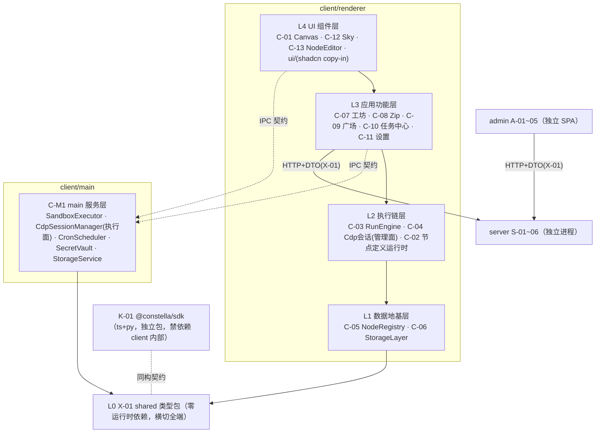

# 03 · 模块设计（模块细分与组件拆分）

| 字段 | 内容 |
|---|---|
| 编号 | docs/03-模块设计.md |
| 日期 | 2026-11-08 |
| 作者 | PM（框架）+ 各批设计工程师（卡片） |
| 状态 | **框架 v0.1 生效，卡片随批封版** |
| 依赖 | 00b §3（模块唯一注册表）、01-PRD / 02-TDD（封版锚）、spikes/*/REPORT.md（可行性证据） |
| 效力 | V1.0 卡 = B1 施工唯一模块输入；V1.1 卡 = B2；占位卡 = 边界声明（不进 M5 拆解）。卡片与 02 冲突时以 02 为准并停卡上报（00 C 章规则） |

> **用户开工令（2026-11-08）**：「架构设计模块细分文档，一定要模块化组件化，要解耦。开发计划配合模块更新。」——即本文件 §0 三条硬约束 + §6 对齐契约的来源。

---

## 0. 设计硬约束（P-1~P-3，每卡强制，评审拦截项）

- **P-1 模块化**：每模块单一职责、显式边界、独立可测。边界 = 对外接口契约（§2 卡模板第 1 节），契约之外一律视为私有。
- **P-2 组件化**：模块内部再拆组件——UI 模块拆到可复用组件（props 接口），非 UI 模块拆到可独立测试的纯函数/类单元。每卡必含「组件拆分」节。
- **P-3 解耦**：依赖**只能向下**（§1 分层图），同层禁止直接 import（经 L0 契约或上层编排）；renderer↔main 只走 02 §3.4 IPC 契约表（payload schema 定义在 TDD-X-01）；UI 层零业务规则；数据层零 UI 依赖；可替换点显式标注并收窄在单一模块内（见 §1 末表）。

**评审拦截**：任一张卡缺少「对外契约 / 依赖方向 / 组件拆分 / 替换点」四节之一 → arch-reviewer 直接打回，不进实质评审。

## 1. 分层与依赖方向总图（依 02 §3 演绎；与 02 冲突以 02 为准并上报）



**替换点登记表**（P-3：收窄在单一模块内，接口先定）：

| 替换点 | 收窄模块 | 当前实现 | 已备替换 |
|---|---|---|---|
| 存储引擎 | C-06 | better-sqlite3 | node:sqlite（S-2 对照组） |
| 画布库 | C-01 | @xyflow/react v12 | Rete v2 / 手写 SVG（02 §2.4） |
| LLM provider | C-07 / C-M1 | OpenAI 兼容自配 | baseUrl/apiKey 可换（D-4） |
| zip 库 | C-08 | jszip 3.10.2 | —（S-6 已冻结） |
| server 地址 | C-09 | 可配置端点 | 离线降级（01 §8） |
| 布局引擎 | C-01（AI 排布辅助） | @dagrejs/dagre | elkjs（如启用走 EPL-2.0 通道，S-9） |

## 2. 卡片模板（全部批次统一）

```markdown
### TDD-?-?? 模块名
| 端 | 波次 | 分层（§1） | 前置 spike | 批次 |
0. 一句话职责与边界（做什么 / 明确不做什么）
1. 对外接口契约（类型、函数签名、事件；逐条标注来源锚）
2. 依赖方向（imports ↓ 逐模块 / 被谁依赖 ↑）
3. 组件拆分（模块内组件清单：职责 · 接口 · 复用处）
4. 数据契约（DDL / 表结构 / store 形状 / 文件格式，如适用）
5. 规则编号引用（只引锚不复制正文：01 A-x / 02 §x / D-x）
6. 验收清单（可执行命令 + 预期结果，前置到 M5 任务卡）
7. demo 行号溯源（如适用，prototypes/demo.html）
8. 替换点 / 扩展点（无则显式写「无」）
```

## 3. 出卡批次与 spike gate（批次划分源自 00-PM 开工安排 2026-11-08）

| 批 | 卡 | 前置 spike | 状态 |
|---|---|---|---|
| G1 地基 | **X-01、C-05**（无前置，先行）＋ C-06（S-2）＋ C-M1（S-3/S-4/S-5） | 见左 | X-01/C-05 出卡中 |
| G2 交互 | C-01（S-1）、C-13、C-12、C-11 | | 待 G1 |
| G3 执行链 | C-03、C-04（S-3）、C-02、C-07 | | 待 G1 |
| G4 流通链 | S-01~05（S-7 审计结论）、A-01~05（S-8）、K-01（S-5） | | 待 G1 |
| G5 V1.1 | C-19 ReportRenderer（先行）、C-18 ModelRouter | 无 M4 前置（S-11 是 B2 前置） | 可与 V1.0 并行 |
| G6 占位 | C-14/15/16、S-06、C-17 —— 只定边界不细化，不进 M5 | | 收尾批 |

评审：每批一轮 **arch-reviewer**（机械核验收清单与编号交叉引用 + §0 四节拦截）；G1 整批（4 卡齐）加一轮 **momus** 对抗评审（DDL/契约返工成本最高）。

## 4. spike 结论登记表（卡片强制吸收，M5 任务卡同步引用）

| spike | 判定 | 必须落进哪张卡 |
|---|---|---|
| S-6 jszip roundtrip | 有条件通过：内容/CRC/文件名/结构三向一致；**DOS 时间口径差异**（demo 本地墙钟 vs jszip UTC，同机 +8h） | **C-08 卡强制**：①导入侧时间换算（减本机 UTC 偏移）②`createFolders:false` 必须设在 `jszip.file()` 选项 ③读端统一 jszip（demo reader 静默跳过 deflate 条目） |
| S-8 admin 空壳 | 通过：antd 6.7.0 / React 19.3.1 / Vite 8.3.6 / react-router 7.18.5 / TS 7.0.2 | **A 系卡**：antd 按需引入（S-8 全量引入单 chunk 1.08MB）；`Statistic` 用 `styles.content` 弃 `valueStyle` |
| S-9 许可证 | 通过：无 GPL 阻断 | **K-01/C-M1 分发卡**：third-party-notices 随分发物；jszip 择 MIT 通道 |
| S-1 / S-2 / S-3 / S-4 / S-5 / S-7 | 运行中 | 收口后回填本表并解锁对应卡 |

## 5. 工程落位约束（02 §3.5 摘要，卡片不得违背）

- client 不依赖 Prisma/pg；shared 只放类型与常量；shadcn 组件 copy-in 于 `client/src/renderer/ui/`；spike 工程不入主干（spikes/ 仅 REPORT.md 入库）。

## 6. 03↔05 对齐契约（「开发计划配合模块更新」的落点）

1. 05 的任务卡**按 03 模块卡组织**：每张任务卡头部标注对应模块编号，禁止出现无模块归属的任务；
2. 任务依赖引用**模块编号**（依赖图 = §1 分层图在卡粒度的展开），不自行发明依赖；
3. 任务验收命令**复用模块卡 §6 验收清单**，模块卡变更 → 受影响任务卡同步改并在 05 留痕；
4. 每卡 ≤1 AI 工作日当量、验收命令前置（00 M5 规则）；out.* 卡（V1.1）硬性前置 `TDD-C-19 + C-18 + S-11 gate`；
5. M5 范围 = V1.0 + V1.1（G6 占位卡不拆解）。

---

## G1 · 地基批（卡片区）

<!-- G1-wave1：TDD-X-01、TDD-C-05 由设计工程师按 §2 模板追加于此 -->
<!-- G1-wave2：TDD-C-06（待 S-2）、TDD-C-M1（待 S-3/S-4/S-5） -->

## G2 · 交互批（待 G1）

## G3 · 执行链批（待 G1）

## G4 · 流通链批（待 G1）

## G5 · V1.1 批（可与 V1.0 并行）

## G6 · 占位批（收尾）
